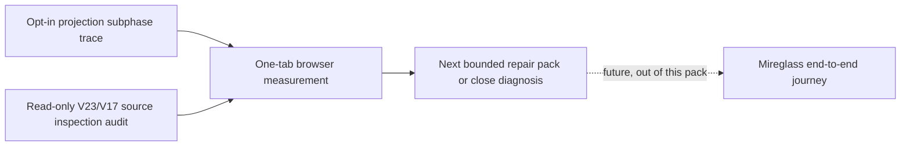
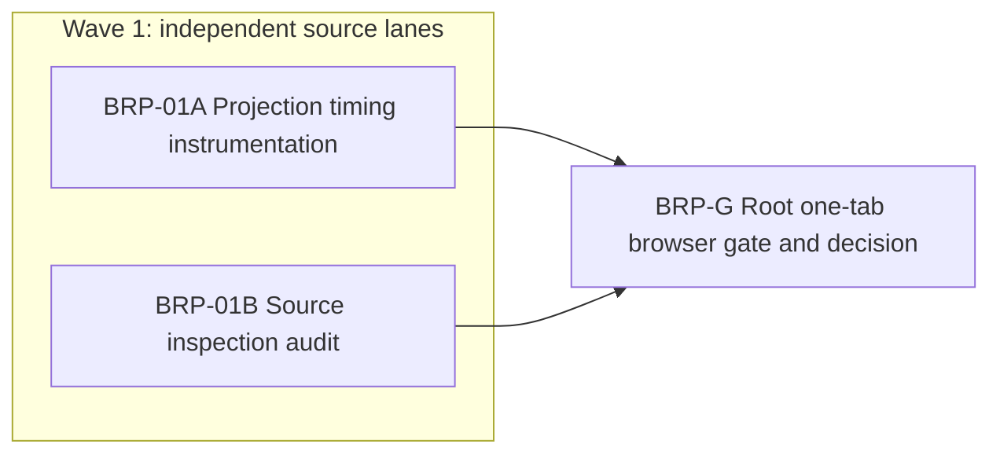

# Ticket Pack: V24 browser responsiveness probe

## Summary

Original ask: build Wizard Realms into a complete, connected third-person RPG.
This pack closes one immediate uncertainty before expanding Mireglass: the
public V24 browser takes about 45 to 50 ms to project one view and roughly
two seconds to save, making the real walk from Greenway difficult to validate.
The aligned problem is to identify the exact projection and source-inspection
owners without weakening movement, save integrity, or the earlier V23 game.
The current V24 preview is accessible at `http://127.0.0.1:5193/?publicWorld=v24`.
This is a diagnostic pack, not proof of Mireglass acceptance or game completion.

Locked design:

- Keep one renderer tab total; workers do source and test work only.
- Preserve V23 and V24 save schemas, validated source lineage, replay, CAS,
  camera and input behavior, and existing local player data.
- `inputTrace=1` diagnostics remain localhost-only and contain numeric timings,
  not world state, seed, personal data, or serialized saves.
- No GitHub writes, dependencies, or shared runtime changes. If GitHub work is
  later requested, use gh-bioscopics, Bioscopics noreply, and `ben/` branches.

Important repo truth: `PublicV23Controller` currently reports one combined
`projectionMs` from V23 base projection through V24 Mireglass overlay.
`commitPublicV24` already reports `v23-v17-source-inspection`; its last live
sample was 534 to 626 ms, while the IndexedDB transaction was under 12 ms.
A validated V24 root cache improved its checked read to 16 to 30 ms. A CUA
one-millisecond held-key request actually yielded key events 429 ms apart,
so that eight-turn observation does not alone prove an input defect.

Goal status: aligned. System translation: not_qualified, this is a local game
diagnostic. Product agent runtime: not_required, the shipped game does not run
an agent. Non-goals: implementation of a new performance cache, altered
movement physics, a debug teleport, a PR, or a claim of full-game readiness.

## Proposed Flow

## Public Interfaces

Only the existing localhost `controller.render` trace record may gain two
finite, nonnegative fields: `baseProjectionMs` and
`mireglassProjectionMs`. The existing `projectionMs`, `viewMs`, and `gate`
fields remain unchanged. No game API, save field, URL, or player control changes.

## Lane Graph

## Topology Audit

- Productive lanes: A owns one numeric trace change and focused test; B owns
  one independent evidence receipt on the source-inspection call graph.
- Maximum parallel width: 2. A and B have disjoint files and neither consumes
  the other's output. Their receipts converge at C.
- Certainty: A closes which V24 projection subphase dominates in the real
  browser. B closes which source-validation stage is plausibly optimizable
  without weakening the source receipt. Stop at decision-sufficient evidence;
  surprising phase results trigger local reinspection, not broad refactoring.
- No conditional repair is authorized by this diagnosis pack. C must author a
  subsequent bounded repair pack from measurements, or report no safe repair.
- Reviewer omitted: this pack changes only opt-in numeric trace metadata and
  has a focused test plus root browser gate. PR finisher omitted: no PR requested.
- Serial edges A to C and B to C consume the trace fields and call-graph
  receipt respectively. Dispatch verdict: PASS.

## Tickets

### Paste now to: Implementer, BRP-01A

Role: implementer only under `auto-planner-ticket-pack` and
`smallest-viable-diff`. Delivery phase: pr_hardening. Milestone:
`SURFACE_READY` already exists at port 5193; final result is diagnostic proof.
Shortest flow: resume V24, move briefly, inspect the local input trace.
Branch/worktree: existing `ben/wizard-playable-v2` in
`/private/tmp/pa-wizard-playable-v2`. Transport: native_spawned_subagent,
model inherited, Cursor runtime not_applicable. Existing-task routing:
not_authorized for durable tasks; custody is shared but A owns only the two
files below. No interruption of other work. Fallback transport: none.

Change only `games/wizard-realms/engine/src/PublicV23Controller.tsx` and
`games/wizard-realms/engine/src/PublicV23ControllerInput.test.tsx`.
Time V23 base projection and V24 overlay separately with `performance.now()`
only when the existing local trace is enabled. Add the two numeric fields to
the existing `controller.render` record without removing or renaming fields.
In the existing input-trace test, assert the fields are finite and nonnegative
for a V24 mount, while plain V23 remains valid. Do not change the projection,
frame scheduler, state, persistence, or renderer; do not launch a browser.
Use the existing trace and test harness. Expected budget: 2 files, fewer than
30 net lines, no new files/dependencies. Config-only is insufficient because
the combined timing does not identify the owner. Simplify the old timing
variables if redundant. Stop and report if a third file or gameplay change is
needed. Acceptance: `npm test -- --run --maxWorkers=1
src/PublicV23ControllerInput.test.tsx` and `npx tsc -b --pretty false` from
`games/wizard-realms/engine`. Receipt: changed files/net lines, reuse scan,
trace example, exact command outputs, no out-of-scope touches, tripwires,
and no-browser confirmation. Visual proof not applicable to this source-only
numeric instrumentation; root owns the one-tab acceptance.

### Paste now to: Reviewer, BRP-01B

Role: reviewer only under `auto-planner-ticket-pack` and
`smallest-viable-diff`, read-only. Delivery phase: pr_hardening. Milestone:
`SURFACE_READY` at port 5193. Branch/worktree: existing shared checkout.
Transport: native_spawned_subagent, inherited model, Cursor runtime
not_applicable. Existing-task routing: not_authorized for durable tasks;
read-only custody, no interruption. Fallback transport: none.

Audit only `publicWorldV24Flow.ts`, `publicWorldV23Flow.ts`, the V23/V17
checked-read and validation functions they call, and current relevant tests.
Answer: what exact work fills `v23-v17-source-inspection`, what invariants must
remain live on every V24 write, and whether one smallest safe optimization can
be attempted without changing schemas, source-drift detection, or CAS. Do not
edit files, run a browser, or run broad tests. Source inspection plus at most
one bounded source-only measurement is allowed; stop once the call graph and
decision are clear. Receipt: exact file/line evidence, safe candidate or
no-go, preserved invariants, residual risk, and next discriminating probe.
This is an independent evidence lane, not generic rereading of A.

### Wait for A and B, then: BRP-G root browser gate

The primary agent remains integration and validation owner. Use one hidden
in-app tab on the existing port and opt-in trace, resume the saved V24 world,
record `baseProjectionMs`, `mireglassProjectionMs`, and total projection
samples plus save status, browser errors, and system memory. Close the tab
immediately after the bounded result. Do not mutate source or use a second
renderer. Compare measurements to the 45 to 50 ms projection baseline.
Return a causal next-owner decision, not a speculative fix. If the trace
patch breaks V23 or the browser, reject A and route a bounded repair.

## Smallest Viable Diff

Behavior delta: add two opt-in numeric timings, no gameplay delta. Expected
diff: 2 files, under 30 net lines, zero new files or dependencies. Reuse:
existing `controller.render` trace and mounted input test. Forbidden:
save schemas, reducers, input scheduler, map, V23 route, art, and package files.
Validation: one focused test, TypeScript, and one renderer trace sample.
Tripwire: any third file or gameplay change returns to Planner mode.

## Assumptions

- Current port 5193 remains available to the user during source work.
- The shared checkout is dirty; workers touch only assigned files and do not
  clean, reset, stage, commit, push, or create PRs.

## Wave 1 receipts and current gate

BRP-01A added the two trace-only projection subphase fields in the scoped
controller and input test. The focused input suite passed 39 tests, and
TypeScript compilation passed. A root-owned follow-up run of that suite plus
the V24 projection and flow suites passed 49 tests across three files. This
is source/test acceptance for the instrumentation, not a measured browser
performance improvement.
The production TypeScript/Vite build also passed; its large-bundle warning
remains and is not a responsiveness acceptance result.

BRP-01B found that each V24 checked write inspects the live V23 root and its
V17 ancestor under one world lock, then compares pinned receipts. The
previous 534 to 626 ms `v23-v17-source-inspection` sample includes both
reads, decode/validation/replay, and comparisons. It does not isolate V17 as
the owner. A one-file V17 decoded-record reuse is plausible only if a later
split timing shows a valid V17 source dominates; it would not help a missing
V17 source. Preserve live source checks, fail-closed validation, witness
replay, and in-transaction CAS. No speculative source cache or decoder change
is authorized by this receipt.

The player-facing fresh-start tab is currently open on port 5193. The primary
agent will not open a second game renderer or navigate that tab away while the
player may be testing the opening. BRP-G browser timing is deferred until the
shared tab is available; this is a renderer-ownership constraint, not a
terminal blocker. Source-only tests and audits remain available. The next
browser gate should measure the new base and Mireglass projection fields,
then split V23 versus V17 source inspection only if the save path remains a
priority. An observed first-screen issue should be tracked separately: the
fresh world immediately displayed `newer progress is not yet saved` despite
no player action, apparently because idle simulation frames become pending.
Confirm its exact cause before changing save cadence or copy.

### BRP-02: opening save-status causal audit

Role: read-only reviewer. Inspect only the V23 entry/controller runtime,
frame scheduler, and save-status projection plus their focused tests. Trace
why a brand-new untouched V23 world reports newer unsaved progress, whether
the warning remains after a completed checkpoint, and whether it can block a
normal leave/reopen. Distinguish intentional elapsed-world ticks from actual
player progress; do not assume idle frames can simply be dropped. Return the
smallest safe owner and an exact regression test scenario, or a NO-GO if the
behavior is required by simulation semantics. No source edits, renderer,
GitHub action, broad test suite, or save-schema change. Root will decide a
separate repair after this evidence and the player's feedback.

BRP-02 reviewer result: a grounded, untouched session still advances one
empty frame per 50 ms. The runtime records it as pending; the first tick
produces generic unsaved status, and the first tick after each 64-frame
checkpoint restores the `newer progress` text. The unload guard requests
confirmation whenever such a frame is pending. A browser may suppress that
confirmation until user activation, so this is a source-proven request, not
a claim that every exit displays a dialog. Empty frames advance clock/RNG,
physical support, and market settlement, so dropping them throughout the
runtime is unsafe. A repair needs an explicit grounded-idle clock policy and
a regression covering fresh start, first tick, checkpoint plus one tick,
normal leave, real movement, airborne motion, and a trade sale. The player's
preview tab remained untouched; no live source edit or second renderer was
used for this diagnosis.
