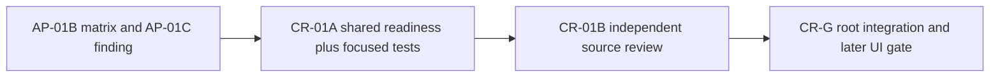

# Ticket Pack: V24 Mireglass choice readiness parity

## Goal and evidence

The current V24 Mireglass view can advertise a choice as actionable while the wizard is airborne or the event sequence cannot advance. The checked V24 action rejects the same request as `invalid-pose` or `invalid-sequence`. AP-01B independently identified this mismatch; AP-01C confirmed it in the integrated boot-action source. The boot-action unit is source GO, but overall action parity is NO-GO until this common gate is repaired.

This is a bounded continuation of the full Wizard Realms goal, not a claim that the campaign, browser stability, or onboarding is complete. System translation: `not_qualified`. Product agent runtime: `not_required`. No PR is requested.

## Locked contract

- Every V24 Mireglass choice uses the same grounded-pose and safe-next-sequence readiness requirement as `applyPublicV24MireglassAction` before it can be advertised actionable. This includes study, discovery, chop, stump, forage, cache, Glow, trade, and all equipment choices.
- Preserve the pure Mireglass action's normal rejection reason when pose and sequence are valid. For invalid pose or sequence, show an honest, stable disabled reason. No false-actionable button or generic E target.
- Replace the leather-boots-only view readiness branch with one shared gate. Do not duplicate the domain action rule, weaken authority, or change exact action decoding, save schema, witness replay, old-root compatibility, movement, or controller routing.
- Work in `/private/tmp/pa-wizard-playable-v2` on `ben/wizard-playable-v2`. All pre-existing dirty and untracked files are user work. No reset, clean, stage, commit, push, PR, GitHub, dependency, or process changes.
- Only one game renderer. A previous browser crash forbids alternate browser control workarounds. Source proof is allowed; UI proof remains `unproven` until a permitted/manual reload.

## Owner and route

This is one atomic owner with serial independent review. Splitting the common readiness expression and its focused view tests would create artificial coupling. AP-01B's independent matrix and AP-01C's review provide separate evidence inputs, not additional code ownership.

### Implementer CR-01A

Role: `implementer` ONLY. Transport: `native_spawned_subagent`, inherited model, continued matching native worker if safe; durable-task routing `not_authorized`; no fallback, no interruption. Delivery phase: `pr_hardening`; milestone `pre_surface`. Read `auto-planner-ticket-pack` and `smallest-viable-diff` completely. No browser, renderer, server, or GitHub action.

Allowed files:

- `games/wizard-realms/engine/src/PublicV24MireglassView.ts`
- `games/wizard-realms/engine/src/PublicV24MireglassView.test.ts`

Replace the boot-specific readiness branch in `add` with a shared readiness calculation matching `publicWorldV24MireglassAction.ts` pose and sequence checks. Compute canonical surface at most once per view projection, not once per choice. Keep the existing boot-action behavior and generic E exclusions. Test at least one normally actionable generic choice and one explicit non-boots choice while airborne, and at the maximum safe event sequence. Assert they are disabled in `choices`, `checkedActionChoices`, and the generic default interaction; also retain grounded success and boots assertions. If the fixture cannot produce a valid authoritative state at that sequence, test the projection boundary directly and describe the limitation.

Acceptance from `games/wizard-realms/engine`: `npx vitest run src/PublicV24MireglassView.test.ts src/domain/publicWorldV24MireglassAction.test.ts src/domain/publicWorldV24Snapshot.test.ts --maxWorkers=1`, `npx tsc -b --pretty false`. Because these V24 files are pre-existing untracked, `git diff --check` does not prove their whitespace; inspect changed hunks directly. Expected scope: two files, under 70 net lines, zero new source files/dependencies. More than two files or 150 net lines, a schema/authority/controller change, or a new parity category returns to Planner mode.

Return exact changed files/net lines, key diff and reuse/deletion scan, test outputs, parity evidence, tripwires, source-only caveat, and transport/session receipt. No PR unit beyond this bounded view/test repair.

### Reviewer CR-01B

Role: `reviewer` ONLY, independent read-only inspection after CR-01A. Read both skills and this pack. Review shared gate against `publicWorldV24MireglassAction.ts` and all choice categories in AP-01B, boot regression, disabled copy, generic E, old-save/replay non-touch, and smallest viable diff. Return severity-ordered findings with exact lines, GO/NO-GO for source parity, test gaps, and UI unproven. No edits, browser, server, renderer, GitHub, or commits.

### Root CR-G

Validate receipts, rerun focused tests and TypeScript if needed, and run the production build only after source GO. Confirm port 5193 remains reachable without opening a renderer. Do not claim browser playability from HTTP. A real, permitted single-renderer fresh-game journey is still needed, including first-start actions, boots switching, airborne rejection, return/trade, save/reload, console/network, and frame performance.

## Smallest viable diff audit

The observed owner is the shared choice projection. Configuration or prompt copy cannot fix a false actionable state. Reuse `resolvePublicV23Surface`, the existing `add` function, existing tests, and the adapter's pose/sequence rule. Remove the boot-only gate when the common gate replaces it. No V23 compatibility changes or new abstractions.
