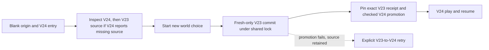
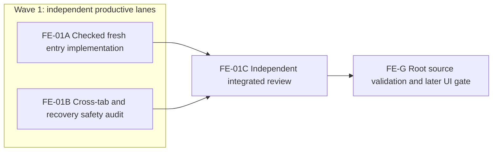

# Ticket Pack: Fresh V24 world entry

## Summary

The [aligned understanding](V24_FRESH_ENTRY_UNDERSTANDING.md) identifies a first-start dead end: a blank origin cannot enter the Mireglass V24 world. Add one explicit new-world choice that creates a V23 foundation only when both older source stores are still absent, then promotes its exact checked receipt to V24. This is progress toward the first expanded-region gate, not game completion.

Goal status: aligned by the active full-game goal. System translation: `not_qualified`. Product agent runtime: `not_required`. Pack state: `paused_at_FE-01B_BLOCK_NOW`. No PR requested. FE-01A made an unvalidated partial patch in `publicWorldV23Flow.ts` and `PublicV24Entry.tsx`, then stopped without rollback. The live contract is superseded by `V24_FRESH_ENTRY_PACK_V2.md`.

Locked design:

- Preserve V17/V23/V24 root shapes, database names, source lineage, witness replay, live source reads, CAS, and shared lock. Never overwrite or silently migrate an existing world.
- Fresh-only V23 creation is rechecked under the V23 world lock. A stale fresh decision must not promote a V23 world another tab created.
- V24 remains a successor of one validated V23 source. If source creation succeeds and V24 promotion fails, leave V23 in place for explicit retry. Never roll back or clear it.
- Existing V17-only entry remains a blocked V24 path with a V23 migration link. Existing V23 migration and V24 resume remain explicit.
- Keep one renderer and port 5193 available. No worker opens a browser. Prior crash protocol forbids alternate-browser workarounds; rendered proof is `unproven` until a permitted/manual reload. No GitHub, commit, push, dependency, or process action.

Important repo truth: `startPublicV23` currently returns an existing same-seed target when `expectedSource` matches, so a plain call from stale fresh UI intent could silently promote another tab's state. `inspectPublicV24` reports `source-v23-missing` both for blank origins and V17-only origins. Existing `inspectPublicV23` distinguishes `fresh-available` from V17 migration. All three flows already use the same world lock and strict checked stores. FE-01B proved that two separate lock acquisitions can strand the newly created V23 root if V17 is created in between, and that even one lock around V23(null-source)+V24 is insufficient because V17 may be created after that lock releases. See the V2 pack for the safe V17-backed contract.

## Proposed Flow

## Public Interfaces

Add `fresh-available` to `PublicV24EntryDecision` and `create` to `PublicV24EntryChoice`. The existing `?publicWorld=v24` entry renders `Start new world` only for a blank, source-free origin. Add a final optional `{ requireMissing: true }` argument to `startPublicV23`; omitted behavior remains exactly the same. No save schema, URL, witness, or required caller signature changes. Use existing `inspectPublicV23` for the blank-versus-V17 distinction and existing `startPublicV24` for promotion.

## Lane Graph

## Topology Audit

- Productive inventory: A owns one new-world checked entry behavior in three existing files and focused tests. B owns one distinct reasoning artifact: adversarial race and partial-failure matrix against V17/V23/V24 flows, with no code edits.
- Maximum parallel width: two. A and B consume only this fixed contract, not each other's output. B is read-only, so file custody does not conflict. Both receipts converge at C.
- Certainty: A's fake-IndexedDB tests distinguish blank, stale, V17-only, existing V23/V24, and failed-promotion branches. B independently checks whether `requireMissing` and two commits actually preserve source data under lock/race semantics. Stop once each branch has a decision; a counterexample or missing recovery branch returns to Planner mode.
- C targets the named cross-boundary risks that A cannot independently close: wrong-world promotion, data loss, idempotence drift, and misleading UI choice. This is not a generic reread. Root checks receipts and build. No PR finisher because no PR is requested.
- Serial A/B to C consumes their implementation and race-matrix artifacts; C to G consumes the GO/NO-GO review. No conditional repair is preauthorized. Dispatch verdict: `PASS`.

## Tickets

### Paste now to: Implementer FE-01A

Ticket: FE-01A. Lane type: parallel. Delivery phase: `pr_hardening`; milestone `pre_surface` for this revision. Shortest flow: blank origin at `?publicWorld=v24`, choose Start new world, enter V24 with a pinned V23 source, save and resume. First feedback: focused fake-IndexedDB and rendered entry markup, not a browser claim. Test policy: `pr_hardening_required`. Visual proof: required, currently blocked by the crashed-browser protocol; return `unproven`. Review BLOCK_NOW: existing save overwritten, stale choice promoted, direct V17 promotion, partial failure cleared data, or misleading fresh button. Validation environment: existing local engine tests and Vite port 5193. Environment repair authority: none; one bounded retry at most. Optional-feedback wait: never.

Role: `implementer` ONLY under `auto-planner-ticket-pack`, `smallest-viable-diff`, and `test-from-ui` applicability. Transport `native_spawned_subagent`, model inherited, Cursor runtime not_applicable, final fallback none. Existing durable task routing not authorized. Reuse a completed matching native V24 worker only if current status and custody are safe; otherwise spawn an ephemeral child. Continued session preferred, no interruption. Existing checkout `/private/tmp/pa-wizard-playable-v2`, branch `ben/wizard-playable-v2` at HEAD `6bb8d39` plus preserved user work. Do not create another worktree or renderer.

Allowed files only:

- `games/wizard-realms/engine/src/domain/publicWorldV23Flow.ts`
- `games/wizard-realms/engine/src/PublicV24Entry.tsx`
- `games/wizard-realms/engine/src/PublicV24Entry.test.ts`

Implementation contract:

1. Add optional `{ requireMissing: true }` to `startPublicV23`. After its existing under-lock inspection, reject a valid target with `target-conflict` when this option is set. Omitted callers keep exact old idempotence. Keep its source-receipt and CAS checks unchanged.
2. `inspectPublicV24Entry` retains its current resume/migration/blocked results. Only on `source-v23-missing`, call `inspectPublicV23` and return `fresh-available` only for its `fresh-available` result. Preserve V17-only and invalid-root blocked states; fail closed on unexpected/blocked source inspection. Do not infer blank origin from V24 reason alone.
3. On `create` from `fresh-available`, call fresh-only `startPublicV23(..., seed, null, {requireMissing:true})`, then `startPublicV24` with that exact `{head,lineage}` receipt. If the second step fails, leave V23 untouched; the app's existing error/re-inspection flow must expose explicit migration on retry. Existing `resume` and `migrate` paths unchanged.
4. Show one clear `Start new world` button and concise on-device-save explanation for `fresh-available`. Keep migration and resume copy/controls unchanged. Do not auto-create in an effect or silently navigate.

Tests in the existing entry test must prove blank classification, visible choice, both roots and source pin after create, V24 resume, V17-only exclusion, stale blank decision after another V17 or V23 creation, old idempotent V23 behavior, and recoverable V23 source if V24 promotion returns failure. Use the current fake-IDB test harness and checked flows. No new test file. Accept from engine: `npx vitest run src/PublicV24Entry.test.ts src/domain/publicWorldV24Flow.test.ts --maxWorkers=1`, `npx tsc -b --pretty false`. Do not run a browser or edit server state.

Smallest viable diff: 3 files, under 160 net lines, zero new files/dependencies. Reuse `inspectPublicV23`, `startPublicV23`, `startPublicV24`, existing entry chooser/test fixture. Prompt/copy alone is insufficient because the checked source does not exist. Simplify no longer applicable blocked-origin copy, but preserve V17 guidance. Tripwire: any fourth file, schema change, second route/controller, or more than 250 net lines returns to Planner mode. Return exact diff/net lines, reuse/deletion scan, rejection/recovery evidence, tests, visual-proof limit, native child/session receipt, and no out-of-scope/GitHub action.

### Paste now to: Evidence implementer FE-01B

Ticket: FE-01B. Lane type: parallel. Delivery phase: `pr_hardening`; milestone `pre_surface`. Shortest flow: inspect the same blank-origin and stale-entry branches against the checked source flows. First feedback: a branch/race/recovery matrix with exact source lines. Test-writing policy: none in this read-only lane. Visual proof: not applicable. BLOCK_NOW: any branch can overwrite or silently promote an existing save, bypass source pinning, or strand a partially created V23 source with no recoverable choice.

Role: `implementer` ONLY, read-only evidence lane under `auto-planner-ticket-pack` and `smallest-viable-diff`. Native spawned subagent, inherited model, no fallback; durable-task routing not authorized. Reuse a completed native persistence reviewer with recent matching context if safe. Shared checkout read-only; no browser, renderer, server, GitHub, edits, builds, or broad tests.

Audit `publicWorldV23Flow.ts`, `publicWorldV24Flow.ts`, `PublicV24Entry.tsx`, and the current entry/flow tests. Enumerate blank, V17-only, V23-valid, V24-valid, partial target, stale choice after concurrent V17/V23 create, promotion failure, and source drift. For each, identify the checked outcome and retained data. Confirm whether the specified `requireMissing` recheck plus exact receipt is sufficient, or return `NO-GO` with a precise counterexample. No speculative architecture. Stop at a decision-sufficient matrix. Return evidence, uncertainty, no-files-changed and native child/session receipt.

### Wait for FE-01A and FE-01B, then paste to: Reviewer FE-01C

Role `reviewer` ONLY under both skills, independent read-only. Native child, inherited model, no fallback; no browser, renderer, server, GitHub, or edits. Review integrated source and both receipts findings-first. Check every FE-01B branch against the actual code, old V23 idempotence, V17 exclusion, strict existing-root/partial-root behavior, exact source pin, promotion-failure recovery, first-start copy, and SVD. Return severity-ordered findings with file/line, explicit GO/NO-GO for source safety and onboarding, test coverage gaps, and UI-unproven caveat. Do not call source tests visual proof.

### Wait for FE-01C, then FE-G root integration

Check all receipts against the understanding and pack, rerun targeted tests if integration invalidated A's output, run TypeScript and production build after source GO, and confirm port 5193 still answers without opening a second renderer. A permitted one-renderer fresh-origin journey with screenshot, inputs, console/network, save/reload, and memory is still required; current browser crash restriction keeps it `unproven`. No PR or GitHub action.

## Smallest Viable Diff

Behavior delta: one explicit fresh V24-compatible world entry, without changing any existing save path. Expected 3 files and under 160 net lines, zero new files/dependencies. Reuse scan and forbidden surfaces are defined in FE-01A. The stale-choice check must be under the V23 lock, so UI copy or a preflight-only read cannot substitute. Remove redundant blocked-origin copy, retain existing V17 migration text. Targeted tests and independent race audit are mandatory. Any schema, CAS, transaction, source receipt, or controller change is a replan tripwire.

## Assumptions

- The current V24 entry is opt-in and its browser behavior is not proven by HTTP 200.
- The dirty worktree belongs to the user; no lane stages, commits, pushes, cleans, or resets it.
- Fresh-first entry improves the first-region path but does not prove visual quality, responsiveness, the expedition, or the full game.
