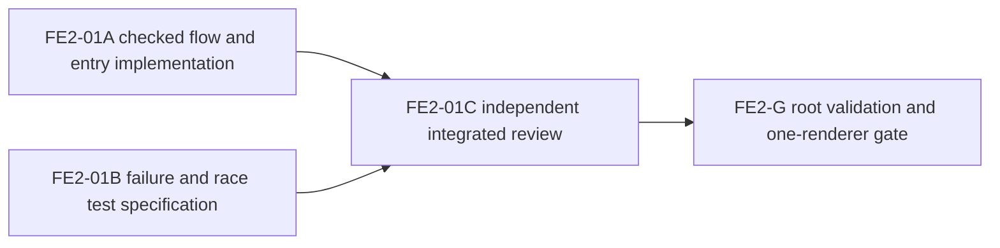

# Ticket Pack V2: Checked first world for V24

## Decision and goal

FE-01B found a source-lineage race in the first fresh-entry proposal. A blank
origin must not create V23 with a null V17 receipt and then promote it in a
second lock acquisition. V17 could be created between those calls or after
them, invalidating both newer roots. This V2 pack supersedes FE-01A's paused
contract. It advances the first-region game goal; it does not complete the
game or prove UI performance.

System translation: `not_qualified`. Product agent runtime: `not_required`.
No PR, commit, GitHub, browser, additional renderer, process kill, save reset,
or dependency change is authorized. Preserve dirty user work and port 5193.

## Locked behavior

- On an origin with no checked V17, V23, or V24 world, show one explicit
  `Start new world` choice
  at `?publicWorld=v24`. Distinguish blank from V17-only by checked V23
  inspection, and confirm the checked V24 target is missing even when V24
  inspection reports `source-v23-missing`. It can report that reason despite
  a standalone V24 root. Existing V17, V23, V24, and malformed-root choices
  remain. A stale display choice still rechecks under the lock before writes.
- V16 and older stores are outside this chain. As with the existing V17
  entry, a player may explicitly start a separate fresh world while an older
  store remains; never read, overwrite, migrate, or clear it implicitly.
- The choice enters one acquisition of `PUBLIC_V7_LOCK_NAME`. Under that lock,
  reject any existing or blocked V24 root, then require checked V23
  `fresh-available` (both V23 and V17 missing). Create a fresh V17 foundation,
  start V23 from the exact newly checked V17 receipt, then start V24 from the
  exact newly checked V23 receipt. Never promote another tab's existing world.
- Reuse/refactor the existing checked V17, V23, and V24 start bodies as
  under-lock helpers with their public lock-taking wrappers preserved. Do not
  nest Web Locks, duplicate the admission rules, modify root shapes, skip live
  source checks, or change save/CAS/witness rules. The old V23 idempotent path
  remains unchanged for callers omitting `requireMissing`.
- If V23 commit fails, keep V17. The V24 entry then offers the existing V23
  migration path; if V24 commit fails, keep V17 and V23 and offer the existing
  V24 migration path. No rollback across databases. If a concurrent creator
  wins before the lock, fail closed and re-inspect without writing.
- Legacy source edits after promotion still intentionally cause
  `source-changed`, per existing migration policy. Do not weaken that policy
  in this pack. The user-facing new-world path must not itself create an
  invalid lineage or an unresumable root merely by releasing the lock.
- Prior browser crash protocol prohibits alternate browser workarounds.
  Focused tests, TypeScript, and build are source evidence; rendered UI remains
  `unproven` until a permitted/manual one-renderer journey.

## Interfaces and custody

The partial FE-01A patch already adds optional `{requireMissing:true}` to
`startPublicV23` and a draft V24 entry create branch. Keep or simplify that
patch only as needed for the safe contract. Add an exported under-lock V17
fresh helper, an exported under-lock V23 start helper, and a V24 checked
fresh-chain operation; keep public wrappers as the locking API. The entry
chooser calls the fresh-chain operation, not two separately locked starts.

Implementation custody, six existing files only:

1. `engine/src/domain/publicWorldV17Flow.ts`
2. `engine/src/domain/publicWorldV23Flow.ts`
3. `engine/src/domain/publicWorldV24Flow.ts`
4. `engine/src/PublicV24Entry.tsx`
5. `engine/src/PublicV24Entry.test.ts`
6. `engine/src/domain/publicWorldV24Flow.test.ts`

No new file or dependency. Target under 260 net source/test lines. A seventh
file, schema/DB change, legacy-source mutation-policy change, or over 350 net
lines returns to Planner mode. Reuse the exact existing checked inspection,
root constructors, writes, and source receipts. This cannot be solved safely
by UI copy, preflight alone, or two lock acquisitions.

## Lane graph

Topology audit: two independent productive lanes. A owns bounded source and
tests; B owns a read-only adversarial test specification from the same locked
contract. B does not wait for A or edit files. They converge at C for an
independent source/safety review, then root runs targeted tests, TypeScript,
build, and confirms the existing port. No PR finisher because none was asked.
No conditional repair is preauthorized.

## FE2-01A implementer

Native continued worker with recent V24 context, inherited model, role
`implementer` ONLY. Read `auto-planner-ticket-pack` and
`smallest-viable-diff` fully, then this pack. Work only in the six custody
files, preserve all existing dirty work, no browser/server/process/GitHub.
Use the smallest source shape that holds one lock for the complete fresh
chain. The V24 fresh-chain function must reject pre-existing V24 or V23
before creating V17. Do not call public lock-taking wrappers from inside it.

Tests in the existing files must prove:

- blank inspected choice and static markup, then V17/V23/V24 valid roots with
  exact V17 and V23 source receipts;
- an existing checked V24 root with missing V23/V17 sources never shows the
  fresh choice, and the create action does not overwrite it;
- V24 resume succeeds, and a later fresh V17 attempt returns `root-present`
  without invalidating V24;
- existing V17-only, V23 migration, V24 resume, partial-root blockers, and old
  V23 idempotence remain;
- stale blank decision after competing V17/V23/V24 creation fails without
  adopting, clearing, or overwriting that world;
- V23 commit failure leaves checked V17 for explicit V23 migration; V24
  commit failure leaves checked V17/V23 for explicit V24 migration;
- exactly one world-lock acquisition for the fresh chain, no nested lock.

Run only focused `npx vitest run src/PublicV24Entry.test.ts
src/domain/publicWorldV24Flow.test.ts src/domain/publicWorldV23.test.ts
--maxWorkers=1` and `npx tsc -b --pretty false`. Return net line accounting,
reuse/deletion scan, exact tests, known gaps, and native child receipt.

## FE2-01B evidence lane

Independent read-only worker, role `implementer` ONLY. Inspect current V17,
V23, V24 flows and fake-IDB fixtures. Deliver a decision-sufficient
adversarial matrix and minimal assertions for existing-root admission,
single-lock behavior, each partial failure, stale choices, and source drift.
Name any BLOCK_NOW counterexample. No edits, browser, server, build, GitHub.

## FE2-01C reviewer and FE2-G root

After both receipts, an independent reviewer performs findings-first
read-only integrated review against this contract, including source pinning,
partial-failure recovery, legacy idempotence, exact copy, and smallest diff.
Root reruns relevant checks when integration invalidates prior output, then
TypeScript and production build. HTTP 200 only proves server availability,
not playable UI. Keep UI proof explicitly unproven under the crash protocol.

## Completion evidence for this pack

Source GO requires all accepted tests and independent safety review.
The first-region game gate still needs a real permitted UI journey from
first launch through regional progress, save/reload, clarity, performance,
and visual review. Neither this pack nor a 200 response closes that gate.

## FE2-01C finding and bounded repair FE2-02

Independent source review found checked save safety GO but onboarding copy
NO-GO: the first-launch text overpromises that local browser storage persists
until the player chooses to clear it. It also identified a V17-commit-failure
test gap against this pack's explicit matrix. FE2-02 is a new, bounded repair
ticket, not a preauthorized conditional change: edit only `PublicV24Entry.tsx`
and `PublicV24Entry.test.ts`. Say the world is saved in this browser and is not
backed up online, without promising indefinite durability. Add one injected
V17 commit-failure test that proves no V23/V24 root is created and entry
reinspection stays fresh or safely blocked. Keep previous source behavior
unchanged. Target under 35 net lines, no browser/server/GitHub. Run the same
focused Vitest and TypeScript. Independent reviewer then checks the two-file
repair before root validation.
