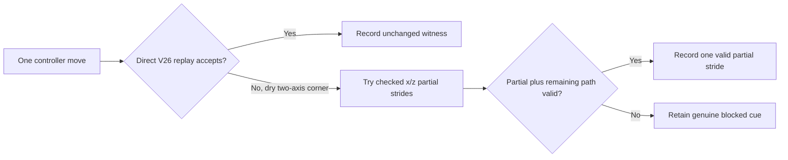
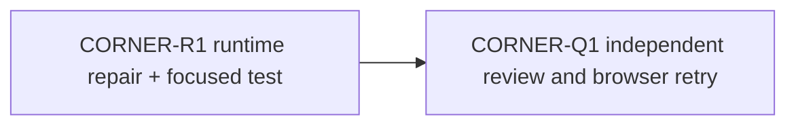

# Ticket Pack: V26 dry-corner collision repair

## Summary

Repair the first reproducible starter-valley traversal defect without changing old replay rules or save shape. The browser stops at ordinary dry ground near x=6, z=-2 and reports a generic checked-terrain error. A one-frame move that crosses both tile edges is rejected, while moving across either edge separately is accepted. The goal is to let the same held-forward input advance over that reachable corner, with a truthful cue if a genuinely blocked river or cliff remains.

The full-game target and player flow remain in `STARTER_VALLEY_WORLD_LOOP_UNDERSTANDING.md`. This pack is a causal repair of one observed failure, not a declaration that world travel, visual quality, digging, and the full RPG are done.

System translation: `not_qualified`. Product agent runtime: `not_required`.

## Evidence and Contract

- UI repro: fresh `http://127.0.0.1:5193/?publicWorld=v26`, walk to x about 5.9, z about -2.0, face the green-to-tan dry corner, hold W. The pose repeats unchanged and the UI says `This move is blocked by checked V26 terrain.` Screenshot: `../engine/.playwright-cli/page-2026-10-09T23-03-14-166Z.png`.
- Deterministic source repro with the starter seed and empty works: from `{x:5.95,y:1.3500530256610364,z:-1.95}` to `{x:6.05,z:-2.05}` returns `cliff_blocked`. The x-only and z-only moves each accept, reaching floors 1.7680494215711953 and 1.8541556918621067. The diagonal destination floor is 2.0499582399893552. Both tile edges have legal rises, but their combined diagonal rise is 0.6999052143283188 m, above the 0.55 m V17/V26 one-frame limit.
- Source owners: `publicWorldV17StarterMovement.ts` and `publicWorldV26Snapshot.ts` keep their current historical replay checks. `PublicV26ControllerRuntime.ts` already guides ladder entry before recording a witness. That controller is the smallest safe place to choose a replay-validated, axis-aligned partial stride when the direct diagonal would otherwise reject at a two-axis cell corner.
- Preserve actual creek, rim, named cliff, pit, bridge, ladder, world-edge, and gait checks. No teleport, pose mutation, accepted one-frame move beyond checked physics, or new save schema. Only a candidate that passes the existing local replay and has a valid sequential route may be recorded. An unfixable rejection keeps the existing cue or a more specific truthful one.

## Proposed Flow

Input continues naturally on the next frame. The stored witness remains the exact accepted move, never a claimed diagonal that the writer would reject.

## Public Interfaces

No exported domain, storage, save, or URL contract change. One private controller input-guidance helper is allowed. Keep the same V26 page and current UI controls. Tests may call the current controller/runtime interface, not private state mutation.

## Lane Graph and Topology Audit

R and Q are serial because Q needs the actual implementation. Width one, with no artificial parallelism and one browser renderer only for Q. The specific failure and owner are known, so this is a short causal loop rather than more speculative research. Unexpected result is the same UI error after the repair or a blocked river/cliff becoming passable; either requires one grounded follow-up, not a broad rewrite.

## Smallest Viable Diff

Expected production file: `engine/src/PublicV26ControllerRuntime.ts`. Expected focused test: existing `engine/src/PublicV26ControllerRuntime.test.ts` or nearest existing controller test. Budget: 2 files and roughly 100 added/modified lines; no dependency or asset change. Do not edit V17/V26 replay, migrations, terrain rendering, or older schema. Reuse the existing frame decoder and V26 replay. Delete/simplify any helper created only for an abandoned approach. Tripwire: if a controller-only, replay-validated corner stride cannot restore the observed path, report before expanding to a versioned movement or renderer change. No PR or GitHub operation.

## Tickets

Paste now to: Implementer, focused runtime repair
Ticket: CORNER-R1
Lane type: serial observed-failure repair
Delivery phase: execution
Delivery milestone: tested local code, not release completion
Shortest complete user flow: fresh valley, hold forward over the dry x=6,z=-2 corner, save, reload, continue moving.
First-feedback evidence: a failing focused test of direct diagonal versus legal axis path, then passing controller behavior.
Test-writing policy: focused regression now, broader tests at hardening.
Review blocking classes: historical replay mutation, invalid durable witness, bypassing creek/cliff/rim, corner still frozen, save/reload mismatch.
Validation environment: tests/typecheck in the existing worktree; do not open a browser.
Environment repair authority: none beyond the touched game package.
Surface readiness gate: existing V26 preview stays live.
Surface entrypoint: `http://127.0.0.1:5193/?publicWorld=v26`
Surface availability and validation isolation: no Vite restart unless affected build requires it; browser proof is separate Q lane.
Optional-feedback wait policy: never.
Depends on: SLOPE-P1 evidence, complete.
Branch: `ben/wizard-playable-v2`
Worktree: `/private/tmp/pa-wizard-playable-v2`
Base branch: `origin/main`
Lane role: implementer
Dispatch transport: native ephemeral subagent
Model: inherited
Cursor runtime: not applicable
Existing-task routing: reuse a relevant idle native worker only with recent capability and ownership proof; otherwise new native worker.
Ownership: only the runtime and focused test; do not touch unrelated dirty files.
Required skills: `auto-planner-ticket-pack`, `smallest-viable-diff`.
Worker instructions: read skills and this pack fully. Write a failing regression first. Repair only the observed diagonal dry-corner rejection with a private controller-side guided partial stride. Verify candidate and its completion path using existing replay; never write an unchecked position. Make river/cliff and save/reload tests explicit. Run focused tests and typecheck. Return changed files, exact validation, risks, and no GitHub action. Do not open a browser.

Paste after R to: Reviewer and UI tester
Ticket: CORNER-Q1
Lane type: independent acceptance
Delivery phase: final_acceptance
Delivery milestone: same-entrypoint browser retry and source review
Shortest complete user flow: repeat SLOPE-P1 route through the formerly blocked corner, save, reload, then check river/cliff still block without built works.
First-feedback evidence: screenshot and before/after map coordinates at the corner.
Test-writing policy: no source edits as reviewer.
Review blocking classes: hidden new dead end, broken save, environmental instability.
Validation environment: one Playwright renderer, current Vite preview.
Environment repair authority: none.
Surface readiness gate: R's focused tests and typecheck pass.
Surface entrypoint: `http://127.0.0.1:5193/?publicWorld=v26`
Surface availability and validation isolation: leave server up; close browser at end.
Optional-feedback wait policy: never.
Depends on: CORNER-R1.
Branch/worktree/base: same as R.
Lane role: reviewer.
Dispatch transport: native ephemeral subagent.
Required skills: `test-from-ui`, `playwright`, `smallest-viable-diff`.
Worker instructions: inspect diff read-only, then repeat exact UI route with normal controls. Stop at first genuine new blocker and report it. No code or GitHub action.

## Assumptions

- The observed UI stop is the same two-axis corner that deterministic movement reproduces. Browser retry must confirm, not merely trust this calculation.
- A one-frame axis partial stride is visually tolerable at 20 Hz. If it jitters or becomes a repeated dead end, escalate to a versioned surface/movement contract instead of hiding the defect.
