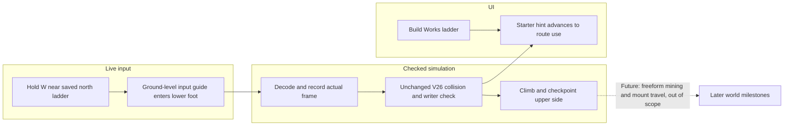
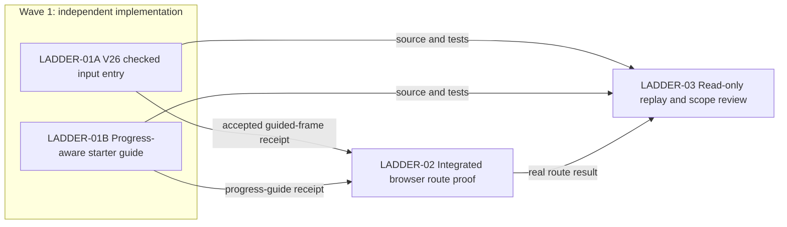

# Ticket Pack: V26 Accessible Ladder Entry

## Summary

Trace: `V26_LADDER_ENTRY_UNDERSTANDING.md`. Fix the first-time north ladder entry that currently leaves the player against a visible wall after construction. Update the starter guide so it advances with construction. Preserve checked V26 movement, writer validation, and all historical save frames.

Locked design:

- Adapt only newly generated V26 controller move input before the frame is decoded and stored. Never change V17 movement, V26 replay, persisted frame shape, or saved Works geometry.
- A near-ladder forward stride may be redirected toward the lower foot. The adapter first moves south on dry ground when already past the lower foot, then moves laterally into the 1.05 m lane, then allows normal northward ascent. Each redirected step is no longer than the requested step; the unchanged checked preview must accept it.
- Guide capture requires a validated built Works north ladder, grounded pose, northward near-axial forward input, and a small local radius. Never guide an unbuilt, distant, airborne, or sideways/backward approach.
- The V26 guide must match ladder/bridge progress; V25 and older copy stays as it is.

Important repo truth:

- `PublicV26ControllerRuntime.ts` constructs the checked `frame-batch/v1` witness from UI intents. Its saved-ladder spans already drive the collision cue. The rung support is narrower than the nearby visual wall.
- `publicWorldV17StarterMovement.ts` contains old bridge entry steering but must remain source-pinned. The ladder face begins at z=-5.35 and meets the rim at z=-6 in the canonical starter valley.
- `PublicV23Controller.tsx` always renders “First steps: chop trees for logs” under a V26 river, even after building routes.
- The existing preview at `http://127.0.0.1:5193/?publicWorld=v26` is available. The previous single-renderer probe reproduced the blocked approach after ladder construction.

Required diff constraints: Keep changes in the two owned source families and their focused tests. No new dependencies, schema, server authority, unrelated graphics, or broad cleanup. The current checkout is dirty and belongs to the user.

## Proposed Flow

Concrete journey: fresh V26 player gathers four logs, builds the north ladder, approaches from a nearby lower-valley lane, holds W, visibly joins and climbs the existing rung surface, saves, and reloads on the upper side. The UI now calls attention to the next route action rather than initial tree chopping.

## Public Interfaces

No new public API or save schema. New V26 controller input behavior affects only future decoded frames. Existing stored frames replay byte-for-byte through the same V26 writer. The V26 starter-guide text changes with saved `greenwayWorks.builtLadderIds` and `builtBridgeIds`.

## Lane Graph

Runnable wave 1: A and B start together because their source and focused tests do not overlap. Dependent wave: P needs both behaviors to exist at the same revision. Final review R consumes both diffs and P’s UI result. No PR finisher is authorized or needed.

## Topology Audit

- Productive-lane inventory: A owns one V26 input-guidance behavior and its focused tests; B owns one V26 guide-state behavior and its focused tests.
- Maximum parallel width: 2. Incomparable pair: A || B, neither needs the other’s output and their files are disjoint.
- Fan-in: P runs the complete route on the integrated source; R consumes both code receipts and P’s actual browser evidence.
- Broad-lane split: A is input adapter only, B is guide copy only. World-generation, renderer art, mining, and save migration are excluded.
- Evidence/decision classification: A and B source/test receipts are productive; P is integrated UI evidence; R is a decision gate, not extra implementation.
- Certainty/novelty: A resolves whether the old rung support accepts the guided lower-foot path; B resolves stale guide state; P resolves whether a human-like browser path reaches and survives reload; R checks replay and scope. A failed checked step, a misleading guide, a browser blocker, or a replay mismatch is new information requiring repair or replan.
- Surprise/escalation: If an input guide cannot climb without changing the historical movement kernel, return NO-GO and plan a new versioned movement contract. Do not silently broaden A.
- Conditional activation: a browser or review finding maps to the smallest owning lane. If none map cleanly, return to planning. No-repair path requires A/B tests, P UI proof, and R GO.

| Serial edge | Consumed artifact | Why concurrent execution is impossible |
|---|---|---|
| A/B to P | Integrated V26 input and guide source | Browser proof needs both at one revision. |
| A/B/P to R | Source/test receipts plus real UI result | Review must judge the actual accepted behavior and exact revision. |

Dispatch verdict: PASS. Two narrow productive lanes can run safely in parallel and converge on real proof.

## Tickets

Paste now to: Implementer A
Ticket: LADDER-01A
Lane type: Parallel
Delivery phase: implementation, then pr_hardening for tests and final UI proof
Delivery milestone: SURFACE_READY, then final_complete
Shortest complete user flow: fresh V26 player builds a north Works ladder and holds W from a nearby lower lane; character joins lower rungs and climbs without an invalid frame.
First-feedback evidence: prior browser at `http://127.0.0.1:5193/?publicWorld=v26` showed a blocked x≈0,z≈-5.9 approach beside x≈1.1 rungs; use focused controller tests before browser.
Test-writing policy: prohibited_until_pr_hardening, then pr_hardening_required
Review blocking classes: replay/schema drift, movement exploit, stale guide affecting unbuilt ladders, rejected checked frame, unrelated diff.
Surface readiness gate: build passes, focused existing controller tests pass, server still HTTP 200, old stored frames unchanged.
Surface revision: pending integrated source hash; report exact HEAD and dirty-file hash.
Surface entrypoint: `http://127.0.0.1:5193/?publicWorld=v26`
Surface availability / validation isolation: leave live server up; do not open extra browsers; P owns final one-renderer browser proof.
Post-surface validation: focused new tests, build, then integrated P UI proof and R review.
Optional-feedback wait policy: never
Depends on: none
Branch: ben/wizard-playable-v2
Worktree: /private/tmp/pa-wizard-playable-v2
Base branch: origin/main
Lane role: Implementer
Dispatch transport: native_spawned_subagent
Model: inherited
Cursor runtime: not_applicable
Existing-task routing: no_qualified_candidate
Existing-task capability and mission evidence: not_applicable
User-authorized task-coordination scope: ephemeral subagent under supplied AGENTS.md delegation preference
Ownership/workspace collision evidence: disjoint ownership from B, limited to `PublicV26ControllerRuntime.ts` and its test
Current-status evidence: no live qualified existing lane owns this source
Existing-task delivery policy: not_applicable
No-interruption disposition: not_applicable
Task/thread receipt: required_after_delivery
Final fallback transport: none
Fallback CLI, model, activation, availability, first contact, follow-ups, and continuity: not_applicable
Runtime selection rationale: native coding lane has local source and test access without another renderer.
Agent spec: V26 controller implementer with source-pinned replay discipline.
Required skills: auto-planner-ticket-pack; smallest-viable-diff
Session policy: first contact is this ticket via native spawn; follow-up through the same native agent; no nested workers or transport/model change.
Worker agent: Wizard ladder runtime implementer
Required behavior:
1. Read both required skills completely and acknowledge the implementer role lock before editing.
2. Use saved validated ladder sites and canonical lower-foot geometry. From a small nearby lower-bank capture area, shape only grounded, northward near-axial W movement before witness decoding. For an already-too-close off-axis start, guide first south on ground to below the ladder foot, then sideways into its lane, then normal north; do not directly side-enter the elevated ramp.
3. Keep each chosen move no longer than the requested stride, and let unchanged V26 preview/writer accept or reject it. Do not modify old movement/replay files or world boundaries. Gate guidance on a real built ladder and clear physical proximity. On unsupported terrain or guidance failure, preserve rejection and surface a truthful reason.
4. After first honest surface gate, add focused tests for guided climb, late recovery, unbuilt/distant/airborne/lateral controls, stride bound, save and reload equality. Do not delete the existing off-axis rejection test without replacing it with the exact guided outcome.
Required files to add: none unless a tiny pure helper is required and justified.
Required files to update: `games/wizard-realms/engine/src/PublicV26ControllerRuntime.ts`
Required tests to add or update: `games/wizard-realms/engine/src/PublicV26ControllerRuntime.test.ts` in pr_hardening.
Smallest viable diff: one V26 input helper and call site; budget 2 files, under 120 net lines; reuse saved-ladder spans, site resolver, checked replay; no config-only alternative; remove obsolete off-axis test expectation only if replaced; replan if historical replay or more than two production files need changes.
Keep this lane narrow: no UI copy, no V17 edits, no world generation or renderer art.
Acceptance commands: `cd games/wizard-realms/engine && npx vitest run src/PublicV26ControllerRuntime.test.ts --maxWorkers=1 --reporter=dot`; `npm run build`.
Required coverage: guided early and late approaches reach north side; all negative gates; guided witness stores actual accepted deltas; saved/reloaded result equals preview.
Visual proof: applicability required; rendered character movement matters; delegate shared single-renderer integrated journey to P, and provide exact runtime trace for it.
Return receipt: dispatch ID, role lock, branch/HEAD, exact changed files/net lines, reuse and deletion proof, tripwires, test/build output, one witnessed guided delta, surface revision/availability, visual-proof handoff, known failures.

Paste now to: Implementer B
Ticket: LADDER-01B
Lane type: Parallel
Delivery phase: implementation, then pr_hardening for focused tests
Delivery milestone: SURFACE_READY, then final_complete
Shortest complete user flow: build ladder, reopen guide, see an accurate route-use hint rather than “First steps: chop trees for logs.”
First-feedback evidence: `PublicV23Controller.tsx` currently renders that summary for every river state, including after V26 ladder construction.
Test-writing policy: prohibited_until_pr_hardening, then pr_hardening_required
Review blocking classes: wrong version copy, guide misstates route, broad UI churn, overlap with A.
Surface readiness gate: V26 rendering compiles, existing V23 snapshot behavior unchanged, server still HTTP 200.
Surface revision: pending integrated source hash; report exact HEAD and dirty-file hash.
Surface entrypoint: `http://127.0.0.1:5193/?publicWorld=v26`
Surface availability / validation isolation: leave server up; P owns browser so no second renderer.
Post-surface validation: focused controller render test, integrated P browser, R review.
Optional-feedback wait policy: never
Depends on: none
Branch: ben/wizard-playable-v2
Worktree: /private/tmp/pa-wizard-playable-v2
Base branch: origin/main
Lane role: Implementer
Dispatch transport: native_spawned_subagent
Model: inherited
Cursor runtime: not_applicable
Existing-task routing: no_qualified_candidate
Existing-task capability and mission evidence: not_applicable
User-authorized task-coordination scope: ephemeral subagent under supplied AGENTS.md delegation preference
Ownership/workspace collision evidence: disjoint from A, owns only controller render/copy and its test
Current-status evidence: no live qualified existing lane owns this UI surface
Existing-task delivery policy: not_applicable
No-interruption disposition: not_applicable
Task/thread receipt: required_after_delivery
Final fallback transport: none
Fallback CLI, model, activation, availability, first contact, follow-ups, and continuity: not_applicable
Runtime selection rationale: native coding lane uses existing controller data, no additional browser.
Agent spec: V26 progression-copy implementer with old-version compatibility discipline.
Required skills: auto-planner-ticket-pack; smallest-viable-diff
Session policy: first contact is this ticket via native spawn; follow-up through the same native agent; no nested workers or transport/model change.
Worker agent: Wizard starter guide implementer
Required behavior:
1. Read both required skills completely and acknowledge implementer role lock before editing.
2. Make the guide summary and short body V26-specific and staged by saved `builtLadderIds`/`builtBridgeIds`. Before construction, teach logs and Works. After ladder, instruct the player to approach the rungs from the lower face and climb; after bridge, give an accurate next route. Keep V25/older rendered copy identical.
3. Do not make the guide claim that a route is built before the saved work exists; do not add coordinate-heavy or impossible objectives.
4. After the initial honest surface gate, add focused render assertions for no works, ladder only, and ladder plus bridge, plus V25 copy preservation.
Required files to add: none.
Required files to update: `games/wizard-realms/engine/src/PublicV23Controller.tsx`
Required tests to add or update: `games/wizard-realms/engine/src/PublicV23Controller.test.tsx` in pr_hardening.
Smallest viable diff: one conditional guide projection; budget 2 files, under 55 net lines; reuse existing `v26`, `snapshot`, and guide markup; no config-only alternative; simplify obsolete static V26 copy; replan if world-state selector changes are needed.
Keep this lane narrow: no runtime movement, no HUD overhaul, no CSS redesign.
Acceptance commands: `cd games/wizard-realms/engine && npx vitest run src/PublicV23Controller.test.tsx --maxWorkers=1 --reporter=dot`; `npm run build`.
Required coverage: staged V26 copy and unchanged V25 copy; accurate saved-work gating.
Visual proof: applicability required; copy is rendered; P owns the one-renderer integrated screenshot.
Return receipt: dispatch ID, role lock, branch/HEAD, files/net lines, reuse and deletion proof, tripwires, tests/build, one rendered staged string, surface revision/availability, visual-proof handoff, known failures.

Wait for LADDER-01A and LADDER-01B, then paste to: UI Evidence Gate
Ticket: LADDER-02
Lane type: Dependent
Delivery phase: pr_hardening
Delivery milestone: final_complete
Shortest complete user flow: new V26 start, get four logs, build north ladder, hold W from a nearby lane, climb, save, reload.
First-feedback evidence: previous same journey blocked after build beside visible rungs.
Test-writing policy: pr_hardening_required only for a narrowly exposed browser regression, otherwise no source edits.
Review blocking classes: cannot climb or reload; extra renderer/RAM spike; unreported console/network issue.
Surface readiness gate: A/B source present, build passed, server HTTP 200.
Surface revision: exact integrated dirty-file hash from A/B.
Surface entrypoint: `http://127.0.0.1:5193/?publicWorld=v26`
Surface availability / validation isolation: use exactly one Playwright browser renderer; keep preview server and user tab available; close test tab on completion.
Post-surface validation: R read-only review and narrow repair if blocker.
Optional-feedback wait policy: never
Depends on: LADDER-01A, LADDER-01B
Branch: ben/wizard-playable-v2
Worktree: /private/tmp/pa-wizard-playable-v2
Base branch: origin/main
Lane role: Reviewer (UI evidence only, read-only)
Dispatch transport: native_spawned_subagent
Model: inherited
Cursor runtime: not_applicable
Existing-task routing: no_qualified_candidate
Existing-task capability and mission evidence: prior same-agent V26 probe may be reused only if idle and still qualified
User-authorized task-coordination scope: ephemeral UI evidence under supplied AGENTS.md
Ownership/workspace collision evidence: read-only, one renderer; no source overlap
Current-status evidence: verify before dispatch
Existing-task delivery policy: bounded same-journey follow-up and result receipt
No-interruption disposition: idle_safe_to_contact or not_applicable
Task/thread receipt: required_after_delivery
Final fallback transport: none
Fallback CLI, model, activation, availability, first contact, follow-ups, and continuity: not_applicable
Runtime selection rationale: browser-capable native lane, single renderer.
Agent spec: realistic first-time player probe, evidence first.
Required skills: auto-planner-ticket-pack; smallest-viable-diff; test-from-ui; playwright
Session policy: first contact or bounded same-agent follow-up; no nested workers or model change.
Worker agent: Wizard ladder UI tester
Required behavior: read required skills completely; role-lock as read-only UI evidence; follow the exact route and stop at first blocker; capture screenshot, input trace, console/network, save/reload outcome; close browser renderer; do not edit source.
Required files to add/update/tests: none.
Smallest viable diff: no code; reuse existing preview and test setup; tripwire is more than one renderer or a server restart.
Keep this lane narrow: no broader campaign testing or code repair.
Acceptance commands: `curl -fsSI 'http://127.0.0.1:5193/?publicWorld=v26'`; real Playwright browser journey.
Required coverage: natural build to climb and reload, plus honest first blocker if NO-GO.
Visual proof: applicability required; screenshot of upper side or blocked state, actions and console/network.
Return receipt: dispatch ID, GO/NO-GO, exact revision, URL, inputs, screenshot path, console/network, save/reload, renderer closed.

Wait for LADDER-01A, LADDER-01B, and LADDER-02, then paste to: Reviewer
Ticket: LADDER-03
Lane type: Serial
Delivery phase: pr_hardening
Delivery milestone: final_complete
Surface revision: exact integrated source hash
Surface entrypoint: V26 preview URL plus A/B/P receipts
Surface availability / validation isolation: read-only source/test inspection, no renderer
Post-surface validation: primary decides GO or maps a narrow repair
Optional-feedback wait policy: never
Depends on: LADDER-01A, LADDER-01B, LADDER-02
Branch: ben/wizard-playable-v2
Worktree: /private/tmp/pa-wizard-playable-v2
Base branch: origin/main
Lane role: Reviewer
Dispatch transport: native_spawned_subagent
Model: inherited
Cursor runtime: not_applicable
Existing-task routing: no_qualified_candidate
Existing-task capability and mission evidence: not_applicable
User-authorized task-coordination scope: ephemeral independent review
Ownership/workspace collision evidence: read-only; no edits
Current-status evidence: dispatch only after A/B/P receipts
Existing-task delivery policy: not_applicable
No-interruption disposition: not_applicable
Task/thread receipt: required_after_delivery
Final fallback transport: none
Fallback CLI, model, activation, availability, first contact, follow-ups, and continuity: not_applicable
Runtime selection rationale: independent native code reviewer with direct replay/test context.
Agent spec: findings-first V26 replay and scope reviewer.
Required skills: auto-planner-ticket-pack; smallest-viable-diff
Session policy: read-only integrated source; no code changes, nested workers, or model change.
Worker agent: Wizard ladder reviewer
Required review: replay/write parity and movement exploitation; scope/version isolation and current UI receipt.
Required output: GO/NO-GO; severity-ordered findings; explicit pass/fail on each review point; topology/smallest-diff/reuse/deletion GO/NO-GO; tripwires; residual risk and test gaps; exact revision, dispatch receipt, no-interruption/fallback disposition.

## Assumptions

- The supported Works north ladder remains the 1.05 m canonical path with lower foot near z=-5.35.
- Existing V26 save grammar can record any checked legal step without schema migration.
- The current V26 preview remains live while worker code and tests run.
- This pack is a bounded step toward the much larger active full-game goal, not completion of that goal.
