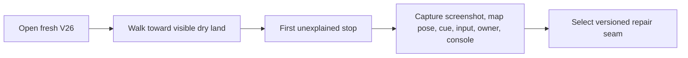
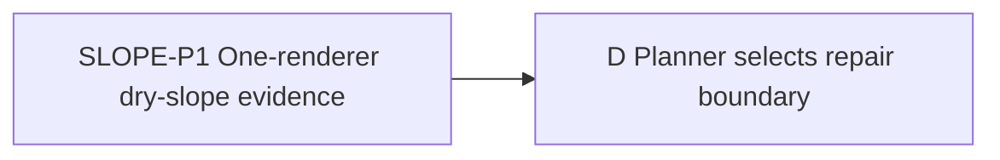

# Ticket Pack: V26 visible-slope collision probe

## Summary

This read-only probe traces the ordinary dry ground that appears walkable but stops the character. It answers which movement owner rejects the step and where the displayed surface diverges from the checked floor, so the next source-pinned version can repair the correct boundary. The aligned ask, constraints, and full-game context are in `STARTER_VALLEY_WORLD_LOOP_UNDERSTANDING.md`, especially its Original Ask and player-directed valley contract.

Locked design: do not change V17 or V26 replay or any game source during the probe. Use only one isolated browser renderer. Leave the V26 preview live and close the test renderer afterward. This does not decide that a visual-only cue is sufficient; the target remains traversable-looking ordinary land that can actually be traversed.

Important repo truth: `publicWorldV17StarterMovement.ts` rejects ordinary ground rises above 0.55 m; `publicWorldV26Snapshot.ts` uses the same 0.55 m cap. `TerrainSurfaceLayer.tsx` visually smooths ordinary adjacent cells until a 0.8 m difference. A 0.55 to 0.8 m rise may therefore be painted as continuous land while movement stops. The concrete first-person path and owner at the observed stop are not yet pinned.

System translation: `not_qualified`, a game feature/physics correction, not a whole-system port. Receipt: `not_applicable`. Product agent runtime: `not_required`, no shipped model or agent execution.

## Proposed Flow

The future source change is outside this probe. The probe stops as soon as its evidence distinguishes Greenway, streamed, or merely UI projection failure.

## Public Interfaces

No public code contract changes. Visible entrypoint is `http://127.0.0.1:5193/?publicWorld=v26`. Evidence artifact is a screenshot and plain-text receipt with exact route and map coordinates. The UI must be driven normally, with no console, storage, controller, or direct state bypass.

## Lane Graph

P runs now. D consumes only its observed location and source-owner classification.

## Topology Audit

- Productive lane: P, one discriminating UI evidence gate for the first real collision.
- Maximum width: one; this is a bounded `user_flow_probe` exception. A second renderer would duplicate the journey and raise RAM cost.
- Incomparable pair: none. No artificial parallelism.
- Fan-in: D uses P's evidence to choose the versioned repair seam, without editing.
- Certainty: unknown is whether Greenway, streamed movement, or projection causes the first dry stop. A visible stop, map location, and correlated source path distinguish branches. Stop at the first decision-bearing result. Surprise is no reproducible stop or an unrelated river/cliff/building collision, which calls for a revised probe rather than assumed physics repair.
- Conditional activation: no repair is authorized by this probe. D will author a substantive pack after evidence. No PR finisher or separate reviewer is needed for a read-only observation.
- Dispatch verdict: PASS under the bounded user-flow-probe exception.

| Serial edge | Exact consumed artifact | Why concurrent execution is impossible |
|---|---|---|
| P to D | First real dry-slope stop and owner evidence | The repair seam depends on the observed movement owner and surface. |

## Smallest Viable Diff

Behavior delta: none, evidence only. Expected diff budget: zero source files, zero lines, zero new files, zero dependencies. Expected changed files: this planner-owned pack only. Forbidden files/surfaces: all game production code, tests, saves, Git and GitHub state. Reuse scan: current V26 preview, map and existing contextual cue. A prompt/config/doc change cannot establish whether the checked step matches the visible terrain. Deletion/simplification: not applicable. Validation: one real browser journey and health evidence. Any source write, second renderer, or environment repair is a tripwire.

## Tickets

Paste now to: Reviewer, bounded UI evidence
Ticket: SLOPE-P1
Lane type: Serial user_flow_probe exception
Delivery phase: user_flow_probe
Delivery milestone: pre_surface, then final_complete evidence
Shortest complete user flow: start a fresh V26 game, walk from the spawn valley toward ordinary visible dry land, and capture the first place the character stops without a visible cliff, river, rock, store, or world edge.
First-feedback evidence: screenshot of character and terrain at the stop, exact key/camera input sequence, map x/z/elevation before and after, visible cue, movement owner, console/network status.
Test-writing policy: prohibited_until_pr_hardening
Review blocking classes: false classification of river/cliff as dry slope, multiple renderers, source/state bypass, missing exact location.
Validation environment: existing local Vite server on port 5193 and one isolated Playwright browser renderer.
Environment repair authority: none.
Environment stop condition: first confirmed external blocker plus at most one documented retry, then report environment blocked.
Surface readiness gate: V26 page loads, new game can start, player can move.
Surface revision: record HEAD and hashes of relevant source before and after.
Surface entrypoint: `http://127.0.0.1:5193/?publicWorld=v26`
Surface availability / validation isolation: keep server and user preview up, close test browser at end.
Post-surface validation: planner compares exact stop to V17, V23 streamed, V26, and renderer source, then plans a source-pinned repair.
Optional-feedback wait policy: never
Depends on: none
Branch: ben/wizard-playable-v2
Worktree: /private/tmp/pa-wizard-playable-v2
Base branch: origin/main
Lane role: Reviewer
Dispatch transport: native_spawned_subagent
Model: inherited
Cursor runtime: not_applicable
Existing-task routing: no_qualified_candidate
Existing-task capability and mission evidence: no user-owned task qualified; prior ephemeral tester can be reused only if currently idle and still on this mission.
User-authorized task-coordination scope: AGENTS.md's ephemeral delegation preference in this goal.
Ownership/workspace collision evidence: read-only browser use; no code ownership.
Current-status evidence: verify prior tester completed and closed its renderer before dispatch.
Existing-task delivery policy: bounded same-session follow-up if qualified; otherwise fresh native child.
No-interruption disposition: idle_safe_to_contact or not_applicable.
Task/thread receipt: not_applicable, native child result receipt required.
Final fallback transport: none
Fallback CLI, model, activation, availability, first contact, follow-ups, and continuity: not_applicable.
Runtime selection rationale: a browser-capable native child is needed for the real visual/physical discrepancy; no new renderer beyond one.
Agent spec: first-time player and evidence-first physics observer.
Required skills: auto-planner-ticket-pack; smallest-viable-diff; test-from-ui; playwright.
Session policy: initialize once or continue prior qualified session, no nested workers, model change, source edits, or API state shortcuts.
Worker agent: Wizard slope UI tester.
Required behavior:
1. Acknowledge read-only reviewer role; read the required skills and this pack completely.
2. Use `test-from-ui` early_smoke and Playwright visible controls. Fresh start through UI. Find the first ordinary dry surface that reads as walkable yet blocks forward travel; record a short route anyone can repeat. Stop before exploring variants.
3. If no such stop is found after a bounded 5-minute walk around the valley and its north/river approaches, report `unresolved` with exact explored route rather than inventing a failure. Distinguish named cliff/river gates from dry slope.
4. Close the single browser renderer and leave Vite running.
Certainty contract: unknown is authoritative owner of first visual/physical mismatch; closure mode discriminating_probe; new information is exact stop/cue/location and owner; stop at first collision; surprise is inability to reproduce or a non-dry obstacle.
Required files to add/update/tests: none.
Smallest viable diff: zero code and dependencies; reuse UI map and normal movement; tripwire is any source/state bypass.
Keep this lane narrow: no code repair, world redesign, deep campaign testing, or GitHub operation.
Acceptance commands: `curl -fsSI 'http://127.0.0.1:5193/?publicWorld=v26'`; one Playwright UI journey with screenshot and browser health checks.
Required coverage: exact visual stop versus visible ground, map pose before/after, movement owner, console/network.
Visual proof: required; one screenshot at failed surface and exact inputs. If unresolved, screenshot furthest tested ordinary dry approach.
Return receipt: dispatch ID, GO/NO-GO/unresolved, branch/HEAD/source hashes, exact steps and screenshot, console/network, browser closed, no files edited, next architecture branch, transport/model/fallback/same-session evidence.

## Assumptions

- The V26 preview remains available.
- A first-time player can traverse the initial route enough to expose an ordinary dry-slope stop, but this is not presumed proven.
- The read-only probe is a dependency of a versioned movement repair, not completion of the starter valley or full RPG.
