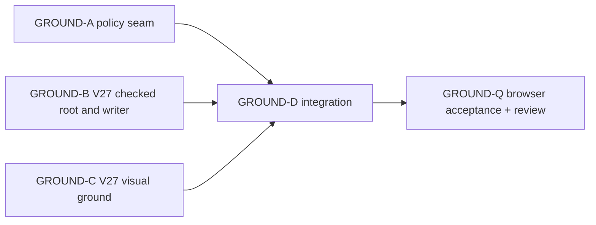

# Ticket Pack: V27 connected dry ground

## Summary

Let players walk over ordinary visible dry terrain lips in the starter region while preserving the river and north-rim route-building gates. V26's exact dry tile-corner freeze is separately repaired and browser-proven, but five ordinary cardinal tile joins still have 0.56 to 0.66 m rises above the source-pinned 0.55 m movement limit. Two other joins of this magnitude cross the authored north rim and must continue to require a ladder. V26 draws all seven as physical edges, not smoothed slopes, so movement and presentation must change together. This pack delivers a new, explicitly migrated V27 save and real UI route, not a silent change to historical V26 replay.

Aligned goal: `STARTER_VALLEY_WORLD_LOOP_UNDERSTANDING.md` and the active full Wizard Realms goal. Evidence: `V26_VISIBLE_SLOPE_PROBE_PACK.md`, `V26_DRY_CORNER_REPAIR_PACK.md`, and the read-only V27-A1 review receipt. The earliest useful user surface is a local V27 URL after checked migration/fresh start, while V26 remains available. System translation: `not_qualified`; agent runtime: `not_required`.

## Player Contract

- Ordinary ground lips with rises up to 0.8 m become traversable in both directions, but their rendered surface must visually slope or show an intentional short step-up, not a 0.6 m wall that the avatar slides through.
- The authored north rim at z=-6 still requires built ladder support. The river still requires a built bridge. Open pits still require their existing exit rules; no 0.8 m unladdered pit escape.
- A previously saved V26 game can be migrated under the existing lock without changing the V26 root, witness, or replay meaning. V27 saves reload and reject stale/source-changed CAS writes.
- Existing V17 through V26 URLs, migrations, tests, and replay remain source-pinned. New V27 behavior is opt-in only.
- Preserve one browser renderer maximum. Automated tests do not need a renderer. No GitHub action.

## Evidence and Design Decisions

The five ordinary dry Greenway pairs for seed `wizard-realms` are `(-5,-1)→(-5,0) .556 m`, `(1,3)→(2,3) .586 m`, `(3,1)→(4,1) .655 m`, `(3,8)→(4,8) .564 m`, and `(4,4)→(5,4) .607 m`. The two authored north-rim pairs `(-7,-2)→(-7,-1) .721 m` and `(6,-2)→(6,-1) .715 m` remain blocked. In V26 physical mode, `TerrainSurfaceLayer` links only differences below 0.3 m, so all seven currently have fascia. `PresentationPoseDriver` dampens Y but does not make wall traversal acceptable.

The policy seam is optional and defaults to historical 0.55 m. Only V27 replay opts into a maximum 0.8 m for ordinary, unexcavated ground. The separate north-seam and river tests stay unchanged. The V27 segment gate must check pit, river, and rim conditions before ordinary ground allowance. Visual linking must be based on the same predicate and must not smooth river banks, authored rim, or saved open-pit walls. If a common predicate cannot safely serve simulation and view without a bigger redesign, choose two functions with shared tests, not implicit matching constants.

## Public Interfaces

- A private/exported movement policy type may be introduced in `publicWorldV17StarterMovement.ts`: `{ maxOrdinaryGroundStepMeters: 0.55 | 0.8 }` (or a semantically equivalent narrowly typed value). The default is exactly `0.55`.
- `advancePublicV17GreenwayFrame`, `createPublicV17ContinuousSession`, and `visitPublicV23Frames` gain an optional trailing policy argument. Old call sites omit it, preserving exact behavior. No global mutable policy.
- New `PUBLIC_V27_SCHEMA`, V27 lineage/source receipt rooted in exact checked V26 source, V27 head/witness/replay/store/flow. Reuse V26 state and unchanged work actions, but V27 movement frames use the opt-in policy and V27 segment gate.
- New `?publicWorld=v27` preview entry. Keep `?publicWorld=v26` and older entrypoints unchanged. The user can resume migrated V26 progress in V27.
- View gets an explicit V27 walkable-surface flag and already-available open-pit and rim facts. No view-based authority.

## Lane Graph

A, B, C may run in parallel with disjoint ownership because signatures above are fixed. B may write against the agreed optional policy signature and report compilation deferment until A lands. D alone wires controller and entrypoint after A/B/C. Q uses one renderer and performs final source review. No child may edit another lane's files. Main owns integration, surprise handling, and final validation.

## Topology Audit

- Productive lanes: three independent owners, A movement seam, B persistence/writer, C visual. D integrates them; Q validates. Width three is justified by file ownership and separate proof obligations.
- Incomparable pairs: A/B (policy vs new V27 modules), A/C (simulation vs view), B/C (save vs visual). No duplicated implementation.
- Fan-in: D receives explicit exports and tested files from A/B/C. Q receives runnable V27 URL and exact route.
- Certainty: the V17 to V23 optional policy path and V26 receipt pattern are known. Unknown is the exact smallest V27 writer reuse and whether the view can distinguish open pits without adding projection data. Stop at first architecture tripwire and report; do not silently copy a full controller or weaken validation.
- Surprise: a V26 persisted pose that cannot be placed in V27, a visible fascia under a walkable lip, V26 replay drift, or an unladdered rim/pit/river crossing. Replan rather than force acceptance.
- Dispatch verdict: PASS for A/B/C. D and Q are conditionally dispatched only after dependencies.

## Smallest Viable Diff

This is a justified versioned subsystem exception to the usual 3-file/120-line production budget: old saves, checked replay, two movement owners, and view geometry all cross the contract. Each lane still minimizes its own diff and reuses existing V26 modules. A owns four existing movement files and focused tests. B owns new V27 domain/store/flow modules and tests only. C owns terrain surface/view files and tests, no simulation. D owns V27 controller/entry wiring and its focused tests. No new dependencies, art generation, global refactor, or unrelated region changes. A full V26 controller copy is a tripwire; prefer parameterization, but preserve V26 default behavior exactly. A migration failing because an old source changed is an expected safe rejection, not a reason to overwrite data.

## Tickets

### GROUND-A: movement policy seam

Paste now to: Implementer, movement owner
Lane role: implementer
Delivery phase: execution
Delivery milestone: focused typechecked source seam, no URL yet
Shortest user flow: ordinary Greenway 0.6 m rise accepts only when V27 opts in; old V26 rejects identically.
First feedback: red then green tests for one ordinary rise and explicit rim block.
Files owned: `publicWorldV17StarterMovement.ts`, `publicWorldV17GreenwayFrame.ts`, `publicWorldV17ContinuousSession.ts`, `publicWorldV23Transitions.ts`, nearest focused tests for those files.
Interface: optional trailing `maxOrdinaryGroundStepMeters` policy as above; historical default 0.55. Do not change `crossesSeam` north-rim cap. Ensure boundary owner path does not silently loosen.
Required skills: `auto-planner-ticket-pack`, `smallest-viable-diff`.
Validation: focused Vitest and TypeScript. No browser, storage, GitHub, or nested workers.
Tripwire: touching old snapshots or migrations, changing old results, more than owned files.
Branch/worktree: `ben/wizard-playable-v2`, `/private/tmp/pa-wizard-playable-v2`.
Dispatch transport/model: native ephemeral subagent, inherited model.

### GROUND-B: checked V27 root and writer

Paste now to: Implementer, versioned persistence
Lane role: implementer
Delivery phase: execution
Delivery milestone: new V27 source-pinned domain/store/flow with tests, no controller URL yet
Shortest user flow: valid V26 source migrates once to V27, V27 frame witness saves and reloads; stale/source-changed write rejects.
First feedback: versioned migration, replay and CAS tests that demonstrate V26 is unchanged.
Files owned: new `publicWorldV27Migration.ts`, `publicWorldV27Snapshot.ts`, `publicWorldV27Flow.ts`, `atomicV27Database.ts`, and associated tests. Do not edit old production files.
Interface from A: `visitPublicV23Frames(..., allowAirborne?, policy?)` with `{maxOrdinaryGroundStepMeters:0.8}`. If integration requires a different signature, stop and message main; do not edit A-owned code.
V27 segment gate: river/rim first, pit before ordinary rise, connector support as before. Reuse unchanged V26 actions and terrain ledger, but not V26 frame replay for new frames.
Required skills: `auto-planner-ticket-pack`, `smallest-viable-diff`.
Validation: focused Vitest and TypeScript after A lands; no browser, GitHub, or nested workers.
Tripwire: copying the whole V26 controller or changing V26 root/flow/store, weakening source receipt.
Branch/worktree: same as A.
Dispatch transport/model: native ephemeral subagent, inherited model.

### GROUND-C: presentation of walkable lips

Paste now to: Implementer, terrain view
Lane role: implementer
Delivery phase: execution
Delivery milestone: V27-only linked ordinary lips with pit/rim/river exclusions and visual geometry tests
Shortest user flow: a 0.6 m ordinary dry lip renders as a continuous slope; an open pit, north rim, and river bank do not.
First feedback: geometry/sampler tests for these four cases; inspect no resource leak or added renderer.
Files owned: `TerrainSurfaceLayer.tsx`, `WizardScene.tsx`, their focused tests, and at most an explicitly agreed view contract field if already needed. Do not edit domain movement or app entry.
Interface: `v27WalkableSurface?: boolean` (or equivalent explicit flag) plus existing V26 open pit/rim facts. Old V26 rendering must be byte-for-byte behaviorally equivalent.
Required skills: `auto-planner-ticket-pack`, `smallest-viable-diff`.
Validation: focused Vitest and TypeScript. Do not open a browser; Q does that once integrated.
Tripwire: visual smoothing across river, rim, or pit; requiring a new save field; broad terrain redesign.
Branch/worktree: same as A.
Dispatch transport/model: native ephemeral subagent, inherited model.

### GROUND-D: integration and early surface

Paste after A/B/C to: Implementer, controller and URL
Lane role: implementer
Delivery phase: integration
Delivery milestone: V27 live URL, fresh/migrated and saved
Files owned: V27 controller/runtime and app entry/writer wiring, related focused tests. Parameterize V26 controller only with explicit V27 replay hooks if needed; preserve old defaults.
Required skills: `auto-planner-ticket-pack`, `smallest-viable-diff`, `test-from-ui` only if D opens browser (prefer Q).
Acceptance: focused suite, typecheck, build, HTTP 200 at V27 URL, no browser yet. Surface access is a milestone, not completion.
Tripwire: wholesale V26 controller copy, unvalidated migration, broken V26 URL, dependency addition.
Branch/worktree: same as A.

### GROUND-Q: independent acceptance

Paste after D to: Reviewer/UI tester
Lane role: reviewer
Delivery phase: final acceptance
Delivery milestone: V27 UI route and persistence receipt
Required skills: `test-from-ui`, `playwright`, `smallest-viable-diff`.
One-renderer route: fresh V27, walk a known ordinary lip (for example grid `(3,1)→(4,1)` near x=14,z=4), capture before/after image, save/reload and reverse; independently probe river and north rim; inspect console/network. Close browser. Also review diff for old-version replay drift. No edits or GitHub action.

## Assumptions

- V27 is an opt-in developer preview until Q passes; it does not automatically replace the current user URL.
- A short slope mesh with presentation Y damping is acceptable for a 0.56 to 0.66 m rise, subject to UI proof. If visual proof shows a glide or feet sinking, add a bounded step-up animation rather than hiding it.
- Existing local V26 saves remain untouched and recoverable even if V27 migration fails.
