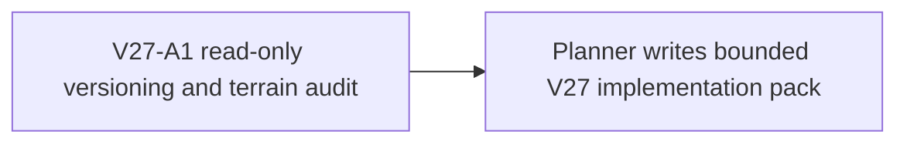

# Ticket Pack: Walkable visible ground, versioned movement seam

## Summary

Prepare the smallest safe next movement version for dry terrain that is drawn as a continuous slope but rejected by checked V26 movement. The UI proof at x about 5.9, z about -2 was a diagonal corner and has a bounded controller repair. A separate deterministic scan found seven adjacent dry tile pairs near the starter region with height differences above the historical 0.55 m walking cap yet below the 0.8 m visual fascia threshold. Those direct cardinal crossings remain blocked. The target is ordinary connected terrain that can actually be walked, while the deliberately impassable north cliff and river still require ladders and bridges.

This is a read-only architecture decision pack. The full-game goal and first-region flow are in `STARTER_VALLEY_WORLD_LOOP_UNDERSTANDING.md`. Do not edit production code in this lane. System translation: `not_qualified`. Product agent runtime: `not_required`.

## Evidence

The seven grid pairs (seed `wizard-realms`, all dry, delta in 0.55 to 0.8 m) are `(-7,-2)→(-7,-1) .721`, `(-5,-1)→(-5,0) .556`, `(1,3)→(2,3) .586`, `(3,1)→(4,1) .655`, `(3,8)→(4,8) .564`, `(4,4)→(5,4) .607`, `(6,-2)→(6,-1) .715`. `TerrainSurfaceLayer.tsx` uses `STEP_HEIGHT=0.8` for ordinary linked terrain. `publicWorldV17StarterMovement.ts` and `publicWorldV26Snapshot.ts` enforce 0.55. `publicWorldV23Transitions.ts` routes Greenway frames through `createPublicV17ContinuousSession`, so changing only V26's final segment gate cannot help Greenway. Streamed movement has its own owner and V26's segment gate.

## Public Interface and Decision Questions

No interface changes during this audit. Return a concrete V27 plan that names:

1. The minimal opt-in movement policy seam so old V17 through V26 witnesses replay exactly as before.
2. Whether allowing ordinary 0.55 to 0.8 m cardinal rises yields acceptable locomotion, or whether a short mantle/step animation is needed in the same increment. Do not trade a hard stop for a visible teleport without stating it.
3. Explicit cliff/rim, river, connector, dig-pit, rescue, boundary, and save-lineage invariants.
4. Exact production and test file footprint, migration and checked-store path, first browser acceptance route, and a simpler alternative if a full V27 schema is disproportionate.
5. Which visually smooth pairs are actually intentional obstacle edges and must remain blocked, using source evidence rather than assuming all seven are walkable.

## Lane Graph and Topology Audit

One read-only lane and planner fan-in. Maximum width one for this audit; unrelated CORNER-Q1 browser acceptance may run concurrently because this lane opens no browser and owns no code. This is not a broad game review. Decision-bearing uncertainty is safe versioning, classification of the seven slopes, and cost of a visible mantle. Stop once a concrete minimal seam and file map are established. If old replay cannot be preserved by opt-in policy, report that surprise and the next exact probe.

## Smallest Viable Diff

No source changes. Expected diff is this planner-owned pack only. Reuse existing V26/V25 source and tests. Forbidden: production code, test edits, save/local storage mutation, Git/GitHub, browser renderer. The follow-on pack must justify any >3-file or >120-line production footprint and any schema migration. A purely verbal cue is not enough for visually walkable ordinary terrain, but a 0.8 m glide may itself be visually poor. A visual-only change is acceptable only if it truthfully turns those edges into recognizable intentional obstacles and user feedback agrees, which this audit must not assume.

## Ticket

Paste now to: Reviewer, movement architecture
Ticket: V27-A1
Lane type: read-only architecture review
Delivery phase: planning evidence
Delivery milestone: exact seam recommendation, no implementation
Shortest complete user flow: player walks across a visually smooth dry cardinal tile seam, persists, reloads, and continues; north rim and river still block until built works.
First-feedback evidence: source line map for policy injection, replay/store versioning, and classification table for seven pairs.
Test-writing policy: none, read-only.
Review blocking classes: old replay drift, missing migration, loophole in cliff/river/pit, visible teleport, oversized diff.
Validation environment: source inspection and in-memory numeric probes only; no browser.
Environment repair authority: none.
Surface readiness gate: V26 preview remains available for user; this lane does not touch it.
Surface revision: record HEAD and relevant source hashes.
Surface entrypoint: existing V26 preview, but no renderer is authorized.
Surface availability: leave Vite running.
Optional-feedback wait policy: never.
Depends on: SLOPE-P1 and deterministic seven-pair scan, complete.
Branch: `ben/wizard-playable-v2`
Worktree: `/private/tmp/pa-wizard-playable-v2`
Base branch: `origin/main`
Lane role: reviewer
Dispatch transport: native ephemeral subagent
Model: inherited
Existing-task routing: reuse a relevant idle reviewer with recent source and safety proof, else new native agent.
Ownership: read-only only.
Required skills: `auto-planner-ticket-pack`, `smallest-viable-diff`.
Worker instruction: read this pack and required skills fully, inspect current code and tests, return exact file/seam plan and risks. No implementation, browser, nested agents, or GitHub action.

## Assumptions

- The seven pairs use the initial `wizard-realms` seed and are representative of one visible/physical mismatch, not exhaustive proof for all seeds.
- The diagonal corner repair is independent and does not solve direct cardinal rises above 0.55 m.
