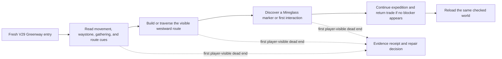
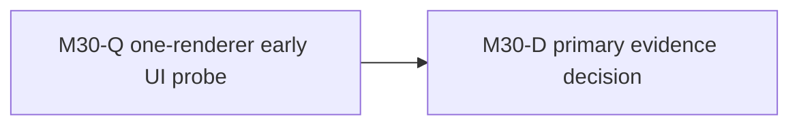

# Ticket Pack: V30 First-Region Public Journey Probe

## Summary

The V29 Greenway excavation loop is validated, but current public-world Mireglass progression is not. Run one UI-only early smoke from a fresh V29 save, stop at the first meaningful dead end, and return exact evidence for the next bounded repair or for a longer acceptance pass. This pack traces to `V30_FIRST_REGION_JOURNEY_UNDERSTANDING.md` and keeps the full-game goal intact.

Locked design:

- The tester uses visible controls, not source coordinates, direct domain calls, dev teleportation, or synthetic save insertion.
- V24 through V29 authority, storage, and old saves remain untouched.
- Only one isolated browser renderer may run; the port 5193 preview remains available to the user.

Important repo truth:

- `?publicWorld=v29` is the current checked entry. Its Greenway dig, pick, stone sale, and reload path passed the UI in the previous local validation receipt.
- `FIRST_EXPANDED_REGION_CONTENT.md` records an older V7-era Mireglass journey. `V24_MIREGLASS_INTEGRATION_PACK.md` and current `GAME_DESIGN.md` leave current public-version proof open.
- The world grid already spans roughly 2 km. Numeric map expansion alone is not the missing player loop.

## Proposed Flow

## Public Interfaces

No game interface changes. The evidence artifact is one M30-Q receipt with URL, isolated-profile identity, exact actions and visible outcome, first blocker or milestone, screenshot path, console/network state, save/reload observation, and an owner hypothesis labeled as inference.

## Lane Graph

Runnable wave 1: `M30-Q` is one bounded discriminating probe. This is the earliest user-flow attempt, not a substantive implementation pack. The explicit early-smoke exception permits its linear graph. `M30-D` consumes its receipt and either enters the observed-failure fast path for a bounded product owner or returns to Planner mode for a larger ticket pack. It does not edit code.

## Topology Audit

- Productive-lane inventory: `M30-Q` is a read-only, decision-bearing UI evidence lane on the V29 real surface.
- Maximum parallel width: one renderer. Parallel browser lanes would violate the RAM and test-isolation constraint; no source implementation is authorized before the first blocker is known.
- Incomparable lanes: none under the early user-flow-probe exception. This is not a substantive implementation pack.
- Fan-in gate: `M30-D` consumes the exact screenshot and health receipt; it cannot infer a fix without observed owner evidence.
- Broad-lane split audit: one concern, the first fresh-player Greenway-to-Mireglass journey blocker.
- Certainty/novelty audit: the live branches are reachable/intuitive current V29 play versus a visible guidance, movement, authority, or save blocker. The browser result is a discriminating probe, not a rerun of the old V7 evidence.
- Surprise/escalation audit: unexpected save corruption, migration failure, memory growth, or two grounded repairs that leave the same error require replanning, not blind retries.
- Conditional activation: no repair or finisher lane is activated by this pack. A concrete product blocker may activate the observed-failure fast path after owner evidence; an architectural or unclear blocker returns to Planner mode.
- Dispatch verdict: `PASS` for the bounded early-smoke exemption only.

| Serial edge | Consumed evidence | Why it cannot run concurrently |
| --- | --- | --- |
| M30-Q to M30-D | Visible steps, first blocker or milestone, screenshot, console/network and save state | The decision depends on the actual user-facing result. |

## Tickets

Paste now to: Reviewer
Ticket: M30-Q
Lane type: Serial early user-flow probe
Delivery phase: user_flow_probe
Delivery milestone: pre_surface, with the existing V29 surface already available
Shortest complete user flow: open the V29 entry, start fresh, follow visible Greenway cues toward the westward Mireglass expedition, reach its first marker or report the first dead end
First-feedback evidence: screenshot and exact visible result from `http://127.0.0.1:5193/?publicWorld=v29`
Test-writing policy: prohibited_until_pr_hardening
Review blocking classes: user cannot reasonably progress, world movement contradicts visible geography, checked action/save fails, or browser runtime error affects play
Validation environment: existing Vite preview on port 5193, one isolated Playwright profile
Environment repair authority: none
Environment stop condition: first confirmed external failure plus at most one documented retry
Surface readiness gate: HTTP 200 and correct V29 entry already exist; do not alter the user's preview
Surface revision: current dirty `ben/wizard-playable-v2` checkout, record file-state time and URL in receipt
Surface entrypoint: `http://127.0.0.1:5193/?publicWorld=v29`
Surface availability / validation isolation: separate browser profile, one renderer, close at end, leave Vite live
Post-surface validation: later bounded repair and a fresh final UI proof after a concrete blocker is fixed
Optional-feedback wait policy: never
Depends on: none

Branch: `ben/wizard-playable-v2`
Worktree: `/private/tmp/pa-wizard-playable-v2`
Base branch: existing branch, no git action
Lane role: Reviewer
Dispatch transport: native_spawned_subagent
Model: inherited
Cursor runtime: not_applicable
Existing-task routing: not_authorized for durable Codex tasks; a recently completed ephemeral child may be reused only if still available and safe
Existing-task capability and mission evidence: prior V29 one-renderer UI receipt is relevant, but reverify status at dispatch
User-authorized task-coordination scope: ephemeral subagents under the supplied AGENTS.md parallel-delegation instruction
Ownership/workspace collision evidence: read-only browser profile, no source ownership; only one renderer
Current-status evidence: required immediately before dispatch
Existing-task delivery policy: continue the same ephemeral child if its recent role and idle state remain suitable; otherwise spawn a new native child
No-interruption disposition: idle_safe_to_contact only, never interrupt active work
Task/thread receipt: not_applicable for native child; retain native dispatch ID and result receipt
Final fallback transport: none
Fallback CLI: not_applicable
Fallback model: not_applicable
Fallback activation conditions: not_applicable
Fallback availability evidence: not_applicable
Fallback first contact: not_applicable
Fallback follow-ups: not_applicable
Fallback session continuity: not_applicable
Runtime selection rationale: the existing native browser tester recently proved V29 UI interactions and can run this bounded, read-only route without another durable task or model switch
Agent spec: skeptical new-player UI tester, findings first
Required skills: auto-planner-ticket-pack, smallest-viable-diff, test-from-ui, playwright
Session policy: initialize once and continue the same native child, no nested workers
Worker agent: Codex UI Reviewer

Required behavior:

1. Confirm port 5193 is reachable, start a fresh isolated V29 browser profile, and use only the visible UI to learn controls and make progress toward Mireglass. Do not consult map coordinates in source before the first result.
2. Capture exact actions, current position if the UI shows it, visible objective/blocked cue, screenshot, and console/network at the first decision-bearing blocker. If no blocker appears, continue only through the first Mireglass marker or interaction before returning the early-smoke receipt.
3. Reload once if a saved milestone exists and report whether the same checked world resumes. Close the isolated renderer, keep Vite live. Stop if the first blocker is clear; do not roam or repair.

Certainty contract:

- Unknown: Can a new player follow the current V29 public route into Mireglass, and what is the first live blocker if not?
- Closure mode: discriminating_probe.
- New information: one current-version browser journey with exact visible behavior and health evidence.
- Stop condition: first blocker or first Mireglass marker/interaction plus reload observation, within a bounded 15-minute browser run.
- Surprise trigger: save loss, invisible wall, unresponsive controls, major memory spike, or a browser result contradicting the existing V29 Greenway receipt.

Required files to add/update: none.
Required tests to add/update: none.

## Smallest Viable Diff

Behavior delta: none in this evidence pack. The next code change, if any, must follow the observed first blocker.

Expected diff budget: zero files, zero lines, zero dependencies. Reuse the current V29 entry and existing preview. A documentation or configuration change cannot replace the real UI observation. Deletion and simplification are not applicable to a read-only probe. Any source edit is a tripwire requiring a separate scoped ticket. Validation is the visible early-smoke receipt, not a test suite.

Reviewer lane omission: not applicable, M30-Q is the read-only evidence owner. PR finisher omission: no PR or packaging action is authorized. The primary agent validates the receipt against the goal and chooses the next pack.

## Assumptions

- The current preview remains reachable on port 5193 and the prior browser test is fully closed.
- The first player-visible blocker is more decision-relevant than another versioned feature added without integration proof.
- Completing this probe is progress toward the full-game goal, but is not gate 1 completion or full-game completion.

## M30-Q2 continuation after observed repair

The initial M30-Q result was a misleading upper cliff-lip cue. V31 repaired only that presentation owner, and its same-entry UI retry reached x about -26.8, z -11.8 west of the ladder with a saved pose. V32 independently proved a bridge crossing. The current gap remains Mireglass progression. Reactivate the same one-renderer reviewer lane as `M30-Q2`, keeping the original role, transport, proof contract, and no-source-edit lock.

Paste now to: Reviewer
Ticket: M30-Q2
Lane type: Serial early user-flow continuation after repair
Delivery phase: user_flow_probe
Delivery milestone: pre_surface, existing V29 surface remains available
Shortest complete user flow: fresh V29 entry, follow the visible ladder or bridge route beyond the starter valley, discover the first Mireglass marker or interaction, or report the first new player-visible dead end
First-feedback evidence: exact route steps, screenshot, cue and map text, console/network, and save/reload at `http://127.0.0.1:5193/?publicWorld=v29`
Test-writing policy: prohibited_until_pr_hardening
Review blocking classes: unreachable-looking land, unexplained route gate, inability to reach a visible marker, checked action/save failure, browser runtime error affecting play
Validation environment: existing Vite preview port 5193, one fresh isolated Playwright profile
Environment repair authority: none
Environment stop condition: first confirmed external failure plus at most one documented retry
Surface readiness gate: HTTP 200 and correct V29 entry; do not disturb user preview
Surface revision: current dirty `ben/wizard-playable-v2` checkout after accepted V31 repair; record file-state time and URL
Surface entrypoint: `http://127.0.0.1:5193/?publicWorld=v29`
Surface availability / validation isolation: separate browser profile, one renderer, close at end, leave Vite live
Post-surface validation: scoped repair or full Mireglass journey proof only after this discriminating result
Optional-feedback wait policy: never
Depends on: accepted V31 upper-lip UI retry, already satisfied

Keep the prior M30-Q reviewer role and native child session. Use only visible UI cues before the first new blocker, with no source-coordinate steering, synthetic saves, direct domain calls, or dev teleport. A first marker or interaction is sufficient for this bounded pass; do not roam to finish the entire expedition after a blocker. Return `observed error | change | restart | retry result | next action` if the previous lip error recurs. No PR finisher is activated. Reviewer remains read-only. The maximum width is one renderer, so this continuation retains the early-probe linear exception and does not create artificial parallel work.
