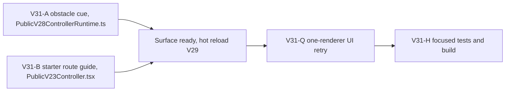

# Ticket pack: V31 starter valley obstacle truth

## Outcome and evidence

The V29 opening has a continuous river, checked ladders and bridges, spade-triggered Dig, persistent strata, and trapped-only Return Home. The fresh-player M30-Q probe built the north ladder but stopped at an upper cliff lip where dry land looked reachable. The obstacle cue wrongly told them to build a ladder. A same-entry follow-up moved back from the lip and continued west on the upper shelf, so this is a guidance and legibility defect, not a global movement softlock. Source of truth: `V31_STARTER_VALLEY_FLOW_UNDERSTANDING.md`, M30-Q and M30-D UI receipts.

Target outcome for this repair: on the existing V29 surface, an upper-shelf player who meets the cliff lip learns to stay on the upper route or use the built ladder to descend; the persistent starter guide no longer treats them as standing at the ladder's lower foot. This is the first bounded step toward the larger first-session valley journey, not a claim that the full RPG is complete.

## Scope lock and interfaces

- Entry: `http://127.0.0.1:5193/?publicWorld=v29`. The Vite preview stays live. Only one WebGL browser renderer at a time; isolated test profile closes after each run.
- Keep V24 through V29 movement authority, root schemas, replay, saves, and checked resource action rules unchanged. No new versioned root or collision adjustment in this pack.
- No PR, GitHub action, new dependency, or durable Codex task. Preserve the dirty shared worktree and the user's saves.
- Public presentation interface A: V28 runtime's `terrain_missing` move-rejection message at a cliff. It may use the canonical cliff face and origin pose but cannot alter move acceptance.
- Public presentation interface B: `publicV27StarterGuide(view, works)` summary and action for a built ladder. It may use projected pose and saved work IDs but cannot alter work eligibility.

## Lane graph and topology audit

Runnable wave 1 has two incomparable productive lanes with disjoint source ownership. Neither waits for the other. Maximum simultaneous renderers is zero during implementation and one during UI validation. The only serial fan-in is when the two presentations are available in the same hot-reloaded entrypoint. This is real parallelism, not duplicate planning. If either lane changes movement authority or broadens its file scope, stop and replan. A reviewer may operate only after the surface is available; test writing is prohibited until the `pr_hardening` phase. There is no PR finisher.

## Tickets

### V31-A, implementation

- Role: Implementer. Transport: fresh native ephemeral subagent. Model: inherited. Branch and worktree: existing `ben/wizard-playable-v2` at `/private/tmp/pa-wizard-playable-v2`; no Git operations.
- Owned source: `games/wizard-realms/engine/src/PublicV28ControllerRuntime.ts` only before hardening.
- Change the `cliff-needs-ladder` message so an origin on the upper north side of the canonical face is not told to build a ladder. The wording must state that the lip is a drop or cliff and give an actual route: stay on the upper shelf by backing away from the lip, or return to the built ladder to descend when one exists. From the lower face, keep a true build/use-ladder cue.
- No collision, witness, state, save, action, route-site, or resource changes. Do not guess whether one-way cliff descent is permitted; that requires user choice and potentially versioned authority.
- First-feedback evidence: changed message path identified in a one-file diff and `SURFACE_READY` handoff to primary, without a pre-surface test suite.
- Later hardening: focused message assertions in the existing `PublicV28ControllerRuntime.test.ts` only if activated after UI surface proof.
- Stop on ambiguous side classification or if the existing face geometry cannot support accurate wording. Report the exact blocker rather than altering authority.

### V31-B, implementation

- Role: Implementer. Transport: fresh native ephemeral subagent. Model: inherited. Branch and worktree: existing `ben/wizard-playable-v2`; no Git operations.
- Owned source: `games/wizard-realms/engine/src/PublicV23Controller.tsx` only before hardening.
- Keep early chop, store, boots, and spade hints intact. When the ladder is built, distinguish a player on the upper north shelf from one on its lower side. On the upper side, guide westward travel along the shelf and clearly separate the bridge route across the southern river. On the lower side, explain climbing from the ladder foot. Never say that a ladder remains to be built when one is saved.
- Do not change movement, work readiness, map serialization, or gameplay authority. Avoid extra persistent tutorial state.
- First-feedback evidence: changed guide branches in a one-file diff and `SURFACE_READY` handoff to primary, without pre-surface test writing.
- Later hardening: focused guide assertions in the existing `PublicV23Controller.test.tsx` only if activated after UI surface proof.
- Stop if the projected player position cannot classify the side truthfully; report it rather than adding new state.

### V31-Q, UI reviewer

- Role: Reviewer. Transport: reuse the recently proven idle one-renderer UI child only after checking its status and mission fit; otherwise a new ephemeral reviewer.
- Depends on both surface handoffs. Use a fresh isolated V29 profile. Repeat axe, four logs, north ladder, climb, upper cliff lip, and a westward detour. Capture exact visible cue/guide, position movement, screenshot, console/network, and save/reload. Stop at first meaningful new blocker. Close renderer and leave port 5193 live.
- Same-error retry classification: `observed error | change | restart | retry result | next action`. If still misleading, send to the smallest owning lane. Do not mask with a new plan.

### V31-H, hardening and integration

- Depends on V31-Q. Activate only after the honest surface is available. The primary routes the two owned test files to the same implementers and runs targeted Vitest and `npm run build` after UI proof. Report any unrelated dirty-worktree failures separately.
- Expected total diff: two production files, at most two existing test files, no dependency or schema changes, about 40 net lines. Over five files or 300 net lines is a scope tripwire.
- Product acceptance for this repair: the exact lip repro gives a true cue and guide; the upper west route remains traversable; save/reload and the old lower-side ladder cue remain valid. Full first-session dig/bridge/rescue proof is a subsequent journey, not falsely implied by a copy-only repair.

## Risks and questions

- Whether stepping down from the upper shelf should be legal is pending user preference. This pack does not silently choose.
- If the cliff still reads as invisible after truthful cue and guide, the next owner is visual geometry, and perhaps a versioned movement profile. Do not alter saved authority in this pack.
- An upper shelf route to Mireglass was not fully proven by M30-D. The retry proves only the bounded detour; a longer expedition acceptance follows.

## Validation receipt

V31-Q passed on a fresh V29 save. The player chopped two tree interactions for four logs, built the north ladder, climbed it, and stopped at the upper cliff lip near x -20.2, z -6.0. The cue described a drop and advised backing away to stay on the upper shelf or returning to the saved ladder to descend. The guide said `Upper shelf: head west` and identified the southern river bridge as a separate crossing. Backing away allowed westward travel to x -26.8, z -11.8. Reload restored the exact pose and one saved ladder. The isolated renderer closed with no console errors; `THREE.Clock` warned and the favicon returned 404. Evidence: `/private/tmp/wizard-v31q.7EOD8e/.playwright-cli/page-2026-10-10T03-00-12-083Z.png` and `/private/tmp/wizard-v31q.7EOD8e/.playwright-cli/page-2026-10-10T03-01-18-600Z.png`.

Hardening passed: `PublicV28ControllerRuntime.test.ts` 12/12, `PublicV23Controller.test.tsx` 8/8, and `npm run build`. Domain regressions for river, rim, escape, and strata passed 24/24. No movement authority or save schema changed.
