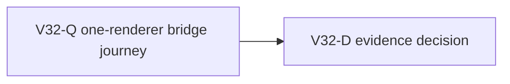

# Ticket pack: V32 first valley exit probe

## User outcome and prior proof

The player should understand the opening valley by doing: chop timber, use it for a ladder and bridge, buy boots and a spade, and cross real cliffs or a continuous river without hitting unexplained stops. V31 repaired a misleading upper cliff-lip cue and guide. A fresh V29 UI replay climbed the ladder, backed away from the lip, traveled west, and reloaded with the ladder intact. V29's earlier excavation receipt proved spade, pick, soil, stone, sale, and saved divot. The first river bridge journey has not been proved at the live V29 entry.

## Scope and interfaces

- Read-only early UI smoke on the live `http://127.0.0.1:5193/?publicWorld=v29` entry in a fresh isolated profile. Only visible controls and in-game information may guide actions before the first result. Do not use synthetic saves, dev teleport, source coordinates, or direct domain calls.
- Only one browser renderer. Close it after the probe; leave port 5193 live for the user. Preserve the shared dirty worktree and saves.
- No code, GitHub, PR, branch, or deployment action in this pack. The result chooses one observed owner or proves a bounded loop.

## Lane graph and topology audit

This is the early user-flow-probe exception, not a substantive implementation pack. Maximum useful width is one renderer. A parallel browser would violate RAM isolation, and the concrete next owner is unknown until the player journey exposes it. No speculative implementer lane is activated. If a repair becomes necessary, the primary uses the observed failure loop and creates a scoped pack or bounded fast-path ticket. A fresh UI result, not an old unit test, is the fan-in gate.

## V32-Q, read-only reviewer ticket

- Role: Reviewer. Reuse the recently proven idle V29 UI reviewer only after status check and recent-context proof. Runtime: native ephemeral subagent, inherited model, one isolated Playwright profile. Required skills: auto-planner-ticket-pack, test-from-ui, playwright, smallest-viable-diff.
- Start at a fresh V29 save. Use visible affordances to gather eight logs and find a Ready southern river crossing. Build a bridge through Works and walk onto and across its saved deck. If the opening guidance suggests buying boots, do so if naturally affordable, but do not let optional shopping delay the bridge blocker. Stop at the first meaningful dead end or on arrival at dry land across the river.
- Record exact UI actions, in-game coordinates if displayed, current guide, obstacle cue, bridge readiness text, screenshot at first blocker or completed crossing, browser console/network, and one save/reload observation. State whether the river has a visible dry bypass near the attempt, without claiming global topology from a bounded UI view.
- Do not roam aimlessly, edit source, run multiple renderers, or spend time on a 30-minute cooldown UI wait. Stop within about 15 minutes. Return a result receipt.

## V32-D, primary evidence decision

- If bridge building/crossing fails, state `observed error | change | restart | retry result | next action` and route the smallest identifiable owner. Do not create a broad plan while a bounded repair is obvious.
- If it passes, record the validated first-session crossing and move to the next unproved UX step, especially dig targeting and trapped recovery, without falsely declaring the full game done.
- Product agent runtime: not required. System translation: not qualified. Full-game goal remains active.

## Validation receipt

V32-Q passed in a fresh V29 isolated browser. Through visible controls, the tester equipped the axe, chopped two nearby oaks for eight logs, saw South creek bridge marked on the map, walked to the dry foot near x 0, z 4, and confirmed the Ready Works bridge. The saved deck carried the player through x about -0.5, z 8.4 to far dry land near x -0.2, z 14.8. A small off-axis input was rejected with a stay-on-deck cue, then a heading correction advanced. Reload restored the far-bank pose and saved bridge. No dry bypass was visible near the crossing, which is a local observation rather than a global topology proof. The renderer closed with zero console errors. Evidence: `/private/tmp/wizard-v32q.BtlHf8/.playwright-cli/page-2026-10-10T03-08-16-029Z.png` and `/private/tmp/wizard-v32q.BtlHf8/.playwright-cli/page-2026-10-10T03-08-56-711Z.png`.

The narrow deck and precise heading requirement are a feel issue for later movement and camera iteration, not a failed crossing. Boots shopping and trapped-rescue UI were outside this bounded probe.
