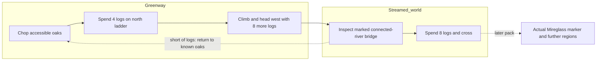
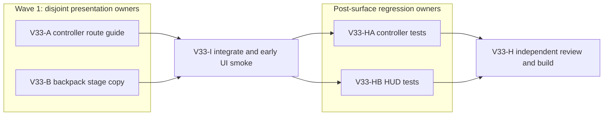

# Ticket Pack: V33 Valley Route Truth

## Summary

This pack fixes the observed mismatch between saved first-valley progress and the guide/backpack instructions. It also records one real-UI boundary probe so the separate geometry question is resolved from evidence, not guesswork. See `V33_VALLEY_ROUTE_TRUTH_UNDERSTANDING.md`.

Locked design:

- V29 save, checked movement, mining, terrain ledger, river, and rescue authority do not change.
- The physical north ladder costs four logs; the separate connected-river bridge costs eight logs. Both expenditures must be explained before the player leaves Greenway.
- Beyond Greenway, no instruction may imply the built north ladder is still ahead.
- Exactly one WebGL renderer runs for the final UI probe.

Important repo truth:

- `PublicV23Controller.tsx` only calculates `v27Guide` when `movementOwner === 'greenway'`, so the streamed world falls back to old starter text.
- `WizardHud.tsx` shows a generic `starterCliff && !greenwayWorks` paragraph in streamed `v28-river` context, which repeats the already-completed ladder step.
- Four explicitly authored `greenway-journey-tree-*` trees provide sixteen logs on top of ordinary core trees; each depleted tree yields four logs. Resource supply is present, but the journey does not ask for enough before departure.
- The M30-Q2 UI run reached a marked crossing at approximately x -76, z 8 after the ladder, found no logs, and saw stale guide/backpack copy. The marker beyond the river was not reached.

## Proposed Flow

## Public Interfaces

- Existing `publicV27StarterGuide` return shape remains `{ summary, action, boots, spade }`; an optional context input may distinguish the streamed owner. No save fields or external action types change.
- Existing `WizardViewProjection.savedTerrainWorks.context === 'v28-river'` and `builtSites` provide the HUD's saved river-stage context. No new projection field is needed.
- UI entrypoint is `http://127.0.0.1:5193/?publicWorld=v29`, with a fresh isolated browser profile for the one-renderer probe.

## Lane Graph

Runnable wave 1: V33-A and V33-B are incomparable, one file each. V33-I consumes both changes for one actual UI journey. After a revision-bound surface receipt, V33-HA and V33-HB add disjoint focused tests. V33-H reviews and builds their integrated result.

## Topology Audit

- Productive lanes: V33-A changes only the controller's context-sensitive guide; V33-B changes only the backpack's stage paragraph.
- Maximum parallel width: 2. A and B have disjoint files and use the existing frozen projection contracts.
- Fan-in: V33-I proves both surfaces together in one browser. V33-HA and V33-HB protect their separate surfaces. V33-H checks contradictory copy and regression risk.
- Broad-lane split: neither lane owns world authority or the other's file. No artificial parallelism.
- Certainty: A closes the known fallback cause; B closes the known HUD fallback cause; I discriminates whether a visible boundary matches checked collision. No duplicate general review.
- Surprise: if UI reveals collision/mesh mismatch, do not patch terrain in A/B; return to planner for a new bounded authority/presentation pack. If a route cannot be reached with available trees, inspect resource access and replan.
- Conditional finish: no PR requested, so no PR finisher. H is the final pack gate. No automatic merge or GitHub write.
- Serial edges: A/B to I consume the integrated guidance revision. I to HA/HB consumes the real UI result and surface revision; only then are new tests permitted. HA/HB to H consumes their focused regression receipts.
- Dispatch verdict: PASS.

## Smallest Viable Diff

Behavior delta:

- Controller instructions follow movement owner and saved ladder/bridge stage.
- Backpack instructions stop repeating the starter ladder in streamed river context.

Expected diff budget: two production files, preferably fewer than 80 net new lines total; two focused test files after surface ready; zero new runtime files and dependencies.

Expected changed files:

- `games/wizard-realms/engine/src/PublicV23Controller.tsx`, controller guide owner.
- `games/wizard-realms/engine/src/view/WizardHud.tsx`, backpack help owner.
- After `SURFACE_READY` only: their existing focused tests, if needed to protect the surviving behavior.

Forbidden surfaces: generation, world chunks, movement, valley rim, river, digging, snapshots, migrations, store authority, package files.

Reuse scan: `publicV27StarterGuide`, `savedTerrainWorks.context`, `builtSites`, existing blocked-move cue, existing V29 mining guidance.

Prompt/config alternative: user-facing copy is embedded in the two owner components; no external prompt or config controls it. This is deterministic presentation.

Deletion/simplification target: remove or stop selecting the stale fallback branches in V29; do not add a second overlapping guide system.

Validation: one fresh V29 browser journey with screenshot, console/network status, and exact blocked boundary; targeted Vitest and build only after readiness.

Tripwire: stop if a save/projection schema, movement, authority, generated terrain, more than five files, 300 net new lines, or dependency change becomes necessary.

## Tickets

Paste now to: Implementer A
Ticket: V33-A
Lane type: Parallel
Delivery phase: implementation
Delivery milestone: pre_surface
Shortest complete user flow: build north ladder, enter streamed world, approach connected river with fewer than eight logs, read stage-correct guide
First-feedback evidence: prior M30-Q2 screenshot at `/private/tmp/wizard-m30q2.mLyctU/.playwright-cli/page-2026-10-10T03-19-46-054Z.png`
Test-writing policy: prohibited_until_pr_hardening
Review blocking classes: false route step, stale stage, changed checked behavior
Surface readiness gate: integrated browser journey, not this lane alone
Surface revision: pending
Surface entrypoint: existing V29 preview
Surface availability / validation isolation: leave Vite live; no browser in this lane
Post-surface validation: targeted controller tests and integrated review
Optional-feedback wait policy: never
Depends on: none
Branch: `ben/wizard-playable-v2`; worktree: `/private/tmp/pa-wizard-playable-v2`; base: current dirty branch, do not commit or push
Lane role: Implementer
Dispatch transport: native_spawned_subagent; Model: inherited; Cursor runtime: not_applicable
Existing-task routing: not_authorized; capability, mission, user scope, collision, status, delivery policy: not_applicable
No-interruption disposition: not_applicable; task/thread receipt: not_applicable
Final fallback transport: none; fallback fields: not_applicable
Runtime selection rationale: local context-sensitive copy in one owner file, native worker fit; no external provider or durable task needed
Agent spec: Wizard Realms presentation implementer; session policy: initialize once then continue; worker agent: native child
Required skills: auto-planner-ticket-pack, smallest-viable-diff
Required behavior:
1. Modify only `PublicV23Controller.tsx`. Make V27+ guide usable for streamed-owner V29 without treating a world Z coordinate as Greenway's upper shelf. A saved ladder behind the player should never be described as unbuilt or still ahead.
2. Before first ladder expenditure, preserve both costs, four logs for ladder and eight additional for the connected river. With fewer than eight logs beyond Greenway, give a concrete return-to-oaks action. With a saved bridge, say the route is ready rather than asking to gather again.
3. Preserve V25/V26 and lower Greenway cue semantics; do not change checked authority or snapshot types. Remove obsolete V29 fallback selection where possible.
Acceptance commands before surface: `git diff --check`; do not add tests or open browser. Return exact diff, reuse/deletion proof, no out-of-scope changes, and remaining UI risk.

Paste now to: Implementer B
Ticket: V33-B
Lane type: Parallel
Delivery phase: implementation
Delivery milestone: pre_surface
Shortest complete user flow: same, read backpack stage paragraph at connected river
First-feedback evidence: same M30-Q2 screenshot
Test-writing policy: prohibited_until_pr_hardening
Review blocking classes: stale stage, contradictory route costs, changed checked behavior
Surface readiness gate: integrated browser journey, not this lane alone
Surface revision: pending
Surface entrypoint: existing V29 preview
Surface availability / validation isolation: leave Vite live; no browser in this lane
Post-surface validation: targeted HUD tests and integrated review
Optional-feedback wait policy: never
Depends on: none
Branch: `ben/wizard-playable-v2`; worktree: `/private/tmp/pa-wizard-playable-v2`; base: current dirty branch, do not commit or push
Lane role: Implementer
Dispatch transport: native_spawned_subagent; Model: inherited; Cursor runtime: not_applicable
Existing-task routing: not_authorized; capability, mission, user scope, collision, status, delivery policy: not_applicable
No-interruption disposition: not_applicable; task/thread receipt: not_applicable
Final fallback transport: none; fallback fields: not_applicable
Runtime selection rationale: local HUD copy and existing projection context in one owner file, native worker fit
Agent spec: Wizard Realms HUD implementer; session policy: initialize once then continue; worker agent: native child
Required skills: auto-planner-ticket-pack, smallest-viable-diff
Required behavior:
1. Modify only `view/WizardHud.tsx`. In `v28-river` context, replace the generic starter-ladder backpack paragraph with a saved-stage route cue. Use existing `savedTerrainWorks.builtSites` to distinguish unbuilt from built connected-river bridge.
2. When short of eight logs, state that the player should return to accessible Greenway oaks, then use a marked Ready dry-bank site. Do not claim there are nearby oaks at the remote river. Keep spade/mining description accurate.
3. Preserve older contexts and all action enablement. Do not add a new panel, dependency, or projection field.
Acceptance commands before surface: `git diff --check`; do not add tests or open browser. Return exact diff, reuse/deletion proof, no out-of-scope changes, and remaining UI risk.

Wait for V33-A and V33-B, then paste to: UI Integrator
Ticket: V33-I
Lane type: Dependent
Delivery phase: user_flow_probe
Delivery milestone: SURFACE_READY if honest UI gate passes
Shortest complete user flow: fresh V29, chop starter tree, build north ladder, cross owner handoff, approach marked river while short of logs, read both cues and test one plausible blocked edge
First-feedback evidence: URL, exact inputs/actions, first blocker, screenshot, console/network health
Test-writing policy: prohibited_until_pr_hardening
Review blocking classes: missing/contradictory route guidance, UI crash, visually open but uncrossable edge
Surface readiness gate: page loads, game progresses to route choice, both panels agree, blocked route is honestly observable
Surface revision: pending integration hash
Surface entrypoint: `http://127.0.0.1:5193/?publicWorld=v29`
Surface availability / validation isolation: one isolated browser renderer, close it after receipt, keep Vite alive
Post-surface validation: V33-HA, V33-HB, then V33-H
Optional-feedback wait policy: never
Depends on: V33-A, V33-B
Lane role: Reviewer (read-only UI evidence; no code edits)
Dispatch transport: native_spawned_subagent; Model: inherited; Cursor runtime: not_applicable
Existing-task routing: not_authorized; related fields: not_applicable
No-interruption disposition: not_applicable; task/thread receipt: not_applicable
Final fallback transport: none; fallback fields: not_applicable
Runtime selection rationale: one real browser probe can distinguish current UI and physical-boundary observations
Agent spec: independent UI tester; session policy: initialize once then continue; worker agent: native child
Required skills: auto-planner-ticket-pack, smallest-viable-diff, test-from-ui, playwright
Required behavior: use `early_smoke`, one renderer, visible controls only, fresh isolated save, record exact blocked edge and whether geometry/landscape matches collision; do not change code or directly seed state. Stop at first decision-bearing visual/collision mismatch or after the two guide surfaces are proven.
Acceptance: screenshot path, exact visible strings, position/route state, console and failed-network count, browser closed, Vite still HTTP 200. Return `SURFACE_READY` only for honest guidance; classify boundary mismatch as a follow-up finding, not a hidden pass.

Wait for V33-I, then paste to: Controller Test Implementer
Ticket: V33-HA
Lane type: Parallel post-surface
Delivery phase: pr_hardening
Delivery milestone: final_complete for controller tests
Depends on: V33-I
Lane role: Implementer; Dispatch transport: native_spawned_subagent; Model: inherited; Cursor runtime: not_applicable
Existing-task routing and related fields: not_authorized / not_applicable; no-interruption: not_applicable; task/thread receipt: not_applicable
Final fallback transport: none; fallback fields: not_applicable
Branch/worktree: `ben/wizard-playable-v2`, `/private/tmp/pa-wizard-playable-v2`; no commit/push
Required skills: auto-planner-ticket-pack, smallest-viable-diff
Required files to update: `games/wizard-realms/engine/src/PublicV23Controller.test.tsx` only
Required behavior: update superseded V31 copy assertions and add a streamed-owner short-log and bridge-built assertion for `publicV27StarterGuide`. Retain V25/V26 compatibility assertions. Do not change production code without observed-failure fast-path approval.
Acceptance commands: `npx vitest run src/PublicV23Controller.test.tsx` from engine, then `git diff --check`.
Return receipt: exact assertions, command output, smallest-diff/reuse/deletion proof, no unrelated edits.

Wait for V33-I, then paste to: HUD Test Implementer
Ticket: V33-HB
Lane type: Parallel post-surface
Delivery phase: pr_hardening
Delivery milestone: final_complete for HUD tests
Depends on: V33-I
Lane role: Implementer; Dispatch transport: native_spawned_subagent; Model: inherited; Cursor runtime: not_applicable
Existing-task routing and related fields: not_authorized / not_applicable; no-interruption: not_applicable; task/thread receipt: not_applicable
Final fallback transport: none; fallback fields: not_applicable
Branch/worktree: `ben/wizard-playable-v2`, `/private/tmp/pa-wizard-playable-v2`; no commit/push
Required skills: auto-planner-ticket-pack, smallest-viable-diff
Required files to update: `games/wizard-realms/engine/src/view/WizardHud.test.ts` only
Required behavior: assert the V28 river backpack's short-log and built-bridge states and ensure stale nearby-oak/ladder instructions are absent. Keep older-context assertions. Do not change production code without observed-failure fast-path approval.
Acceptance commands: `npx vitest run src/view/WizardHud.test.ts` from engine, then `git diff --check`.
Return receipt: exact assertions, command output, smallest-diff/reuse/deletion proof, no unrelated edits.

Wait for V33-HA and V33-HB, then paste to: Hardening Reviewer
Ticket: V33-H
Lane type: Dependent
Delivery phase: pr_hardening
Delivery milestone: final_complete for this bounded pack
Shortest complete user flow: same route and blocked-edge probe
First-feedback evidence: V33-I receipt
Test-writing policy: pr_hardening_required
Review blocking classes: contradictory guidance, regression in old contexts, changed authority
Surface readiness gate: already reached by V33-I or mark NO-GO
Surface revision: integrated revision from V33-I
Surface entrypoint: same V29 preview
Surface availability / validation isolation: no second renderer; reuse UI receipt
Post-surface validation: focused tests and build
Optional-feedback wait policy: never
Depends on: V33-HA, V33-HB
Lane role: Reviewer; Dispatch transport: native_spawned_subagent; Model: inherited; Cursor runtime: not_applicable
Existing-task routing and related fields: not_authorized / not_applicable; no-interruption: not_applicable; task/thread receipt: not_applicable
Final fallback transport: none; fallback fields: not_applicable
Runtime selection rationale: independent cross-surface consistency review and focused deterministic regression proof
Agent spec: findings-first reviewer; session policy: initialize once then continue; worker agent: native child
Required skills: auto-planner-ticket-pack, smallest-viable-diff
Required behavior: read-only review; inspect the accepted HA/HB test results, run `npm run build` in engine and `git diff --check`. Report GO/NO-GO, exact results, contradictory copy, smallest-diff assessment, and boundary finding. Do not write tests or create PR.

## Assumptions

- This is one bounded first-valley slice within the active full-game goal, not a claim that the full RPG is complete.
- The reported boundary may require a later versioned terrain/collision pack after the UI probe; copy alone will not be called a fix for that issue.
- A player can harvest three of the explicitly authored Greenway journey trees to obtain twelve logs before departing.
