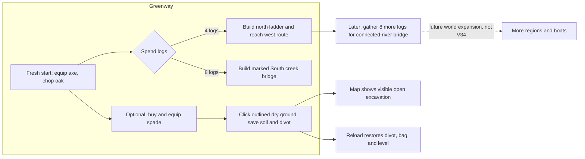
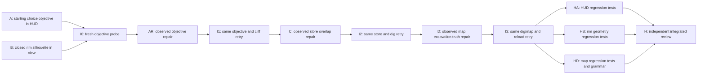

# Ticket Pack: V34 first-valley choice and cliff silhouette

Read `V34_FIRST_VALLEY_AFFORDANCE_UNDERSTANDING.md` first. V33's independent review was GO before V34 dispatched. The initial two implementation lanes had disjoint owners; C and D were added only after their respective real UI failures. This pack does not change checked world state.

## Summary

The first objective should explain an obvious tree-to-route choice before mining becomes the main task. The closed north cliff should always visibly rise above the high-side ground. V29 currently selects mining first in `WizardHud.tsx:226-236`. For default seed `wizard-realms`, `V26ValleyRimLayer.tsx` produces a closed center crest at y=2.943895 while nearby high ground is y=2.975318. The west return tested in V33 was visibly blocked, so this is a specific north-lip defect, not a reason to rewrite collision.

## Proposed Flow

This is the intended visible behavior, not an implementation dependency map. Checked world authority and save logic stay unchanged.

## Public Interfaces

- A changes only `games/wizard-realms/engine/src/view/WizardHud.tsx`. Use existing `projection.map.guidance`, `savedTerrainWorks`, bag/equipment, and store data. At a fresh V29 start, put the axe/tree/log-to-ladder-or-bridge choice ahead of mining-only instructions. Keep digging available as an optional path. Distinguish the optional nearby South creek bridge from the later connected-river bridge. Advance saved-stage text through the ladder/bridge, without contradicting V33 guide/backpack cues. Preserve pre-V29 and older Greenway behavior.
- B changes only `games/wizard-realms/engine/src/view/V26ValleyRimLayer.tsx`. Keep canonical endpoints, discovery gating, 1 m facet budget, and saved ladder aperture. For a closed rim with both adjacent cells revealed, every crest sample clears the higher adjacent ground. Do not alter collision, terrain height, discovery, or game state.
- AR is the observed one-sentence A repair after I0. C owns `view/WizardSurface.tsx` store-panel CSS only. D owns `view/WizardMap.tsx` map count presentation only. Their real UI evidence and predicates are in the tickets.
- No lane changes controller/runtime, store authority, strata, save schema, migrations, world generation, new dependencies, or user settings. An exact dig yield/depth toast requiring a runtime contract is a separate unit.
- Preserve the dirty worktree and untracked source. No commit, push, GitHub action, or additional renderer in implementer lanes.

## Lane Graph

Initial safe parallel width was two: A and B had disjoint file owners. I0 was the first real UI convergence, then AR, C, and D were conditional observed-failure repairs with serial, identical UI retries I1, I2, and I3. HA, HB, and HD were post-surface disjoint tests. Only one renderer was open at a time. No PR finisher was dispatched because no PR was requested.

## Topology Audit

- Productive initial lanes A and B were incomparable, file-disjoint implementation work. Maximum safe parallel width was two. C and D were conditional, screenshot-triggered repairs, not artificial parallel lanes. HA, HB, and HD were file-disjoint test work after the honest UI surface.
- Ownership: A and its AR continuation touched only `WizardHud.tsx`; B touched `V26ValleyRimLayer.tsx`; C touched `WizardSurface.tsx` CSS; D touched `WizardMap.tsx`. Their tests used existing corresponding test files. No checked simulation or save owner changed.
- UI evidence receipts I0, I1, I2, and I3 were serial discriminating probes in one renderer, not productive implementation lanes. They were closed between runs. H was an independent source/build decision gate, not counted as productive width.

| Serial edge | Consumed artifact or decision | Why concurrent execution was impossible |
| --- | --- | --- |
| A and B to I0 | Integrated HUD objective and closed-rim geometry revision | A real UI judgment needs both source changes loaded together. |
| I0 to AR | Screenshot of objective saying far bridge `or` ladder while guide says ladder `then` far bridge | The exact contradictory sentence was not known before the first visible probe. AR continued A's same file ownership. |
| AR to I1 | Revised sentence distinguishing South creek from connected river | Only the new objective can be retried against the original fresh-start path. |
| I1 to C | Screenshot and click timeout showing gait overlay intercepting Outfitters Close | The store hitbox failure arose only after the objective/cliff path advanced. |
| C to I2 | Store-specific stacking rule in `WizardSurface.tsx` | The same Close click must run against that CSS revision. |
| I2 to D | Dig screenshot with Soil ×1/divot and map screenshot falsely saying zero dug cells | The map discrepancy was exposed only after the store blocker was removed and digging succeeded. |
| D to I3 | V29 map branch using visible open columns | The same dig/map/reload route must run against the new label and count. |
| I3 to HA, HB, HD | `SURFACE_READY` receipt with saved dig, truthful map, and reload | The pack's test-writing gate intentionally follows a real honest surface. |
| HA, HB, HD to H | Focused regression receipts and integrated source revision | H checks their combined compatibility and build; one HA fixture type failure returned to the same HA owner before H retried. |

| Decision-bearing lane | Unknown and closure mode | New information or constraint | Stop condition and surprise trigger |
| --- | --- | --- | --- |
| I0 | Whether fresh objective and cliff read honestly; real UI probe | Found the `or` versus `then` route contradiction at four logs | Stop at first false route choice; unexpected authority change forces replan. |
| I1 | Whether the corrected choice and closed cliff work; identical UI retry | Choice and cliff passed, then Outfitters Close was intercepted | Stop at first blocked normal click; broader HUD collision forces a layout plan. |
| I2 | Whether store Close permits spade digging; identical UI retry | Close and dig passed, then map said zero despite Soil ×1 and divot | Stop at false saved-state display; missing projection field forces replan. |
| I3 | Whether V29 map count and saved dig survive reload; identical UI retry | One visible open column, Soil, level, spade, and divot persisted | Stop at first mismatch or after Resume proof; save corruption forces separate authority audit. |
| HA | Whether fresh/saved HUD copy and old version agree; focused assertions | Added route, optional dig, and legacy cases; repaired one test-only bridge fixture after build evidence | Stop on failing assertion or type error; production contract mismatch returns to A. |
| HB | Whether crest, aperture, reveal gating, and vertex bound coexist; pure geometry tests | Default center crest clears higher ground by 0.35 m, with old invariants retained | Stop on failed geometry; hidden-cell dependence forces view-contract replan. |
| HD | Whether V29 visible pit count and V26-V28 legacy count are distinct; focused map tests | Added one/zero pit and older dug-count cases, then singular copy | Stop on failed count or old-version regression; missing view field forces replan. |
| H | Whether the integrated slice compiles, builds, and avoids cross-surface regressions; read-only source and command review | Found a test-only fixture type error, then 51/51 tests, TypeScript, and build passed after HA repair | Stop on first build or contract failure; any production-owner mismatch triggers a new repair ticket. |

- Surprise handling is causal: each blocker was classified as the next observed owner, repaired there, then retried through the identical entrypoint. No speculative authority edits or second renderer were used.
- Packaging: no PR was requested, so no stack or GitHub finisher was dispatched. The local candidate unit remains in a broad dirty checkout and is not packaged.
- Dispatch verdict: PASS for the amended graph and receipts. The usable preview was exposed before exhaustive tests. This gate does not claim full-game completion.

### Smallest Viable Diff

Expected four production files after observed C/D, two or three existing focused test files, zero new runtime files. A may simplify the current V29 mining-priority branch rather than add another HUD panel. B may raise only the render crest from already-revealed neighbor heights, keeping aperture omission. C should prefer one store-panel stacking or hitbox rule over moving broad HUD layout. D should derive a truthful nearby open-pit count from `v26OpenPitColumns`, not pretend it is an all-world total. Tripwire: if any fix requires authority, snapshots, a new projection field, more than seven files, more than 300 net lines, or a second concurrent renderer, return to planner.

## Tickets

### V34-A, HUD implementer, pre-surface

Depends on V33 GO. File owner: `view/WizardHud.tsx` only. Required skills: auto-planner-ticket-pack, smallest-viable-diff. Role lock: implementer. Worktree `/private/tmp/pa-wizard-playable-v2`, branch `ben/wizard-playable-v2`, no commit/push. Existing-task routing only with recent-context proof, otherwise fresh native child. Transport must return actual dispatch receipt.

Shortest flow: fresh V29 player sees equip-axe/chop-tree and 4-log ladder versus 8-log bridge value, can still choose boots/spade, then saved route state advances. First-feedback evidence: source line 226 mining-first branch; V33-I fresh UI screenshot. Test writing prohibited until `SURFACE_READY`. Run `git diff --check` only. Return exact changed lines, old-version preservation, and UI uncertainty.

### V34-B, view implementer, pre-surface

Depends on V33 GO. File owner: `view/V26ValleyRimLayer.tsx` only. Required skills: auto-planner-ticket-pack, smallest-viable-diff. Role lock: implementer. Same branch/worktree/no Git writes. No browser. Reuse the existing revealed terrain heights to keep the closed crest visibly above the higher side at default center and other representative cells. Preserve ladder apertures, discovery gating, and geometry bounds. Run `git diff --check` and a cheap pure geometry numeric probe if possible, not a WebGL renderer. Return exact formula, x=0 result, and risk of high/low-side reveal changes.

### V34-I0, real UI reviewer, early smoke

Depends on A and B. Required skills: auto-planner-ticket-pack, smallest-viable-diff, test-from-ui, playwright. Role lock: read-only reviewer. One isolated browser at `http://127.0.0.1:5193/?publicWorld=v29`; never a second renderer. Fresh start, record first objective, equip axe, chop one nearby tree, compare the objective and expanded guide, then continue to the cliff/store/dig only while truthful. Stop at the first decision-bearing blocker. Record screenshot, exact text, position, console/network, and source hashes. Close browser and keep Vite live. I0 found the route-choice contradiction and did not claim readiness.

### V34-AR/I1, conditional objective repair and identical retry

AR is A's continued implementer lane after I0's screenshot `/private/tmp/wizard-v34i.DZr4Zr/.playwright-cli/page-2026-10-10T03-55-06-409Z.png`. It changes only the fresh V29 objective sentence in `WizardHud.tsx`, distinguishing the nearby South creek bridge from the later connected-river bridge. No tests/browser/commit/push; `git diff --check` is required. I1 is the same read-only one-renderer tester, using the identical fresh-start route against AR. Its receipt passed objective/cliff and found the store Close hitbox. Stop at the first blocker, close browser, keep Vite live.

### V34-HA/HB, post-surface regression implementers

After I3, HA owns only `view/WizardHud.test.ts`; HB owns only `view/V26ValleyRimLayer.test.ts`; HD owns only `view/WizardMap.tsx` singular copy and `view/WizardMap.test.ts`. Required skills: auto-planner-ticket-pack and smallest-viable-diff. Add assertions for fresh V29 choice and saved-stage/older-version preservation (HA), crest-above-both-sides plus open aperture and vertex budget (HB), and V29 pit count versus historical dug cells (HD). Run focused Vitest and `git diff --check`. One HA test-only fixture type mismatch was repaired in the same lane after H's build failure. No browser or production edit absent an observed-failure repair request.

### V34-C/I2, observed store fast path

C depends on I1's blocked-store screenshot and owns only `view/WizardSurface.tsx` CSS. Role lock implementer; required skills auto-planner-ticket-pack and smallest-viable-diff. The Walk/Run overlay intercepts Outfitters Close at the live 1280 x 720 viewport. Make the Close hit target usable without disabling pace or moving unrelated panels. No browser, tests, action code, commit, or push. Run `git diff --check`. Return observed error, smallest layout rule, restart/HMR, and pending retry.

I2 is the same read-only one-renderer UI reviewer after C. Repeat fresh entrypoint, buy/equip spade, close Outfitters by normal click, dig a nearby revealed dry cell, and inspect the map. It found the map zero-count contradiction after successful Soil/divot proof. Stop at first blocker, close browser, leave Vite live.

### V34-D/I3, observed map-truth fast path

D depends on I2's dig plus zero-count screenshot and owns only `view/WizardMap.tsx` before surface. Role lock implementer, required skills auto-planner-ticket-pack and smallest-viable-diff. Reuse `v26OpenPitColumns` if it captures V29's visible open pits. The map must say a truthful scoped count, such as visible open pit columns, without changing legacy historical `dugTileIds` semantics. No new projection field, action code, browser, test before surface, commit, or push. Run `git diff --check` and report exact branch behavior.

I3 is the same UI reviewer in one fresh isolated browser after D. Repeat buy/equip spade, normal store Close, nearby dry-cell dig, expanded map, then save/reload if the run remains healthy. Show Soil/divot against truthful map count. Close browser, Vite live. Only I3 may mark `SURFACE_READY` for the integrated V34 journey, and it did so with a saved Resume receipt.

### V34-H, independent finisher

After HA/HB/HD, reviewer role, read-only, no browser. Run focused Vitest, TypeScript, build, and diff checks. Review A/B/C/D for contradiction, discovered-cell leakage, store hitbox scope, historical map copy, and scope drift. Return GO/NO-GO and residual UI unknowns. The first build found only an HA fixture type mismatch, which returned to HA; the current-tree 51 tests, TypeScript, and build then passed. No PR/GitHub write.

## Assumptions

- The V29 preview remains local at port 5193 during this pack; no deployment or production authority is inferred.
- The V26 revealed open-pit projection is the truthful scoped count for visible V29 excavation. It is not presented as a global total.
- The already dirty and partly untracked checkout belongs to the user. These scoped edits are not independently packaged or committed in this pack.
- Numeric dig depth, deeper minerals, traps, return-home UI, and the full 2 km campaign remain separate goal work, not hidden V34 completion claims.
