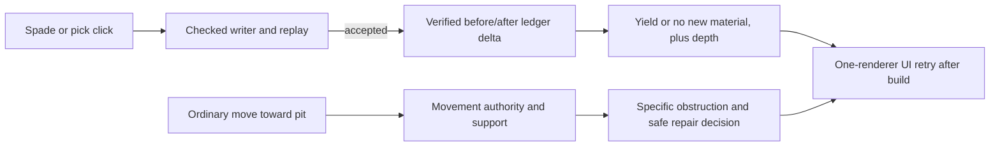
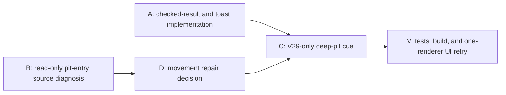

# Ticket Pack: V35 checked excavation feedback and pit-entry diagnosis

## Summary

Give the player the actual saved material and depth after a successful V29 dig, instead of telling them to inspect a bag. In parallel, diagnose the exact UI obstruction that kept the player from entering a three-layer pit. Do not change pit movement from a screenshot alone.

## Proposed Flow

The dig toast consumes only committed, verified state. The pit-entry track is diagnosis first, not a preapproved movement rewrite.

## Public Interfaces

- `createPublicV29ControllerRuntime().action` may add a V29-only, ephemeral `digOutcome` to a **saved** return for `deep-dig` and inherited `terrain-action/v1` `dig`: `{ material: 'soil' | 'stone' | 'iron_ore' | 'gold_ore' | 'diamond' | null; depthLayers: number }`. It is derived after `checkedReply` from before/committed ledgers. No witness, save, schema, migration, or older runtime result changes.
- `PublicV23Controller.tsx` may format that optional verified outcome. A null material means the pit deepened without a new yield after fill/re-dig; it must not say a resource was found. Numeric depth is `depthLayers * 0.4` meters. If no verified outcome is present, retain generic saved copy.
- V29 existing authority remains owner of movement and trap safety. The source audit must distinguish layer-drop rejection, water/rock obstruction, target alignment, and replay mismatch before proposing a change.
- Preserve one WebGL renderer maximum and leave the Vite preview live at `http://127.0.0.1:5193/?publicWorld=v29`.

## Lane Graph

## Topology Audit

- A and B are independent productive lanes. A changes only the result/feedback contract; B reads movement authority and does not touch source or use a browser. They ran concurrently. D chose an explanatory cue, not a V29 movement-authority change. C is serial after A and B because it touches A's runtime owner and consumes B's classification. V cannot call a direct three-layer pit entry fixed: that remains intentionally blocked pending a versioned fall contract.
- The maximum safe width is two. A code/test owner may run focused checks while B audits source. No PR or GitHub action is in scope.

| Serial edge | Consumed artifact | Why serial |
| --- | --- | --- |
| V35-A evidence to A | Checked ledger delta contract | The toast must not infer material from appearance or raw coordinates. |
| V35-B UI to B | Exact column and failed movement state | A generic failure is insufficient to choose a movement owner. |
| B to D | Authority trace and counterexample | Movement changes affect saves, replay, fall safety, and rescue. |
| A and D to V | Built feedback and pit-entry decision | Real UI retry needs the actual repair or an explicit unresolved blocker. |
| A and D to C | Shared V29 runtime owner and exact pit-only classification | Concurrent edits would collide, and a guessed cue could mislabel river/cliff obstruction. |
| C to V | Built cue and one-layer path | The real UI needs the implemented text and stable hot-reload state. |

| Lane | Certainty, expected information | Stop condition and surprise trigger |
| --- | --- | --- |
| A | High. Source trace showed a checked before/after ledger surface. Expect saved first soil, deeper stone, and no-yield re-dig feedback. | Stop after focused tests and type check. Any need to change schema or older action return triggers replan. |
| B | Medium. V35-B showed a blocked movement at depth three, but the exact edge cause is unknown. Expect an authority call chain and a minimal safe proposal. | Stop at causal owner or evidence that the UI step was misaligned. Do not edit. |
| V | Conditional. Feedback can be UI-checked; trap/rescue is only tested if a safe movement repair is activated. | Stop at first new real UI blocker, record exact error, and use the observed-failure loop. |
| C | Medium. V29 may wrap the generic rejected move with a read-only counterfactual, without changing authority. | If exact pit causality cannot be proven cheaply and deterministically, preserve the generic cue and report a design blocker. |

## Tickets

### V35-A, checked dig outcome and honest toast

Role lock: implementer. Own only `PublicV29ControllerRuntime.ts`, `PublicV23Controller.tsx`, and their focused tests. Do not modify saves, witnesses, migrations, movement, map, assets, Git state, or browser. Worktree `/private/tmp/pa-wizard-playable-v2`, branch `ben/wizard-playable-v2`. For V29 successful dig actions, derive `digOutcome` only after accepted `checkedReply` by comparing the targeted column and material bag in captured pre-action progress with the committed head. Require open depth +1; allow either exactly one novel material bag increment with reward depth +1, or no bag/reward increment for re-dig. Keep missing/invalid delta as generic saved message, never manufacture a yield. Format actual material and numeric meters; keep V26-V28 unchanged. Cover first soil, deeper stone, fill/re-dig no yield, forged writer reply no outcome, and toast variants. Run focused Vitest, TypeScript, diff check. Return changed-file/validation receipt, no commit or push.

### V35-B, pit-entry source diagnosis

Role lock: reviewer. Read-only trace of the V35-B real UI obstruction for column `(0,1)` at depth three and player `x≈-2.1,z≈2.2,elevation≈1.0`. Determine whether stepping into this cell should be accepted or whether another surface/edge blocked it. Trace checked movement and displayed rejection, note concrete safe change and regression if actionable. No edits, builds, browser, commit, or push.

### V35-D, movement decision

Source diagnosis found that V29 inherits V27's checked 0.55 m pit-edge step cap. Three layers mean a 1.2 m drop, so direct entry is intentionally rejected. A saved pit ladder cannot be installed from outside; its action requires the player already in the column. The primary agent chooses the smaller, compatibility-safe response: preserve authority and add a V29-only cue that truthfully identifies this deep saved pit and guides the player to Fill until one layer, enter, then deepen from inside. A direct 1.2 m fall would need a separately versioned V29 movement and animation contract, with replay compatibility proof.

### V35-C, V29-only causal deep-pit cue

Role lock: implementer, after A. Own only `PublicV29ControllerRuntime.ts` and its focused tests, plus a small V23 copy test only if needed. A rejected single-move frame may replace V28's generic `terrain_missing` cue only when the exact from/to step enters a saved open column of depth at least two, no saved pit ladder applies, and replaying that same move against a read-only V28 preview copy with only the target `openDepth` set to one succeeds. Preserve north-ladder guided input semantics or conservatively skip guided frames. Do not mutate committed/preview/witness/saved state, do not double-advance the live core, do not change V26-V28, and avoid repeated expensive counterfactual replay on held keys. If exact causal classification is not safely available from the runtime boundary, stop and report rather than approximate. Cue must distinguish enough carried soil from missing soil and must not promise Fill if other checks fail. Test deep pit vs ordinary cliff/river, missing soil, existing pit ladder, unchanged V28, and identical real movement authority. No browser, commit, or push.

### V35-V, integration and real UI retry

After C, run focused tests, TypeScript, production build, and the same visible V29 flow with one renderer. Verify first yield and deeper yield toasts, the truthful three-layer blocked cue, and then an ordinary fresh one-layer entry followed by own-cell deepening. If a genuinely trapped state is reached, try pit ladder, return-home, cooldown, and reload through visible controls. Stop at the first new blocker rather than forcing a favorable result. Close browser afterward, keep preview live. Report `observed error | change | restart | retry result | next action` for each grounded repair.

## Assumptions

- V34's 51 passing focused tests, typecheck, build, and real UI first dig/resume are baseline evidence, not proof of the full game.
- The V35-B blocked step is not yet classified as a universal pit-entry bug. The exact movement intent and edge may matter.
- The full RPG goal remains active. This ticket is one small gameplay-feedback repair, not completion.

## Receipts to date

- V35-A finished in four scoped source/test files. The saved V29 dig return now carries an ephemeral before/committed-ledger `digOutcome`; the V29 toast names yielded material or no new material and reports depth at 0.4 m per layer. Focused tests passed 67/67, TypeScript passed, and whitespace checks were clean. No save, witness, movement, browser, commit, or push change occurred.
- V35-B confirmed the depth-three pit is a 1.2 m drop rejected by the inherited checked 0.55 m pit step cap. One-layer entry and own-cell deepening are source-legal, not yet UI-proven. The read-only source lane proposed a V29-only counterfactual classification so the cue cannot mislabel an ordinary cliff, rim, or river rejection.
- V35-D selected the cue and ordinary shallow-entry path as the immediate compatibility-safe repair. Direct deep-pit falling and the full trapped/rescue journey remain unresolved until real UI proof.
- V35-C implementation receipt: the V29 runtime leaves movement authority unchanged and replaces only a generic rejected move when the saved deep-pit target is the deciding difference under a read-only depth-one replay. It accounts for soil/spade state and caches repeated held-key checks with pose in the key. Focused V29/V28 runtime tests passed 21/21, TypeScript passed, and whitespace checks were clean. The first test used a 0.2 m barefoot step and failed under the independent gait rule; reducing only that synthetic step to a legal 0.1 m yielded a successful causal counterfactual. The real UI retry remains pending.
- Independent V35 review: GO for the scoped code and automated gates. Four focused files, 83 tests passed; TypeScript and the production build passed. The build reported only its existing >500 kB chunk advisory. The reviewer found no save/replay bypass, older-version result change, or in-scope scope creep. This is not UI proof.
- First V35 real UI retry: fresh purchase of field spade and basic pick succeeded. The first spade dig on dry column `(0,1)` showed `Found soil. Depth 0.4 m`, Soil x1, Excavation Lv2, and a shallow divot. The tester then missed the cell while pivoting and stopped at visible map coordinates `x=2.2,z=1.4`, outside that cell (`x<=2,z>2`), without a movement rejection. Therefore shallow entry, own-cell deepening, and rescue remain unproven, not failed. The browser was closed and Vite remained live. A narrow saved-position visible-controls retry and an independent exact-seed checked regression are the next evidence steps; neither may seed browser state or alter movement authority.
- Narrow V35 UI retry: reopening the same isolated browser session did not retain its prior saved world and offered only `Start new V29 world`, so the tester stopped without recreating the setup or injecting state. This is a test-profile limitation until separately reproduced in a durable user browser; it is not evidence that the game's save/resume is broken. The preview still answered HTTP 200 and no renderer was left open.
- Exact-seed checked regression: at default `wizard-realms` seed, checked spade Dig produced one saved layer at `(0,1)`; a legal 0.1 m move crossed its edge without rejection and put effective floor 0.4 m below carrier; the move saved; a second spade Dig from inside saved depth two. V29/V28 replay agreed. Focused V29/V28 tests passed 22/22, TypeScript and whitespace checks passed. This is stronger authority proof for shallow entry and own-cell deepening, but it is not an intuitive-controls UI pass, nor rescue/cooldown UI proof.
