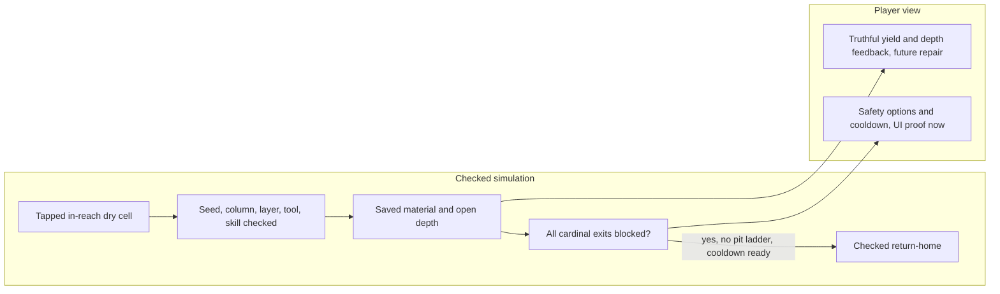
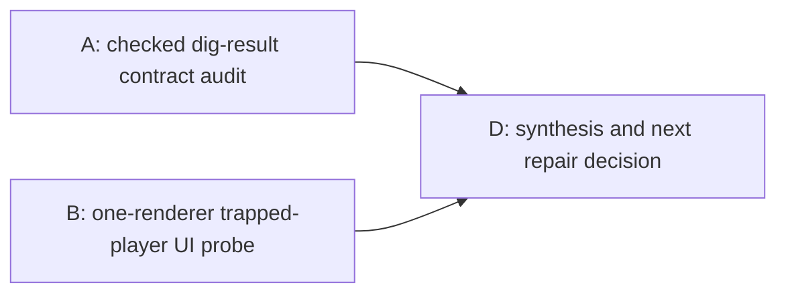

# Ticket Pack: V35 excavation and rescue evidence

## Summary

Before changing the checked dig response or rescue UI, prove the exact current contracts. The V34 first soil dig and reload passed, but the success message omitted material and depth, and a genuinely trapped player has not been exercised from the UI. This pack produces two independent, decision-bearing evidence receipts. It makes no code or save change.

## Proposed Flow

The chart is intended behavior. The UI lane may reveal a blocker before reaching Home. No future repair is authorized by this evidence-only pack.

## Public Interfaces

- V29 `deep-dig` action and `PublicV29ControllerRuntime.action` return are read, not changed. A identifies the smallest checked result surface available for a future toast and any type/test implications.
- V26/V29 pit, pit ladder, and return-home authority are read, not changed. B uses only visible game controls, never state injection.
- UI entrypoint is `http://127.0.0.1:5193/?publicWorld=v29`. One isolated browser renderer is allowed for B; A opens none. Preserve Vite, dirty worktree, and all user files.

## Lane Graph

## Topology Audit

- A and B are independent productive evidence lanes with different concerns, source methods, and artifacts. A can audit deterministic return/result types while B plays the current game. They may run concurrently because A does not edit code or use a renderer.
- Maximum safe parallel width is two. D is a decision node, not a productive lane. No PR finisher or GitHub action is requested.

| Serial edge | Consumed artifact | Why it cannot run concurrently |
| --- | --- | --- |
| A to D | Source/type trace and smallest checked result contract | A future repair decision cannot choose a safe owner or interface before the result path is known. |
| B to D | First real UI blocker or complete trap/rescue/cooldown receipt | The repair priority depends on whether the current flow is reachable and what actually fails. |

| Evidence lane | Unknown and closure mode | New information expected | Stop condition and surprise trigger |
| --- | --- | --- | --- |
| A | Can a saved V29 deep-dig return true material and depth without new authority or migration? Read-only source and type trace. | Exact before/after fields, candidate owner, type/test impact, no-yield case, and smallest viable diff. | Stop when one safe contract or proof it needs a larger design is established; cross-version return shape or save mutation triggers replan. |
| B | Can a fresh player dig two layers, become provably trapped, see safety options, return home once, and observe cooldown? One real browser journey. | Exact visible steps, screenshot, position, saved state, first blocker or success, console/network. | Stop at first decision-bearing UI blocker or after reload/cooldown proof; unsafe state manipulation or second renderer is forbidden. |

- D compares A and B, records a repair activation manifest, and creates a separate implementation ticket pack if and only if an actionable in-scope change remains. D does not silently patch production code.
- Dispatch verdict: PASS. Evidence can run in parallel and the UI remains available to the user while the probe runs in one isolated browser.

## Tickets

### V35-A, read-only checked-result audit

Role lock: reviewer, no edits, builds, browser, renderer, commit, or push. Worktree `/private/tmp/pa-wizard-playable-v2`, branch `ben/wizard-playable-v2`. Required skills: auto-planner-ticket-pack, smallest-viable-diff. Trace `applyPublicV29DeepDig`, V29 runtime checked write and return, V23 controller toast, terrain column/bag projection. Distinguish material yield from a no-yield depth increment and classify whether a post-save before/after delta is sufficient. Give exact source lines, proposed smallest owner, return type risks, and focused regression targets. Return one source-contract receipt, not a patch.

### V35-B, read-only real UI trap probe

Role lock: reviewer, no edits, direct seeding, browser devtools state writes, commit, or push. Required skills: auto-planner-ticket-pack, smallest-viable-diff, test-from-ui, playwright. Use one isolated browser at the V29 URL, fresh visible start. Buy/equip spade, dig the first in-reach dry cell, buy/equip basic pick for a second layer, and attempt to enter/dig the same pit until the safety condition can be observed. Try an ordinary escape first; if genuinely trapped, inspect pit-ladder and return-home options, use return-home through visible controls, then inspect cooldown and reload if healthy. Stop at the first decision-bearing blocker, not an exhaustive hunt for favorable geology. Record screenshots, exact actions/cues/position, save state, console/network. Close browser and leave Vite live.

### V35-D, evidence synthesis and repair activation

Primary agent only after A and B receipts. Classify each requested behavior as proved, blocked, or source-only. Write a bounded implementation contract for immediate yield/depth feedback or a specific observed UI blocker, with safe ownership, migration stance, one-renderer retry, and focused tests. No code or Git action in D.

## Assumptions

- The V34 surface/build GO remains the working baseline; this pack does not revalidate all V34 code.
- A second layer may require the basic pick and adequate Excavation level. If checked geology refuses it, B reports the exact rejection rather than forcing progress.
- A trap is not inferred from a visual pit alone. The authoritative return-home gate is the deciding test.
- The full Wizard Realms goal remains active and is not complete when this evidence pack finishes.

## Evidence receipts and decision

- V35-A source receipt: the checked V29 writer reply is compared against replayed progress before it becomes committed state. A V29-only ephemeral result can derive the accepted column's new `openDepth` and the exact bag/material delta from the verified saved ledger. This also distinguishes a deeper no-yield re-dig after filling from a newly rewarded layer. The smallest future owner is `PublicV29ControllerRuntime.ts`, then the `PublicV23Controller.tsx` toast. No save schema or witness change is needed. This is source evidence, not UI proof.
- V35-B real UI receipt: a fresh V29 player bought a field spade and basic pick with visible controls, dug column `(0, 1)` twice with the spade for Soil x2 and Excavation Lv3, then used the equipped pick on that same column for Stone x1 and Excavation Lv4. The pit visibly deepened. A subsequent ordinary movement attempt from outside at approximately `x=-2.1,z=2.2,elevation=1.0` did not advance, and the UI displayed the generic no-supported-route cue. [Captured UI](/private/tmp/wizard-v35b.scsJ3n/.playwright-cli/page-2026-10-10T04-19-24-414Z.png). Pit entry, actual trapped state, pit ladder, return-home, and cooldown remain unproven. This single obstruction may be the deep step, the specific edge, or targeting/alignment; the evidence does not distinguish them yet.
- Activation decision: run a narrow, read-only authority/geometry diagnosis for that exact movement before any pit-entry repair. Independently, the checked yield/depth feedback contract is safe to implement as an ephemeral V29 result. Retest the same visible input after a grounded movement repair, then exercise rescue and cooldown only if a genuinely trapped state is reachable. Do not claim the whole excavation/rescue flow works from the dig success alone.
- Follow-up source diagnosis: a saved three-layer column is 1.2 m below its carrier floor. V29 frame replay delegates through V28/V27, whose checked pit transition rejects height changes above 0.55 m unless a saved pit ladder spans the edge. The V28 controller maps that rejection to the generic supported-route cue. The target `(0, 1)` is dry and away from the closed valley rim, so this fall gate is sufficient to explain the observed stop, although the precise attempted movement delta was not captured. A pit ladder itself requires the player already inside the column. The immediate decision is to keep older movement authority unchanged, make this obstacle legible in V29, and verify the intended one-layer-entry-then-deepen path from visible controls. Allowing a direct 1.2 m fall needs a separate versioned movement/animation/replay compatibility design, not a local threshold relaxation.
