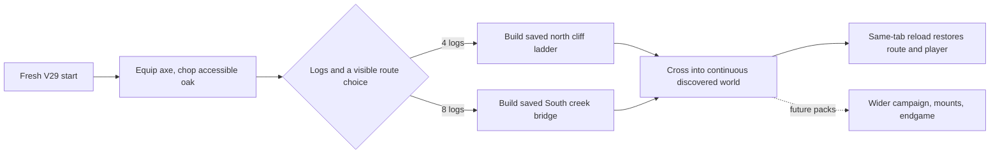
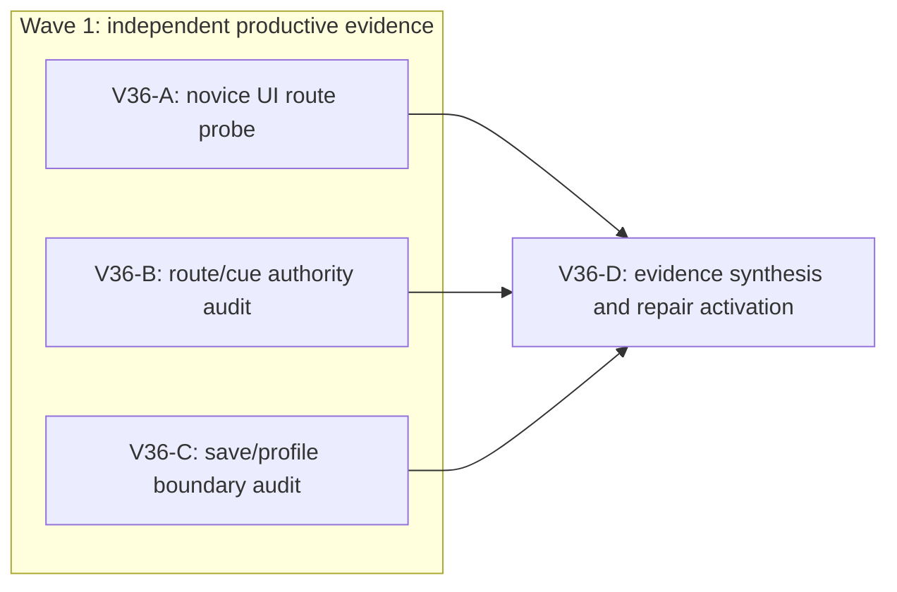

# Ticket Pack: V36 first-valley novice journey evidence

Read `V36_FIRST_VALLEY_JOURNEY_UNDERSTANDING.md` first. This pack is read-only and produces the first decision-bearing observation before any new repair. The standing full-game goal remains active.

## Summary

The next user-facing unknown is whether the starting valley teaches and permits its tree-to-route progression. Use one real browser journey, plus independent source traces of route authority and save ownership, to distinguish a product blocker from a control-alignment mistake or isolated-browser profile loss. No production edit is authorized by this pack.

Locked design:

- A visible cliff or river may be a meaningful obstacle, but a blocked step must have a truthful, useful route to progress.
- One connected world persists across discovery boundaries. No teleporting replacement tiles or source-only test shortcuts count as player proof.
- Preserve current checked V29 action and save authority until an exact failure identifies an owner.

Important repo truth:

- V35's first real Dig showed `Found soil. Depth 0.4 m`; exact-seed checked tests prove legal shallow entry and own-cell second Dig. The UI did not reach that cell, so rescue remains unproven.
- V34's live first-valley flow found and repaired contradictory route copy, a store Close hitbox, and a map count. Its current `SURFACE_READY` evidence is for Dig and reload, not the full ladder/bridge journey.

## Proposed Flow

The diagram is target behavior, not evidence that the UI already passes.

## Public Interfaces

- Entry point: `http://127.0.0.1:5193/?publicWorld=v29`. Keep it live; use one isolated browser renderer at a time.
- The UI lane uses only rendered controls, keyboard/mouse input, visible map, and browser reload. No direct localStorage/IndexedDB writes, save injection, teleport, or source-derived coordinates.
- Source lanes read current `games/wizard-realms/engine/src` only. They do not alter action/witness schemas, migration, run state, or browser state.
- Evidence output is a screenshot set and exact first-blocker receipt, a route-authority trace, and a persistence-boundary trace. The decision node maps these to a bounded repair pack if necessary.

## Lane Graph

## Topology Audit

- Productive lanes: A provides a real user-flow observation; B provides an independent route/cue authority trace; C provides a save and browser-profile contract trace. They own distinct concerns, require no upstream artifact from each other, and can run in the same wave. A alone uses the renderer; B and C are read-only source lanes.
- Maximum safe parallel width is three. `A || B`, `A || C`, and `B || C` are incomparable. D is a synthesis decision, not a productive lane. No code reviewer or PR finisher is included because this pack makes no code or Git change.
- Coarse model: the visible tree-to-route choice is intended to work, while UI clarity and route crossing are unproven. A real blocked click/step is a surprise that focuses diagnosis; no blocker and a saved crossing closes this pack's UI unknown. Source disagreement with the UI is a surprise that requires a repair contract, not a silent acceptance.

| Serial edge | Exact artifact consumed | Why it cannot run concurrently |
| --- | --- | --- |
| A to D | First real UI blocker or saved crossing plus screenshot/health receipt | The repair choice depends on what a novice actually sees and does. |
| B to D | Route guidance/action/movement owner trace | D cannot safely identify a smallest repair owner from a screenshot alone. |
| C to D | Same-tab save contract and profile teardown classification | D must not confuse an isolated test profile reset with lost game state. |

| Evidence lane | Unknown and closure mode | New information, stop, surprise |
| --- | --- | --- |
| A | Does the opening route work without source hints? Discriminating UI probe. | First actual blocked step/click or one saved crossing; stop there. A misleading success banner or missing route is a surprise. |
| B | Which source owner governs hints, building, and crossing? Read-only reasoning plus targeted code trace. | Exact call chain, saved-witness boundary, and smallest owner; stop when route/cue mapping is decision-sufficient. Source rule inconsistent with UI is a surprise. |
| C | What does a normal reload prove versus browser teardown? Read-only source trace. | Storage owner, same-tab reload expectation, and isolated-profile caveat; stop when classification is sufficient. A non-durable product save path is a surprise. |

- Conditional repair graph: none activated in this pack. D must emit `activated_repairs`, `not_required_repairs`, `finding_to_ticket_mapping`, and `unmapped_findings`. Any activated repair requires a new bounded implementation pack. Dispatch verdict: PASS.

## Smallest Viable Diff

Behavior delta: none in this evidence pack. Expected changed files and net lines: zero production/test files, zero dependencies, zero new abstractions. Only these two planning documents may be changed by the primary planner. Reuse scan: inspect existing V23/V29 controller, HUD/map/Works, checked route actions, and save adapter before proposing code. Prompt/config/contract alternative: a clearer existing on-screen instruction may solve an apparent dead end without code; determine from the UI first. Deletion/simplification target: not applicable until a specific repair is activated. Validation: first real UI receipt and source contract traces. Tripwire: any production edit, second renderer, save manipulation, or new server requires replan.

## Tickets

### Paste now to: V36-A, read-only UI reviewer

- Role lock: `reviewer` ONLY under `auto-planner-ticket-pack`, `smallest-viable-diff`, `test-from-ui`, and `playwright`. No code, browser storage write, direct action dispatch, commit, push, or second renderer.
- Delivery phase: `user_flow_probe`; milestone: existing `SURFACE_READY`, new route journey unproven. Shortest flow: fresh V29 start, equip axe, chop visible oaks until the displayed log choice is actionable, choose the first obvious route (north ladder or South creek bridge), use normal Works controls, and attempt to traverse it. Stop at first decision-bearing blocker or one saved crossing. Do not use source coordinates or source-derived timing to coach the run.
- Worktree `/private/tmp/pa-wizard-playable-v2`; branch `ben/wizard-playable-v2`. Existing preview at port 5193. Start a single isolated browser, retain it during a same-tab reload if the route is saved, close it after evidence. Limit one renderer and avoid extra tabs. A 10-minute run that cannot determine a route is itself a novice-flow finding; capture what the screen did show.
- Required evidence: starting view, resource gain/guide state, Works state or first blocker, map position/cue, screenshot paths, URL, visible inputs, console/network, and same-tab reload only if route progression remains healthy. Distinguish interaction failure from simple misalignment. Report `observed error | change (none) | restart (none) | result | next action`.
- Certainty: unknown is novice completion versus first blocker; closure is the smallest real UI probe. Stop at first decision-bearing failure. Unexpected persistence or camera issue is a surprise. Browser profile teardown is not the game save test.
- Transport: `native_spawned_subagent` continued from dynamically discovered, recently capable idle child if available, otherwise fresh native child; model `inherited`; Cursor runtime `not_applicable`; existing durable-task routing `not_authorized`; final fallback `none`. No user-owned Codex task message. Native child receipt required; no nested workers. Validation environment is existing local Vite; environment repair authority `none`; one documented retry only if the preview is transiently unavailable.

### Paste now to: V36-B, read-only route authority reviewer

- Role lock: `reviewer` ONLY under `auto-planner-ticket-pack` and `smallest-viable-diff`. No code, test edits, browser, commit, or push.
- Trace fresh V29 axe/equip/chop log count, the 4-log north ladder and 8-log South creek bridge selection, checked action/witness save, visual guide, and actual crossing movement owner. Name exact files/functions, route preconditions, and the smallest owner for a failed first route. Do not send source hints to A before its first observation.
- Unknown: whether the UI objective and checked route rules map to a coherent starter choice. Closure: decision-sufficient source trace, not a general review. Surprise: a route is visually offered but cannot be saved/crossed under current rules.
- Worktree/branch as above. Transport `native_spawned_subagent`, model `inherited`, Cursor runtime `not_applicable`, existing durable-task routing `not_authorized`, fallback `none`. No renderer. Receipt: exact lines, behavioral trace, migration/safety boundary, no edits.

### Paste now to: V36-C, read-only persistence reviewer

- Role lock: `reviewer` ONLY under `auto-planner-ticket-pack` and `smallest-viable-diff`. No code, browser, commit, or push.
- Trace V29 local save on movement/action, same-tab reload and Resume, underlying browser storage, and the previous isolated test profile teardown behavior. Name what a product save failure would look like and what the prior lost test session does or does not prove. No environment repair.
- Unknown: product persistence versus isolated profile lifetime. Closure: source contract and one bounded non-browser check if needed. Surprise: save acknowledged while no durable storage write or reload path exists.
- Worktree/branch as above. Transport `native_spawned_subagent`, model `inherited`, Cursor runtime `not_applicable`, existing durable-task routing `not_authorized`, fallback `none`. No renderer. Receipt: exact files/lines, classification, no edits.

### Wait for A, B, C, then: V36-D primary synthesis

Consume the three receipts, classify each explicit journey step as UI-proven, source-only, contradicted, or untested. Emit `activated_repairs`, `not_required_repairs`, `finding_to_ticket_mapping`, and `unmapped_findings`. If an observed product blocker has a small in-scope owner, author a separate implementation pack and immediately repeat the same UI sequence after repair. If the evidence does not identify an actionable owner, run one bounded discriminating probe, not a broad rewrite. Do not mark the full RPG goal complete.

## Assumptions

- The existing preview is user-accessible and need not wait for this pack; `curl` returned HTTP 200 at dispatch preparation.
- The dirty worktree belongs to the user. Read-only lanes must not clean, stage, reset, or change it.
- A UI reviewer may report an honest failure; that is evidence, not a failed lane receipt.

## V36-D synthesis, 2026-10-10

The real novice UI route advanced: start, equip axe, chop one oak twice, receive four logs, choose and build the north ladder, then walk to the upper north shelf. The saved build spent four logs and granted 60 Construction XP. This is a genuine first-route success, not proof of the South creek bridge, the connected-river crossing, a same-tab reload, or pit rescue. UI screenshots are under `/private/tmp/wizard-v36a.OoWdmz/.playwright-cli/`, including `page-2026-10-10T05-05-28-367Z.png` (start), `page-2026-10-10T05-09-31-750Z.png` (Ready ghost), `page-2026-10-10T05-10-28-839Z.png` (saved build), and `page-2026-10-10T05-14-57-019Z.png` (upper shelf). The isolated browser was closed; the Vite preview remains available.

The novice needed expanded-map coordinates and two pivot corrections to align with the built rungs. Source comparison found the saved Greenway ladder's dry-foot marker around 1.75 m south of the first actual rung, while the movement alignment aid begins within 1.5 m of that rung. The checked 1.05 m ladder corridor and rendered rungs agree. A view-only marker move closer to the rung is a bounded UX improvement; widening the checked corridor would change saved geometry and historical replay, so it is not part of a small repair. The starter valley is about 14 m north-to-south between central cliff and river; its side rock returns and generic fallback rejection remain broader experience concerns, not UI-proven blockers in this run.

- `activated_repairs`: one view-only built Greenway ladder approach-marker alignment repair, with independent unit test and identical real-UI climb retry.
- `not_required_repairs`: axe ownership, chop reward, four-log ladder build authority, checked crossing movement, river continuity, Return Home timer, and save adapter. Source and/or UI evidence already supports these specific components; no schema or movement rewrite is justified here.
- `finding_to_ticket_mapping`: coordinate-hunting at a built ladder maps to a V37 scene-marker visual correction and regression test. Bridge, same-tab reload, and pit rescue map to separate future UI acceptance probes, not to speculative implementation edits.
- `unmapped_findings`: the HUD's text density and a possible generic blocked-step cue remain broad presentation issues. They need a focused observation before code changes. No console or network failure blocked the ladder route; the UI reviewer saw only a favicon 404 and Three.js clock deprecation warning.
