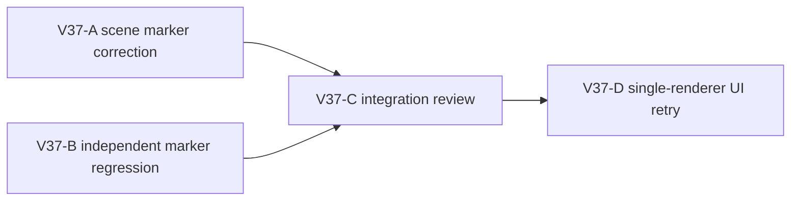

# Ticket Pack: V37 starter ladder approach marker

Read `V36_FIRST_VALLEY_JOURNEY_UNDERSTANDING.md` and the V36 evidence pack first. The active full-game goal remains unchanged. This is a small visual affordance repair, not a claim that the opening valley is finished.

## Summary

One authentic novice run reached the upper shelf by building the four-log Greenway north ladder. It needed expanded-map coordinates and two pivots to find the climb lane. Source inspection found the built ladder's dry-foot marker around 1.75 m from the actual lower rung, while the existing W-input alignment aid begins within 1.5 m. The rung mesh and checked 1.05 m corridor agree. Move only that presentation marker closer to the rung, test the geometry, and repeat the same UI route. Do not widen the checked ladder or change saves.

## Proposed Flow

## Public Interfaces

- Keep `terrainWorkApproachMarkers(works, terrain)` shape and existing non-Greenway output exactly. Only a committed `works4:ladder:greenway-north-cliff:*` may move.
- For that built site, center the dry-foot mark on the saved lower rung's X and approximately 0.4 m on the approach side of `site.supportPath[1].z`, around z -4.95 for the tested ladder. Keep it on the lower dry floor. The checked 1.05 m corridor, support path, build witness, and save schema are unchanged.
- One renderer maximum in the real UI; use the existing `http://127.0.0.1:5193/?publicWorld=v29` preview. No storage injection or source-derived positioning in the final novice retry.

## Lane Graph and Topology Audit

Two productive, incomparable lanes are safe in Wave 1. A owns only `engine/src/view/WizardScene.tsx`; B owns only `engine/src/view/WizardScene.test.ts`. B writes the externally observable marker-position contract from the locked interface above, not from A's implementation, so no serial edge is needed between them. Both feed C. D must wait for C so HMR does not disrupt the browser. A source reviewer already confirmed the geometry boundary and original novice UI run, so no speculative movement-authority lane is needed. No PR finisher is included because no PR was requested.

| Serial edge | Exact artifact consumed | Why it is serial |
| --- | --- | --- |
| A and B to C | Code diff and independently authored regression | The integration check must judge both together. |
| C to D | Tested, built view-only candidate | A live browser retry before code stabilizes would be invalid and could raise RAM use. |

| Lane | Unknown and closure | Stop or surprise |
| --- | --- | --- |
| A | Does the view-only branch put the mark within the existing alignment aid's range? Deterministic geometry change. | Stop after one scoped function edit. Any need to alter saved site or movement rules is a replan. |
| B | Does a test distinguish old z -3.6 from target near -4.95 and preserve other works? Independent test. | Stop after focused test file edit. If fixtures cannot express the site, report rather than broad refactor. |
| C | Do the independent changes cohere without schema or movement effects? Focused test, TypeScript, build, diff review. | Stop on pass or first actionable failure, using the short causal repair loop. |
| D | Does a novice climb without consulting coordinates after placing the ladder? Real early-smoke UI retry. | Stop at climb or first blocker; close browser. |

Dispatch verdict: PASS. A and B are parallel work on separate files and one fixed observable contract; C and D are necessary serial acceptance, not artificial parallelism.

## Smallest Viable Diff

Expected changed files: `WizardScene.tsx` and `WizardScene.test.ts`, no new files, no dependencies, no save or domain code. Reuse the existing `terrainWorkApproachMarkers` helper, saved support path, `TerrainWorkApproachMarker` view and current V29 preview. Net code budget under 35 lines, test budget under 50 lines. A config-only alternative is insufficient because the mark derives from saved per-site geometry; a source-only copy change cannot move it. Deletion/simplification: avoid any new routing abstraction or duplicate site math. Tripwires: changed historical/other works marker output, off-ground Y, widened collider, snapshot migration, or second renderer require replan. Validation: focused test, TypeScript, production build, identical novice UI route, visual screenshot.

## Tickets

### Paste now to V37-A, implementer ONLY

- Read the applicable auto-planner-ticket-pack and smallest-viable-diff skills completely, then this pack and V36 synthesis. Role: implementer only. Worktree `/private/tmp/pa-wizard-playable-v2`, branch `ben/wizard-playable-v2`; preserve all dirty files. Do not commit/push.
- Own only `games/wizard-realms/engine/src/view/WizardScene.tsx`. Move only the built Greenway north ladder dry-foot approach mark from the `site.from` offset to the saved first-rung X with about 0.4 m of lower-side approach clearance. Keep dry-floor Y, return shape and all other markers unchanged. No authority/schema/collision change.
- Report before/after position for tested site, changed lines, smallest-diff/reuse, `git diff --check`, any risk. No browser or tests beyond a focused code sanity check; B owns test file.
- Transport `native_spawned_subagent`, inherited model, one local worktree, no durable task, no Cursor, no nested worker. Current preview is already `SURFACE_READY`; your work is a visual improvement.

### Paste now to V37-B, independent test implementer ONLY

- Read the applicable auto-planner-ticket-pack and smallest-viable-diff skills completely, then this pack and V36 synthesis. Role: implementer only. Preserve dirty worktree. Do not commit/push.
- Own only `games/wizard-realms/engine/src/view/WizardScene.test.ts`. Add a focused regression for a built Greenway north ladder such that the approach mark X matches the lower rung, z is on the dry approach side roughly 0.4 m from it and within 1.5 m, and other existing bridge/regional/preview marker behavior remains unchanged. Use an existing compatible fixture and exported helper; no source edits.
- It may fail until A lands. Report expected red/green, changed lines, smallest-diff/reuse, `git diff --check`, any fixture risk. No browser.
- Transport `native_spawned_subagent`, inherited model, one local worktree, no durable task, no Cursor, no nested worker.

### Wait for A and B, then V37-C integration reviewer

Reviewer only, no edits unless a precise test-fixture integration failure is separately authorized. Run focused `WizardScene.test.ts`, `npx tsc -b --pretty false`, production build, `git diff --check`, and verify two-file scope. Classify pass/fail and exact first error. Use the observed-error loop for any failure. No renderer.

### Wait for C, then V37-D UI reviewer

Use test-from-ui and Playwright with one isolated renderer, fresh V29 world, no source coordinates or state injection. Equip axe, chop twice, select/build ladder, walk toward the now-visible approach mark and try W climb. Capture start, marker, upper shelf or first blocker, console/network. Close browser after proof; Vite remains live. A successful climb with no map coordinates is an improvement, not a full-game completion claim.

## Assumptions

- Current V36 screenshots and source trace reflect this checkout. The first UI journey is valid and the preview returned HTTP 200 at pack creation.
- The worktree is broadly dirty; all unrelated files are user-owned and untouched.
- The tested ladder is `works4:ladder:greenway-north-cliff:11`, but the marker branch must apply to every built Greenway north ladder site, not that exact ID only.

## V37-R observed UI revision

The first V37-D retry built and climbed the ladder without opening the expanded map. It still needed the same two pivot corrections as V36. More importantly, the new marker at z -4.95 was occluded by the rung foot from the initial built viewpoint, whereas the previous z -3.6 mark was visibly on open grass. This is not a validated UX improvement. Screenshot: `/private/tmp/wizard-v37d.Vp3BWH/.playwright-cli/page-2026-10-10T05-28-39-983Z.png`; one-step-nearer view: `page-2026-10-10T05-30-18-247Z.png`; upper shelf: `page-2026-10-10T05-31-38-697Z.png`.

Observed error | change | restart | retry result: marker hard to see at initial built viewpoint | first-rung-minus-0.4 m view placement | Vite HMR only | climb passed, usability same and marker visibility worse | revise one view placement and repeat identical fresh UI route.

Revised fixed interface for V37-R: place the built Works4 Greenway ladder ground marker about 0.2 m from `site.from` toward `site.supportPath[1]`, on the lower dry floor and at the lower rung's X. For the tested site this is around z -4.27, about 1.08 m from the first rung, inside the existing 1.5 m input-aid range and farther onto open grass than z -4.95. Keep all checked geometry, save, and non-Greenway markers unchanged. The goal is visibility from the built starting viewpoint plus usable approach, not a prettier numeric assertion. V37-A and B may edit only their originally owned files in parallel; C must rerun validation, then D repeats the same no-map browser route with one renderer. If the mark remains unclear or alignment still takes the same pivots, stop iterating marker positions and activate an interaction-model ticket instead.

## V37-R acceptance receipt

V37-R put the tested built marker at z -4.27, 0.27 m from the saved dry-foot start and 1.08 m from the first rung. The independent regression covers two Greenway ladder fixtures and preserves historical, bridge, and regional-preview marker behavior. Focused tests passed 59/59; TypeScript, production build, and `git diff --check` passed. The build's existing large-chunk warning is nonfatal.

The fresh, no-map UI retry showed the approach marker on the grass immediately after building. The player reached it with ordinary forward movement and then climbed to the upper shelf with one further W900 input and zero A/D pivot corrections. Compared with V36 and the first V37-D attempt, which each needed two pivot corrections, this is a genuine local usability improvement. Screenshots: built marker `/private/tmp/wizard-v37r.Rgx8pr/.playwright-cli/page-2026-10-10T05-42-20-800Z.png`; near marker `/private/tmp/wizard-v37r.Rgx8pr/.playwright-cli/page-2026-10-10T05-43-32-529Z.png`; upper shelf `/private/tmp/wizard-v37r.Rgx8pr/.playwright-cli/page-2026-10-10T05-44-50-597Z.png`. This proves only the first ladder route, not every cliff, river crossing, dig, rescue, or save reload journey.

Observed error | change | restart | retry result: first revised marker hidden under rung and two pivots still needed | moved only built Greenway approach marker onto lower grass, within existing aid radius | Vite HMR only | passed, visible marker and zero-pivot climb | next action: stop marker tuning and test the other first-valley interactions.
