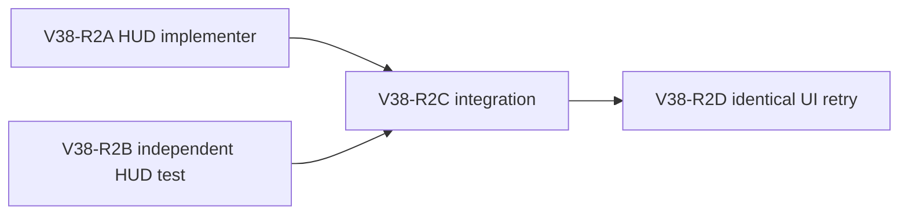

# Ticket Pack: V38-R2 South creek Bridge discovery cue

## Summary and observed failure

In a fresh V29 UI journey the player gathered eight logs, selected Bridge in Works, and encountered a disabled `Nearest discovered site`, no Confirm, and generic text to explore or manually aim. The source says the fresh reveal radius is 12 m while a legal creek bridge's far-bank footprint reaches z=16; eight logs alone cannot make the site discovered. The slider cannot override this checked rule. This is an observed novice dead end, not a construction-authority defect.

The behavior change is one V29-scoped, immediately visible Works cue: when Bridge is selected at the Greenway start and no discovered site is available, direct the player along dry ground toward the South creek to reveal both banks and explain that the marked crossing and Nearest control will then appear. State that the north cliff ladder is the first route west, so the optional creek bridge is not mistaken for the main westward exit. Do not claim a site is Ready before the full footprint is discovered.

## Fixed interface

- Input: V29 projection with Works4 Greenway, selected kind Bridge, no `nearestSuggestedWork`. Output: replace the generic `No discovered bridge site... or use the slider` note with concise directional South creek guidance. The note must be in the same immediately visible position as the prior one.
- Other version/owner/work-kind combinations retain exact prior behavior. Once a site is suggested, existing Nearest, preview and Confirm paths remain untouched.
- No change to discovery radius, site geometry, checked construction, bridge collider, movement witness, save schema, or legacy versions.
- UI proof is the identical fresh Start, axe equip, two oaks/eight logs, Works Bridge path, then follow only the new visible cue until a site appears or the next real blocker. One renderer, close it after proof.

## Lane graph and certainty

A and B own separate files and can work concurrently. C needs both diffs; D needs a built candidate. Maximum productive parallel width is two, with one renderer only in D. A source-only wording change is the smallest plausible observed repair; if UI retry still cannot find a crossing, stop copy tuning and replan an in-world near-bank affordance. No broad exploration refactor.

| Lane | Unknown and closure | Stop or surprise |
| --- | --- | --- |
| A | Can V29 Works4 show truthful directional copy without touching older projections? One bounded source edit. | Stop if state cannot identify Greenway Works4 safely; report needed interface. |
| B | Can a test discriminate fresh V29 8-log no-site cue from generic and preserve discovered-site behavior? Focused HUD test. | Stop if existing fixture cannot express it without broad rewrites. |
| C | Do source/test cohere with no authority change? Focused test, TypeScript, build, diff. | First actionable failure enters short causal loop. |
| D | Does a novice now know where to walk and reveal a marked bank? Identical UI entrypoint. | Stop at first new blocker or one saved crossing. |

## Smallest viable diff

Expected files `engine/src/view/WizardHud.tsx` and `engine/src/view/WizardHud.test.ts`, no new source, dependencies, domain changes, or save changes. Reuse `works4Greenway`, `savedWorks.selectedKind`, and `nearestSuggestedWork` already in the HUD. Source delta budget under 15 lines; test budget under 35. A config or prompt-only alternative cannot fix the runtime note. The generic note should remain for all other states rather than duplicating the whole Works panel. Validation: focused HUD tests, TypeScript, build, `git diff --check`, one UI retry. Existing large-chunk warning is nonfatal. Tripwires: saved state contract, target selection, bridge site candidate list, or world reveal behavior modified.

## V38-R2A implementer ticket

Read applicable auto-planner-ticket-pack and smallest-viable-diff skills completely, then this pack and V38 source/UI receipt. Role lock: implementer only. Own just `games/wizard-realms/engine/src/view/WizardHud.tsx` on `/private/tmp/pa-wizard-playable-v2`, branch `ben/wizard-playable-v2`; preserve all dirty files. In the existing note under `Nearest discovered site`, when V29 Works4 Greenway Bridge is selected and no site is suggested, explain that the player must walk south along dry ground toward South creek until both banks reveal, then the marked crossing/Nearest site appears; north cliff ladder is the first west route. Do not suggest slider bypasses discovery. Leave all other states and action callbacks unchanged. Report exact changed lines, before/after copy, scope, diff check. No test file, browser, commit, or push. Transport native continued `/root/v37_ladder_marker`, inherited model, no durable task/Cursor/nested worker.

## V38-R2B independent test ticket

Read applicable auto-planner-ticket-pack and smallest-viable-diff skills completely, then this pack. Role lock: test implementer only. Own just `games/wizard-realms/engine/src/view/WizardHud.test.ts`; preserve dirty files. Add a focused V29 Works4 Greenway Bridge/no-discovered-site case with eight logs that requires actionable South creek discovery guidance and rejects slider-as-solution copy. Check a discovered site still exposes Nearest/normal preview, and an older/non-Greenway state retains generic behavior. Reuse fixtures/helper; no production file, browser, commit, or push. The test may be red until A lands. Report changed lines and focused test/diff result. Transport native continued `/root/v37_ladder_test`, inherited model, no durable task/Cursor/nested worker.

## V38-R2C integration and D UI acceptance

After A and B, independent reviewer runs focused `WizardHud.test.ts`, `npx tsc -b --pretty false`, `npm run build`, `git diff --check`, reviews two-file scope and semantic gates, no edit. D then repeats V38-A fresh journey with one isolated renderer. The preview at 5193 is already HTTP 200. D stops at one saved crossing or first decision-bearing blocker; no source coordinates, state injection, or extra tab. Capture cue screenshot, subsequent marked site or blocker, console/network, and close renderer.

## Status

V38-R2A changed only the V29 Works4 Greenway Bridge no-site note. V38-R2B added independent focused HUD regressions for eight-log no-site guidance, unchanged action controls, enabled Nearest and normal preview after a discovered site, and older/non-Greenway fallback. V38-R2C independently verified 29/29 focused tests, TypeScript, production build, `git diff --check`, and unchanged checked route/action callbacks. Only the existing nonfatal large-chunk build warning appeared.

V38-R2D repeated the fresh UI path. The new cue appeared where the generic note had been. Following it south revealed a map ◇ and enabled Nearest; Nearest selected the creek Bridge 4.35 m away, one bounded move made the site `Ready: spend 8 logs`, and Confirm saved `works4:bridge:greenway-creek:0`. Eight logs were spent, 80 XP awarded, and a visible wooden deck appeared. Screenshots: new cue `/private/tmp/wizard-v38r2d.7wWZmZ/.playwright-cli/page-2026-10-10T06-12-37-500Z.png`; Ready `/private/tmp/wizard-v38r2d.7wWZmZ/.playwright-cli/page-2026-10-10T06-16-59-963Z.png`; saved deck `/private/tmp/wizard-v38r2d.7wWZmZ/.playwright-cli/page-2026-10-10T06-17-41-794Z.png`. The single renderer is closed. Console showed only favicon 404 and THREE.Clock deprecation; no non-static network requests. Physical deck crossing and same-tab reload remain untested.

Observed error | change | restart | retry result: eight logs but no discoverable bridge or actionable direction | V29-only directional Works note, no authority or geometry change | fresh isolated browser after Vite HMR | advanced through marked site, Ready, checked saved bridge | next action: bounded crossing and reload acceptance, plus separate spatial dig/rescue UI proof.

`activated_repairs`: none further from this specific failure; directional cue fixed the observed dead end. `not_required_repairs`: discovery-radius expansion, checked bridge rule, collider change, action/schema migration. `finding_to_ticket_mapping`: saved-deck physical traversal and same-tab reload need separate acceptance probes, not speculative production edits. `unmapped_findings`: none for this scoped bridge discovery step.
