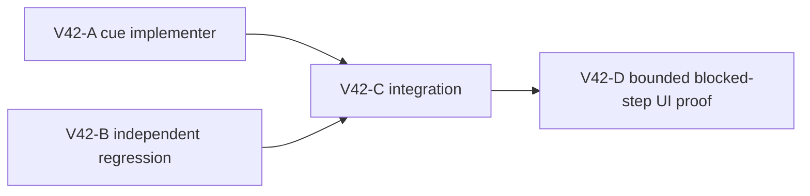

# Ticket Pack: V42 truthful dry-rise and wetland block cues

## Summary

The player reports stopping on visible terrain without understanding why. V41 source audit found a specific regression: V29 inherits V28's movement-rejection classifier, which recognizes world edge, connected river, north cliff and side rock return, but lacks V26's more specific ordinary dry-rise, slate-cliff, and non-river wetland classifications. Those steps can display the generic “no supported route” message. This pack restores precise **presentation-only** cause messages. It does not make a steep rise or wetland traversable.

## Fixed interface

For a rejected V28/V29 move, keep current edge, connected-river/deck, starter-cliff, side rock, and pit cue precedence. Before the final generic fallback, classify a non-river wetland/fen obstruction as unsupported wetland with a dry-ground/marked-crossing instruction, a slate cliff as a ladder/gentler-slope obstacle, and an ordinary dry terrain rise above the existing checked 0.8 m threshold as too steep with a gentler-slope/ladder instruction. Reuse V26's established predicates and wording where compatible. Do not claim a route or ladder is presently buildable without checked evidence. Earlier versions and saved-witness replay must remain unchanged.

Source owner: `games/wizard-realms/engine/src/PublicV28ControllerRuntime.ts` function `blockedMoveMessage`. Test owner: `games/wizard-realms/engine/src/PublicV28ControllerRuntime.test.ts` or existing V28/V29 test file with the smallest relevant fixture. V29 delegates to V28 and overrides only deep-pit messages, so focused V29 regression should prove inheritance if practical. No action schema, terrain generation, movement simulator, save, route geometry, discovery radius, or renderer change.

## Lane graph and certainty

A and B can run concurrently on separate files after V40's browser is closed. They must not edit while V40 is live because Vite HMR would invalidate that run. C needs both diffs; D needs a built candidate and one renderer. The UI step should be a natural reachable wetland or dry rise, not a hidden state-injected location. If no suitable obstacle can be reached within a short novice route, test/code evidence stands but UI is unproven; do not wander for long. Maximum productive width two, plus one later renderer.

| Lane | Unknown/closure | Stop or surprise |
| --- | --- | --- |
| A | Can V26's precise classification be restored in V28 without altering authoritative movement? Scoped runtime edit. | Stop if checked rule owners or old-version behavior must change. |
| B | Do exact rejected movement fixtures produce wetland/slate/dry-rise cue and keep river/cliff precedence? Focused tests. | Stop if fixture cannot express without broad source test harness rewrite. |
| C | Tests, TypeScript, build and diff pass; no authority/schema change. | Short causal loop for first failure. |
| D | A visible blocked step names its cause and next action. | Stop at first meaningful observation. |

## Smallest viable diff

Expected code/test files only: `PublicV28ControllerRuntime.ts` and one focused runtime test file. Reuse V26 classifier and existing imports instead of new utilities. Source delta target under 55 lines, test delta under 75. Config/copy-only cannot classify cause when the V28 owner omitted it. Deletion/simplification: no duplicate message mapping elsewhere. Tripwires: moving checked boundary, schema, broad generation edits, exposing unrevealed sites, second renderer. Validation: focused runtime tests, V29 inheritance test if available, TypeScript, build, `git diff --check`, one bounded UI attempt. Existing chunk-size warning is nonfatal.

## V42-A implementer ticket

Read auto-planner-ticket-pack and smallest-viable-diff skills completely and this pack. Role lock: implementer only. Own `games/wizard-realms/engine/src/PublicV28ControllerRuntime.ts` only. Worktree `/private/tmp/pa-wizard-playable-v2`, branch `ben/wizard-playable-v2`, dirty user files preserved. Add the minimum classification before generic fallback for non-river wetland/fen, slate cliff, and dry ordinary rise over 0.8 m using V26 source patterns. Preserve current cue precedence and all checked movement/saves. Report exact changed lines, semantic proof, diff check, no browser/commit/push. Transport native continued `/root/v37_ladder_marker`, inherited model, no durable task/Cursor/nested worker. **Do not begin source edit until primary confirms V40 browser is closed.**

## V42-B independent test ticket

Read auto-planner-ticket-pack and smallest-viable-diff skills completely and this pack. Role lock: independent test implementer only. Own one existing focused V28/V29 runtime test file, no production edit. Add deterministic rejected steps for dry rise and non-river wetland, and ensure river/cliff precedence and old saves stay intact. Exact message content may be checked semantically, not brittle punctuation. Test can be red before A lands. Report changed lines and result, no browser/commit/push. Transport native continued `/root/v37_ladder_test`, inherited model, no durable task/Cursor/nested worker. **Do not edit until V40 browser is closed.**

## V42-C and D

After A and B, independent reviewer `/root/v35_integration_review` runs focused runtime tests, TypeScript, build and diff check; examines two-file scope and unchanged authority. After GO, one UI reviewer may attempt an ordinary visible blocked-step journey and capture cause cue, stop quickly if no natural suitable obstacle. Preview remains live for user access.

## Status

V40-A closed its sole renderer, then V42-A and B edited their disjoint scoped files. V42-C independently reviewed the integrated change. World-edge, connected-river/deck, north-cliff, side-rock and pit cues still take precedence. Added wetland/fen, slate-cliff, and ordinary dry-rise cause messages run only after a rejected checked move, before the generic fallback. No movement, action, save, schema, or old-version authority changed.

New real-world deterministic tests prove authored fen and slate-cliff blocked moves leave preview and pending frames unchanged; existing river/cliff and V29 pit cases remain green. Focused V28 plus V29 tests passed 24/24, TypeScript and production build passed, and no-index whitespace checks covered the two untracked source/test files. The existing >500kB build warning is nonfatal. A generator scan found no reachable ordinary dry terrain rise above 0.8 m outside authored barriers, so that defensive branch is source-matched to V26 but not runtime-proven here. No browser acceptance has yet observed the new cue on a natural obstacle.

Observed error | change | restart | retry result: source-classified fen/slate steps fell through to generic no-route cue | restored V26-specific cause messages in V28 rejection presentation only | no runtime restart; focused runtime tests and build rerun | passed 24/24, build and TS passed, UI pending | next action: one bounded UI blocked-step probe after the prioritized far-bank/reload acceptance.

`activated_repairs`: none beyond this V42 cue restoration. `not_required_repairs`: checked terrain/replay and save changes. `finding_to_ticket_mapping`: temporary 3.5 s cue expiry and follower bedrock beyond finite edge remain separate visual-truth issues to assess after a real UI probe. `unmapped_findings`: no reachable ordinary dry-rise fixture in current generation; retain as an explicit coverage limitation.
