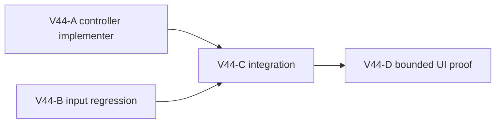

# Ticket Pack: V44 keep obstacle explanation visible during a held block

## Observed source defect and behavior contract

The player reports unexplained stops. V43 audit proved a centered obstacle cue is set for 3.5 seconds on the first rejected move, but an identical repeated rejection while W remains held does not renew it; the cue vanishes while the player is still blocked. `recentEvents` may retain the first message but is not always visible in compact/Works layouts. The existing input test currently encodes this expiry. This repair changes presentation only: keep the centered cause visible while actual checked move rejections continue, without calling `tell` or adding duplicate event-log entries. On a successful move, clear it as before. Once rejection stops, allow expiry after the normal timeout. A fresh blocked press must still show the cue.

## Fixed interface and lane graph

Owner: `games/wizard-realms/engine/src/PublicV23Controller.tsx` at rejected-movement deduplication/timer. Test owner: `games/wizard-realms/engine/src/PublicV23ControllerInput.test.tsx` existing held-W test. Preserve all V23–V29 runtime/movement/save contracts, no witness or schema change, no new overlay or component. Keep the exact cause text from V42 and current cue precedence. A code implementer and independent test implementer own separate files concurrently only after V40-R's browser closes. Then integration reviewer runs focused input/runtime tests, TypeScript, build, diff check. UI proof is a bounded ordinary held-block attempt with one renderer later, not an excuse to wander or inject state.

Maximum productive width two; A and B are disjoint files. C is serial because it consumes both diffs. D is serial because browser/HMR stability matters. The UI run currently active is V40-R and must not be disrupted.

## Smallest viable diff

Expected two files, source delta under 12 lines and test delta under 35, no dependencies or new source files. Reuse `obstacleCueUntil`, `lastMovementRejection`, `setObstacleCue`, and the existing test clock. A config-only timeout increase would still expire during a long hold and is insufficient. Do not increase `tell` frequency or keep a stale cue after movement resumes. Tripwires: change to action/save authority, additional event entries, cue never expiring after release, old-version input breakage, second renderer. Validation: focused held-input test and controller tests, TypeScript, build, diff and no-index whitespace if needed, one bounded UI step when feasible.

## V44-A implementer ticket

Read auto-planner-ticket-pack and smallest-viable-diff skills completely, then this pack. Role lock: implementer only. Own `PublicV23Controller.tsx` only on `/private/tmp/pa-wizard-playable-v2`, branch `ben/wizard-playable-v2`; preserve dirty files. Renew the centered cue deadline on every actual identical movement rejection and restore the same cue if it expired, but do not call `tell` again or change movement/replay. Preserve success clear, fresh press, and V23–V29 behavior. Report exact lines, diff/whitespace, no browser/commit/push. Transport native continued `/root/v37_ladder_marker`, inherited model, no durable task/Cursor/nested worker. **Wait for primary's V40-R browser-closed confirmation before editing.**

## V44-B independent test ticket

Read auto-planner-ticket-pack and smallest-viable-diff skills completely, then this pack. Role lock: test implementer only. Own `PublicV23ControllerInput.test.tsx` only. Update existing held-W test to assert centered cue remains after 3.5 seconds of repeated *actual* rejections, event log not spammed, and cue later expires once rejections stop; keep success-clear/fresh-press coverage. No production file/browser/commit/push. May be red before A. Transport native continued `/root/v37_ladder_test`, inherited model, no durable task/Cursor/nested worker. **Wait for primary's V40-R browser-closed confirmation before editing.**

## V44-C/D

Independent reviewer `/root/v35_integration_review` validates the code/test pair and tests plus build after A/B. One later UI reviewer may prove the centered cue persists during a natural held block without source-coordinate coaching; stop if no suitable obstacle appears quickly. Do not use a second renderer. The existing Vite preview remains available to the user.

## Status

V40-R closed its sole renderer, then V44-A/B edited their scoped controller and input test files. V44-C independently reviewed the integrated behavior: each actual identical blocked move renews centered cue visibility; `tell` fires only for a new cause, a successful move clears the cue, release permits normal expiry, and a new press rearms it. Focused input tests passed 50/50; V23/V28/V29 runtime tests passed 40/40; TypeScript, production build, and no-index whitespace checks passed. The existing >500kB build warning is nonfatal. The two files are untracked in this broad dirty worktree, so ordinary Git diff is not sufficient; direct file review and no-index checks were used. No save, witness, schema, or checked movement code changed in the V44 scope. Browser proof of a long natural held block remains pending; V45's dig UI run is prioritized next.

Observed error | change | restart | retry result: centered cause cue expired after 3.5 s of still-rejected held W | renew visibility on each actual rejection without duplicate `tell` | no browser restart yet; focused tests/build rerun | tests and build passed, browser unproven | next action: bounded natural blocked-step UI probe when a suitable obstacle is reached.
