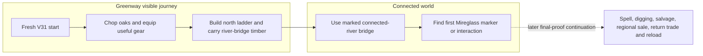
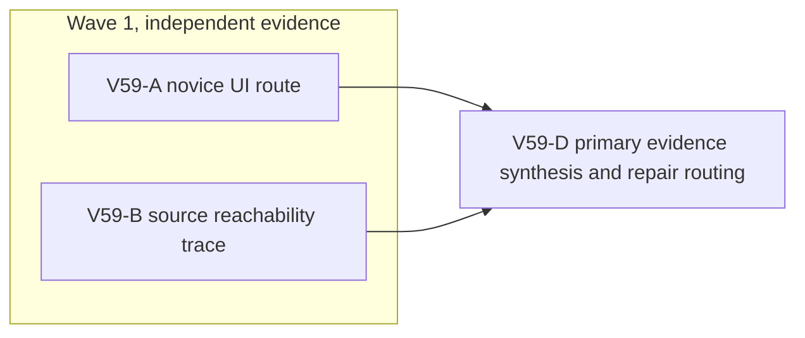

# Ticket Pack: V59 V31 first-region journey probe

## Summary

Find the first real obstacle between a fresh V31 Greenway start and the first Mireglass interaction. Pair a novice, visible-UI journey with a separate source-truth trace; use their fan-in to select a bounded repair or the longer outward-and-return proof. This pack follows `V59_V31_FIRST_REGION_JOURNEY_UNDERSTANDING.md` and does not claim the first region or full game complete.

Locked design:

- V31 source-pinned saves, movement, river, geology, routes, and older roots remain unchanged in this evidence pack.
- One isolated automated WebGL renderer maximum, closed after the UI receipt. Keep the local Vite preview live and user saves untouched.
- The novice tester gets no source-derived coordinates or state injection. The source reviewer does not coach that lane before its first result.
- First real blocker stops the early smoke. A source explanation does not substitute for visible UI proof.

Important repo truth:

- `/private/tmp/pa-wizard-playable-v2` is on `ben/wizard-playable-v2`, ahead of its remote by two commits and extensively dirty. All changes are preserved.
- `http://127.0.0.1:5193/?publicWorld=v31` returns HTTP 200. The prior local soil UI journey, 255 focused tests, and build pass do not prove a Greenway-to-Mireglass journey.
- `FIRST_EXPANDED_REGION_CONTENT.md` describes a complete earlier V7 fresh route, while `V30_FIRST_REGION_JOURNEY_UNDERSTANDING.md` records the current-profile evidence gap. Later guidance repairs address specific observed route copy, not the full path.

## Proposed Flow

The dashed continuation is deliberately outside this first-blocker probe. The full-game goal still requires it and more regions, mounts, boats, accessibility, recovery, performance, and endgame.

## Public Interfaces

- No schema, API, action, or projection interface changes are allowed in this evidence pack.
- Visible entrypoint: `http://127.0.0.1:5193/?publicWorld=v31`; first create is `Create V30 foundation and V31 copy`, later opens use `Resume V31 world` in that isolated profile.
- Player-facing controls include W/S move, A/D pivot, E interact, B Works, M map, visible inventory/equipment, and Store UI. Use the labels actually rendered if they differ.
- Evidence artifacts are screenshot paths, exact URL/input sequence, visible messages, console issues, source file/line references, and a synthesis decision. Do not mutate product state outside the isolated test browser.

## Lane Graph

Runnable wave 1 has two incomparable productive evidence lanes. A tests what a newcomer can actually infer; B traces what the current authority intends. D consumes both and decides the next pack or one bounded observed-failure owner. There is no serial source-to-UI coaching edge.

## Topology Audit

- Productive-lane inventory: V59-A owns the first visible V31 path and screenshot/console receipt; V59-B owns the independent current-source route and save/gate trace. Both yield distinct decision-bearing evidence.
- Maximum parallel width: 2. V59-A and V59-B share no files or renderer. V59-B reads source only and sends no instructions to A before A's first result.
- Incomparable pair: A || B; neither needs the other's result. Fan-in: D compares observed UI with intended reachable path.
- Broad-lane split: A stops at the first meaningful blocker or first Mireglass interaction. B traces reachability and first-region systems without testing the UI or editing code. No catch-all implementation lane.
- Certainty/novelty: A discriminates playable route versus actual dead end using visible controls. B closes whether the same route is intended and where authority, resource, and save gates reside. D does not repeat either probe.
- Surprise/escalation: if V31 fails source validation, has no compatible Mireglass path, or the UI hits a misleading collision, D returns to Planner mode for a bounded compatibility or route repair. If A reaches the first marker, D schedules full outward-and-return final proof rather than declaring completion.
- Conditional activation: no repair ticket is preactivated because the defect owner is not yet known. D can use observed failure fast path only if one small owner is unambiguous and in scope; architecture, migration, or ownership changes require a new pack.
- Reviewer omission: A and B are independent read-only evidence owners; no duplicate generic reviewer adds new information. PR finisher omission: no PR or packaging action is requested.

| Serial edge | Consumed evidence | Why concurrent execution is impossible |
|---|---|---|
| A to D | Actual novice journey and first blocker or marker | D cannot classify unseen behavior. |
| B to D | Current-source route and save truth | D needs authority context to select a safe owner. |

Dispatch verdict: PASS. Both evidence lanes can start now; one renderer only.

## Smallest Viable Diff

Behavior delta: none in this evidence pack. Expected files changed: two planning documents only, zero production/test/config files, zero dependencies. Reuse the existing V31 preview and Playwright CLI. A documentation-only response cannot prove the visible route, so the browser probe is necessary. Deletion/simplification is not applicable to read-only evidence. `git diff --check` is the file-hygiene gate. Any product edit, new save, migration, dependency, or extra renderer is a tripwire and requires a scoped repair decision.

## Tickets

Paste now to: V59-A UI Reviewer
Ticket: V59-A
Lane type: Parallel
Delivery phase: user_flow_probe
Delivery milestone: pre_surface for this first-region journey; existing V31 preview stays available
Shortest complete user flow: fresh V31 start, follow visible Greenway guidance, gather enough timber, build/use a north route and connected-river bridge, reach the first Mireglass marker or interaction, or stop at the first decision-bearing blocker
First-feedback evidence: actual V31 URL, exact controls/actions and visible messages, initial and blocker/milestone screenshots, console health, save/resume if safely reached
Test-writing policy: prohibited_until_pr_hardening
Review blocking classes: UI crash, unreasoned visible boundary, contradictory resource/route instruction, action rejected despite Ready cue, save failure
Validation environment: existing local Vite server on port 5193, one fresh isolated Playwright CLI browser profile
Environment repair authority: none
Environment stop condition: first confirmed external setup failure plus at most one documented retry
Surface readiness gate: correct V31 entry and an honest, playable first step; return any blocker as evidence, not a pass
Surface revision: current dirty `ben/wizard-playable-v2` checkout at dispatch; record timestamp and URL
Surface entrypoint: `http://127.0.0.1:5193/?publicWorld=v31`
Surface availability / validation isolation: do not disturb user storage; close the sole test browser at end, leave Vite live
Post-surface validation: D compares this UI result to B and routes repair or longer proof
Optional-feedback wait policy: never
Depends on: none

Branch: `ben/wizard-playable-v2`; worktree: `/private/tmp/pa-wizard-playable-v2`; base: current dirty checkout, no Git writes
Lane role: Reviewer
Dispatch transport: native_spawned_subagent; Model: inherited; Cursor runtime: not_applicable
Existing-task routing: no_qualified_candidate; existing-task capability/mission, task-coordination scope, custody, status, delivery policy: no current compatible idle task; previous children are completed under other role locks
No-interruption disposition: excluded_stale; task/thread receipt: not_applicable
Final fallback transport: none; fallback CLI/model/activation/availability/first contact/follow-up/session: not_applicable
Runtime selection rationale: a native child can run the one-renderer local UI journey with precise visible-state evidence and no external account or durable task
Agent spec: independent novice UI tester; session policy: initialize_once_then_continue; worker agent: native child
Required skills: auto-planner-ticket-pack, smallest-viable-diff, test-from-ui, playwright

Required behavior:
1. Read the required skills and this pack fully. Use `test-from-ui` in `early_smoke` mode. Check `npx` before Playwright CLI. Open exactly one headed browser session with fresh isolated storage, using `/Users/Benjamin.Fowlersmith/.codex/skills/playwright/scripts/playwright_cli.sh`; name the session `wizard-v59-first-region`.
2. Start from the actual V31 entry. Do not use source-derived coordinates, dev teleport, direct domain calls, synthetic saved state, or a second renderer. Follow visible in-game prompts. Stop at the first decision-bearing blocker. If a first Mireglass interaction is reached without blocker, stop there and report the milestone, not full completion.
3. Capture initial state, progress, and first blocker/milestone screenshots; record precise controls, position if shown by the map, visible text, console errors and failed requests if available. Reload/resume only if it will not obscure the first blocker. Close the browser and confirm HTTP 200 still holds.

Certainty contract: live branches are reachable/legible versus guidance/collision/action/save blocker; closure mode discriminating_probe; new information is the first actual UI result; stop at that result; surprise trigger is any browser error or land that appears passable but refuses movement without accurate cue.

Smallest viable diff: zero product files, zero net lines, zero dependencies. Reuse V31 and Playwright CLI. No source implementation or tests. Any edit or second renderer stops the lane.
Acceptance commands: `command -v npx`; `curl -sS -o /dev/null -w '%{http_code}\n' 'http://127.0.0.1:5193/?publicWorld=v31'`; Playwright CLI snapshot/screenshot/console/close; `git diff --check` only if this lane changes documentation.
Visual proof: required; the rendered route is the question. Return screenshot paths, exact journey and inputs, console/failed-request status, and browser-closed receipt.
Return receipt: role/runtime/transport and native child ID, checkout/timestamp/URL, exact first result, files changed none, net lines zero, reuse and scope proof, validation commands, screenshot paths, browser health, renderer closure, first-blocker classification, residual uncertainty, `SURFACE_READY` only if actually observed.

Paste now to: V59-B Source Reviewer
Ticket: V59-B
Lane type: Parallel
Delivery phase: user_flow_probe
Delivery milestone: pre_surface
Shortest complete user flow: model the same Greenway-to-first-Mireglass path and the longer return loop in current V31 source, without running a browser
First-feedback evidence: exact source files/functions/line references for route requirements, resource availability, spell, salvage/trade, save/resume, and likely failure branches
Test-writing policy: prohibited_until_pr_hardening
Review blocking classes: source-proven unreachable route, false guide, V31 inheritance omission, save/replay contradiction
Validation environment: read-only current worktree; no renderer, tests, or dev-server restart
Environment repair authority: none
Environment stop condition: missing worktree or source after one confirmation
Surface readiness gate: not applicable to source-only audit; do not claim user-visible readiness
Surface revision: current dirty checkout at dispatch; record file-state timestamp
Surface entrypoint: same V31 URL for context only, do not open it
Surface availability / validation isolation: leave Vite and browser state unchanged
Post-surface validation: D consumes exact source constraints with A's independent observation
Optional-feedback wait policy: never
Depends on: none

Branch: `ben/wizard-playable-v2`; worktree: `/private/tmp/pa-wizard-playable-v2`; base: current dirty checkout, no Git writes
Lane role: Reviewer
Dispatch transport: native_spawned_subagent; Model: inherited; Cursor runtime: not_applicable
Existing-task routing: no_qualified_candidate; existing-task capability/mission, task-coordination scope, custody, status, delivery policy: no current compatible idle task; completed previous children are not routine targets
No-interruption disposition: excluded_stale; task/thread receipt: not_applicable
Final fallback transport: none; fallback CLI/model/activation/availability/first contact/follow-up/session: not_applicable
Runtime selection rationale: read-only source tracing is local and bounded; independent native context avoids contaminating the novice UI test
Agent spec: findings-first reachability and save reviewer; session policy: initialize_once_then_continue; worker agent: native child
Required skills: auto-planner-ticket-pack, smallest-viable-diff

Required behavior:
1. Read required skills and pack fully. Trace current `PublicV31Entry.tsx`, V31 migration/root/runtime, V29 inherited movement/region handoff, Greenway route/material generation, and Mireglass marker/spell/trade owners. Return exact file/line references and a compact ordered route-gate table.
2. Answer whether current source makes the full first-region outward-and-return journey possible in principle, and distinguish source-proven contradiction from untested visual legibility. Identify the single smallest likely owner only for a concrete finding. Do not coach V59-A before its first result.
3. Do not edit, run a browser, mutate saves, restart Vite, commit, push, or create a PR. Source inspection may use `rg`, `sed`, and read-only Git commands.

Certainty contract: live branches are inherited V31 region path intact versus integration omission/route-source mismatch; closure mode reasoning with exact source, with a narrow deterministic read-only probe only if a named branch remains; new information is authority/gate ownership; stop once source can classify A's likely outcome; surprise trigger is a V31 source path that does not preserve an inherited Mireglass action or save.

Smallest viable diff: zero product files and net lines. Reuse existing region, route, migration, and test owners. No new abstraction. Any edit stops the lane.
Acceptance commands: `rg`/`sed` as needed; no test suite or browser. Report exact files/lines and no-change receipt.
Visual proof: not_applicable; this lane deliberately does not see the rendered UI.
Return receipt: role/runtime/transport and native child ID, checked files and line references, GO/NO-GO source verdict, severity-ordered findings, route-gate table, save compatibility assessment, smallest-diff/reuse proof, residual unverified UI questions, files changed none and no-interruption/renderer-none status.

## Assumptions

- The V31 preview remains reachable while these read-only lanes run; a transient test-session timeout does not prove the app stopped.
- A first blocker may require a new versioned authority change, not copy-only repair. D must not let a worker improvise migration or alter historical replay.
- The source lane's route map is for diagnosis after the UI observation, not a way to steer the tester through hidden knowledge.
- The full first-region gate and full-game objective remain active after this probe.

## Dispatch registry

- 2026-10-10 12:05 UTC: V59-A dispatched to native child `/root/v59_ui_journey`, inherited model, fresh role-locked reviewer session, result pending. No existing task was contacted.
- 2026-10-10 12:05 UTC: V59-B dispatched to native child `/root/v59_source_reachability`, inherited model, fresh role-locked reviewer session, result pending. No existing task was contacted.
- An unrelated Playwright CLI browser session named `rosetta-r2` was already open before dispatch. Neither V59 worker owns or may touch it; only V59-A may open a Wizard WebGL renderer.

## Evidence fan-in, pending visible journey

- V59-B returned a read-only source receipt. The V31 source retains the Greenway ladder, connected-river bridge, first Mireglass marker, Wayfinder Glow, cache excavation, salvager sale, and checked save/replay path. This establishes intended reachability in principle, not a proven user journey.
- V59-B found a source-proven false-guide risk: `PublicV24MireglassView.ts` prepares stage-specific map guidance, but `PublicV23Controller.tsx` replaces it with the starter river-bridge action whenever the V27 guide is present. Once the bridge is built, that message still tells the player to use its saved deck. The UI may have other sufficient cues, so no repair is activated before V59-A reports its independent visible result.
- V59-A remains the decision-bearing first-contact probe. Its first blocker or Mireglass milestone determines the next bounded action.

### V59-A observed first blocker

- Fresh V31 browser creation succeeded. Using visible instructions alone, the player equipped the axe, gathered timber, built and climbed the Greenway north ladder, walked the west wilderness route, and found a marked connected-river bank. The Works panel said the bridge was `Ready`; building it consumed 8 logs and awarded 80 Construction XP.
- Walking south onto the visible saved deck stopped at x -172.67, y 1.36, z 10.04 with `This step has no supported route. Try nearby dry ground or an existing crossing.` The map located the discovered dry far exit at x -170.60, z 16.00. The avatar appeared near the deck's far/right edge; that 2.07 m lateral difference leaves centerline alignment unresolved.
- This is the first decision-bearing user-flow blocker, before any Mireglass interaction. It is not evidence of a crash, network failure, or save failure. One favicon 404 and a THREE.Clock deprecation warning were the only console issues; app requests were 200. The tester closed its sole Wizard browser and left Vite live.
- Screenshots: `.playwright-cli/page-2026-10-10T12-12-44-784Z.png` (Ready), `.playwright-cli/page-2026-10-10T12-12-50-343Z.png` (built), `.playwright-cli/page-2026-10-10T12-13-02-037Z.png` (blocker), `.playwright-cli/page-2026-10-10T12-13-12-672Z.png` (map). The crossing was not reloaded because the UI said travel since checkpoint was unsaved.
- V59-B was reactivated in the same read-only Reviewer role to trace the exact deck geometry and movement support. No product repair is authorized until that owner is identified. The earlier Mireglass guidance override remains a secondary finding, not this first blocker.
