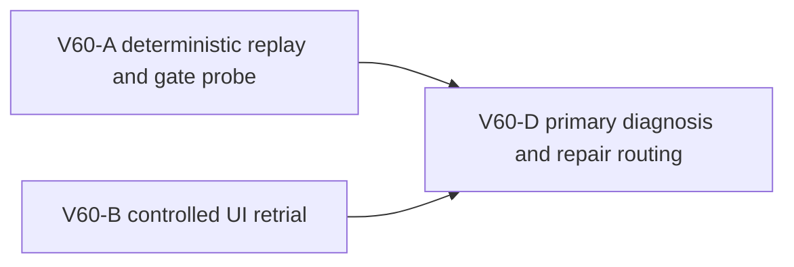

# Ticket Pack: V60 connected-river crossing diagnosis

## Summary and locked decision

V59 fresh-start browser testing built a `Ready` connected-river bridge, then stopped on its visible deck at x -172.67, y 1.36, z 10.04 with `This step has no supported route`. The bridge is `works6:river-bridge:-43`, centered at x -172. The player's x offset is 0.67 m, within the checked 0.8 m half-width; z 10.04 is within the deck ending at z 12. The far-bank post at x -170.60, z 16 is intentionally outside the deck centerline. The first Mireglass interaction is unproven.

Do not patch geometry or widen the bridge on this evidence alone. Determine which exact movement gate rejected the next frame, then choose the smallest repair that preserves V28 saves, replay, route geometry, and older roots. Keep one WebGL renderer maximum. Preserve the user's browser storage and live Vite preview. No GitHub, commit, push, or PR action is authorized.

## Public interface and earliest surface

- Existing surface: `http://127.0.0.1:5193/?publicWorld=v31`, HTTP 200 after V59. The live preview remains available while diagnostics run.
- UI reviewer may create one fresh isolated Playwright CLI session, ideally resuming the prior isolated V59 profile if the tool actually preserves it. Never use or close the unrelated `rosetta-r2` session. If the prior test save is absent, repeat the exact visible route from fresh V31 creation.
- Domain reviewer uses source and disposable read-only probes only. No product file, test, schema, save, or dependency changes in this diagnosis pack.
- Input evidence: V59 screenshots in `.playwright-cli/`, the blocked coordinates above, `greenway-alpha` seed, and bridge id. The exact rejected frame delta and carrier state are not yet known.
- Output evidence: one UI retrial result with exact controls and state, one deterministic gate trace, then a primary diagnosis decision. The diagnosis is not a repaired game or a full first-region proof.

## Lane graph and topology audit

V60-A and V60-B are incomparable, productive evidence lanes. A proves which current-source condition fails at or immediately after the reported position without opening a renderer. B tests whether the exact visible crossing fails again, succeeds with a centered approach, or reveals a different first blocker. Neither lane depends on the other's result or edits shared product files. Maximum parallel width is two and browser width is one. D needs both receipts before selecting a movement owner. A source-only hypothesis cannot substitute for B's visible result, and B's visual cannot by itself identify an internal gate. No extra generic reviewer or PR finisher is warranted. If a disposable probe cannot reconstruct the rejected frame or the UI profile is lost, report that uncertainty rather than inventing a root cause.

## Smallest viable diff and tripwires

Behavior delta: none in this pack. Expected repository change is this one planning document, zero production/test/config lines and dependencies. Existing bridge site, V28 passage, V28 replay, V23 trial, and controller runtime are the owners to inspect. A full new movement framework, bridge redesign, widened collision, save migration, user-data reset, or new renderer is out of scope. A later observed-failure repair gets a separate bounded implementation ticket after fan-in. `git diff --check` is the document hygiene gate.

## Tickets

### V60-A, deterministic gate Reviewer

- Delivery phase: `diagnosis`; milestone: `post_surface`; lane role: Reviewer; depends on none.
- Branch/worktree: `ben/wizard-playable-v2` at `/private/tmp/pa-wizard-playable-v2`; current dirty checkout, no Git writes.
- Runtime: native spawned child, inherited model, `initialize_once_then_continue`; no Cursor or existing-task contact. Use the completed V59 source reviewer only if its recent context and idle status remain compatible. No interruption of unrelated work.
- Required skills: auto-planner-ticket-pack and smallest-viable-diff. Read this pack fully.
- Trace `publicWorldV28RiverPassage`, `publicWorldV28Replay`, `PublicV28ControllerRuntime`, and V23 trial movement around seed `greenway-alpha`, bridge `-43`, reported coordinates. Reuse an existing focused test fixture or a disposable probe outside tracked product files if needed. Do not mutate the live browser, saves, Vite, product files, tests, or dependencies.
- Determine which gate rejects a short southward frame from an inside-deck state, or report the missing inputs precisely. Vary lateral x inside the checked corridor only to distinguish an alignment bug from a carrier/height/passage issue. Return numeric inputs, outputs, and exact file/line owner, with `proven` versus `hypothesis` labels.
- Certainty contract: closure is a discriminating deterministic probe; stop once one gate is proven or inputs cannot be reconstructed. New information is the first failing predicate, not an architectural recommendation. Surprise trigger is a source route that accepts the frame while UI still rejects it.
- Validation: read-only commands and disposable probe only. No renderer or browser. No `SURFACE_READY` claim.
- Receipt: child ID, model, transport, commands, exact gate result and references, files changed none, net lines zero, dependencies none, scope/reuse proof, residual uncertainty, fallback/no-interruption status.

### V60-B, controlled UI Reviewer

- Delivery phase: `diagnosis`; milestone: `post_surface`; lane role: Reviewer; depends on none.
- Same branch/worktree/runtime policy as A. Reuse the completed V59 UI reviewer if compatible and idle. Open exactly one Wizard WebGL renderer, leaving Vite and unrelated browser sessions untouched.
- Required skills: auto-planner-ticket-pack, smallest-viable-diff, test-from-ui, and playwright. Read this pack fully. Use `test-from-ui` early-smoke mode.
- Reopen the isolated V59 test profile only if saved state actually persists. Otherwise repeat the visible new-player sequence from V59 to the same bridge. Start at `http://127.0.0.1:5193/?publicWorld=v31`. Record whether saved bridge and player position are present. Capture frame-by-frame map position, heading if visible, held W duration, exact blocked message, and screenshot when crossing. Test a deliberate centered approach only if doing so does not erase the original failure observation. Do not use dev teleport, source-derived coordinates to skip gameplay, direct domain calls, synthetic save, or a second renderer.
- Shortest user flow: load/resume test world, reach the built or rebuildable bridge, cross to its dry far bank, or stop at the first reproducible movement rejection. Do not continue into Mireglass merely to avoid a bridge blocker.
- Certainty contract: branch is repeatable bridge collision versus angle-dependent miss versus transient save/profile artifact. Stop at the first discriminating result. A source explanation does not override the visible evidence.
- Acceptance: `command -v npx`, HTTP 200 pre/post, Playwright snapshot/screenshot/console/close. Close the one Wizard browser and state whether Vite remains live. No code, test, docs, Git, or save injection changes. No `SURFACE_READY` unless the tested crossing genuinely reaches far dry bank.
- Receipt: child ID, model/transport/session, URL/profile timestamp, precise controls and positions, screenshots, console/network health, browser closure, files changed none, net lines zero, residual uncertainty, fallback/no-interruption status.

## Dispatch registry

- 2026-10-10 12:17 UTC: `git diff --check` passed. V60-A dispatched by native follow-up to completed, compatible Reviewer `/root/v59_source_reachability`, inherited model; result pending. No unrelated task contacted.
- 2026-10-10 12:17 UTC: V60-B dispatched by native follow-up to completed, compatible Reviewer `/root/v59_ui_journey`, inherited model; result pending. It owns the only Wizard WebGL renderer; result pending.

## Evidence fan-in, pending UI retrial

- V60-A completed a read-only in-memory replay probe. At x -172.67, z 10.04, the canonical carrier is y 1.276632 and the visible deck pose is y 1.355498. A southward 0.16 m frame passed the V23 trial, V28 river passage, V28 witness, V30 witness, and V31 replay. Sixteen consecutive frames, including tested x positions -172.79, -172.67, -172, and -171.21, reached dry ground at z 12.60. A simple width or length mismatch is not reproduced.
- This probe used a valid reconstructed V31 state with the bridge footprint discovered, empty terrain ledger, no raised soil, and a grounded carrier. Those state details and the UI's exact rejected yaw/delta are not yet known. The probe's success therefore conflicts with the observed UI block but does not invalidate it. A visible y of 1.36 cannot be substituted for canonical carrier y; doing so fails V23 decoding.
- V60-B reported that its isolated browser profile did not retain the previous bridge save. It is repeating the visible route in the sole Wizard renderer, then will measure short-step position and heading at the first rejection. No repair is activated until this receipt distinguishes the branches.

### Final V60 diagnosis

- V60-B rebuilt the bridge through visible play. An off-center entry stopped at x -172.92, z 5.99 with the accurate river/deck cue. Centering the avatar then advanced along the deck through z 6.06, 7.66, and 9.42 before movement stopped again at x -171.90, z 10.06 with the generic `This frame has no supported route.` The interior stop is the first actual route blocker; widening the deck alone cannot fix it.
- The V31 isolated save at revision 43 held bridge `works6:river-bridge:-43` and canonical checkpoint x -171.8884454470931, y 1.2771094657969306, z 9.422940177857594, yaw 3.12. The UI said travel since that checkpoint was unsaved. A later `Save now` did not commit the blocked stretch. The live carrier velocity was not captured.
- V60-A reconstructed the centered seam with current source. A grounded wet-side carrier at z 9.9029 stepping 0.16 m south to dry z 10.0629 retains carrier y 1.2771094658 while the dry carrier floor is 1.2766321022, leaving a 0.0004773636 m vertical difference and velocity -0.49. The deck snap requires a wet-gap tile and therefore does not ground this dry-end seam. The next idle or south frame fails the inherited V23 streamed-carrier validation. This is a source-level reproduction of the visible interior stop, though the exact UI preview velocity is inferred, not directly read.
- Smallest causal owner is `groundedDeckCarrier` in `publicWorldV28Replay.ts`, not width or V31 scene drawing. The saved-witness compatibility of changing historical V28 replay must be checked before implementation. A later renderer `DataCloneError: Data cannot be cloned, out of memory` and React scheduler errors appeared after the blocker. The Wizard test browser was closed, Vite remained HTTP 200, and host memory returned to 60% free; causal relation between repeated blocked idle previews and memory error is unproven.
- V60 diagnosis closes with a V61 compatibility gate before a bounded seam repair. The separate entrance alignment and Mireglass guidance findings remain follow-up usability issues, not substitutes for reopening the blocked route.
