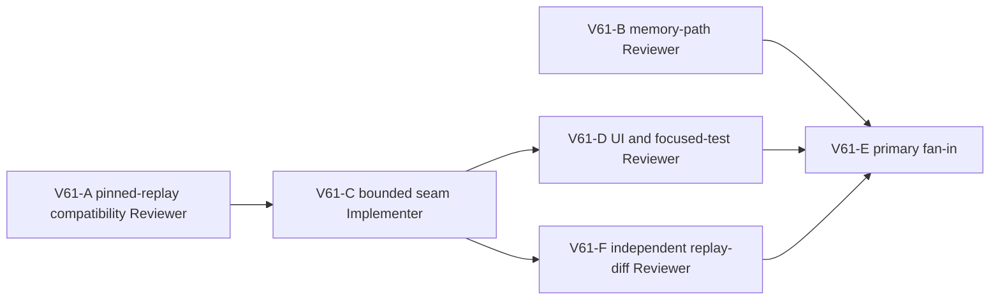

# Ticket Pack: V61 connected-river seam repair

## Understanding and terminal condition

Fresh V31 play builds a connected-river bridge and reaches its deck, but a grounded carrier stepping from a wet deck tile to the dry-end seam becomes transiently airborne by about 0.00048 m. `groundedDeckCarrier` in V28 replay only recognizes wet-gap tiles. The next frame is rejected, so a newcomer cannot reach Mireglass over the built crossing. V60 reproduces the same state transition with current source, after V59 and V60 visible-UI failures.

The terminal condition for this pack is a compatible, smallest-owner fix that lets the same fresh V31 player cross onto the far dry exit and approach its post, with source-pinned save/replay tests and a one-renderer UI retry. This does not prove the entire Mireglass outward-and-return loop or the full game. Do not reset user data, modify old saved roots without a compatibility proof, widen the bridge as a substitute, or disguise the failure with copy alone.

## Public interface, version, and surface contract

- Existing user surface stays at `http://127.0.0.1:5193/?publicWorld=v31`, and must remain available outside the bounded UI retry. One Wizard WebGL renderer maximum; close it immediately if memory errors recur.
- Public controls and V31 save root format stay unchanged unless the compatibility review proves that a new versioned authority is required. No migration change is preauthorized by this pack.
- The exact candidate is a dry-end deck snap in or adjacent to `groundedDeckCarrier`, constrained to a player over the saved bridge support path with a nearly grounded canonical carrier. V61-A found a second 0.00048 m drop at the same bridge's immediate dry exit, beyond deck support; a distinct guarded site.to-to-site.exit continuation is needed to meet the far-bank terminal condition. Neither branch may snap over an unrelated dry step, pit, raised soil, or occupied cell.
- The earlier off-center entrance rejection is real but separate. The interior seam must cross first. A later frontend `DataCloneError: Data cannot be cloned, out of memory` occurred after repeated blocked frames and may be related but is not yet causal evidence.
- No GitHub, commit, push, or PR action is requested. Preserve the dirty `ben/wizard-playable-v2` worktree and all user files.

## Lane graph and topology audit

V61-A and V61-B are independent, productive read-only lanes and can run in parallel. A answers whether the historical V28 snap rule can change in place without invalidating persisted witnesses, or whether a new versioned movement authority is necessary. B classifies the later memory error without touching the renderer. C cannot safely implement before A fixes the version/interface contract. D cannot repeat the same UI journey until C changes the failing owner. After C, D and F are incomparable: D tests the live player route, while F audits the changed replay predicate and negative boundaries without rendering. E consumes both validation and memory risk. Maximum parallel width is two; only D may open one Wizard renderer. If A finds an unavoidable migration or architecture boundary, C stops and the primary replans rather than improvising.

## Smallest viable diff

- Expected behavior delta: grounded crossing from a saved wet deck to its dry end and onward through that bridge's immediately adjacent dry exit accepts following idle or move frames; ordinary river and V28/V31 replay rules remain intact.
- Likely implementation owner: `games/wizard-realms/engine/src/domain/publicWorldV28Replay.ts` plus its existing focused test. Do not add a new helper, dependency, schema, or UI control if the local snap predicate suffices.
- Historical-compatibility tripwire: if a V28 rule edit replays any previously accepted witness differently or invalidates a pinned root, do not ship it in place. Return a versioned-authority proposal and replan.
- Other tripwires: extra renderer, save injection into user profile, broad map or bridge-geometry change, unbounded allocations, new ignored source files, commit/push, or unrelated UI cleanup.
- Existing V31 preview is the earliest honest surface, not a completion claim. `git diff --check`, focused tests, type check/build, and one realistic browser crossing are the validation gates after implementation.

## Tickets

### V61-A, compatibility Reviewer, dispatch now

Role: Reviewer. Delivery phase `compatibility_gate`, pre-implementation. Worktree `/private/tmp/pa-wizard-playable-v2`, branch `ben/wizard-playable-v2`, current dirty checkout. Runtime `native` continued completed source reviewer with inherited model, no Cursor or unrelated existing task contact. Required skills: auto-planner-ticket-pack and smallest-viable-diff, read this pack fully.

Read the V28/V29/V30/V31 migration, witness replay, root-pinning, and test fixtures relevant to `groundedDeckCarrier`. Construct a read-only counterfactual or temporary in-memory probe for the narrow dry-end snap. State whether it changes replay results for prior accepted witnesses or root validation, and whether a V28 in-place fix is safe. Distinguish a tested guarantee from a reasoned risk. Do not edit product/tests/docs, run a browser, mutate saves, or restart Vite. If compatibility cannot be established, return the minimal versioned seam contract instead of implementation advice that assumes in-place safety.

Certainty contract: discriminating compatibility proof, stop at GO/NO-GO for in-place V28. Surprise trigger is any old root/witness state delta. Receipt: exact source/test references, commands/probe inputs/results, GO/NO-GO, residual uncertainty, child ID/transport/model, zero-file/net-line/dependency change, no renderer/fallback/interruption status.

### V61-B, memory-path Reviewer, dispatch now

Role: Reviewer. Delivery phase `risk_classification`, parallel with A. Runtime `native` continued completed UI reviewer with inherited model. Required skills: auto-planner-ticket-pack, smallest-viable-diff, and test-from-ui for interpreting its prior UI receipt; read this pack fully.

Using existing V60 screenshots and console receipt plus read-only source inspection, classify the post-block `DataCloneError`/React scheduler errors. Check whether the airborne preview plus repeated idle frames could grow pending/flight data or cause cloning pressure, and identify any independently actionable bounded owner. Do not open a renderer or browser, mutate saves, edit product/tests/docs, or restart Vite. Do not claim cause without evidence. The seam repair must not wait for a speculative memory fix, but a proven memory safety issue should be flagged as a separate bounded ticket.

Certainty contract: source-supported causal versus noncausal/unknown, stop at a severity-ranked finding. Receipt: source references, evidence, files changed none, child ID/transport/model, no renderer/fallback/interruption, residual uncertainty.

### V61-C, seam Implementer, conditional after A

Role: Implementer, not dispatched until A returns GO for an in-place narrow V28 fix. Own only `publicWorldV28Replay.ts` and its existing focused bridge replay test file. Read auto-planner-ticket-pack and smallest-viable-diff. Reproduce the wet-to-dry seam with the reported `greenway-alpha` bridge `-43`, then make the smallest deck-backed grounding correction plus a separately guarded immediate site.to-to-site.exit dry continuation if A confirms it is compatible. Prove idle plus south steps reach beyond the far exit/post, and off-deck, pit, and unrelated dry-step movement still reject. Run focused V28/V31 replay and pinned-root validation tests, TypeScript, and `git diff --check`. No browser, migration, unrelated file, commit, or push. If A says NO-GO, do not activate this ticket; primary replans a versioned repair.

### V61-D, UI and focused-test Reviewer, conditional after C

Role: Reviewer. Own final read-only validation. Run focused tests and one realistic fresh V31 UI route through the same bank, bridge, and far dry end; then stop at the first Mireglass marker or next blocker. Exactly one Wizard renderer, closed at end. Check console, save/resume, app HTTP, and memory. Do not alter product or user saves. The identical error should be recorded as `observed error | change | restart | retry result | next action` by primary after receipt.

### V61-F, independent replay-diff Reviewer, conditional after C

Role: Reviewer. Read only the two-file C diff and the existing focused tests, without opening a browser or renderer. Verify the two snap branches require the saved bridge lane and exact seam, and cannot ground off-deck, occupied/pit soil, unrelated dry steps, or a fast fall. Check old witness compatibility reasoning and the test assertions rather than rerunning the slow full suite. Return severity-ranked findings, line references, and GO/NO-GO for UI-facing acceptance. No edits, save mutation, Git write, or Vite restart.

## Dispatch registry

- 2026-10-10 12:28 UTC: `git diff --check` passed. V61-A dispatched by native follow-up to completed compatible Reviewer `/root/v59_source_reachability`, inherited model, result pending.
- 2026-10-10 12:28 UTC: V61-B dispatched by native follow-up to completed compatible Reviewer `/root/v59_ui_journey`, inherited model, result pending. Neither lane owns a renderer. No unrelated task contacted.
- V61-C and V61-D are explicitly dormant until their dependencies are met.
- 2026-10-10 12:31 UTC: V61-A returned GO for in-place V28 replay correction. Previously accepted durable frames are grounded, while the two new falling-carrier branches were previously rejected; the existing `-14` outward/return full-result hashes stayed identical in a read-only counterfactual. Scope amended above to include the immediate site.to-to-site.exit seam. Residual risk is non-exhaustive user-save coverage.
- 2026-10-10 12:31 UTC: V61-B returned a separate memory-risk finding. The stuck airborne preview triggers empty-frame retries and repaints every 50 ms, but no retained unbounded queue is proven. OOM appeared later and is not the cause of the first rejection. No speculative memory patch is in C.
- 2026-10-10 12:31 UTC: V61-C dispatched to fresh native Implementer `/root/v61_bridge_seam_impl`, inherited model, two-file owner boundary, no renderer. Result pending. V61-D remains dormant until C returns.
- 2026-10-10 12:39 UTC: V61-C released files. Two-file fix and focused tests passed: 23/23 across five V28/V31 files, final V28 bridge file 5/5, TypeScript and diff checks passed. No renderer or Git writes. V61-D and V61-F are activated as independent validation lanes.

## Validation fan-in, pending live route

- V61-F returned GO for the live retry. Independent read-only probes accepted move plus idle at both seams and V31 batches from z4 to z16; off-lane deck/exit, unrelated dry step, pit, fast fall, and forged raised-soil replay rejected. Previously accepted `-14` outward/return full-result hashes remain `6af3b089` and `7e96fd2a`.
- V61-F found a non-blocking P2 test gap: the new worktree test asserts off-lane deck, pit, and unrelated dry step, but not off-lane exit and fast fall explicitly. Its source probes cover those branches. Add focused assertions after the live browser closes, so hot reload cannot disrupt the current UI retry.
- V61-D owns the only Wizard renderer and has not yet returned its live crossing result.

### First live retry result

`observed error | change | restart | retry result: advanced | next action`: interior saved-deck movement stopped at z 10.06 and could not checkpoint | guarded V28 replay grounding at the wet-to-dry deck seam and immediate dry exit seam | no server restart; V61-D created a fresh isolated V31 browser world on the updated Vite preview | the avatar crossed the old z 10.06 blocker, reached far dry ground z 13.83, then reached the dry exit z 16.07 | classify a new generic movement/claim failure beside the far-bank post, verify save behavior, and avoid declaring the first-region journey complete.

At x -169.88, y 1.28, z 16.68 beside the visible far-bank post, no claim control appeared and later frames repeated `This frame has no supported route.` The UI still reported travel since the checkpoint unsaved after Save now. The sole renderer remained free of app/OOM errors at that point. V61-F source reviewer was reactivated read-only to identify the new owner while V61-D makes one same-session reload and closes its browser.

### Final V61 result and next owner

- V61-D crossed the old interior blocker and reached far-bank x -172.02, z 16.07 in a fresh V31 run. Same-session reload validated V31 save revision 40 and restored the built bridge with player x -170.24, z 17.00. No out-of-memory error recurred. The sole browser was closed and Vite remained HTTP 200.
- The new post-side failure is a different but related dry-to-dry micro-drop. Read-only replay of an east step from x -170.04 to -169.88 at z 16.68 found a 0.00726355 m downward tile change, vertical velocity -0.49, then a rejected idle frame. This excludes a bridge-width fix and shows a systemic small-downhill grounding problem beyond the two longitudinal bridge seams. The post claim is geometrically in range but requires grounded canonical terrain, so the airborne preview hides its control. Actual live vertical velocity was not captured, so the exact UI state match remains inferred.
- V61 meets its crossing terminal condition but not the broader first-region journey. The next V62 contract is bounded dry-ground adhesion with replay compatibility, not another post-specific longitudinal seam. The V61-F non-blocking off-lane-exit/fast-fall test gap can be closed in that focused test pass.
