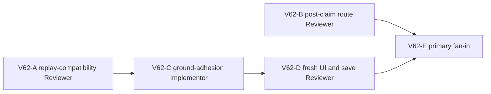

# Ticket Pack: V62 streamed near-ground adhesion

## Summary and goal

V61 fixed two bridge-specific longitudinal seams and the fresh V31 player crossed onto the far bank. A new dry-to-dry lateral seam beside the bridgehead post still left the avatar transiently airborne, hid a Ready claim, and rejected the next idle/move frame. The source reproduction is an east 0.16 m step from x -170.04 to -169.88 at z 16.68: a dry-floor drop of 0.00726355 m leaves vertical velocity -0.49. This is a systemic near-ground locomotion defect, not a reason to add another post-specific bridge seam.

Goal: establish a bounded, replay-compatible ground adhesion rule for small downward dry terrain steps in the streamed world. Keep real falls, pits, wet river gaps, cliffs, raised soil, and ungrounded approaches distinct. Prove the post-side failure no longer strands the player and the bridgehead claim can be reached in a fresh V31 UI journey. This is not a full-game or full first-region completion claim.

## Interface and safety contract

- Preserve the V31 entry, user saves, V28/V31 root formats, existing accepted witnesses, bridge IDs/geometry, and visible player controls. No migration or schema change unless the read-only compatibility gate returns NO-GO; in that case stop implementation and replan.
- Candidate owner is the current V28 replay grounding helper in `games/wizard-realms/engine/src/domain/publicWorldV28Replay.ts`. It may generalize only a near-ground falling carrier reached by a short checked move from a grounded dry terrain carrier to another dry, supported terrain tile. The destination carrier must be above its local floor by no more than the existing 0.03 m tolerance, falling slowly within the existing `[-0.5, 0)` envelope. Preserve the old wet-deck branch and previously accepted replay outputs exactly.
- Do not ground open pits, raised-soil ledges, wet cells without saved deck, ordinary high drops, airborne starts, invalid frame distances, or blocked valley/river segments. The downstream checked segment gate must still reject inaccessible paths.
- Existing surface remains `http://127.0.0.1:5193/?publicWorld=v31`. One Wizard WebGL renderer maximum, only in the UI validation lane. Close promptly and preserve system memory; Vite stays available.
- Worktree `/private/tmp/pa-wizard-playable-v2`, branch `ben/wizard-playable-v2`, remains dirty. Do not commit, push, create a PR, reset files, or touch user browser storage.

## Lane graph and topology audit

A and B are incomparable read-only lanes with distinct outputs. A decides the movement authority and compatibility guard. B traces the next visible route after bridgehead claim so the UI validation can distinguish the next real blocker from a missing post interaction; it does not coach D before first UI result. C depends on A's GO; D depends on C's released implementation. E consumes D plus B and routes any new observed failure. Maximum parallel width two, with a single renderer only in D. If A finds versioning required, C is not activated. No generic reviewer or PR finisher is needed for this local repair pack; an independent diff audit can be activated after C if the predicate broadens materially.

## Smallest viable diff

- Expected implementation files: the existing V28 replay helper and existing bridge replay test. If a separate existing V28 movement test better owns a generalized case, ask primary before editing. No new abstraction, dependency, config, migration, UI, or version file is expected.
- Reuse the current snap tolerance, grounded-carrier projection, bridge passage checks, V31 soil gate, and focused replay fixtures. Delete redundant bridge-specific dry-exit logic only if the generalized guard fully subsumes it and compatibility proof remains exact.
- Required tests: reported lateral dry seam plus following idle/move; another unrelated small dry downhill step; old `-14` accepted outward/return output; wet river gap, off-lane exit, pit, raised soil, fast fall, high drop, and formerly valid route behavior.
- Tripwires: historical witness output change, save validation failure, snapping across a blocked river/cliff, widening all walkable surfaces, hidden state injection into live UI, more than one renderer, or unrelated dirty-file edit. `git diff --check`, focused tests, TypeScript, and one fresh UI route are required.

## Tickets

### V62-A, compatibility Reviewer, dispatch now

Role Reviewer, native continued source reviewer, inherited model, `initialize_once_then_continue`, no existing-task contact. Read auto-planner-ticket-pack, smallest-viable-diff, and this pack fully. Read-only source/in-memory probes only, no browser, renderer, file edit, save mutation, Vite restart, or Git write. Prove whether the candidate near-ground dry-to-dry snap can only accept formerly rejected durable frames, with old accepted witness hashes unchanged. Test the reported x -170 seam and a different dry small drop, plus negative wet/pit/high-drop cases. Return GO/NO-GO, exact source references, threshold/guard recommendations, residual risk, full zero-diff receipt. Stop on an architecture or migration boundary.

### V62-B, next-route Reviewer, dispatch now

Role Reviewer, native continued UI reviewer, inherited model. Read required skills and this pack. Source-only audit, no renderer or browser. Trace V30 bridgehead Ready/claim visibility and next stage guidance toward Mireglass marker in V31. Identify the visible action a grounded player should see at x -172.02,z16.07 and any source-proven false guide after claim. Return exact file/line references and distinguish expected behavior from actual UI unknowns. No edits, saves, tests, server restart, Git, or task contact.

### V62-C, Implementer, conditional after A

Role Implementer, fresh native child unless a completed compatible implementer may be reused safely. Own only the V28 replay owner and its existing focused test. Read auto-planner-ticket-pack, smallest-viable-diff, and this pack. Reproduce the lateral micro-drop and next idle failure first. Implement the smallest safe streamed dry-ground adhesion predicate allowed by A, while retaining exact old wet-deck behavior. Cover positive and negative gates above, run focused V28/V31 replay and pinned-root tests, TypeScript, and diff checks. Do not open a browser, edit migration/schema/UI, restart Vite, or perform Git/GitHub writes. Stop if old witness output changes or a different owner is required.

### V62-D, live UI Reviewer, conditional after C

Role Reviewer, reuse compatible UI tester if idle. Exactly one fresh isolated Wizard WebGL renderer. Repeat the visible fresh V31 route to the same bridgehead; confirm the prior dry lateral seam no longer traps the player, the claim is visibly Ready and succeeds, a save/reload validates, and record first Mireglass interaction or next blocker. Close promptly, leave Vite live, watch memory/console. No source-derived teleport, direct state, user-save mutation, product edit, Git action, or second renderer. Report exact screenshots, actions, coordinates, requests, and first result. Primary writes `observed error | change | restart | retry result | next action` from the receipt.

## Dispatch registry

- 2026-10-10 12:50 UTC: `git diff --check` passed. V62-A dispatched by native follow-up to completed compatible Reviewer `/root/v59_source_reachability`, inherited model; result pending.
- 2026-10-10 12:50 UTC: V62-B dispatched by native follow-up to completed compatible Reviewer `/root/v59_ui_journey`, inherited model; result pending. Neither lane owns a renderer. C and D remain dormant until dependencies are met.

## V62 gate result and replan

- V62-A returned NO-GO for C's V28-only scope. It can preserve old accepted witness outputs and fixes the observed x -170 seam, but V28 cannot inspect V31 raised-soil cells, and the empty-bridge fastpath delegates to V27, leaving the same dry seam unfixed before bridge construction. C was not dispatched.
- V62-B confirmed the grounded far exit should show a dedicated `Claim River Works find` button, clicked directly rather than E. The visible post is offset from the checked exit; standing at x -172.02, z 16.07 is within reach. It also confirmed a source-proven next-stage false guide: the V27 starter bridge text overrides Mireglass guidance even after bridgehead claim.
- The raised-soil example was a **valid V31 step** under the current 0.8 m effective-height gate. The next architecture decision must distinguish legitimately walkable raised terrain from bypassing that gate, rather than treating every raised-soil destination as forbidden.
- The implementation lane remains dormant. V63 examines a lower movement owner with replay compatibility and V31 effective-height enforcement; no V28-only patch is made under this pack.
