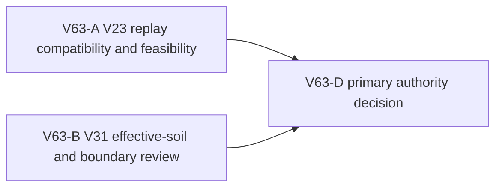

# Ticket Pack: V63 ground-adhesion authority decision

## Decision question

V61 proved that centimeters-scale dry tile drops can leave the streamed player with vertical velocity -0.49 and reject the next frame. The bridge-specific V28 correction made the connected-river crossing playable, but a 0.00726355 m lateral dry drop beside the far-bank post still strands the player. V62's V28-only generalization was stopped before implementation: it cannot cover the no-bridge V27 fastpath and cannot itself inspect V31 raised-soil state. A valid V31 raised-soil destination may nonetheless be walkable under the existing effective-height gate, so a blanket exclusion is not the desired behavior.

Choose the smallest movement authority that can adhere a grounded avatar to small supported dry downhill steps across the current V31 world, including before and after bridge construction, without changing previously accepted saved witnesses or bypassing river, cliff, pit, and V31 effective-soil gates. This is a read-only authority decision, not implementation or completion of the first-region journey.

## Fixed interface and scope

- Existing V31 URL, user saves, root formats, controls, bridge and soil geometry remain unchanged during this pack. No renderer, browser, product edit, tests, save mutation, Vite restart, GitHub action, or Git write.
- Candidate A is an in-place V23 streamed-movement near-ground settlement immediately after `stream.advance` but before durable decode, guarded by a genuine move from grounded dry terrain to a lower dry supported tile by at most 0.03 m. Later V25/V28 river checks and V31 effective-soil checks remain mandatory. Candidate B is a new versioned current-root movement authority if in-place V23 would change accepted witness outputs. A V28-only bridge-world patch is not sufficient for the stated goal.
- The observed x -170 post-side seam, an unrelated dry seam before a bridge, and a legitimate raised-soil step are required decision cases. Invalid wet/pit/high drop/airborne/collision cases remain rejected.

## Lane graph and topology audit

A and B are independent read-only lanes with distinct decision-bearing evidence. A tests whether V23 can ground a small dry descent while preserving old witness outputs, including no-bridge current behavior. B checks the V31 raised-soil contract and whether later authority gates prevent a V23 snap from bypassing it. D selects one implementation owner and revised tests; neither worker edits or opens a renderer. Maximum parallel width two. If both candidates fail, D broadens to an explicit versioned-root plan rather than improvising. No generic third reviewer or PR finisher adds information here.

## Smallest viable diff

No production/test/config edits in V63. This document is the only expected file. Reuse current V23/V28/V31 movement, validation, and focused test fixtures for in-memory probes. No new dependency or abstraction. `git diff --check` is the hygiene gate. A later implementation pack sets exact file ownership after D's authority decision.

## Tickets

### V63-A, global streamed movement Reviewer

Role Reviewer. Native continued compatible source reviewer, inherited model, no unrelated task contact or interruption. Read auto-planner-ticket-pack, smallest-viable-diff, and this pack fully. Read-only in-memory probes only. Trace V23 streamed transition, durable decode, V25/V28/V31 replay and old root validation. Test a hypothetical small dry-downhill settlement before bridge and after bridge at the reported x -170 seam. Compare serialized results/events for previously accepted V23 and V28/V31 witnesses, not just boolean acceptance. Test wet, pit, high drop, airborne start, blocked valley, and ordinary upward steps. Determine whether V23 in-place is compatible, with exact guard and source line. No browser, renderer, file write, test-file creation, save mutation, Vite restart, or Git write. Return GO/NO-GO, caveats, receipt, and smallest owner.

### V63-B, V31 effective-soil Reviewer

Role Reviewer. Fresh native child, inherited model. Read required skills and pack fully. Read-only source/in-memory probes only. Determine what raised-soil steps are intentionally walkable in V31 and which are blocked by `publicV31EffectiveStepAccepted`, overlap, pit, or other gates. Test whether a V23 pre-decode near-ground settlement would bypass any V31 effective-height rule, especially a destination raised by 0.4 m, a higher ledge, and a pit/occupied cell. Identify whether V31 is required as an explicit owner or its existing post-replay gate suffices. No browser, renderer, edit, save mutation, Vite restart, or Git write. Return exact source references, allowed/blocked examples, GO/NO-GO for V23-only scope, and full zero-diff receipt.

## Dispatch registry

- 2026-10-10 12:54 UTC: `git diff --check` passed. V63-A dispatched by native follow-up to completed compatible Reviewer `/root/v59_source_reachability`, inherited model; result pending.
- 2026-10-10 12:54 UTC: V63-B dispatched to fresh native Reviewer `/root/v63_soil_boundary_review`, inherited model; result pending. No implementation lane or renderer is active.

## Interim compatibility evidence

- V63-A found a concrete NO-GO for direct in-place V23 first-frame snapping under exact historical event preservation: V23 already accepts the reported post drop as a two-frame `[east 0.16 m, idle]` durable batch. The first frame alone rejects, but the two-frame result settles; its accepted `player_moved` event records the old higher y on tick 1. Earlier snapping would rewrite that accepted event and break exact witness replay. V63-A is checking whether V28 can preserve this batched behavior without changing V23 or whether a versioned current-root authority is required.
- V63-B raised-soil boundary review remains pending. No production implementation is authorized yet.

### V63-B result

- V63-B found that V31 already enforces raised-soil effective height after inherited movement. A valid +0.4 m lifted destination is intentionally walkable; a native +0.5 m rise combined with soil lift becomes +0.9 m and is rejected by the 0.8 m ordinary-step gate. A dry native downward 0.007 m step onto valid raised soil remains a legitimate +0.393 m effective step. Deep unladdered pits and wet/occupied/invalid placements retain their own checks. Thus the blanket raised-soil exclusion in the V62 candidate was overconservative; any lower-level snap must still leave V31's effective-step gate mandatory.
- Test gap: an existing positive V31 raised-soil movement test uses a cell reserved from persisted placement. A later implementation should add a checked-root example using a genuinely valid raised cell and tiny native dry descent.
- V63-A's event-parity verdict remains pending. V63-B made no file or browser changes; 11 focused V31 tests passed in its read-only review.

### Final authority decision

- V63-A returned conditional GO for an in-place V23 returned-carrier settlement, not a blanket first-frame event rewrite. Its read-only overlay changed only the returned grounded carrier on a newly accepted terminal dry descent, preserved the cached stream and nonterminal raw movement events, and matched full serialized progress/event hashes for sampled previously accepted V23, V27, V28, and V31 witnesses, including the `-14` 50-frame bridge crossing and return. The candidate accepted the observed post singleton and an unrelated prebridge dry singleton; a 0.044 m drop remained rejected.
- A direct rewrite of the first frame's event was ruled out because an existing accepted V23 two-frame fall-and-settle witness records the original intermediate y. The candidate leaves that accepted event untouched. Its wet base-loam singleton can be accepted by V23 alone, but V27/V28/V31 mandatory river gates still reject the crossing. V31's effective-soil gate remains mandatory and accepts a legitimate +0.4 m raised step while rejecting combined rises over 0.8 m.
- Decision: use V23 `framesResult` as the smallest owner for V64, subject to implementation tests proving old accepted witness/event parity and downstream safety. No V32 version is activated yet. V63 itself made no production changes.
