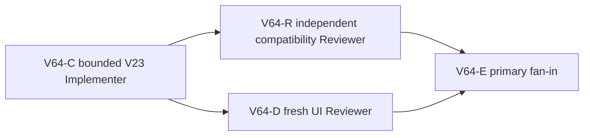

# Ticket Pack: V64 streamed micro-drop repair

## Outcome and authority lock

Make ordinary tiny dry downhill steps feel continuous in Wizard Realms. The observed fresh V31 far-bank step at x -170.04 to -169.88, z 16.68 drops 0.00726355 m, leaves a transient velocity of -0.49, hides the bridgehead claim, and rejects the next frame. A separate prebridge dry step drops 0.02102895 m and has the same singleton problem. V63 found that a constrained in-place V23 transition can accept these new singleton frames without rewriting sampled previously accepted witness progress or events. V31 already checks effective raised-soil height after inherited movement. No source evidence currently requires V32.

Terminal condition: a fresh V31 player can cross the saved river bridge, step laterally near its far-bank post without getting stuck, see and claim `Claim River Works find`, and validate save/reload. Source-level tests must preserve old accepted witness/event bytes and reject blocked wet, pit, cliff, high-drop, and invalid raised-soil paths. This is not the full Mireglass journey or full game.

## Interface and safety contract

- Owner: `games/wizard-realms/engine/src/domain/publicWorldV23Transitions.ts`, specifically `framesResult` after `stream.advance` and before durable decode, plus the V28 caller in `publicWorldV28Replay.ts`. The settlement may change only returned canonical carrier Y and vertical velocity on a newly accepted terminal dry descent. Do not reset or rewrite the cached stream. Preserve raw `player_moved` events on nonterminal frames; if the newly accepted settlement is the final frame, match its terminal event to the returned canonical carrier. Avoid any change to previously accepted progress/events. V23 settlement is durable-only (`allowAirborne=false`); V28's saved-bridge airborne trial retains its raw carrier and existing deck correction. A V28 fallback may retry only an uncorrected falling trial for a newly valid dry-ground micro-drop, only when the complete V25 river sweep reports no wet contact, still through V28 river, valley, pose, and V31 soil gates. Do not import V25 river rules into V23.
- Guard: actual move from a grounded streamed terrain carrier to a distinct lower supported base-dry tile; native drop strictly greater than 0 and at most 0.03 m; source Y within 1e-6 of source floor; trial carrier no more than 0.03 m above destination floor and falling velocity in [-0.5,0). No snap for idle as the first frame, wet unsupported gap, high drop, open deep pit, airborne start, or blocked valley passage. V25/V27/V28 river and valley gates and V31 effective raised-soil gate remain mandatory.
- V23 base terrain cannot identify later V25 river overlay. A base loam wet cell may be newly accepted by V23 alone, but V27/V28/V31 must still reject it with their mandatory passage gates. Do not claim a V23-only no-wet proof. Legitimate V31 +0.4 m raised-soil steps are allowed when the effective step is <=0.8 m; invalid or too-high raised-soil steps remain rejected.
- Preserve V23 through V31 root formats, old accepted witnesses, visible controls, user saves, V31 URL `http://127.0.0.1:5193/?publicWorld=v31`, and the live Vite preview. No migration, schema, dependency, bridge geometry, UI copy, GitHub, commit, push, or reset action.
- One Wizard WebGL renderer maximum, only for the final UI lane. Keep it brief and close on memory errors. No hidden teleport or test-save injection into the live browser.

## Lane graph and topology audit

V63-A and V63-B are the completed independent authority/safety gates. The interface is fixed, so C can implement. After C, R and D are incomparable: R audits exact witness/event parity and negative source gates without a renderer, while D follows the actual new-player route with the sole renderer. E consumes both and routes the next first blocker. Maximum parallel width two. If C finds that historical accepted outputs change, stop before D and replan to a versioned authority. The saved-bridge regression found during C activates read-only diagnostic V64-X in parallel with C, not D: X identifies the first failing V28 predicate and a layer-safe fix boundary without owning code or opening a renderer.

## Smallest viable diff

- Expected owner files: `publicWorldV23Transitions.ts`, `publicWorldV28Replay.ts`, existing `publicWorldV23Movement.test.ts`, existing `publicWorldV28BridgeAction.test.ts`, and existing `publicWorldV31Movement.test.ts` for a persisted-valid raised-soil step. If the existing tests cannot cover a required gate, ask primary before adding another file. No new abstraction or dependency.
- Reuse `resolvePublicV23Surface`, current terrain/support validation, the existing stream, and V31 effective pose gate. The repair should remove the need to add more bridge/post-specific micro-drop exceptions; do not delete the V61 seam guard until exact compatibility and UI proof show it is redundant.
- Focused tests: observed post and prebridge singleton move+idle; old accepted V23 `[east,idle]` and `[east,east]` serialized progress **and event** parity; saved V28 `-43` bridge outward/return and pinned V31 root with old event parity; V25/V27/V28/V31 river rejection, including off-lane and no-bridge; dry high drop, deep pit, cliff, airborne/fast fall, valid and invalid raised soil. TypeScript, build if proportional, and `git diff --check`.
- Tripwires: old accepted witness/event output delta, new water crossing without saved bridge, invalid soil walk, unbounded state growth, broad dirty-file edits, extra renderer, user save mutation. A source-only test pass is not the terminal proof: a fresh UI claim/save must follow.

## Tickets

### V64-C, Implementer, dispatch now

Role Implementer, native child with inherited model. Read auto-planner-ticket-pack, smallest-viable-diff, V63 evidence, and this pack fully. Own only the five expected files, expanded after V64-X's regression diagnosis. Reproduce the single-step post failure first, then implement the guarded V23 returned-carrier settlement and narrow V28 dry-ground fallback. Preserve cached stream, nonterminal raw events, and existing saved-bridge seam replay exactly. Add focused tests for the cases above, and run V23/V27/V28/V31 replay/root tests, TypeScript, `git diff --check`. Do not open browser, mutate saves, restart Vite, commit, push, or edit unrelated files. If old accepted event parity fails or more files/authority are required, stop with evidence. Return exact diff, tests, numeric input/output, and full runtime receipt; release file ownership.

### V64-R, replay/safety Reviewer, conditional after C

Role Reviewer, native continued source reviewer. Read two/three-file diff and existing tests read-only. Independently verify old accepted output/event parity, cache-consistency logic, mandatory river/cliff/V31 soil gates, and bounded near-ground threshold. Run a focused in-memory counterexample only if needed; do not duplicate a slow full suite or open renderer. Return GO/NO-GO, severity-ranked findings, and zero-diff receipt.

### V64-X, saved-bridge regression diagnostic Reviewer, active during C

Role Reviewer, native continued source reviewer. The new V23 terminal ground settlement makes the previously passing saved V28 bridge test fail at z 9.92. Trace the exact first rejection predicate with a read-only deterministic reproduction, compare before/after terminal carrier and event positions, and recommend the smallest layer-safe repair. In particular, avoid a V23 import of V25 river rules. Do not edit files, open a browser, restart Vite, mutate saves, or run Git actions. Return the numeric evidence and zero-diff receipt to the primary and Implementer.

### V64-D, fresh UI Reviewer, conditional after C

Role Reviewer, native continued UI reviewer. Read test-from-ui and playwright skill as needed. Open one fresh isolated V31 renderer. Repeat visible ladder and connected-river bridge route; cross, approach far-bank post including the x -170 seam, click `Claim River Works find` if Ready, save/reload, and stop at the first Mireglass interaction or next blocker. Capture exact positions, messages, screenshots, browser console/network, renderer closure, and memory. Do not edit files, inject saves, use dev teleport, open second renderer, or alter user browser state.

## Dispatch registry

- 2026-10-10 13:01 UTC: `git diff --check` passed. V64-C dispatched by native follow-up to completed compatible Implementer `/root/v61_bridge_seam_impl`, inherited model, three-file owner boundary; result pending. No existing unrelated task contacted. R and D remain dormant until C releases files.
- 2026-10-10: Wider V28 saved-bridge suite exposed a new regression at z 9.92. V64-D is held. Primary rejected a V23→V25 import as reverse layer ownership and activated read-only V64-X alongside C. X reproduced first rejection at saved bridge frame 37: V23 settled a 0.00047736355 m wet-to-dry descent and rewrote the event, bypassing the V28 deck carrier; V28 river passage then rejected. In-memory durable-only V23 settlement preserved all 50 saved-bridge singleton frames. X required complete dry-segment river sweep, not just dry endpoints, for the V28 fallback. Primary expanded C to V28 caller and focused test with that dry-ground fallback contract; C retains exclusive production ownership.
- 2026-10-10: C released five owner files after 80/80 focused movement/snapshot/sweep tests, TypeScript, and whitespace checks. R independently returned GO: all 76 accepted saved `-43` outward frames, old preview bytes, accepted V23 batches, and V31 pinned root matched. A pre-existing return crossing rejects near z 10.08. D used one isolated visible V31 renderer, crossed the former bridge and far-bank microdrop, saved and reloaded a valid V31 save #52 at x -170.83,z 17.56, then closed the browser. Claim control did not appear at several positions within the apparent bridgehead radius; that is the next observed blocker, not a V64 movement regression. Memory returned from 43% free to 61% free after browser close. No full-game completion claim.
