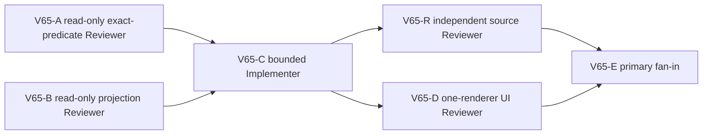

# Ticket Pack: V65 visible bridgehead claim diagnosis

## Outcome and observed failure

A fresh V31 player built and saved the north ladder and connected-river bridge `works6:river-bridge:-43`, crossed outward to the far dry bank, traversed the former x -170 micro-drop seam, and saved/reloaded V31 save #52. The map shows the discovered P post and says to claim it, but the HUD never shows `Claim River Works find` at x -172.38,z 15.91; -170.16,z 16.95; -169.68,y 1.27,z 16.96; or -170.83,y 1.28,z 17.56. The browser is closed. V64 movement source and live outward crossing passed. Diagnose the first false predicate and repair only the observed owner, then retry the same visible journey. Full Mireglass progression and the pre-existing bridge return failure are not this pack's terminal condition.

## Authority and safety contract

- V30 checked claim action remains authoritative. Do not bypass built bridge, discovery, ownership, unclaimed, grounded dry exit, reach, or reward validation to show a button.
- The visible P post, map advice, HUD Ready control, and saved action must agree. If the P marker is placed outside checked reach, adjust presentation/geometry narrowly without accepting remote claims. If surface/pose precision causes a false negative, correct only an observed tolerance with a negative guard.
- Preserve V23-V31 saved formats and old accepted witnesses. Do not alter V64 movement, actual river bridge geometry, excavation rules, migration, save storage, or full-game guidance until this claim works. No GitHub, commit, push, reset, or user browser state mutation.
- One isolated Wizard WebGL renderer maximum, only for final UI retry; close after claim/save or first blocker. Live URL `http://127.0.0.1:5193/?publicWorld=v31` must remain available. User saves must be preserved.

## Lane graph

A and B are independent: A checks the domain claim predicate using the numeric far-bank witness; B checks projection/HUD/action gates and exact post position. Both are read-only and can run in parallel. C receives their fixed owner/interface decision and makes the smallest change. R and D then run in parallel. Maximum practical width two. Do not activate C if predicates or data lineage remain unknown; ask for a focused source probe first. No speculative broad terrain work while this concrete UI failure remains.

## Tickets

### V65-A, domain predicate Reviewer, dispatch now

Read-only trace `previewPublicV30BridgeheadClaim` and its checked dependencies for saved bridge `-43` using numeric positions from V64-D. Reconstruct the actual far-bank state or run a deterministic source probe from the known seed if possible without browser or save writes. Return exact first rejection (`not_built`, `undiscovered`, `unavailable_here`, `too_far`, etc.), source/pose/exit Y values, and which conditions must remain strict. No production edits, renderer, saves, Vite restart, or Git writes.

### V65-B, projection/HUD Reviewer, dispatch now

Read-only trace `localPublicV30BridgeheadPost`, V31 projection composition, `WizardHud` button gate, `controllerActionsEnabled`, and `legacyActionsUnavailable`. Compare visible P post/map note with canonical site.exit and selected bridge. Identify the earliest false presentation gate and a smallest owner boundary. Do not edit, open browser, mutate saves, restart Vite, or Git write.

### V65-C, bounded Implementer, conditional after A/B

Own only the confirmed owner files plus focused tests fixed at fan-in. Reproduce the exact failure in a source test before change; modify the smallest observed owner. Preserve strict claim authority and previously accepted replay/event bytes. Run focused claim/view/controller tests, TypeScript, and `git diff --check`. Report an observed-error loop and release ownership. No renderer, Vite restart, saves, commits, or GitHub actions.

### V65-R, independent Reviewer, conditional after C

Read-only audit exact checked claim and view parity, negative remote/undiscovered/unbuilt/claimed/airborne cases, old saves, and smallest diff. Return GO/NO-GO; no browser or edits.

### V65-D, one-renderer fresh UI Reviewer, conditional after C

Use one isolated V31 browser and visible controls. Prefer the prior isolated profile's persisted V31 save #52 at the exact far-bank post if available; otherwise repeat the same fresh ladder, saved river bridge, and far-bank route. Do not inject saves or teleport. Claim, save/reload, and stop at first blocker. Capture screenshots, actual control text, console/network, memory before/after closure.

## Dispatch registry

- 2026-10-10: V64-D one-renderer UI retry observed bridge crossing and save/reload pass, claim button absent at four far-bank positions, no dynamic console/network failure. Screenshot `/private/tmp/pa-wizard-playable-v2/.playwright-cli/page-2026-10-10T13-27-29-358Z.png` shows visible post guidance without claim control. Browser closed, memory recovered to 61% free. V65-A/B pending.
- 2026-10-10: V65-A reconstructed V31-valid built `-43` bridge states at all four observed XZ positions with canonical Y; V30 checked claim returned Ready/basic-pick at every one. Exit `(-172,1.276151702590684,16)` is discovered and distances are 0.391, 2.071, 2.511, and 1.950 m. No domain guard change is justified. V65-B found the false HUD gate: V14 streamed projection sets `unavailableActions: true`, carried through V31, and `WizardHud.tsx` incorrectly includes `!legacyActionsUnavailable` in the V30 claim-specific button predicate. Existing `WizardHud.test.ts` asserts this old hiding behavior. Fixed V65-C owner boundary: only `view/WizardHud.tsx` and existing `view/WizardHud.test.ts`. Remove the legacy-action condition from the V30 claim predicate only; retain claimReady, reward, controllerActionsEnabled, savePaused, and all checked writer gates. Assert Ready in streamed wilderness shows the claim while unrelated legacy interactions remain hidden, and non-Ready/disabled/claimed cases remain hidden. V65-C dispatch pending.
- 2026-10-10: V65-C native continued Implementer released the two HUD owner files. Red test reproduced hidden Ready claim (31/32); one predicate deletion and focused test update passed 32/32, broader 7-file view/domain 140/140, TypeScript and whitespace checks. V65-R read-only independent review and V65-D one-renderer UI retry dispatched in parallel. Existing checked V30 claim authority was not changed.
- 2026-10-10: V65-R independent source review GO. V65-D one fresh isolated V31 browser rebuilt the north ladder and saved `works6:river-bridge:-43`, crossed outward, saw `Claim River Works find` at x -171.58,y 1.28,z 15.53, clicked once, and saw `River Works claim saved: basic pick added to your tools`. Reload validated V31 save #53 at the same position, retained Basic pick Equip, removed duplicate claim control, and showed the one-time reward as recorded. Browser closed, V31 preview HTTP 200, memory 60% free after closure. Console after reload had zero errors and one THREE.Clock deprecation. This pack passed; Mireglass and return crossing remain for the next journey step.
