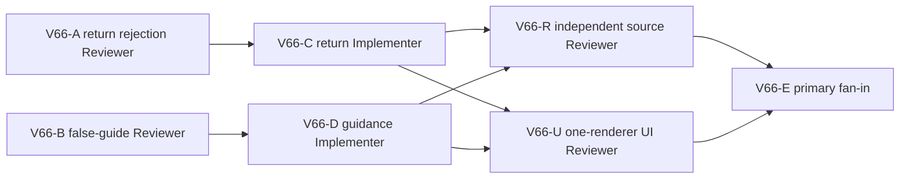

# Ticket Pack: V66 River Works return and frontier guidance

## Outcome and observed failures

The V65 fresh UI route can build the north ladder and connected-river bridge, cross outward, claim a basic pick, and reload at the far bank. Two concrete issues still obstruct a coherent first-region loop:

1. A previously accepted far-exit `-43` bridge state can return north for 38 singleton frames, then a move near z 10.08 is rejected. This predates V64 but prevents a reliable return to trade.
2. The far-bank HUD/map still says to cross the saved bridge after it has already been crossed and the one-time reward claimed. The source path overrules Mireglass frontier guidance with V27 bridge-built copy, as seen in the V64 far-bank screenshot and V65 claimed-state map.

Terminal condition: a player who claimed River Works can cross the same saved bridge back to the source bank with visible controls, while outward accepted history remains byte-identical, and the far-bank/claimed guidance points to the next meaningful frontier action instead of falsely saying to cross. Save/reload must retain claim and bridge. This is still a first-region slice, not full-game completion.

## Interface, authority, and safety

- Return route must use the existing saved bridge and checked V28 river passage. No air-walk, teleports, bypass of 1.6 m lane, new bridge, broad river geometry change, new save schema, or mutation of old accepted frame results/events. Investigate exact first failed predicate before code.
- Guidance is a view projection concern. It may depend on checked bridge built/claimed status and player location. Do not change saved claim authority, automatic progression, player action permissions, or distant undiscovered map reveal. A player on the source bank who has not crossed may still need “cross the bridge” guidance.
- Preserve V23-V31 roots and V31 soil gates, user saves, live preview URL `http://127.0.0.1:5193/?publicWorld=v31`, and one WebGL renderer maximum for final UI. No GitHub, commits, pushes, reset, or user browser/save mutation.

## Lane graph and topology audit

A and B are read-only diagnostics over separate owners, safe in parallel. C and D can implement in parallel only if their file ownership is disjoint and diagnosis establishes a small fix. R and U are independent final gates after both owners release. Use one UI renderer only and close promptly. Do not open a renderer during source diagnosis or implementation. If the return issue repeats after two grounded repairs or needs a broad physics rewrite, stop that lane and replan without blocking independent guidance.

## Smallest viable diff and tripwires

- Return owner fixed after A: `domain/publicWorldV28RiverPassage.ts` and existing `domain/publicWorldV28BridgeAction.test.ts`. A found a V28 wet-contact projection issue at the canonical grounded `site.to` dry-to-last-wet return seam, not a V23 or generic V26 issue. Reuse saved site, base surface, V25 river sweep, V26 pose, V31 soil gate. Exact old 76-frame outward result/event parity is pinned by V64-R.
- Guidance owner fixed after B: `PublicV23Controller.tsx`, `view/WizardHud.tsx`, existing `PublicV23Controller.test.tsx`, and existing `view/WizardHud.test.ts`. One stage-aware view rule should supply map and route-panel guidance, while the backpack should reuse that projected guidance rather than hardcoding a second bridge instruction. Do not change domain or saved state.
- Tripwires: changed old accepted bridge events, unbuilt/off-lane wet crossing accepted, return across unrelated bridge accepted, false map reveal, duplicate claim, full-game action unlocked, schema or migration edits, second renderer, user save mutation.

## Tickets

### V66-A, source return diagnostic Reviewer, dispatch now

Reproduce the known saved `works6:river-bridge:-43` far-exit return using a deterministic read-only in-memory witness. Identify exact first rejecting frame, before/trial/corrected carrier Y and velocity, tile IDs, dry/wet seam, and first false V28/V23 passage or pose predicate. Compare old accepted outward/first 38 return result+event bytes. Recommend smallest layer-safe fix and negatives. No edits, browser, saves, Vite, or Git writes.

### V66-B, false-guide diagnostic Reviewer, dispatch now

Trace post-claim V31 map/HUD guidance through `PublicV23Controller.tsx`, V27 bridge guidance and Mireglass projection. Identify exact overwritten field/condition and minimal view-only precedence rule for source bank versus far bank and claimed versus unclaimed bridge. Use the V65 claimed state as target; no source edits or browser.

### V66-C, return Implementer, conditional after A

Own only the source/tests fixed by A and primary. Reproduce return rejection red, fix narrow saved-bridge seam, preserve old accepted outward/event bytes and all river/pit/high-drop/soil negatives. Run focused bridge/root suites, TypeScript, whitespace, and release. No renderer, saves, Vite restart, or Git actions.

### V66-D, guidance Implementer, conditional after B

Own only the view/controller source/tests fixed by B and primary, disjoint from C. Reproduce false guide in source test, change smallest projection rule, test before-cross, far-bank, claimed, unrelated bridge, and no-hint cases. Run focused view/controller tests, TypeScript, whitespace, and release. No renderer, saves, Vite restart, or Git actions.

### V66-R, independent source Reviewer, conditional after C/D

Read-only review both patches, old accepted byte parity, safety negatives, and no save/schema effects. GO/NO-GO for one UI retry.

### V66-U, one-renderer UI Reviewer, conditional after C/D

One isolated fresh V31 player, visible ladder/bridge/claim, then return across the same saved bridge to the source bank and inspect guidance on both sides. Save/reload. Stop at first blocker and close browser. Capture exact position, screenshot, console/network, RAM. No state injection, teleport, production edits, or user browser/saves.

## Dispatch registry

- 2026-10-10: V65-D source+UI passed outward crossing and one-time basic-pick claim on save #53. Browser closed, V31 HTTP 200, memory 60% free. V64-R independently found existing complete return rejection near z 10.08. V59 source review identified post-bridge guidance overwrite.
- 2026-10-10: V66-A read-only reproduced first return failure after 76 outward + 38 north frames: z10.08 dry tile to z9.92 wet tile, Y rise 0.00047736 m. V28 wet-contact interpolated carrier at z9.9999984 is 0.00023868 m below wet floor, so V26 pose rejects before saved-deck coverage. In-memory V28-only canonical saved return-seam shim completes all 76 return frames and preserves old accepted bytes; direct unbuilt/off-lane/unrelated/pit/forged-drop negatives stay rejected. V66-B found Controller V27 guide overwrites V24 Mireglass/map guidance and route-panel copy, while WizardHud independently hardcodes “find crossing and cross” even after claim. Fixed disjoint owners above; C/D may implement in parallel after red tests.
- 2026-10-10: V66-D view lane released four owner files after red→green and 46 focused tests, TypeScript, whitespace. Early independent view review found a concrete V24 precedence miss: seed `wizard-realms`, streamed x=-80,z=0 is on the valid Mireglass marker trail and within 8 m region classification, while V25 river center is z=4. V24 sets `Follow the dry west trail and study the frontier marker`; V28 `nearRiver` then overwrites it with generic connected-river Works guidance, and D's Controller branch copied the already-overwritten soilWorld guidance. V66-R(view) NO-GO pending a narrow fix that retains the authored V24 stage guidance at this overlap. V66-C return lane remains disjoint and active.
- 2026-10-10: D's narrow two-file repair preserved V24-authored guidance through V28 composition; 70 focused tests and TypeScript passed. Independent V66-R(view) GO at the real V31 x=-80,z=0 overlap and all bridge stages, no map reveal/action authority finding. C released V28 passage/test after red→green 76-out/76-return, pinned old accepted result/event bytes, current-source 8-file V28/V31 suite 39/39, TypeScript, whitespace. V66-R(domain) independent source review and V66-U one-renderer fresh UI retry dispatched in parallel. No Git actions or save/schema changes.
- 2026-10-10: V66-R(domain) GO, independent `-43` outward/return replay and old accepted byte parity. V66-U fresh visible V31 route selected another Ready site `works6:river-bridge:-44`, built and saved it, then failed outward on the rendered deck near x -175.53,y 1.38,z 6.00 with `The river blocks this step off the built bridge. Stay on the deck, or return to a dry end before moving sideways.` First blocker stopped claim/return/reload proof. Browser closed, memory recovered from 39% to 60% free. This is a new `-44` outward coverage/reachability issue, not evidence that the guarded `-43` return repair failed. V67 must reproduce the exact `-44` case before broader UI retry.
