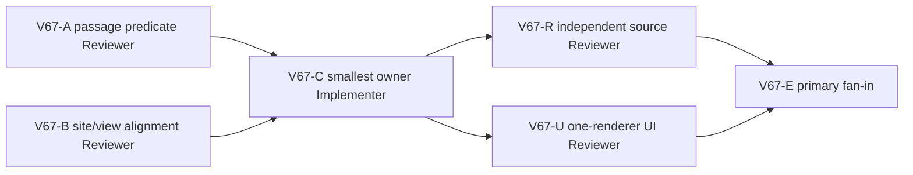

# Ticket Pack: V67 saved `-44` connected-river deck reachability

## Outcome and observed failure

In V66-U, a fresh visible V31 player built the north ladder, gathered eight bridge logs, and saved the Ready `works6:river-bridge:-44` from x -174.17,z 2.02. The player aligned to x -175.44,z 1.84, yaw -3.12 rad, walked south on the visible deck, and stopped at x -175.53,y 1.38,z 6.00. The next W step displayed: `The river blocks this step off the built bridge. Stay on the deck, or return to a dry end before moving sideways.` The map showed a P post at x -174.60,z 16.00. The sole browser is closed, memory recovered to 60% free. V66 `-43` deterministic outward/return replay and guidance source gates pass, but do not prove this `-44` user route.

Terminal condition: the exact visible `-44` lane can cross outward to the dry exit, claim the one-time River Works reward, return to the source bank on the same saved deck, save/reload, and show stage-correct guidance. If UI input is truly outside the designed lane, the game must accurately align the visual deck/map and explain how to enter it; do not widen the claim silently. The full campaign remains unfinished.

## Safety and authority

- Preserve V23-V31 roots and old accepted frame/event bytes, V31 soil gates, saved bridge width/coverage, one-time claim, user saves, and live Vite preview. No invisible crossing, generic river tolerance, broad geometry rewrite, teleport, dev-save injection, GitHub, commits, push, or reset.
- Diagnose the exact first rejecting frame and contact, not a guessed bridge-placement flaw. Compare canonical `-44` site support path/footprint/wetGap IDs with player XZ and the V25 wet supercover. Determine whether the block is a real off-lane coordinate, a false V28 projection rejection, or a world-view/visual mismatch.
- One isolated Wizard WebGL renderer maximum for final UI retry, close at first blocker or completion. No renderer for diagnostics/implementation. Preserve unrelated browser sessions and user work.

## Lane graph

A and B run read-only in parallel. C starts only after they agree on exact owner and tripwires. R and U can run in parallel after C. Maximum width two. If no small source owner can be identified, stop C and replan to explicit geometry/route design without mutating the game speculatively.

If C's first fix advances the journey to another seam, pause edits and use V67-X independent read-only diagnosis before expanding the contract. The next seam is not automatically covered just because it shares a bridge.

## Tickets

### V67-A, saved-passage diagnostic Reviewer, dispatch now

Read-only deterministic replay for the actual fresh-app seed `greenway-alpha` and saved `works6:river-bridge:-44` at x -175.44,z 1.84, yaw -3.12, south movement near last accepted x -175.53,z 6.00. Find exact first rejected frame, from/to XZ/Y/vv, V23 trial and V28 passage/pose, every wet contact tile and supporting deck. Compare ideal centerline x -176 and the actual offset. Recommend smallest safe owner and focused negatives. Do not edit/browser/saves/Vite/Git writes.

### V67-B, site/view alignment Reviewer, dispatch now

Read-only compare canonical `-44` bridge site from/exit/support path/width/wet-gap tile IDs with rendered deck and minimap in V66 screenshots. Determine whether x -175.53 is inside the actual deck, whether visual/map drift misleads, and whether the player is correctly told how to align. Identify smallest visual or source owner if A proves a mismatch. No edits/browser/saves/Vite/Git writes.

### V67-C, bounded Implementer, conditional after A/B

Own `games/wizard-realms/engine/src/domain/publicWorldV28RiverPassage.ts`, `publicWorldV28Replay.ts`, and existing `publicWorldV28BridgeAction.test.ts`, expanded after V67-X diagnosis. First reproduce exact `greenway-alpha` `-44` failure red in focused source test: x -175.44,z 1.84, inferred positive-3.12 yaw, 26 accepted W frames, frame 27 dry→wet seam failure near x -175.533,z 6.159. Extend the V28-local saved return-seam probe symmetrically for canonical grounded `site.from` dry→first-wet outward seam only when direct V26 wet-contact pose is null. Keep distinct direction/tile predicates, saved site/deck and 1.6 m lane, `(0,0.03]` floor rise/underfloor, no touched open pit, and full wet contact checks. Then cover the separate reverse first-wet→site.from dry seam in V28 `groundedDeckCarrier`: only a grounded saved bridge, matching first-wet and source dry tile IDs, negative z, both X within lane, native floor drop at most 0.03 m, no open pit, canonical returned old-carrier/event settlement. Preserve `-43` old accepted outward/return bytes, `-44` old 26-frame prefix and newly accepted outward bytes; test full 90/90 offset `-44`, centerline, unbuilt/off-lane/unrelated/pit/forged-rise/diagonal-wet-corner/V31 soil negatives. Run focused V28/V31, TypeScript, whitespace; release. No renderer/saves/Vite/Git actions.

### V67-R, independent source Reviewer, conditional after C

Read-only review actual diff and replay parity, safety negatives, visual alignment, and no save/schema changes. GO/NO-GO for UI.

### V67-X, conditional next-seam source Reviewer, active during C pause

After the outward seam advanced, C observed an offset `-44` reverse failure at north return frame 63 near z 6.159, wet→dry source bank. Independently identify the first failing predicate, exact carrier/contact floor and saved deck relationship, and whether a same-owner narrow guard can preserve all prior accepted results/events and safety negatives. No edits, browser, saves, Vite, or Git writes. Primary decides whether to amend C scope.

### V67-U, one-renderer fresh UI Reviewer, conditional after C

Use visible controls only in one isolated V31 browser. Repeat fresh ladder, bridge, outward claim, return, save/reload. If the site differs from `-44`, report it; explicitly inspect any next Ready bridge site rather than falsely claiming `-44` UI proof. Stop at first blocker, capture screenshots/positions/messages/console/network/memory, close browser promptly. No state injection, teleport, edits, user save changes, Vite restart, or Git actions.

## Dispatch registry

- 2026-10-10: V66-U first visible blocker at saved Ready `-44`, x -175.53,y 1.38,z 6.00, after entering from x -175.44,z 1.84 with yaw -3.12; exact river-off-bridge message above. Browser closed, RAM recovered. V66 source passed on `-43`; this pack diagnoses `-44` without assuming the same cause.
- 2026-10-10: Read-only V67-A was first dispatched to completed compatible source reviewer `/root/v59_source_reachability`, who immediately returned unable to complete with zero changes. Primary re-routed the same read-only contract to fresh native child `/root/v67_minus44_source_diag` without interrupting unrelated work. V67-B remains with completed compatible UI/site reviewer `/root/v59_ui_journey`. No implementer is active pending source evidence.
- 2026-10-10: Fresh source reviewer found a contract correction: visible fresh V31 defaults to seed `greenway-alpha`, whereas the initial V67 ticket guessed `wizard-realms`. Observed post z16 and deck z4→12 match `greenway-alpha` -44; `wizard-realms` -44 exits z8. Primary amended V67-A and informed V67-B. The incorrect seed hypothesis is not a game bug.
- 2026-10-10: V67-B read-only GO on geometry: actual player x -175.53,z6 is 0.33 m inside saved `-44` deck; render and minimap match canonical support path, so no view change is justified. V67-A independently reproduced 26 accepted south frames from x -175.44,z1.84 and frame 27 rejection at x -175.533,z6.159. V23 trial and both V28 endpoint bridge poses are valid; V28 wet supercover entry carrier probe at z6.0000016 is 0.000461623 m below the wet tile floor, so generic V26 pose returns null before saved deck coverage. Existing V28 return-seam probe is negative-z only. A recommends symmetric saved `site.from`→first wet guard, owner only V28 passage/test; B confirms real on-deck movement. C may start. A pinned old `-44` accepted 26-frame result hash `e4b24c1bfd526c0520cb05ff2ba6fda47410e63f00c29f2797dd6e780108d0fe`, event hash `1fe2ff3404d7bf6ec1e5080cb42293de8858961adc1c465b88658ec3675ae562`.
- 2026-10-10: C red reproduction reached the same frame/position but its actual `ready(-44)` built fixture had a different pre-fix prefix hash than A's synthetic saved-ledger fixture. A sent exact fixture construction and digest recipe to C. This is a fixture-state difference, not yet a behavior delta; C must pin pre/post bytes for one identical fixture rather than compare unrelated initial states.
- 2026-10-10: C's outward-only saved `site.from`→first-wet correction advanced the exact offset `-44` frame 27. A full-route probe then found a distinct reverse wet→dry source-bank reject at north return frame 63 near z 6.159. C paused production edits; primary activated V67-X independent read-only diagnosis before any scope expansion. No renderer open.
- 2026-10-10: V67-X independently reproduced the reverse failure after 90 outward and 63 accepted return frames. From wet z6.159 to dry z5.999, V23 trial is only 0.00046444 m above the dry floor with vv=-0.49. V28 river passage already succeeds; `groundedDeckCarrier` excludes northbound wet→dry at its direction guard, so durable decode fails. Primary expanded C to `publicWorldV28Replay.ts` for an exact saved first-wet→site.from dry carrier settlement, retaining V28 passage/test owner and strict predicates. No generic V23/V25 change authorized.
- 2026-10-10: C released three owner files after exact offset `-44` 90-south/90-north replay passed, focused V28BridgeAction 8/8, broad current-source V28/V31 40/40, TypeScript and whitespace. Old `-43` accepted digest tests and `-44` built-fixture 26-frame pre-fix prefix pins passed; unbuilt/off-lane/unrelated/pit/forged-rise/wet-corner/V31 soil negatives passed. V67-R independent source review and V67-U one-renderer fresh visible route dispatched in parallel. Browser still closed at dispatch.
- 2026-10-10: V67-R independent source review GO, including `-43`/`-44` accepted-byte parity, exact saved bridge guards, V31 raised-soil counterexample, and no schema/view change. V67-U one fresh isolated V31 player built Ready `-44`, passed former outward stop x -175.55,z6.01→6.17, crossed to x -175.83,z18.96, claimed basic pick, returned over the reverse seam z6.17→5.85 to source bank x -175.47,z2.01, and saw Greenway trade/optional recross guidance. Reload validated V31 save #57 and restored the completed bridge, claimed reward, basic pick, position, and no duplicate claim button. Console had no gameplay error, HTTP 200. Sole browser closed, memory recovered from 35% to 64% free. Terminal condition passed for the exact fresh `-44` loop; wider Mireglass spell/trade and full game remain unfinished.
