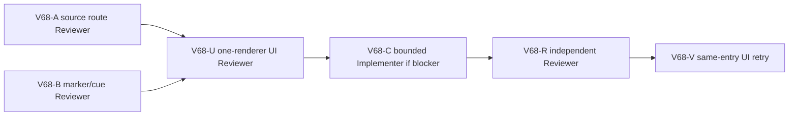

# Ticket Pack: V68 Mireglass first-spell journey

## Outcome and starting evidence

V67 proved in the real fresh V31 UI that a player can build a north ladder and connected-river bridge, cross, claim a basic pick, return over the same deck, and resume a validated save. V66 also proved the intended Mireglass marker guidance survives a real V24/V28 river overlap at x -80,z0. The next first-region question is whether a player can naturally travel from a far-bank exit into Mireglass Reach, find and study the frontier marker, learn Wayfinder Glow, and retain that spell after save/reload without using a dev teleport or injected save.

Terminal condition: one isolated visible V31 journey reaches the marker from an ordinary fresh player path, sees a clear actionable study control, learns Wayfinder Glow, casts it once if the checked context permits, and resumes a save with the learned state. Stop at the first reproducible blocker and fix that owner through the short observed-error loop. This is not full-game completion, monster-world expansion, or a redesign of the spell system.

## Safety and interface contract

- Preserve old V23-V31 save formats, accepted bridge replay/event bytes, V31 soil/river/cliff gates, discovered-map fog, marker study and spell authority, user saves, and the V31 live preview. Do not reveal distant terrain or trigger a spell without checked action.
- No GitHub/commit/push/reset. Do not mutate user browser or saves. One isolated Wizard WebGL renderer maximum; save/reload in that tab to recover memory if needed. Close at first blocker or completion. A source-only route preflight should precede another long renderer run.
- A source route can use deterministic world coordinates and checked actions for diagnosis, but final proof must use visible player controls and map guidance with no teleport, save injection, direct runtime method call, or hidden click.

## Lane graph

A and B are independent, read-only, and can run in parallel. U starts after route/cue preflight, then stops at the first real blocker. C is conditional and owns only the observed source, set at fan-in; R and V follow if C changes code. Do not invent code work if U passes. Maximum practical width two source lanes, then one renderer. Do not keep the renderer idle while diagnosis is underway.

## Tickets

### V68-A, source route Reviewer, dispatch now

From fresh seed `greenway-alpha` and saved Ready bridge `works6:river-bridge:-44` far exit x -176,z16, trace a physically valid path to the Mireglass frontier marker using existing terrain, bridge, V25 river, V26 valley, and V31 soil rules. Give approximate intermediate waypoints and tested stepping/jump constraints, not an impossible straight-line promise. Identify the first existing checked marker study action, its reach/ownership/discovery conditions, and save effect. Source-only probes allowed; no browser, edits, saves, Vite, or Git writes.

### V68-B, visible marker/cue Reviewer, dispatch now

Read-only inspect V31 map, HUD, interaction/action choices, and marker render for the journey after the far-bank claim. Determine what the player can actually see, whether the map guidance points to the marker without premature reveal, how Study and Cast controls appear, and any contradictory stale bridge copy. Recommend a realistic UI route and evidence checkpoints. No renderer, edits, saves, Vite, or Git writes.

### V68-U, one-renderer visible journey Reviewer, after A/B

One isolated fresh V31 player. Use visible axe, trees, north ladder, Ready river bridge, claim, then navigate to Mireglass frontier marker, Study, Cast if available, save/reload. Avoid turning the renderer into a long idle probe; reload after a checkpoint to reclaim memory, and close at first blocker or completion. Capture screenshots, exact position/messages, console/network, memory. If a different Ready bridge site is selected, report it and adapt route honestly. No state injection, teleport, dev controls, product edits, user browser/saves, Vite restart, or Git actions.

### V68-C, bounded Implementer, only after observed blocker

Use read-only UI and source evidence to set the smallest owner and red reproduction; change only that owner, repeat identical entrypoint and action, run focused compatibility/TypeScript/whitespace. No renderer or Git actions.

### V68-R and V68-V, only after C

Independent source review and one-renderer same-entry retry; preserve old saves, action authority, and discovery. Stop if safety requires a broader design decision.

## Dispatch registry

- 2026-10-10: V67 source and fresh UI passed saved `-44` bridge out/claim/back/save/reload. Browser closed, memory 64% free. V68-A/B pending; no renderer active for Wizard Realms.
- 2026-10-10: V68-A source replay proved a dry direct east corridor nevertheless fails at x -154.08 to -153.92, z16, on a 0.0735449 m downward tile step against the durable 0.03 m dry-settlement cap. Its only proven all-gates dry detour was 1,108 m north to z≈576 and back, not a plausible first-spell route. V68-B confirmed Study requires the marker tile discovered/visible, reach under 3 m, and a grounded streamed pose; it persists `wayfinder_glow`. No renderer was opened. Treat the reproducible source replay rejection as the first V68 blocker and diagnose the terrain seam before asking a UI tester to walk an impractical detour.

### V68-C1, causal seam diagnosis

Read-only compare the generated terrain heights and V23 durable movement rules at the first direct-corridor failed frame. Determine whether the smallest safe owner is world terrain continuity, movement descent tolerance, or route guidance. Preserve wet/soil/cliff gates and old saves. Produce a red replay fixture and a bounded repair contract. The primary agent then dispatches one implementation lane, an independent review, and a same-entry source/UI retry.

### V68-C2, bounded dry-step settlement implementer

C1 found the first seam is hashed terrain detail, not a river, cliff, or authored Mireglass barrier. Do not edit canonical tile heights: existing saved pose Y validation would reject old saves. A nearby 188 m dry route has exactly one failed 0.03733 m downward boundary at x -144→-140,z120; the existing 0.03 m terminal settlement rule makes it impassable, with no modest alternate route under current gates. Make a red grounded replay fixture at the first x -154.08→-153.92,z16, then change only the V23 terminal dry settlement owner, allowing a narrowly bounded downward step up to about 0.08 m when both source and target are base dry terrain, the carrier starts grounded, and movement remains a terminal, mild descent. Update both drop and target-height checks in the same rule. Preserve wet, pit, cliff, airborne-start, raised-soil, saved-bridge, event, and witness gates; stop if accepted historical witnesses change. Prove the 188 m path's formerly blocked seam under V31 replay, not merely the first frame. No canonical world generation or save schema changes.

#### Smallest viable diff and owner decision

Two independent read-only reviews agreed canonical height mutation would invalidate old grounded saves. One suggested a V28 bridge-ID/corridor-specific workaround; the other suggested guarded V23 dry terminal settlement. Integration chooses the V23 owner because independent hashed dry-cell falls affect ordinary no-bridge exploration throughout the connected world, not just the saved `-44` path. The V28-only workaround would leave that systemic defect elsewhere. Limit production edits to `publicWorldV23Transitions.ts` and focused movement/replay tests; no world generation, save schema, rendering, or route-guide edits. Keep the existing outer river, valley-rim, soil, and bridge checks unchanged. This deliberately updates the old test that expected a 0.0676 m dry fall to reject, while an explicitly larger fall and all protected gates must still reject. Preserve accepted historical witness output exactly.

## Final proof receipt

The V23 repair raised only the guarded dry terminal settlement cap to 0.08 m. The implementer reported 92/92 focused V23/V27/V28/V31 domain tests and TypeScript passing, including old accepted hash pins, negative wet/pit/raised-soil/high-drop gates, and both target seams. Independent read-only review returned GO. Source replay then passed a 188 m `-44` route (1,175 consecutive frames) and a 184 m `-43` route (1,150 frames), both reaching the marker and learning Wayfinder Glow through checked Study.

One fresh visible V31 browser run selected the legitimate Ready `works6:river-bridge:-43` site, not `-44`. The player equipped an axe, gathered logs, built and saved the north ladder and river bridge, aligned to the actual deck lane, crossed, claimed the Basic pick, and reloaded a validated far-bank checkpoint. Visible movement followed the source-proven north-first route through Mireglass Reach to the frontier marker. At x≈-108.03,z106.12 the 3D marker and minimap M were visible and `Study frontier marker` was enabled; clicking it displayed `fringe marker studied` and `Wayfinder Glow: Learned`. Cast was correctly disabled by checked reason `No new terrain or cache is within Wayfinder Glow reach`, so the optional cast condition was not met, not falsely claimed. Reload validated save #87 with Learned retained. Console had zero app errors, one Three.js deprecation warning; no failed requests in the CLI scan. The sole isolated renderer was closed, memory free rose to 65%. This proves the first-spell journey, not the full-game campaign.
