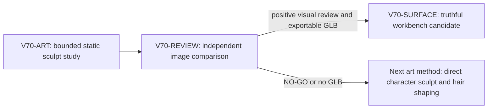

# V70 Wayfarer fidelity step pack

Status: repair_pack_required. Aligned with the active Wizard Realms full-game goal. Step-one art and independent review completed; both judged the result a visual NO-GO against the approved sheet. The conditional workbench lane was not activated.

## Problem and contract

The approved male and female turnaround sheets set the target: a coherent stylized adult face, layered hair, tailored violet robe, gold trim, and readable leather equipment. The current rigged v2 male is a visual NO-GO. The procedural bust was also a NO-GO. Produce an honest, visible **first improvement** using the staged UV-ready CC0 stylized male human mesh, not another collection of facial primitives. This is a staged art candidate and must not silently replace gameplay art.

The user's immediate acceptance surface is a reproducible front and three-quarter render next to the approved male sheet and v2 render. The editable Blender source must remain available for further sculpt, costume, rig, and animation steps. Preserve the approved sheet as reference, never a texture. Preserve v2, game saves, and all existing runtime assets.

## Scope locks and safety

- Work only under `games/wizard-realms/engine/art/characters/wayfarer_v3_staging/` for the art lane. A separate integration lane may update `engine/src/workbench/` only after a candidate GLB and render exist.
- Use one Blender process and one renderer at a time; no multiple browser preview windows. Prefer 2 Blender threads, bounded samples, and inspect memory.
- The human-base source is the existing official Blender CC0 bundle, SHA-256 pinned in `STAGING_MANIFEST.json`. Do not download or introduce unlicensed assets.
- No GitHub, branch, commit, or PR action. This pack does not authorize production promotion.
- Stage 1 is **face/hair/form** with an honest static pose. Rigging, walking, female variant, and final material fidelity are later gates, not claims in this pass.

## Acceptance and evidence

1. Front and three-quarter PNGs render from an editable `.blend`; an exportable static `.glb` is desirable but not required if it would compromise the art pass.
2. Face reads as one coherent adult head at game viewing distance. No separate cheek balls, detached nose, googly eyes, or spike-tube hair. Hair covers the back scalp with large swept layered clumps. The jaw, brows, eyes, and hairline move noticeably closer to the approved concept than v2.
3. If a bust rather than full body is delivered, frame and label it as a bust study. No workbench animation controls are presented for a non-rigged asset. Do not claim visual approval or gameplay readiness.
4. A short comparison verdict identifies objective improvements and remaining gaps. Include exact Blender command, version, render samples, image size, elapsed and peak memory when measurable, geometry/poly budget, and license provenance.
5. Re-open the exact generated PNGs and compare visually to `art/concepts/wayfarer-male-concept-v4.png` and `wayfarer_v2/male_three_quarter.png`. If the result does not improve those specific criteria, mark NO-GO and iterate once within the same bounded stage before handoff.

## Tickets and graph

`V70-ART` (implementer, primary transport `native_spawned_subagent`, model routing `planner_selected`, repository-aware native model). Starting inputs: approved sheet, v2 renders, `wayfarer_v3_artist_staging.blend`, CC0 source manifest, earlier negative probe verdict. Own only the art staging directory. Create/edit source and render a genuinely improved step-1 candidate, with visual verdict. Report files, exact command, resource use, and no-go gaps. Coding conventions: repo `AGENTS.md`, this pack, existing Blender authoring scripts. Smallest Viable Diff: add only necessary script/source/render/manifest files in the staging directory; do not alter v2, game, UI, or unrelated docs. PASS requires no out-of-scope edits and no unreviewed gameplay promotion. Conditional repair: if first render still has detached primitives or uncovered scalp, revise the same stage once and re-render one process at a time.

`V70-REVIEW` (read-only reviewer, primary transport `native_spawned_subagent`, model routing `planner_selected`). Runs after V70-ART. Own no files. Compare actual generated front and three-quarter PNGs against approved sheet and v2 at similar crop. Focus on the previously missed face/hair silhouette gap and whether the step is a real improvement. Findings-first verdict with specific visual evidence, not a generic code review. Smallest Viable Diff: read-only.

`V70-SURFACE` (conditional implementer, primary transport `native_spawned_subagent`, model routing `planner_selected`). Activate only if V70-ART provides an exportable static GLB and V70-REVIEW confirms an honest improvement. Own `engine/src/workbench/` catalog/viewer/tests only. Add v3 selectable beside v2 with static-stage labeling; disable or hide unavailable animation controls, and keep v2 clips inspectable. Exact UI acceptance: stage loads and image/reference compare works at `?workbench=wayfarer&candidate=wayfarer-v3-male-step1`. Smallest Viable Diff: only catalog/viewer/test edits needed for truthful static candidate handling, no game integration. Otherwise mark surface not required and provide PNG comparison in the reply.

No PR finisher: the user asked to see graphics improvement, not a PR. Reviewer is required because visual fidelity is the core acceptance and code checks alone cannot prove it. The primary agent owns pack tracking, worker receipts, final image inspection, relevant automated validation, and user delivery.

Topology audit: PASS. ART precedes REVIEW. SURFACE is predicate-gated on both an exportable GLB and positive visual review. Conditional repair is bounded to ART's same directory. Owners are disjoint, so there is no conflicting concurrent render or file write.

## Smallest Viable Diff

The current step adds only an editable head-study script, `.blend`, front and three-quarter PNGs, and the art verdict within the existing v3 staging directory. No v2 asset, gameplay character, save, or workbench code changed. The next pass should replace the inadequate head/hair study with direct sculpted forms in that same source scene, rather than broadening into costume, rigging, or runtime integration before the likeness gate passes. No PR unit is proposed for this visual NO-GO study.

## Result receipts

- `V70-ART`: native child `/root/v70_wayfarer_art`, inherited model, static front and three-quarter images plus editable Blender source, 16-sample Eevee render, 1.15 seconds, 431,767,552-byte maximum resident set, no game or Git action. Visual verdict: incremental coherent face improvement, still NO-GO.
- `V70-REVIEW`: native child `/root/v70_wayfarer_review`, direct inspection of both renders versus the approved sheet and v2, no edits or renderer. Visual verdict: improvement limited to face coherence; eyes, expression, and hair remain NO-GO. It identified the missing graph and standalone smallest-diff section, corrected here.
- `V70-SURFACE`: not activated because there is no exportable GLB and the independent visual review was NO-GO. The existing v2 workbench remains unchanged.
