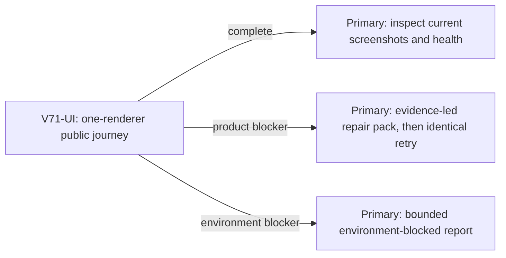

# V71 V31 Mireglass return-journey UI proof

Status: ready_to_dispatch. Goal alignment: prove the complete first distinctive region in the real UI before treating it as a foundation for the full connected campaign. Previous goal turn was progress: a new editable Wayfarer art stage and independent visual verdict established that direct sculpting, not another procedural head pass, is the next art method.

## Problem and acceptance

The current V31 public build at `http://127.0.0.1:5193/?publicWorld=v31` is live. A prior fresh-player UI journey learned Wayfinder Glow at the Mireglass frontier marker and persisted that state. The remaining current-revision journey must be driven through visible controls: reach the shelf, cast within range, reveal and excavate the seal cache, gather a Bell Alder herb, return and sell the expedition find and herb, visibly equip any earned gear, save, reload, and confirm the same world changes remain. The product must give usable route, dig, and return cues without source-coordinate intervention during the final proof.

One early-smoke lane should first continue from the prior UI state if its browser profile is still available. If not, start an isolated fresh browser profile, do not tamper with the user's local saves, and use the visible UI to reach the same point. After reaching the first decision-bearing outcome, either complete final proof or report the exact first blocker for a separate repair pack. Source-only replay and API calls are diagnostic evidence, never a substitute for UI proof.

## Scope and resource locks

- One Playwright browser renderer and one tab for this game. No Blender process, duplicate preview, or second Chromium instance. Close the test browser when evidence is captured. Leave the Vite server and user browser tabs alone.
- Test only the already-live app. Do not modify game code, saves, migrations, infrastructure, or Git state in this lane. Use an isolated browser profile for any new save.
- UI validation skills: `test-from-ui` in `early_smoke`, then `final_proof` if the journey advances; `playwright` CLI with fresh snapshots before element references.
- Capture start, key journey, final/reload or failure screenshots plus visible message, console error, and failed-network evidence. Do not claim the full game is done after this region.

## Lane graph

Topology audit: PASS. One productive UI lane is appropriate because another renderer would violate the RAM constraint; no artificial parallel lane exists. A product repair requires a new scoped pack after the observed owner is known, rather than a speculative conditional edit ticket. `V71-UI` uses a reusable, recently completed native subagent with direct V31 journey context. Primary transport: `native_spawned_subagent` via follow-up to `/root/v59_ui_journey`; model routing `planner_selected`, inherited native model. Recent capability proof: it previously completed the V31 bridge, frontier marker, spell-learning, and save/reload UI path, reported screenshots and browser health, then closed its renderer. Status was completed, so there is no interruption or ownership conflict. No fallback transport is selected.

## Ticket and receipt

`V71-UI`, role `user_flow_probe`, read-only. Start from the exact prior UI environment if available, otherwise isolated fresh profile. Own browser actions and screenshot evidence only, not source files. Required receipt: browser session ID/profile, current revision/URL, exact visible action path, snapshots and screenshots, pass/fail for cast, cache, herb, sale, gear, and reload, console/network health, RAM/renderer disposition, and exact first failure classification. If blocked, return `observed error | change: none | restart: none | retry result: not yet retried | next action` and source diagnostics only if necessary. Do not expand into unrelated tests.

Coding conventions: repo `AGENTS.md`, this pack, and the two UI skills. Smallest Viable Diff: read-only, zero files edited. Reviewer omitted because the primary can independently inspect screenshots and browser-health receipt for this one UI lane; a separate reviewer would duplicate observation and require another renderer. PR finisher omitted because no PR was requested and no code change is planned.
