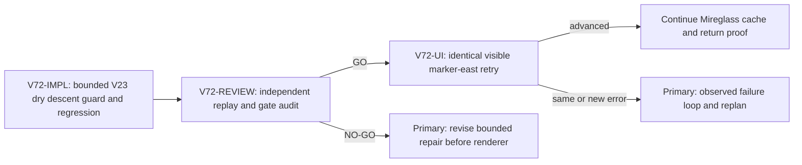

# V72 V31 visible dry-seam repair

Status: observed seam advanced in identical UI retry; first-region expedition and return proof still pending. Goal alignment: a player must be able to walk the visible continuous Mireglass route, learn and use magic, then finish the first-region return journey before broader campaign work.

## Observed failure and causal proof

Fresh `?publicWorld=v31`, seed `greenway-alpha`, studied frontier marker, then walked east on visibly continuous grassy ground. Last durable movement was near `(-87.19, 1.32, 102.02)`. Eight `(+0.15875, -0.01625)` frame deltas reproduce the failure at `(-85.92, 101.89)`: frames 1 through 7 accept, frame 8 crosses a dry tile edge. Source floor falls from `1.3223458559823957` to `1.2389021608756816`, a `0.0834436951067141` m descent. V31 strict replay returns null; its transient view reaches the target with `verticalVelocity=-0.49`, leaving Cast disabled as `Stand on grounded terrain to interact.` The UI reports `This step has no supported route.` See `.playwright-cli/page-2026-10-10T15-45-05-287Z.png`. The Mireglass barrier is null and river crossing false. The visual terrain links/smooths neighbors up to a larger elevation difference, so the grass honestly appears continuous.

`publicWorldV23Transitions.ts` guards terminal dry descents at `<=0.08` in both the source-floor drop and target-gap checks. This seam misses by only `0.0034437` m. The V28 retry and V31 durable replay inherit that guard. This is an observed product blocker, not an intended obstacle or environment failure.

## Acceptance and locks

Smallest causal repair: widen the guarded dry terminal descent allowance just enough to include the 8.344 cm seam, with a named bound and explicit tests. Provisional bound `0.10 m`; the implementer may choose a smaller principled value above the observed drop if corpus evidence supports it. Do not change tile heights, rendering, save schema, player velocity globally, wet/river/cliff/pit barriers, or unrelated UI. Old valid witness replays and source migrations must retain their exact result; corrupt and hostile moves remain rejected.

Reproduce the eight-frame case as a regression test at the V31 replay boundary. Add negative tests for a descent above the chosen bound, wet/river barriers, a pit edge, and non-terminal or airborne starts as needed to protect the guard. Run focused V23/V28/V30/V31, migration/replay, TypeScript, and `git diff --check` validations. Then retry the identical fresh UI entrypoint and eastward marker step. The UI retry must advance, remain grounded for Spell, and retain save/reload. If the same error survives two grounded repairs, broaden diagnosis rather than blindly increasing the threshold.

## Lane graph

Topology audit: PASS. Implementation and review are serial because the reviewer must inspect the actual patch. UI begins only after a GO review and runs with one isolated browser renderer. No artificial parallel renderer or overlapping file ownership exists. A failed review or changed failure returns to the primary planner with exact evidence.

## Tickets

`V72-IMPL`: implementer, primary transport `native_spawned_subagent` by safe follow-up to `/root/v61_bridge_seam_impl`, inherited native model, `planner_selected`. Recent-context proof: this completed subagent authored the prior 3 to 8 cm V23 dry-settlement change and passed 92 focused tests with no browser or Git writes. Own `engine/src/domain/publicWorldV23Transitions.ts` and narrowly related V31/V23 tests only. Read repo AGENTS, auto-planner, smallest-viable-diff. Receipt: exact observed error, changed bound/guard, affected tests, regression outputs, TypeScript, no browser, no Git, changed-file list and Smallest Viable Diff verdict. No fallback.

`V72-REVIEW`: read-only reviewer, native spawned follow-up to `/root/v63_soil_boundary_review`, inherited model, `planner_selected`. Recent-context proof: independently reviewed the prior V23 descent patch, V31 effective-height checks, and migration/replay risks. Focus on whether this precise seam is fixed without cliff/river/pit or historical-witness broadening beyond the stated acceptance. Findings-first GO/NO-GO, no files, no renderer. No fallback.

`V72-UI`: user-flow probe, native spawned follow-up to `/root/v59_ui_journey`, inherited model, `planner_selected`. Recent-context proof: this subagent produced the exact fresh UI blocker and screenshots, then closed its sole renderer. After review GO, repeat the same `?publicWorld=v31` fresh route and marker-east step through visible controls, then continue shelf/cast/cache/return until the next decision-bearing result. One renderer only. Receipt must use `observed error | change | restart | retry result | next action`, screenshots, console/network, save/reload, browser closure. No fallback.

Reviewer is necessary because the V23 guard is inherited through multiple save versions. No PR finisher: no PR requested. Primary agent owns source and screenshot integration, plus validation scope. GitHub actions are out of scope.

## Smallest Viable Diff

Change the one existing guarded dry-descent bound and focused regression tests. Reuse the current replay path, tile generator, and save contract. Do not introduce a new motion engine, schema, helper package, or terrain content revision for an 8.344 cm existing dry seam. Report changed lines/files and any historical replay implication. Deletion/simplification pass: remove no active guard; preserve both source drop and target gap predicates and all wet, pit, cliff, and bridge checks.

## Result receipts

- `V72-IMPL`: `publicWorldV23Transitions.ts` now uses one named 0.10 m maximum terminal dry descent for both existing guarded predicates. The exact eight-frame V31 regression and above-bound V23 negative were added. Eighty-eight focused tests, TypeScript, and whitespace checks passed. No renderer or Git action.
- `V72-REVIEW`: independent GO to the UI retry, 19/19 focused tests passed. Residual P2 gap: the eight-frame unit fixture has no saved bridge ID, so the exact saved `-43` branch required visible UI evidence. No source finding blocked the retry.
- `V72-UI`: a fresh `greenway-alpha` route built and claimed actual `works6:river-bridge:-43`, resumed validated save #41, and studied the frontier marker. From `(-86.94, 1.32, 102.21)`, visible `A` for 950 ms then `W` for 520 ms advanced to `(-85.23, 1.24, 101.81)` across the formerly rejected dry seam. The UI showed `V31 progress saved on this device`; Cast's reason changed to grounded `No new terrain or cache is within Wayfinder Glow reach`, not `Stand on grounded terrain`. Screenshot: `games/wizard-realms/.playwright-cli/page-2026-10-10T16-08-41-362Z.png`. Console: zero errors, one existing `THREE.Clock` warning, no dynamic failed request listed. One browser renderer closed after the decisive retry; free system memory recovered to 64%.

Observed error: visible dry route rejected at x≈-85.92 | change: guarded dry terminal bound 0.08 to 0.10 m | restart: none, existing Vite preview | retry result: **advanced** with actual saved bridge | next action: resume the Mireglass spell, cache, herb, and return-sale journey in a later isolated proof. This pack fixes the exact movement blocker; it does not complete the first-region or full-game goal.
