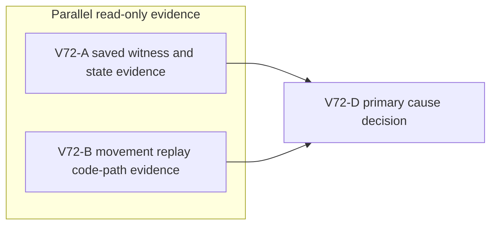

# Ticket Pack: V72 local frame replay failure diagnosis

## Summary

Original ask: build Wizard Realms into a complete, playable single-player RPG. The current first-region UI proof is blocked by a reproducible save freeze. This pack identifies the exact replay divergence before a narrow repair. It does not declare the first region, or the full game, complete.

Aligned problem statement: a fresh V31 player built the north ladder, gathered eight bridge logs, and walked west on the upper shelf. At x -90.36, y 1.26, z -27.48, the visible UI froze with `Save blocked (local-frame-replay)`. Browser console had no app exception. The isolated IndexedDB export contains a committed V31 head at revision 25 and x -80.43882791987258, y 1.3336058709881582, z -30.0020115161052. The exact cause of divergence between local movement preview and durable replay is not yet known.

Goal status: aligned. This diagnosis advances the first-region proof gate of the full-game goal. System translation: not_qualified, this is a local product bug. Product agent runtime: not_required, the shipped game does not run an agent. No human clarification is needed for read-only diagnosis.

Locked design:

- Do not weaken `local-frame-replay`, writer checks, save schema, lineage, recovery, or old-version semantics to make the error disappear.
- Do not modify the user's saves or browser profile. The 115 MB export is isolated test-harness evidence, not a state to inject as product proof.
- One browser renderer maximum. These lanes launch no browser or Blender process.
- This pack is read-only. A subsequent observed-failure repair ticket may touch only the identified smallest owner, then the identical UI journey must be retried.

Important repo truth:

- `PublicV31ControllerRuntime.ts` adapts V30, which adapts V29 and V28. The literal `local-frame-replay` freeze originates in `PublicV28ControllerRuntime.ts` `flush()`.
- V28 frame preview calls replay with `allowAirborne=true`, while `flush()` calls the durable replay without that flag and requires exact equality with the preview.
- When there are no built river bridges, V28 delegates movement replay to `replayPublicV27FramesWithEvents()` in `publicWorldV27Snapshot.ts`.
- `publicWorldV23Transitions.ts` has a terminal dry-descent settlement path when `allowAirborne=false`. It must not be bypassed without proof.

Success criteria: return a decision-sufficient, evidence-backed owner and smallest repair hypothesis. Record whether the committed head is valid, whether a specific accepted frame sequence can reproduce the mismatch, and whether preview/durable replay differ at a dry descent, another movement seam, or an unrelated validity gate. Unknowns must remain explicit. No code change is authorized by this pack.

## Lane Graph

## Topology Audit

- Productive-lane inventory: V72-A closes the saved-state validity and last-commit unknown using the isolated export; V72-B closes the preview-versus-durable replay ownership unknown using source and existing tests. Neither produces a generic duplicate review.
- Maximum parallel width: two read-only lanes. A and B are incomparable because neither consumes the other's artifact.
- Fan-in: V72-D consumes both receipts and either selects a single bounded repair owner or returns an explicit unresolved reproduction gap.
- Broad-lane split: each lane owns one evidence concern and edits zero files. No artificial implementation fanout.
- Certainty and surprise: the coarse model is a movement replay mismatch near a dry terrain seam. A valid state plus a same-state replay mismatch supports that model. Invalid committed state, a bridge ledger failure, or a version-wrapper mismatch is a surprise and redirects only the affected diagnosis.
- Serial edge justification: A and B must finish before D can identify the smallest safe edit; D cannot infer the owner from the UI label alone.
- Reviewer lane: A and B are the independent read-only evidence lanes. Another reviewer would duplicate them. PR finisher: omitted because no PR or code change is requested here.
- Dispatch verdict: PASS for this diagnosis pack. A repair requires a separate scoped ticket after the owner is known.

## Tickets

Paste now to: V72-A read-only evidence reviewer
Ticket: V72-A
Lane type: Parallel
Delivery phase: user_flow_probe
Delivery milestone: pre_surface
Shortest complete user flow: prior V31 fresh-player ladder and westward movement, ending in the captured save freeze
First-feedback evidence: `games/wizard-realms/.playwright-cli/page-2026-10-10T17-28-52-367Z.png`
Test-writing policy: prohibited_until_pr_hardening
Review blocking class: the saved-state evidence cannot distinguish product replay failure from a malformed test export
Validation environment: current worktree and isolated IndexedDB export only
Environment repair authority: none
Environment stop condition: one bounded export-read confirmation, then report unavailable evidence
Surface readiness: not_applicable, read-only diagnosis
Surface revision: V31 current worktree, V31 head saveRevision 25 in export
Surface entrypoint: `http://127.0.0.1:5193/?publicWorld=v31`, do not launch it
Surface availability: Vite remains live; no browser is opened
Post-surface validation: primary will decide repair and identical UI retry
Optional-feedback wait policy: never
Depends on: none
Branch: `ben/wizard-playable-v2`
Worktree: `/private/tmp/pa-wizard-playable-v2`
Lane role: Reviewer
Dispatch transport: native_spawned_subagent
Model: inherited
Cursor runtime: not_applicable
Existing-task routing: no_qualified_candidate, existing UI tester has browser evidence but no saved-state decoder mission
User-authorized coordination: ephemeral collaboration within the active game goal
Ownership/collision evidence: read-only; no files or browser owned
Current-status evidence: fresh child, no active work to interrupt
Delivery policy: one bounded source/export analysis receipt
No-interruption disposition: not_applicable
Task/thread receipt: not_applicable
Final fallback transport: none
Fallback fields: not_applicable
Runtime rationale: native child can examine local export without a model/provider dependency or extra renderer
Agent spec: exact-state and replay-witness forensic reviewer
Required skills: auto-planner-ticket-pack, smallest-viable-diff
Session policy: one native child session, no nested workers
Worker agent: Codex reviewer
Required behavior: inspect only `/private/tmp/wizard-v71-ui-blocked-idb-state.json`, V31/V28 save decoders and relevant existing tests. Verify head revision, pose, vertical velocity, bridge ledger, witness, and whether a read-only deterministic replay from the saved head can isolate failure. Do not inject the export into a browser, edit files, or do Git actions.
Certainty contract: discriminate valid committed V31 state from malformed state or invalid bridge sites. Stop once evidence determines the branch; surprise if state invalid or missing.
Smallest Viable Diff: zero files, zero new lines, zero dependencies. Reuse the existing decoders. No code or prompt/config edit is applicable. No tripwire may be crossed.
Acceptance: return exact values, source paths, any read-only command output, and a minimal reproducing frame sequence if found; otherwise say precisely what the export lacks.

Paste now to: V72-B read-only replay reviewer
Ticket: V72-B
Lane type: Parallel
Delivery phase: user_flow_probe
Delivery milestone: pre_surface
Shortest complete user flow: same V31 fresh-player westward movement freeze
First-feedback evidence: same UI screenshot and `local-frame-replay` label
Test-writing policy: prohibited_until_pr_hardening
Review blocking class: no actionable replay owner established
Validation environment: current source and existing tests only
Environment repair authority: none
Environment stop condition: one bounded source/test inspection, then report uncertainty
Surface readiness: not_applicable, read-only diagnosis
Surface revision: current V31 worktree
Surface entrypoint: `http://127.0.0.1:5193/?publicWorld=v31`, do not launch it
Surface availability: Vite remains live; no browser is opened
Post-surface validation: primary will decide repair and identical UI retry
Optional-feedback wait policy: never
Depends on: none
Branch: `ben/wizard-playable-v2`
Worktree: `/private/tmp/pa-wizard-playable-v2`
Lane role: Reviewer
Dispatch transport: native_spawned_subagent
Model: inherited
Cursor runtime: not_applicable
Existing-task routing: no_qualified_candidate, existing art and UI agents have incompatible mission for replay source review
User-authorized coordination: ephemeral collaboration within the active game goal
Ownership/collision evidence: read-only; no files or browser owned
Current-status evidence: fresh child, no active work to interrupt
Delivery policy: one bounded source analysis receipt
No-interruption disposition: not_applicable
Task/thread receipt: not_applicable
Final fallback transport: none
Fallback fields: not_applicable
Runtime rationale: native child can inspect current TypeScript and tests without an extra renderer
Agent spec: movement replay invariants reviewer
Required skills: auto-planner-ticket-pack, smallest-viable-diff
Session policy: one native child session, no nested workers
Worker agent: Codex reviewer
Required behavior: inspect `PublicV28ControllerRuntime.ts` preview/flight/flush and `publicWorldV27Snapshot.ts`, `publicWorldV28Replay.ts`, `publicWorldV23Transitions.ts` around airborne and dry settlement. Name the exact condition by which a frame accepted in preview can fail or differ in durable replay. Recommend the smallest owner and a discriminating focused test, but do not edit, run browser/Blender, or do Git actions.
Certainty contract: distinguish dry-descent preview/replay divergence from bridge-site validity or wrapper drift; stop at evidence-backed owner, surprise if source logic disproves the coarse model.
Smallest Viable Diff: zero files, zero new lines, zero dependencies. Reuse existing tests and helpers. No code or prompt/config edit is applicable. No tripwire may be crossed.
Acceptance: return file/line evidence, exact live branches, smallest repair hypothesis, and risks to older saves.

## Assumptions

- The browser export is generated by the isolated fresh V31 test and contains no user save. It is diagnostic input, not a replacement for UI validation.
- The current code version is the same one served when the failure occurred. If Vite hot-reloaded after the screenshot, the primary must rebind evidence before authorizing a repair.
- No GitHub or PR action is authorized by this pack.
