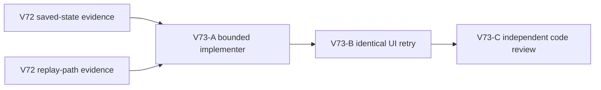

# Ticket Pack: V73 V31 movement replay repair

## Outcome and evidence

Original goal: a complete playable Wizard Realms RPG. Immediate user-flow blocker: a fresh V31 player who has built the north ladder and gathered eight bridge logs freezes while walking west with `Save blocked (local-frame-replay)` at approximately (-90.36, 1.26, -27.48).

V72 diagnosis verified the isolated committed revision 25 and its bridge ledger. Replaying 63 copies of the committed movement frame from that head accepts each frame in the local controller, then `save()` fails before writer invocation. A 64-frame continuation reaches the UI's rounded pose and fails the same way. The V28 controller previews one frame at a time but flushes the accumulated batch. V23's small dry-descent settlement applies only to the final frame of a durable batch. This creates a non-compositional seam. The exact browser's unsaved queue is unavailable, but the matching deterministic continuation is sufficient for a bounded repair and identical UI retry.

Goal status: aligned, not complete. System translation: not qualified. Shipped agent runtime: not required. No new human choice is needed for this bug repair. This is a one-PR-unit product fix, but no PR is authorized in this task.

## Scope and invariants

- Preserve strict `local-frame-replay` and writer equality gates. Do not silently discard frames, bypass checked writes, change saved witness meaning, rewrite prior saves, or alter V23 historical replay semantics.
- Own the smallest V28 controller buffering/acceptance path. Touch a V31 UI caller only if a verified save/retry handshake cannot be completed within the controller contract. Do not edit unrelated game or aquarium code.
- Keep the V31 preview live at `http://127.0.0.1:5193/?publicWorld=v31`. One browser renderer maximum. The implementer needs no browser; the existing UI tester owns the later retry.
- Use `apply_patch`; preserve the dirty worktree. No GitHub action or PR. The user's `gh-bioscopics`, personal noreply, and `ben/` rules remain in force if future GitHub work is requested.
- Do not add a broad subsystem. A focused regression is appropriate after the fast-path repair advances the identical journey.

## Lane graph and topology audit

The implementer and UI tester are serial because the retry must use the patched code. Independent review may start as soon as the patch is ready, in parallel with the UI retry. Each lane has a distinct output. No speculative extra implementers or renderers. Dispatch verdict: PASS.

## V73-A implementer ticket

Role lock: implementer. Delivery milestone: repair before UI proof. Branch/worktree: `ben/wizard-playable-v2`, `/private/tmp/pa-wizard-playable-v2`. Reuse the V72 deterministic revision-25 continuation. Identify the first exact cause of durable null at frame 63, then make the smallest V28 runtime change that prevents a grounded preview from accumulating a non-durable witness while allowing legitimate passage over the dry seam. A checkpoint/retry handshake is acceptable if source contracts support it. Do not merely replace the freeze with an impassable invisible wall. Keep old-version saved witness replay exact. Validate the same 63/64-frame continuation, writer call, final pose, and a subsequent continued movement/second save. Run focused existing tests and add a regression only once the entrypoint advances. Report `observed error | change | restart | retry result | next action`, changed files, and residual risks. No browser, Blender, Git commit, PR, or nested agents.

Smallest viable diff: prefer `PublicV28ControllerRuntime.ts` only; a second file is allowed only if the caller's existing save/retry contract makes it necessary. No new dependency, migration, or version bump. Preserve historical tests.

## V73-B UI tester ticket

Role lock: UI acceptance tester. Depends on V73-A patch. Repeat the same V31 entrypoint and fresh-player journey: north ladder, eight logs, westward upper-shelf movement through the failure coordinate, save, then continue to the creek bridge and beyond. The prior screenshots are early-smoke evidence, not proof of a fix. One isolated browser only, close it when finished. Report visible result, console/network, saved revision, and any next blocker. If a harness-reconstructed revision-25 state is used for exact retry, label that as a harness diagnostic and also run a fresh UI route for product proof.

## V73-C review ticket

Role lock: read-only reviewer. Depends on patch. Check the V28 replay invariant, witness/writer gates, older V23 replay semantics, pending-frame cap and retry behavior, and the focused regression. No browser. Return findings-first GO/NO-GO and concrete citations.

## Stop rule

If the same error survives two grounded bounded repairs, or a fix requires changing historical witness semantics or save migration, stop this fast loop and replan. Do not claim the first region or the full game is finished merely because this freeze is fixed.

## Validation receipt, 2026-10-10

Observed error | change | restart | retry result | next action: A fresh V31 player froze at (-90.36, 1.26, -27.48) with `Save blocked (local-frame-replay)` | V28 now keeps a dry descent airborne through its short flight and reserves room to land before the frame cap, while preserving replay and writer equality | the existing Vite preview served the changed modules and a fresh isolated browser was opened | the same fresh-player UI route advanced past (-92.77, 1.26, -27.85), built and crossed `works6:river-bridge:-43`, claimed the Basic pick, and resumed from validated save #58 with the claim preserved | continue separate first-region spell, herb, cache, return-trade, and equipment UI proof.

Focused automated validation: 33 tests passed across the V28 controller, V31 controller, and V23 movement files; TypeScript `--noEmit` passed. The exact isolated revision-25 continuation saved at frame 65 and again after five more frames. A 127-look plus dry-descent cap case saved at frame 128 and accepted another movement and save. Checked-successor validation passed on those saves. Independent review found no blocking issue after the cap correction. Current terrain flights tested landed within the 32-frame reserve; an unusually long future flight remains a residual risk to revisit if world geometry expands.

Real UI proof: a fresh greenway-alpha player built the north ladder, gathered eight logs, crossed the former freeze point, built the connected-river bridge, crossed it, claimed the pick, reloaded, and restored that state. Console showed only a favicon 404 and a `THREE.Clock` deprecation warning, with no failed dynamic requests. The sole Wizard browser session was closed afterward. This proves the replay repair and this bounded journey, not the entire first region or game.
