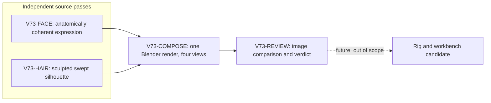
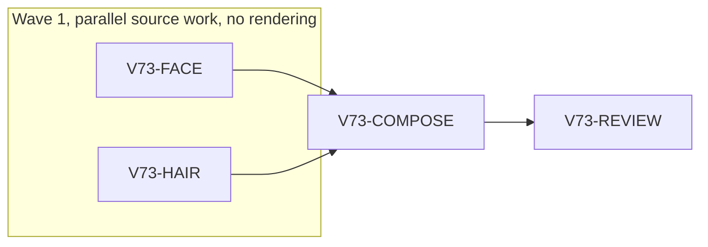

# Ticket Pack: V73 Wayfarer head fidelity

Status: static head-study milestone ready to show after bounded repair; not approved for workbench or gameplay. The full character-fidelity request remains open.

## Ask and aligned problem

Original ask: show stepwise improvement in the wizard character's graphics so it approaches the approved turnaround sheets. There is no new PRD. The current rigged v2 is a structural pipeline test, not accepted art. The v3 static head study has coherent anatomy but still reads as a wide-eyed, anxious youth with helmet-like hair. The next honest increment is an editable, visibly better **head study**, compared directly with the approved male sheet and the v3 baseline. It must not silently replace the playable avatar.

Goal contract: aligned with the active full Wizard Realms goal. This pack is one art-fidelity increment, not full-game completion. System translation: not_qualified, no runtime/platform port. Product agent runtime: not_required, the delivered game gains no agent execution.

Goals: adult confident face, narrower grounded eyes, more natural brows and mouth, swept layered chestnut hair that covers scalp and nape without a hard helmet edge. Success is front, three-quarter, side, and back renders from an editable Blender source that are clearly closer to the approved sheet at matched crop, plus an honest visual verdict. Non-goals: game promotion, full robe, rig, animation, female character, save changes, PR or GitHub action.

Constraints: use the pinned CC0 Human Base Meshes source and the existing `wayfarer_v3_step1_head.blend`. The approved concept is a guide, never a texture. Avoid detached face parts, tubes, spikes, and a uniform hair cap. Preserve the existing 2.257 m coordinate contract. Only one live browser or Blender renderer at a time because of RAM. The V72 UI replay currently owns the renderer slot; art lanes may prepare source in parallel but must not render until it closes.

Open question: can bounded Blender sculpt and authored hair forms reach a visual improvement without a human sculptor or image-to-3D service? The integrated four-view render is the discriminating probe. If not, retain the editable source as an experiment and mark visual NO-GO rather than promoting it.

Implementation risk: mesh edits could harm eyelid topology or reveal scalp. Compare all views and preserve base topology where possible. The prior v70 visual NO-GO is the baseline evidence.

## Summary

Create two independent, composable Blender passes against the same static head scene. Compose and render only after both are available and the UI renderer has closed. Review the actual images against the approved sheet. Show the user the new stage even if it remains a NO-GO, with explicit differences and remaining gaps.

Locked design:

- Neither pass edits the playable character, v2 asset, workbench, or saves.
- No asset enters the workbench without an exportable GLB and positive visual review. This pack does not target either.
- There is no Git commit, branch, PR, or GitHub action.

Important repo truth:

- `art/characters/wayfarer_v3_staging/wayfarer_v3_step1_head.blend` is the editable static baseline.
- `art/concepts/wayfarer-male-concept-v4.png` is the approved male reference.
- `art/characters/wayfarer_v2/male_three_quarter.png` and `wayfarer_v3_staging/step1_three_quarter.png` show the visual debt.
- `engine/src/workbench/characterCatalog.ts` lists only rejected rigged v2; the v3 bust is intentionally absent.

## Proposed Flow

## Public Interfaces

No game/runtime interface changes. `face_pass.py` exports `apply_face_pass()` and `hair_pass.py` exports `apply_hair_pass()`; both accept the open Blender scene and mutate only their named head/face or hair object groups. `author_step2.py` loads the step1 scene, calls face then hair, saves `wayfarer_v3_step2_head.blend`, and renders `step2_{front,three_quarter,side,back}.png`. These paths are art artifacts, not playable assets.

## Lane Graph

## Topology Audit

- Productive lanes: FACE owns facial mesh and expression in `face_pass.py`; HAIR owns layered scalp and locks in `hair_pass.py`. Neither consumes the other. Both create distinct source artifacts.
- Maximum parallel width: 2. `FACE || HAIR` is safe because file and Blender object ownership are disjoint and neither starts a renderer.
- Fan-in: COMPOSE consumes the two modules to produce one candidate source and four renders. REVIEW consumes the rendered result.
- Serial edges are necessary because composition needs both modules, and visual judgment needs actual integrated views.
- Certainty: the four-view composition tests whether these separate passes survive integration; visual review decides whether resemblance improved. An extra generic reviewer or broad automated suite would not answer the art question.
- Surprise: if either module corrupts topology, faces disappear, hair clips into face, or RAM exceeds the one-renderer budget, stop and repair only that owner.
- Conditional game integration is absent. PR finisher is omitted because no PR was requested. Dispatch verdict: PASS.

## Smallest Viable Diff

Behavior delta: one static art candidate with better face and hair likeness.

Expected diff budget: three new Python files, one `.blend`, four PNGs, one short verdict note; zero dependencies, zero runtime changes, zero refactors. FACE and HAIR source total 298 new lines, so composition will cross the generic 300-net-line tripwire. Replan decision: permit at most about 400 net Python lines for this art-only, separate-pass experiment, because the authored face and hair geometry plus a reproducible four-view renderer cannot fit the generic production-code budget without obscuring their ownership. Keep composition near 80 lines and reuse Step 1 helpers. Stop again if another source file, dependency, game change, or more than 400 new Python lines becomes necessary. The artifact count exceeds generic code-file guidance because each view is a required art proof, not a separate implementation surface.

Expected changed files: `face_pass.py`, `hair_pass.py`, `author_step2.py`, `wayfarer_v3_step2_head.blend`, four `step2_*.png`, and `STEP2_VERDICT.md`, all inside the existing v3 staging directory. Forbidden: game source, workbench, v2, saves, concept sheets, package files.

Reuse scan: `author_step1.py`, its scene/camera/material helpers, the CC0 base and `STAGING_MANIFEST.json`, v2 rig contract. Prompt/config alternative is insufficient because the shortfall is actual geometry and expression. Simplify by removing the old v3 HAIR study from the composed candidate, not layering more locks on it. No new dependency or shared abstraction. If the pass needs broader files or another service, stop and replan.

Validation: `blender -b -t 2 --python author_step2.py` after V72 UI closes, inspect four outputs against the approved concept and v3 baseline, verify `.blend` opens and size/axis stay sensible. Record process memory and close it. No new tests until a candidate enters the workbench.

## Tickets

Paste now to: V73-FACE implementer. Role is `implementer` ONLY under `auto-planner-ticket-pack` and `smallest-viable-diff`. Delivery phase `implementation`, milestone `pre_surface`. Native ephemeral child, inherited model, no Cursor runtime or provider fallback. Existing task routing is a recently completed native child with current same-art scope and no active work. Worktree `/private/tmp/pa-wizard-playable-v2`, branch `ben/wizard-playable-v2`. Own only `games/wizard-realms/engine/art/characters/wayfarer_v3_staging/face_pass.py`. Required: use the existing anatomical head mesh, adjust eye aperture/eye globe, lids, brow, cheeks/jaw and expression toward the adult confident sheet without detached primitives; export `apply_face_pass()`; no rendering or Blender process while V72 UI is active. Inspect `author_step1.py` and v3 source first. Return exact source change, anatomy assumptions, validation possible without rendering, and small-diff receipt. No game, Git, or other file edits. Visual proof waits for COMPOSE.

Paste now to: V73-HAIR implementer. Role is `implementer` ONLY under the same two skills. Delivery phase `implementation`, milestone `pre_surface`. Native ephemeral child, inherited model, no Cursor runtime or provider fallback. No qualified existing task with hair-only ownership, so use a fresh ephemeral child. Same worktree/branch. Own only `games/wizard-realms/engine/art/characters/wayfarer_v3_staging/hair_pass.py`. Required: remove/rebuild prior HAIR objects, keep full scalp/nape coverage, asymmetrical swept fringe and layered side/back masses; no helmet edge, five identical spikes, tubes, or exposed bald patches; export `apply_hair_pass()`; no rendering or Blender process while V72 UI is active. Inspect `author_step1.py`, baseline render, concept. Return exact source change, mesh method, validation possible without rendering, and small-diff receipt. No game, Git, or other file edits. Visual proof waits for COMPOSE.

Wait for FACE and HAIR plus V72 browser closure, then paste to: V73-COMPOSE implementer. Role is `implementer` ONLY under both skills. Delivery phase `user_flow_probe`, milestone `SURFACE_READY` if four images render. Native ephemeral child, inherited model, no provider fallback. Own `author_step2.py`, `wayfarer_v3_step2_head.blend`, and four `step2_*.png` only. Import and apply the two passes to the step1 scene, maintain the camera/studio contract, render one Blender process at a time with 2 threads and at most 16 samples, record memory. No facial or hair ownership changes unless one pass fails and a bounded bugfix is separately activated. Return editable scene, four views, command, Blender version, image size, face count/triangles, elapsed and peak memory. If rendering fails, report first concrete error.

Wait for COMPOSE, then paste to: V73-REVIEW reviewer. Role is `reviewer` ONLY, read-only. Compare front, three-quarter, side, back against the approved male sheet and v3 baseline at similar crop. Findings-first GO or NO-GO for a **head study**, with specific face, hairline, side/back, silhouette, and material observations. Assess one-renderer and source-scope compliance, plus Smallest Viable Diff. Do not infer robe, rig, or animation quality from this bust. A GO permits only showing this as a static art study, not game promotion.

All implementers must report changed files, additions/deletions, reuse proof, why non-code was insufficient, simplification, tripwires, out-of-scope edits, exact commands, result artifacts, current revision, transport/model/session continuity, and visual-proof status. No existing external Codex task is contacted. The UI browser lane is isolated and owns no art files.

## Assumptions

- The approved male sheet remains the accepted style target.
- One visual increment is more honest than claiming a finished character or a female derivative from a weak male base.
- A Blender script can encode bounded edits, but if the rendered result remains below target, the verdict will say so and the next step must change method, not disguise the gap.

## Result receipts

- `V73-FACE`: one source-only pass on the staged CC0 anatomical mesh, then one bounded eye/brow repair after the first visual NO-GO. No detached facial objects, Blender run, runtime edit, or Git action by that lane.
- `V73-HAIR`: one source-only pass replacing the prior `HAIR |` objects with a covered scalp and asymmetric layered masses, then a two-addition/one-deletion rear-shell clearance repair after the first back render exposed a crown patch. No Blender run, runtime edit, or Git action by that lane.
- `V73-COMPOSE`: four views and editable `.blend` from one Blender 5.2.2 LTS process per attempt, 2 threads, 16 Eevee samples, 720 x 800 pixels. The identical retry after both bounded repairs passed: 1.35 s real, 439,402,496 bytes maximum resident set, 22 non-studio meshes, 19,541 faces, 38,854 triangles, 2.257000 m body height. Six legacy mask-driver warnings were already recorded in the source manifest. No new render error.
- `V73-REVIEW`: first render NO-GO because back crown exposed skin and eyes remained wide. Revised render GO only for showing an honest improved **static head study**. Crown coverage, eye narrowness, and side/back hair volume improved. It remains NO-GO for workbench/game and misses the approved adult likeness due to round face, severe/sleepy expression, broad plate-like hair, and flat materials. Further procedural parameter changes have diminishing return; next fidelity method is direct sculpting, hand-shaped hair, and material painting.

Observed error: exposed crown and protruding eyes | change: scoped hair-shell clearance plus recess/narrow eye and soften brow | restart: identical single Blender command | retry result: advanced to a truthful improved static-study milestone | next action: establish a non-procedural sculpt and material pass before any GLB, rig, female derivative, or game promotion.
