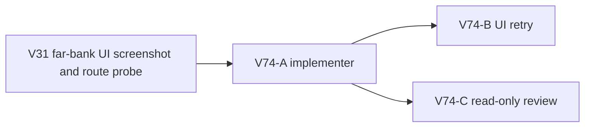

# Ticket Pack: V74 far-bank frontier wayfinding

## Outcome and evidence

The full Wizard Realms goal remains active. The current bounded objective is the V31 Mireglass first-region UI journey. A fresh isolated player built the north ladder and connected-river bridge, crossed it, claimed the Basic pick, and saved/reloaded. At (-156.84, 1.28, 117.46), the HUD said only to continue toward the Mireglass frontier marker. The north-up map showed no visible marker or direction. The independent tester stopped rather than navigating with source coordinates.

The `greenway-alpha` marker is at (-108, 104), about 50 m east-northeast of that saved position. One-meter samples of the direct segment and terrain are dry and unblocked. The same check from the far-bank exit to the marker also passes for the default `wizard-realms` seed. The current generic text is owned by `publicV27StarterGuide` in `PublicV23Controller.tsx`; it receives the player position and seed. This is a guidance handoff defect, not evidence that the marker or river crossing is missing.

## Scope and invariants

- Make the post-claim, far-bank guidance provide a clear, current bearing and approximate distance to the generated marker. State that north is up on the map and that the player should stay on dry ground. Do not expose raw source coordinates or reveal undiscovered map cells.
- Derive the target from the canonical seed-specific anchor. Do not hardcode either tested coordinate or rewrite region geometry. Keep the unclaimed post, source-bank return/trade, saved bridge, and `Mireglass Reach` regional guidance precedence unchanged.
- Prefer one production file and one focused test file. No save schema, movement, terrain, dependency, asset, or old-version replay change. Preserve the dirty worktree.
- Keep one game renderer maximum. No Blender. No GitHub action or PR in this task. Future GitHub actions must use `gh-bioscopics`, personal noreply, and `ben/` branches.

## Lane graph and topology audit

The implementer has exclusive code ownership. After its patch, UI retry and independent review can run concurrently. The reviewer needs no renderer. Dispatch verdict: PASS.

## V74-A implementer ticket

Role lock: implementer. Worktree `/private/tmp/pa-wizard-playable-v2`, branch `ben/wizard-playable-v2`. Own only `games/wizard-realms/engine/src/PublicV23Controller.tsx` and the corresponding focused test file. Repair the far-bank claimed bridge stage's generic marker text with live, seed-derived bearing/distance. Prefer existing bearing/anchor helpers where appropriate and a small local helper only if needed. Include a regression at the observed `greenway-alpha` player position and a default-seed check. Preserve the existing regional guide precedence and all other bridge stages. Use `apply_patch`. Run focused tests and TypeScript. Report changed files, exact validation, and residual limits. No browser, Blender, commit, PR, or nested agents.

## V74-B UI tester ticket

Role lock: read-only UI acceptance tester. After V74-A, start one isolated browser at `http://127.0.0.1:5193/?publicWorld=v31`. Reproduce the post-claim far-bank journey from a fresh player if practical, or clearly label an isolated harness state. Read and follow only visible UI guidance from the bridge to the marker. Capture HUD/map and marker study, then continue Glow, cache, herb, return sale, visible equipment, and save/reload as time permits. Note exact first blocker, console/network errors, and save revision. Close the sole renderer when finished.

## V74-C reviewer ticket

Role lock: read-only reviewer. Check that the target comes from canonical seed data, wording matches actual bearing/distance conventions, no undiscovered map tiles are leaked, regional guide precedence is retained, and test scope covers the far-bank saved position. Findings-first GO/NO-GO with file and line citations. No browser.

## Stop rule

If a visible route still leads into a real barrier, or this guidance owner cannot be fixed without map or terrain changes, stop the fast text-only loop and replan with the observed screenshot and collision evidence. This repair is not full-game completion.

## Validation receipt, 2026-10-10

Observed error | change | restart | retry result | next action: the claimed far-bank HUD named the frontier marker but gave no direction | seed-derived live bearing and approximate distance, with a north-up map cue | the existing Vite preview served the patch through HMR | **advanced** in a fresh UI run from the claimed far-bank exit through the visible `M` marker and successful Study | repair the newly observed post-Study discoverability gap before continuing the first-region journey.

The implementer changed only `PublicV23Controller.tsx` and its focused test, which passed 17/17 tests, TypeScript, and `git diff --check`. Independent read-only review was GO with no blocking findings. The fresh `greenway-alpha` browser run showed `SE, about 107 m direct` at the far-bank exit; following the live SE/SSE cue caused the distance to fall and revealed the marker. Study succeeded and Wayfinder Glow became Learned. Save/reload #58 preserved that state. The sole browser renderer was closed; the recorded console had no error after reload and only a THREE.Clock deprecation warning. No PR was requested.

At the marker, casting correctly reported no new terrain or cache within reach. After a bounded search east to (-79.11, 1.26, 101.63), the map showed Wilderness and no next shelf or salvager bearing. This is a **new** decision-bearing guidance blocker, not a failure of V74's marker route or proof that casting or excavation is broken.
