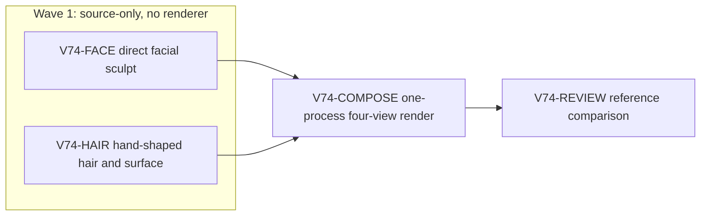

# Ticket Pack: V74 Wayfarer sculpt fidelity

## Ask and aligned problem

Original ask: improve the wizard character step by step until it looks much more like the approved turnaround references. The V73 static head is editable and more coherent than v2, but its round young face, severe eyes, smooth hair plates, and flat surfaces are visibly unlike the approved adult wizard. This pack makes one honest, reviewable Step 3 head study. It does not imply a finished playable character.

Goal status: aligned with the active full Wizard Realms goal. System translation: not_qualified, this is a local art study. Product agent runtime: not_required, no shipped agent behavior changes.

Goals: more adult facial planes and confident expression; directional, overlapping chestnut hair masses without a helmet edge; richer but restrained skin and hair surface response. Success is a reproducible editable `.blend` plus matched front, three-quarter, side, and back renders that an independent visual review finds materially closer to `wayfarer-male-concept-v4.png` than Step 2. Non-goals: full costume, female derivative, rig, GLB, animation, workbench/game promotion, PR, Git action, or concept-sheet-as-texture shortcut.

Constraints: only one renderer at a time. The V74 source lanes may work while the live V31 browser validation is active, but composition and Blender rendering wait until that browser closes. Keep the existing 2.257 m coordinate contract and pinned CC0 anatomical source. No game/runtime/save edits. There is no authority to use a third-party 3D service or spend API funds for this pass.

Open question: can bounded hand-authored mesh shaping, rather than another pass of generic falloff constants, produce a meaningful visual jump? The four-view render is the discriminating probe. If it fails, keep the experiment in staging and change production method again.

## Summary

Create two disjoint Step 3 source passes against the V73 head: direct local face shaping and redesigned hair forms. Compose once after the browser renderer closes, then review actual images against the approved sheet and Step 2. The first feedback surface is the four rendered PNGs, not the playable game.

Locked design:

- All outputs stay inside `games/wizard-realms/engine/art/characters/wayfarer_v3_staging/`.
- No playable asset, workbench catalog, rig, or game file changes.
- Preserve the Step 2 source and renders for before/after comparison.
- A negative visual verdict is valid; do not promote an unconvincing candidate.

Important repo truth:

- `wayfarer_v3_step2_head.blend` is the editable V73 source, with separate existing `FACE |`, `EYE |`, and `HAIR |` objects.
- `face_pass.py` and `hair_pass.py` generated the Step 2 study; their broad Gaussian deformation and leaf hair masses are the method to move beyond, not surfaces to tune again.
- `author_step2.py` supplies the exact studio camera, orthographic crop, 16-sample Eevee render, and 2-thread/height checks to reuse.
- `STEP2_VERDICT.md` records the baseline NO-GO for gameplay and the specific visual debt.

## Public Interfaces

`sculpt_pass.py` exports `apply_sculpt_pass()` and mutates only the existing anatomical face/eyes/brows on the open Step 2 scene. `hair_sculpt_pass.py` exports `apply_hair_sculpt_pass()` and replaces only `HAIR |` objects and materials. `author_step3.py` opens Step 2, runs face then hair, preserves the coordinate contract, saves `wayfarer_v3_step3_head.blend`, and renders `step3_{front,three_quarter,side,back}.png`. These are staging art artifacts, not runtime interfaces.

## Lane Graph

## Topology Audit

- Productive lanes: FACE owns anatomical facial mesh and existing facial feature object adjustment in `sculpt_pass.py`; HAIR owns only the `HAIR |` family in `hair_sculpt_pass.py`. They are incomparable and independently author source artifacts.
- Maximum safe parallel width: 2 source lanes. COMPOSE depends on both modules and on the UI renderer closing. REVIEW depends on actual integrated renders.
- Certainty: FACE probes whether local mesh editing can create adult planes without broken topology. HAIR probes whether an authored layered silhouette escapes the Step 2 plate effect. COMPOSE tests integration. REVIEW uniquely judges likeness and across-view failures.
- Surprise triggers: eyelid/topology damage, uncovered crown, hair-face clipping, static file not editable, missing material response, or renderer memory materially beyond Step 2. Stop and repair the observed owner only.
- No artificial parallelism, file overlap, speculative game integration, or PR finisher. Dispatch verdict: PASS.

## Smallest Viable Diff

Behavior delta: one improved staged static head study, with no game behavior change. Expected source budget: three new Python files, one `.blend`, four PNGs, one verdict note; no dependency or runtime edit. A deliberate art-output exception to the usual five-file tripwire is required because four views and an editable source are the acceptance evidence. Keep each source pass around 150 lines or less and composition around 80 lines; if total new Python exceeds 400 lines, stop and replan.

Expected changed files: `sculpt_pass.py`, `hair_sculpt_pass.py`, `author_step3.py`, `wayfarer_v3_step3_head.blend`, four `step3_*.png`, `STEP3_VERDICT.md`, all in the v3 staging directory. Forbidden: `engine/src`, workbench catalog, v2, Step 2 artifacts, saves, package files. Reuse scan: Step 2 modules, `author_step2.py`, pinned staging manifest, four Step 2 PNGs, approved male concept. Non-code alternative is insufficient because the missing visual quality is actual geometry and surface. Simplify by removing/replacing Step 2 hair meshes in the Step 3 scene, not stacking extra fake strands over them. Validation: one Blender 5.2.2 LTS process, `blender -b -t 2 --python author_step3.py`, 16 Eevee samples and four 720 x 800 views; inspect each against the reference and baseline; verify height, source editability, mesh counts, and memory. No tests or game builds, since no game code changes.

## Tickets

Paste now to: V74-FACE implementer. Your role is "implementer" ONLY under `auto-planner-ticket-pack` and `smallest-viable-diff`; read both skill files completely before acting. Delivery phase `implementation`, milestone `pre_surface`. Transport `native_spawned_subagent`, model `inherited`, Cursor `not_applicable`, no provider fallback. Existing task routing: no qualified idle user-owned task; a fresh native child avoids contacting an unrelated durable task. Worktree `/private/tmp/pa-wizard-playable-v2`, branch `ben/wizard-playable-v2`. Own only `games/wizard-realms/engine/art/characters/wayfarer_v3_staging/sculpt_pass.py`. Read the approved concept and Step 2 renders/source. Export `apply_sculpt_pass()` against the open Step 2 Blender scene. Keep the CC0 face topology continuous, no separate nose/cheek primitives. Directly shape jaw/chin, cheek and brow planes and lip corners with localized vertex/loop edits so the front and three-quarter read as an adult with a calm expression. Keep eyes seated and clear from side view. Do not render, launch Blender, edit any other file, or claim visual success. AST-parse source as narrow acceptance. Return exact file/diff, method, reuse/deletion proof, limits, and runtime receipt.

Paste now to: V74-HAIR implementer. Your role is "implementer" ONLY under the same two skills; read them completely before acting. Delivery phase `implementation`, milestone `pre_surface`. Transport `native_spawned_subagent`, model `inherited`, Cursor `not_applicable`, no provider fallback. No qualified idle user-owned task, fresh native child. Same worktree/branch. Own only `games/wizard-realms/engine/art/characters/wayfarer_v3_staging/hair_sculpt_pass.py`. Read approved concept, Step 2 renders and `hair_pass.py`. Export `apply_hair_sculpt_pass()` against the open Step 2 Blender scene. Replace existing `HAIR |` objects with hand-shaped, asymmetric swept masses that interlock from crown to temples and nape; eliminate the broad uniform leaf plates, hard cap edge, repeated spikes, and exposed skin. Give warm chestnut material variation by root/mid/tip or directional roughness without bitmap concept projection. Do not render, launch Blender, edit any other file, or claim visual success. AST-parse source. Return exact file/diff, modeling method, reuse/deletion proof, limits, and runtime receipt.

Wait for FACE and HAIR plus V31 browser closure, then paste to: V74-COMPOSE implementer. Your role is "implementer" ONLY under the same two skills, with `test-from-ui` for visual proof. Delivery phase `user_flow_probe`, milestone `SURFACE_READY` when four images exist. Transport `native_spawned_subagent`, model `inherited`, no fallback. Own only `author_step3.py`, `wayfarer_v3_step3_head.blend`, and four `step3_*.png`. Import the two passes, open Step 2 `.blend`, reuse Step 2 camera/studio helper and coordinate checks, save the editable source, render four 720 x 800 images with one Blender process, 2 threads, 16 samples. Record elapsed, max RSS and macOS footprint, mesh/face/triangle counts, height and source paths. Stop at exact observed error. Do not edit source passes without a separately activated bounded repair. No game changes or Git.

Wait for COMPOSE, then paste to: V74-REVIEW reviewer. Your role is "reviewer" ONLY under both skills, read-only. Compare each Step 3 view to Step 2 and approved male sheet at matched crop. Findings-first GO/NO-GO for an improved **static head study**, not game promotion. Explicitly judge adult face, expression, hairline, front/side/back masses, materials, continuity/clipping, coordinate contract, memory, and smallest viable diff. Own no source edits. If GO, write no file; send precise verdict for a separate `STEP3_VERDICT.md` documentation step. If NO-GO, name the smallest observed owner and remedy or method change. Do not claim robe, rig, or animation from a bust.

No PR finisher: no PR or GitHub action requested. The primary will reconcile lane receipts and write the verdict note only after review, without editing production art source.

## Assumptions

- The approved v4 male sheet remains the target, and Step 2 remains a valid editable baseline.
- A staged visual increment is more truthful than premature promotion.
- The live V31 browser lane retains exclusive renderer ownership until it closes.

## Revision B: observed visual failure and bounded correction

The first V74 integrated render was NO-GO. `step3_back.png` exposed a skin-colored crown patch, and all views showed repeated smooth clumps over a dark cap. The face improved only slightly. This is not a compositor error or a reason to promote the asset. The UI browser has closed and the Blender process exited.

The next bounded question is whether the locally improved face is a genuine incremental gain when paired with the previously better-covered Step 2 hair. Change only `hair_sculpt_pass.py` so `apply_hair_sculpt_pass()` retains the already-authored Step 2 `HAIR |` geometry and its full scalp coverage, with at most a restrained chestnut material/roughness adjustment. Delete the failed replacement-mesh implementation rather than preserving it as a fallback. The method is conservative reuse, not another attempt to add more of the same tuft forms. Keep the old first-render PNGs available for comparison, but the compositor may overwrite the Step 3 outputs on identical retry. Re-run `blender -b -t 2 --python author_step3.py` only after source repair, one process, same camera and sample settings, then independently review all four views. If this revised render is not clearly better than Step 2, mark the Step 3 experiment NO-GO and stop parameter tuning. A future pack would require a genuinely different sculpt or artist workflow.

The first compositor hard-coded 16 `HAIR |` meshes for the failed replacement pass. Step 2 legitimately has 13. Once the HAIR repair is ready, the existing COMPOSE owner must change only that stale count assertion to a truthful Step 2-retention invariant before running the same Blender command. Do not manufacture three extra meshes to satisfy the old count. This is a narrow integration repair in `author_step3.py`, with no change to camera, body-height contract, outputs, or runtime surfaces.

Observed error | change | restart | retry result | next action: exposed crown and repeated hair clumps | planned source-only reuse of Step 2 hair | same Blender command after edit | pending | identical four-view comparison.

## Final V74 receipts and decision

- FACE: source-only `sculpt_pass.py`, 123 lines, AST passed, no renderer. Local cheek, jaw, lid, brow, and skin changes on the continuous CC0 head.
- HAIR first pass: source-only `hair_sculpt_pass.py`, 141 lines, AST passed; the integrated render revealed crown exposure and worse plate-like clumps. Revision B deleted that method and retained the Step 2 hair unchanged in five lines.
- COMPOSE: `author_step3.py`, editable `.blend`, and four 720 x 800 views. Revision B's identical one-process retry passed save/reopen and 2.257 m height checks. It retained all 13 Step 2 hair mesh identities, used Blender 5.2.2 LTS with two threads and 16 Eevee samples, took 1.34 seconds real time, 439,894,016 bytes max RSS, and 2,045,625,976 bytes macOS peak footprint. The renderer exited.
- REVIEW: Revision B fixed crown continuity but did not materially approach the approved likeness. Adult face, calm expression, layered hair, and materials remain below target. The brow repositioning introduces a thin high stroke. Smallest-diff scope passed for the bounded experiment, with partial cleanup debt from a five-line no-op hair pass.
- Decision: **NO-GO for Step 3 as a meaningful likeness milestone, and NO-GO for workbench/game promotion**. Preserve source and renders as failed-study evidence. `STEP3_VERDICT.md` records the comparison. The next art attempt must change method, not tune these parameters further.
