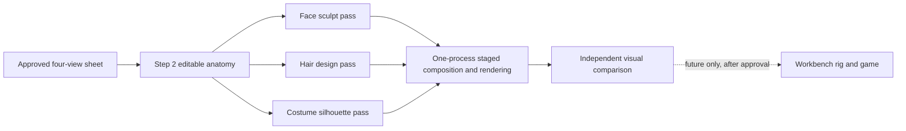
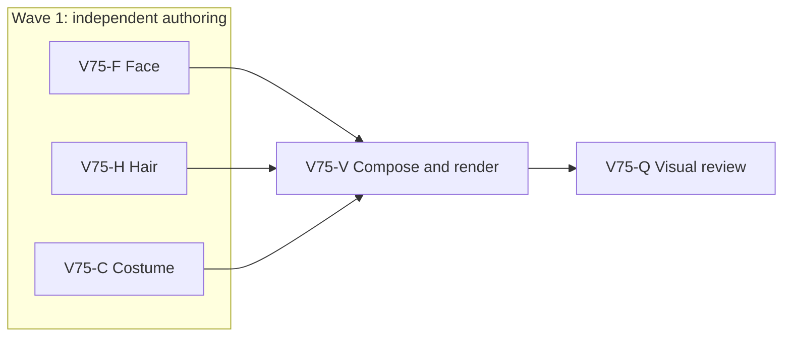

# Ticket Pack: Wayfarer reference-matched visual study

## Summary

Original ask: improve the wizard character graphics step by step until the model looks much more like the approved male and female reference sheets. This pack makes one honest male visual study, with visible face, hair, and outfit checkpoints. It does not claim a playable or rigged result.

Aligned problem: the current v2 workbench rig is structurally valid but visibly primitive. The staged v3 anatomy is continuous, yet Step 3 is still a youthful, severe, helmet-haired head with no costume. More tiny procedural tweaks are not an adequate production method. The next study must shape recognizable forms against the approved sheet and show cumulative comparisons before promotion.

Goal status: aligned. Terminal condition for this pack: an editable, reference-compared four-view male study plus intermediate checkpoint images and a clear GO or NO-GO verdict. This is a visual milestone within the larger Wizard Realms goal, not completion of the character or game.

Non-goals: female model, rigging, clips, game avatar replacement, PR, and general map work. The female sheet remains an approved target for a later matching pass, not a reason to duplicate unapproved male geometry.

System translation: not_qualified. Product agent runtime: not_required.

Locked design:

- Use `engine/art/concepts/wayfarer-male-concept-v4.png` as the visual target, not as a texture.
- Preserve source provenance and the staging coordinate contract: floor Z=0, +Z up, +Y forward, body height 2.257 m.
- Keep all V75 files in `engine/art/characters/wayfarer_v3_staging/`; do not overwrite Step 1 to Step 3, `wayfarer_v2`, the workbench catalog, or the playable avatar.
- At most one Blender renderer process at a time, two threads and 16 Eevee samples, with browser previews closed during rendering.
- Promotion requires visual review of front, three-quarter, side, and back. Valid topology or a successful render alone is not visual approval.

Important repo truth:

- `wayfarer_v3_step2_head.blend` contains the editable CC0 anatomical base, eye loops, and fully covered 13-mesh hair study. Step 3 kept that hair after a failed replacement attempt.
- `author_step3.py` already defines reproducible camera views and renders in one process. The V75 composer should reuse its `point_at`/`render` utilities and camera contract.
- `STEP3_VERDICT.md` documents the actual visual failure. The current v2 candidate remains the only workbench candidate and is marked NO-GO.

## Proposed Flow

## Public Interfaces

No public game interface changes. The deliverable is `wayfarer_v4_visual_study.blend`, `v75_face_{front,three_quarter}.png`, `v75_hair_{front,three_quarter}.png`, and `v75_outfit_{front,three_quarter,side,back}.png`, plus `V75_VERDICT.md`. Scripts expose scene-local `apply_*_v75()` functions and must avoid rendering in the parallel lanes.

## Lane Graph

## Topology Audit

- Productive lanes: F edits anatomical face/brows, H replaces only hair meshes, C authors only costume meshes. All consume the immutable Step 2 source and approved sheet, so maximum productive parallel width is three.
- Fan-in: V composes disjoint passes and is the sole renderer. Q consumes its images to decide visual fidelity, not generic code quality.
- Serial edges: F/H/C to V consume actual pass scripts; V to Q consumes rendered PNGs and reopened blend. Neither can start earlier.
- Unknowns: F closes adult facial shape, H closes layered hair versus helmet, C closes recognizable outfit silhouette. A mere code syntax check cannot close any visual question; Q must compare the resulting images.
- Surprise trigger: a pass destroys coverage, topology, coordinate contract, or silhouette. Keep it staged, report NO-GO, do not promote.
- No PR finisher: no PR requested. No new tests before visual surface, and no game code is changed.
- Dispatch verdict: PASS.

## Smallest Viable Diff

Behavior delta: new editable visual study and comparison images only.

Expected budget: three narrow pass scripts, one composer, one verdict, staged `.blend`/PNG outputs; zero dependencies, zero game code, zero refactors. New files are required because existing scripts and stages are preserved for A/B comparison. Reuse the Step 2 blend, scene objects, camera utilities, materials, and reference sheet. Remove the V74 no-op hair pass only if the composer no longer imports it, without touching historical scripts. Stop if any lane needs to alter shared engine files, the v2 rig, or more than its named staging files.

## Tickets

### Paste now to: V75-F Implementer

Role lock: `implementer` ONLY under `auto-planner-ticket-pack` and `smallest-viable-diff`. Delivery phase `implementation`, milestone `pre_surface`. Dispatch transport `native_spawned_subagent`, model `inherited`, local shared checkout. No fallback CLI. Existing task routing: prior completed face worker may be reused only if its current status and file ownership remain safe. Scope: create `face_v75.py` only, exposing `apply_face_v75()` on the already-open Step 2 scene. Do not render or edit other files.

Exact target: a calm adult face closer to the sheet, with less rounded cheeks/jaw, a narrower nasal silhouette, open alert eyes, neutral mouth corners, eyebrows seated on the brow rather than appearing as a high line. Preserve the continuous source head, eyes, UVs, and 2.257 m coordinate contract. Do not add separate facial primitives. Inspect `face_pass.py` and `sculpt_pass.py` before editing, then use explicit anatomical landmarks and local mesh edits rather than another global Gaussian tweak. Acceptance: Python AST parse; source-object existence and non-destructive guard checks in function; return which meshes/vertices were changed. Visual proof is deferred to sole compositor. Receipt: exact file, diff/line count, reuse/deletion/tripwire status, test output, no out-of-scope files, session ID.

### Paste now to: V75-H Implementer

Role lock: `implementer` ONLY under `auto-planner-ticket-pack` and `smallest-viable-diff`. Delivery phase `implementation`, milestone `pre_surface`. Dispatch transport `native_spawned_subagent`, model `inherited`. No fallback CLI. Existing task routing: prior completed hair worker may be reused only if status and custody remain safe. Scope: create `hair_v75.py` only, exposing `apply_hair_v75()` on an open Step 2 scene. Do not render or edit other files.

Exact target: reference-like chestnut swept fringe, overlapping unequal locks, side and nape coverage, no exposed scalp from four views, no repeating spikes, no broad smooth helmet plate. Own only `HAIR |` objects and hair materials. Inspect `hair_pass.py`; replace its overly broad plates with narrower hand-shaped interlocking forms and restrained strand-groove material/geometry treatment. Do not touch the face or body. Acceptance: Python AST parse, deterministic mesh creation, complete coverage guard, and a small return summary. Visual proof deferred to compositor. Receipt fields same as F.

### Paste now to: V75-C Implementer

Role lock: `implementer` ONLY under `auto-planner-ticket-pack` and `smallest-viable-diff`. Delivery phase `implementation`, milestone `pre_surface`. Dispatch transport `native_spawned_subagent`, model `inherited`. No fallback CLI. Existing-task routing: no qualified previous costume owner. Scope: create `costume_v75.py` only, exposing `apply_costume_v75()` on an open Step 2 scene. Do not render or edit other files.

Exact target: the approved violet layered robe silhouette, raised collar, draped mantle, shaped sleeves, split hem, cream tunic, thin gold piping, belt, diagonal satchel strap, brown trousers and boots. The robe must read as tailored cloth with folds, not cylinders/cones, and must not hide the face or scalp. Own only `COSTUME |` objects/materials; do not mutate anatomy or hair. Start from the preserved 2.257 m base, hand-shape silhouette meshes with asymmetric fold lines and nonuniform cross-sections, and include a return summary. Acceptance: Python AST parse, object-prefix guard, no game files. Visual proof deferred to compositor. Receipt fields same as F.

### Wait for F, H, C, then paste to: V75-V Implementer

Role lock: `implementer` ONLY under both skills. Delivery phase `user_flow_probe`, milestone `SURFACE_READY` when first comparative render exists. Dispatch transport `native_spawned_subagent`, model `inherited`, no fallback. Scope: create `author_v75.py`, compose on `wayfarer_v3_step2_head.blend`, call F then H then C, render face and hair front/three-quarter checkpoints and final outfit four views. Only one Blender process, `blender -b -t 2 --python author_v75.py`; two threads, 16 samples, sequential views. Save and reopen `wayfarer_v4_visual_study.blend`; verify body coordinate contract, intended object prefixes and no blank crown. Do not export GLB or touch workbench/game. If visual probe fails, return exact error and smallest affected owner for repair. Surface: local rendered PNGs. Receipt includes paths, dimensions, command output, max memory, source hash, blend reopen, and visual self-check. Post-surface: Q review.

### Wait for V, then paste to: V75-Q Reviewer

Role lock: `reviewer` ONLY under both skills. Read-only. Dispatch transport `native_spawned_subagent`, model `inherited`, no fallback. Compare the approved sheet, Step 2/3 images, and all V75 images at matched views. Decide whether each of face, hair, costume, and overall silhouette is materially closer, not merely different. Findings first, GO/NO-GO for showing the static study, and separate GO/NO-GO for rig/workbench promotion. Verify no source/game overwrite, one-renderer memory policy, coordinate and mesh guards, and smallest viable diff. Write no files. Primary writes `V75_VERDICT.md` from the receipt and opens the comparison images for the user.

## Assumptions

- This request authorizes an iterative visual study now, not replacing the game avatar without a matching-quality review.
- The approved male and female reference sheets remain the acceptance target. This pack starts with male because the male editable base is available and its failure is directly observed.
- A visibly better static study is useful even if rigging and animation must wait; a NO-GO result is reported honestly and used to change method, not promoted as success.
