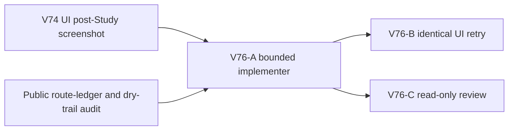

# Ticket Pack: V76 post-Study Mireglass salvage guidance

## Outcome and observed failure

The full Wizard Realms goal remains active. V74's fresh V31 UI retry reached the frontier marker from the saved far-bank exit using only the new live bearing, and Study succeeded. Wayfinder Glow became Learned. Casting at the marker was unavailable with `No new terrain or cache is within Wayfinder Glow reach.`, which is a valid checked result there. The player then walked east along revealed ground to (-79.11, 1.26, 101.63). The map title became Wilderness, the checked Mireglass action was unavailable, and there was no direction to the next useful destination. Save/reload #58 preserved the learned spell and pose. This is a post-Study discoverability failure, not a failed cast or save.

The canonical immediate objective for this fresh state is the Mireglass salvager, where the player can buy a field spade. The `greenway-alpha` marker is (-108,104) and the salvager is (-276,292). The authored marker-to-salvager approach trail is dry, cardinal, barrier-safe, and grade-safe for both `greenway-alpha` and `wizard-realms`. The source-only coordinates above are diagnostic, never player-facing UI. Public V31 records Works bridges and ladders separately from the standalone Mireglass world's `expedition.builtRoutes`; do not transplant that standalone objective state machine wholesale.

## Scope and invariants

- After the saved frontier marker is studied, and while the public player owns no field spade, show a live, seed-derived direction toward a nearby waypoint on the canonical dry trail to the salvager. Name the intended action: buy a field spade there. Keep the cue available even if the player strays outside the Mireglass presentation region. At the observed eastward position it should help the player rejoin the trail rather than point to the already-studied marker as an objective.
- Preserve V74's pre-Study marker bearing and all source-bank, deck, unclaimed post, Greenway-return, and post-cache guidance. Do not claim that Glow is broken or imply it should be cast at the marker. Preserve fog-of-war tiles and checked-action gates; do not reveal raw coordinates, hidden cache positions, or distant map cells.
- Guard the cue by actual saved `fringeMarkerStudied` and actual spade ownership. If an imported or later player already owns a spade, this first-step cue must not falsely tell them to buy another.
- Prefer the `publicV27StarterGuide` owner and its focused test file. A small pure trail-waypoint helper may live in that file; only broaden if source contracts require it. No new dependency, save schema, movement physics, terrain, asset, or historical replay change. Preserve the dirty worktree. Use `apply_patch`.
- One Wizard renderer maximum, no concurrent Blender. No GitHub action or PR. Future game GitHub actions must use `gh-bioscopics`, personal noreply, and `ben/` branches.

## Lane graph and topology audit

The implementer alone owns source edits. UI retry and code review start after the patch and may run concurrently because the reviewer needs no renderer. Dispatch verdict: PASS.

## V76-A implementer ticket

Role lock: implementer. Worktree `/private/tmp/pa-wizard-playable-v2`, branch `ben/wizard-playable-v2`. Read this pack and applicable instructions. Own `games/wizard-realms/engine/src/PublicV23Controller.tsx` and its focused test file; touch another code file only if a verified interface contract requires it. Extend the starter-guide context with the canonical saved Study flag. For the studied, no-spade, streamed state, derive a rejoin/next bearing from `mireglassApproachTrail(view.seed)` and show a clear salvager plus spade-purchase instruction. Keep the text correct both at the marker and from the observed off-trail east position; it should update as the player moves. Do not use `mireglassMapGuidance` wholesale. Respect existing precedence once the spade is owned or cache/return state takes over. Add focused tests for both seeds, at-marker and off-trail states, pre-Study V74, already-owned spade, and surrounding stage precedence. Run focused tests and TypeScript. No browser, Blender, nested agents, commit, PR, or GitHub action. Report exact changed files, validation, and `observed error | change | restart | retry result | next action`.

## V76-B UI tester ticket

Role lock: read-only UI acceptance tester. After V76-A, use one isolated browser at `http://127.0.0.1:5193/?publicWorld=v31`. Repeat a fresh journey if the prior isolated save cannot genuinely be restored; never present a reconstructed harness as a fresh player. Reach Study, then navigate only from visible cues toward the salvager. Verify that leaving the local Mireglass presentation zone does not remove the cue. If the salvager is reached, buy the spade and continue through the next decision-bearing step, stopping at the first real blocker. Capture screenshots, exact UI text, console/network, save/reload revision, and renderer/memory disposition. Close the sole renderer afterward.

## V76-C reviewer ticket

Role lock: read-only reviewer. Check actual saved Study and spade gates, route waypoint correctness and off-trail recovery, dynamic bearing/map convention, fog and hidden-cache safety, old stages, and test coverage. Independently sanity-check the two seeds if useful. Findings-first GO/NO-GO with line citations; no browser, edits, Blender, or GitHub.

## Stop rule

If the same post-Study wayfinding error persists through two grounded bounded repairs, or the authored trail is not traversable in the real UI despite the route audit, broaden the diagnosis to scene/map collision or route rendering before more copy changes. Completing this navigation step is not proof of the rest of Mireglass or the full game.

## Review gate and bounded correction

The first V76 implementation passed 21 focused tests and TypeScript, but independent review returned **NO-GO** before the long UI walk. Its globally nearest 4 m trail cell and `nearest + 1` target can switch the bearing after only 2 cm of movement at a segment midpoint. The authored route has 90 cells with 84 turns for `greenway-alpha` and 103 cells with 94 turns for `wizard-realms`. Public V31 does not display the authored trail as a continuous visible path, so a player cannot reasonably follow hundreds of tiny, rapidly shifting directions. The phrase `Buy a field spade there` can also refer to the next 4 m waypoint instead of the distant shop.

The correction must replace per-cell directions with stable, human-scale legs or a safe direct salvager bearing. Any straight shortcut must be validated against actual dry terrain and movement barriers for the seed, including a known corpus counterexample: a direct marker-to-salvager line crosses wetland for `mireglass-corpus-13`, `-26`, and `-58`. Avoid per-render long terrain scans that would create a new frame-time problem. From the marker and the observed off-trail Wilderness position, the text should remain useful across small continuous movements and should say `At the salvager, buy a field spade.` Tests should cover a tiny midpoint motion, a meaningful leg advance, both UI seeds, and at least one wetland-crossing corpus seed. A purely static compass-to-salvager replacement fails this gate.

The V76-B browser run was limited to confirming that the first cue appears after Study and survives a short Wilderness step; it was not asked to traverse the route until the review defect is repaired. This is the second bounded repair of the same observed guidance issue. If its UI retry still fails, follow the stop rule and broaden to route visualization or geometry rather than issuing another text-only patch.
