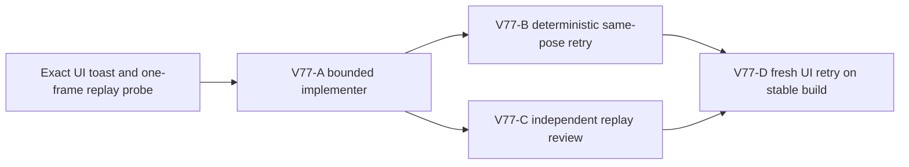

# Ticket Pack: V77 saved-bridge dry-flight replay repair

## Outcome and observed failure

The full Wizard Realms goal remains active. A fresh V31 `greenway-alpha` UI run built and claimed connected-river bridge `works6:river-bridge:-43`. On the dry far-bank route toward the already proven frontier marker, holding W from about (-148.25, 1.33, 38.01) gave zero progress and repeated `This frame has no supported route.` A 900 ms same-input retry repeated the message. The browser was then closed after a later save click remounted to the Greenway start with WebGL Context Lost logs; that remount's cause is unproven and is not part of the movement diagnosis.

Read-only in-memory V31 replay reproduced the exact movement message: moving south from z 37.85 to 38.01 crosses dry floor heights 1.3252568916 to 1.2193430329, a 0.1059138587 m descent. V23's one-frame terminal dry-settle allowance is 0.10 m, so the first frame remains airborne. With a saved bridge ID, V28 replays each frame through a separate V23 call; the next neutral frame starts from airborne state and V23 rejects it as an input. A whole-batch V23 preview lands at frame four. This failure occurs at one pending frame, far from the bridge deck, so it is neither the 128-frame cap nor river geometry.

## Scope and invariants

- Repair the V28 saved-bridge replay of a short dry flight so it can continue to a grounded terminal state and save through the existing checked writer. Preserve strict witness equality, deck crossing/collision rules, saved bridge ledger, and historical V23 semantics.
- Do not widen V23's terminal-settlement threshold, skip frames, silently teleport, or accept invalid airborne saves. No save schema, migration, terrain, region guide, asset, dependency, or unrelated version change.
- Prefer `games/wizard-realms/engine/src/domain/publicWorldV28Replay.ts` and one focused existing V28 controller/replay test file. Touch V28 controller only if a verified interface constraint requires it. Use `apply_patch`, preserve dirty worktree.
- The V76 salvager cue is under a separate NO-GO review and must not be promoted as complete. Keep the V74 marker guidance intact while repairing movement.
- One Wizard browser renderer at a time, no concurrent Blender. No GitHub action or PR. Future game GitHub actions must use `gh-bioscopics`, personal noreply, and `ben/` branches.

## Lane graph and topology audit

The implementer has exclusive production-code ownership. Deterministic retry and review can run in parallel after the patch. One UI renderer opens only after the code is stable and both gates pass, avoiding HMR during the acceptance journey. Dispatch verdict: PASS.

## V77-A implementer ticket

Role lock: implementer. Worktree `/private/tmp/pa-wizard-playable-v2`, branch `ben/wizard-playable-v2`. Read this pack and applicable instructions, including smallest-viable-diff. Own the V28 replay path and focused regression. Reproduce the two-stage failure from z 37.85 to 38.01 with the saved `-43` bridge, then implement the smallest checked dry-flight batch treatment that lands in about four frames and remains replayable. Do not weaken river/deck collision or writer gates. Run focused V28/V31 controller and replay tests plus TypeScript. Report exact `observed error | change | restart | retry result | next action`, changed files, and residual risk. No browser, Blender, nested agents, commit, PR, or GitHub action.

## V77-B deterministic retry ticket

Role lock: read-only validator, after patch. Repeat the identical in-memory greenway-alpha pose/bridge input and neutral continuation. Verify the flight lands, the frame batch replays identically, checked save accepts, then another movement and second save work. Also test the same move without a saved bridge and deck-crossing rejection. Return exact numbers and code/test citations. No browser or edits.

## V77-C review ticket

Role lock: read-only reviewer, after patch. Check saved-bridge replay compositionality, flight buffering, deck crossing, terminal landing, witness/writer equality, pending-cap interaction, and focused regressions. Findings-first GO/NO-GO; no browser or edits.

## V77-D UI retry ticket

Role lock: read-only UI acceptance tester, after deterministic and review GO. On a stable Vite preview with no production edits during the run, repeat a fresh V31 `greenway-alpha` river bridge and far-bank route through the observed x -148.25,z38.01 seam. Capture movement across it, save/reload, marker arrival and Study. If V76 guidance remains NO-GO, do not spend time on the long salvager trek. Capture console/network and memory; close the sole renderer. A diagnostic reconstructed save may supplement, never replace, fresh UI proof.

## Stop rule

If the exact movement error survives two bounded grounded repairs, or preserving checked replay requires a schema/witness semantic change, stop the fast loop and replan. The later page remount must be investigated separately only if it recurs on a stable build.

## Code-gate receipt, 2026-10-10

The first dry-seam repair passed the exact four-frame retry but exposed a saved-bridge Greenway jump deadlock. A second support-specific correction fixed Greenway jump and exposed the same deadlock on a saved bridge deck. The final V28-owned correction treats this as a replay admission invariant: an airborne preview is accepted only when its checked, bounded neutral continuation can land within the remaining frame cap. Per-frame V23/V28 support checks remain in force, and a jump-led replay fast path avoids repeatedly replaying every prefix.

The exact saved `-43` bridge seam, Greenway jump, and saved `-14` deck jump pass deterministic state/event/witness replay and actual atomic checked-store save/reload, including a subsequent move/save. Off-deck, river, and open-pit controls reject. Focused V28/V31 tests passed 48/48 and TypeScript passed. Independent code review and deterministic validation returned GO for correctness. A measured 25-frame V28 deck-jump replay still takes about 352–377 ms in Node, roughly 19 times the canonical V23 batch; live UI cadence remains an explicit acceptance concern. Browser proof is pending and must not be inferred from these code gates.

## Fresh UI receipt, 2026-10-10

In one stable V31 `greenway-alpha` renderer, the player built and crossed saved bridge `-43`, then moved through the former x≈-148.25,z38.01 failure seam to x -145.91,z41.20 without the route error. Validated save #44 restored that position after same-tab reload. The same run reached and Studied the marker, followed the visible Mireglass trail to the salvager, bought and equipped a field spade, and resumed exact position and gear from validated save #112. Console had zero errors; no recorded HTTP 4xx/5xx. The renderer was closed. This is a GO for the observed seam and linked first-region route, not a general performance or full-game claim. Bridge setup used learned navigation, so independent new-player discoverability remains unproven.
