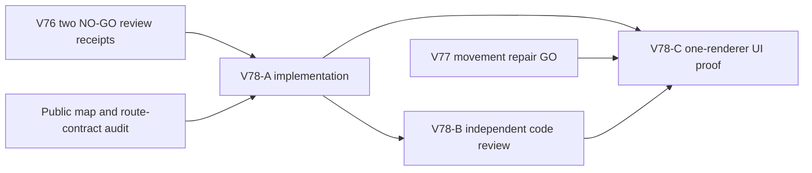

# Ticket Pack: V78 visible and recoverable Mireglass approach

## Outcome and evidence

The full Wizard Realms goal remains active. V74 proved a fresh player can reach and Study the frontier marker by visible UI cues. The first V76 post-Study cue used 4 m waypoints and failed independent usability review. Its second correction uses cached human-scale legs, but review found reachable off-trail positions with no bearing, including `greenway-alpha` (-40,104) and `mireglass-corpus-13` (-276,272), where wetland separates the player from the geometric nearest trail. A third text-only adjustment would repeat the same failure mode. V76 is therefore **not approved** as a complete route solution.

Public V31 currently has no visible trail dots in its map projection, although `WizardMap` already renders `hasFrontierTrail` and the standalone Mireglass projection marks an authored trail. A local map overlay can make discovery legible. It cannot by itself prove a traversable rejoin from an off-trail position. The necessary dependent companion is a bounded route over known, locally connected dry cells to a discovered trail cell, using actual saved terrain and movement barriers. This pack broadens from copy to map plus route-aware guidance, as required by V76's stop rule.

The separate V77 dry-flight movement repair owns `domain/publicWorldV28Replay.ts` and a V28 regression. V78 must not touch those files, and UI validation waits for V77 to pass so that a movement defect cannot be misattributed to wayfinding.

## Scope and invariants

- Mark only canonical Mireglass trail cells that are in the local map window and actually discovered. The public map and accessibility text may show those cells; never reveal fogged trail cells or hidden cache coordinates. Continue showing a useful trail legend when the player briefly leaves the Mireglass presentation zone.
- Do not broaden V24 interaction ownership outside Mireglass. If the normal V24 overlay early-returns in Wilderness, a map-only decoration is allowed; checked Mireglass actions remain unavailable there.
- For studied, no-spade public V31 players, choose a stable, human-scale continuation toward the salvager along charted dry trail. If off-trail, use a bounded route over known locally connected dry cells and actual saved terrain to a discovered trail cell; guide toward the next safe turn. Do not point through wetland merely because a trail cell is geometrically near. If no known connection exists, say so and give a retrace/explore instruction instead of fabricating a safe bearing.
- Supersede V76's non-directional fallback in `PublicV23Controller`, whose guide currently overwrites V24 map guidance. Preserve V74 pre-Study marker, saved bridge stages, actual Study/spade/cache gates, return guidance, and regional checked-action precedence. No save schema, physics, content generator, historical replay, dependency, or unrelated game change.
- Prefer four existing files: `PublicV24MireglassView.ts` and its test, `PublicV23Controller.tsx` and its test. Extract a pure route helper only if the source/test boundary genuinely requires it. Use `apply_patch` and preserve all dirty worktree files. One Wizard renderer maximum; no Blender while UI proof runs. No GitHub action or PR; future game GitHub work must use `gh-bioscopics`, personal noreply, and `ben/` branches.

## Lane graph and topology audit

V78-A and V77-A may run concurrently because they own disjoint code paths. V78-C opens a browser only after both code gates pass and neither implementer is editing live modules. Dispatch verdict: PASS.

## V78-A implementer ticket

Role lock: implementer. Worktree `/private/tmp/pa-wizard-playable-v2`, branch `ben/wizard-playable-v2`. Read this pack, applicable AGENTS and smallest-viable-diff instructions. Own only the four preferred source/test files. Add fog-safe public trail map flags and Wilderness map-only overlay without enabling regional actions. Replace the V76 no-direction recovery with a bounded, cached-or-tile-stable known-dry route-to-trail cue. Use actual public saved terrain, not standalone `expedition.builtRoutes`, and avoid per-frame wide-world pathfinding. Human-scale downstream trail legs may reuse the V76 validated simplification. Tests must include discovered and fogged trail cells, Wilderness with no newly enabled actions, map accessibility, observed eastward position, corpus-13 wetland-separated rejoin, no-known-connection wording, tiny movement stability, both UI seeds, hidden cache suppression, and saved stage precedence. Run focused tests, TS and scoped performance check. No browser, Blender, nested agents, commits, PR, or GitHub action. Return exact changed files and `observed error | change | restart | retry result | next action`.

## V78-B independent review ticket

Role lock: read-only reviewer after patch. Check fog/knowledge isolation, no out-of-region actions, actual terrain/barrier safety for rejoin, search bounds and frame cost, clear fallback, stage precedence, accessibility, and regressions. Findings-first GO/NO-GO with citations. No browser.

## V78-C UI ticket

Role lock: read-only UI acceptance tester after V77 and V78 code review GO. Run a fresh V31 `greenway-alpha` journey in one isolated browser. Cross the previously blocked dry seam, Study marker, then follow only visible map/HUD cues to the salvager and buy a spade. Deliberately step a short safe distance off the trail to test recovery. Capture map and HUD, first next decision-bearing blocker, console/network, save/reload, and renderer memory; close the browser. Do not claim the first region or full game complete unless all later steps are separately proven.

## Stop rule

If V78's known-cell route still fails to give an actionable safe cue in a reproducible position, treat route visualization/navigation as a larger feature with explicit design and terrain contracts. Do not iterate another unreviewed text-only patch. The local map can guide only through discovered ground and cannot guarantee a complete route through fog or later player-modified terrain.

## Code-gate receipt, 2026-10-10

V78-A is implemented in the four planned public controller/projection source and test files. The local map exposes only discovered canonical trail cells, including a map-only Wilderness overlay that does not add checked Mireglass actions. The studied, no-spade cue finds a bounded known-dry rejoin or honestly asks the player to retrace/explore. It excludes saved open pits; an exact two-depth, no-ladder pit regression prevents an impassable 0.8 m drop from being labeled a safe turn. Production-sized 33×33 map and 31×31 terrain fixtures deliberately return the no-known-connection fallback at (-40,104), while corpus-13 finds a known-dry rejoin around wetland.

Focused tests passed 38/38 and TypeScript passed. Independent review returned GO for the code gate, including fog, Wilderness action isolation, saved-stage precedence, scope, and performance. The browser journey remains pending on V77 movement review; this receipt does not claim route completion or full first-region proof.

## Fresh UI receipt, 2026-10-10

After Study, discovered trail marks were visible on the V31 map. Two deliberate small off-trail moves produced 2–4 m rejoin bearings that returned the player to marked cells. Subsequent 12–26 m live bearings and discovered dots guided the player to the Mireglass salvager, where buying a field spade changed coins 120→102; validated save #112 restored the exact position, 102 coins, inventory, and equipped Main Hand field spade. The directional objective was collapsed by default and required opening to see the bearing. That is a usability follow-up, not a blocker for this witnessed route. The browser was closed. Post-spade cache, gathering, return trade, and independent novice route discovery remain unproven.
