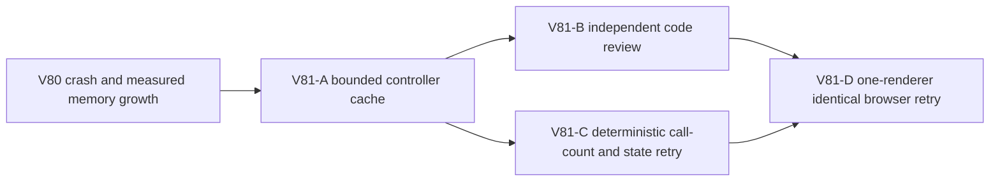

# Ticket Pack: V81 public view churn repair

## Outcome and evidence

The full Wizard Realms goal remains active. V80 restored a real isolated V31 save #98 at x -157.42,z83.37, then repeated a same-yaw 17-second W hold. The player advanced to z111.36 without a second crash, but CDP JS heap rose 54.2→214.0 MB and the Chrome renderer RSS rose about 483 MB→1.53 GB with CPU near 100%. After a same-tab save/reload and short movement, RSS regrew to 1.72 GB, so the tester stopped below a 2 GB safety cap. The preceding failed run logged `structuredClone ... out of memory` in V28 `view()` and an out-of-memory error in React Three Fiber before the page crash. This proves severe renderer-local allocation pressure, not yet a retained heap leak.

Read-only source audit found that a timed 50 ms W step may call V28 `view()` around four times: timed airborne check, before and after movement, and React render. Each `view()` rebuilds streamed terrain and defensively deep-clones up to 2,304 active tile objects. The versioned V23–V31 runtimes have no cheap player accessor; substituting `preview()` would clone full progress and is not a measured optimization. The smallest candidate is a controller-local cached active view keyed by runtime identity plus `(saveRevision,pendingFrames)`, preserving the runtime's view isolation contract.

## Scope and invariants

- Own `engine/src/PublicV23Controller.tsx` and a focused existing controller test file. Add a `readActive()` memo for the controller's active view, reuse it for timed sampling, before/after movement, and render. Invalidate on accepted frame, checked save/action/return home, runtime replacement, and any other mutation that changes the view. Rejected/no-op frames may reuse only if the view is semantically unchanged. Keep the V28 runtime's defensive clone intact unless this bounded intervention fails.
- Do not replace `view()` with `preview()` or return internal active tile references. Do not change physics, replay, save schema, map generation, scenery, UI copy, or asset quality. Preserve V74/V78 guidance and all checked V31 action semantics.
- Prove cached reads equal fresh `runtime.view()` through accepted and rejected frames, save, checked action, return-home, and V31 soil changes. Compare yaw, vertical velocity, equipment, active tiles, discovery IDs, and movement owner. Assert call-count reduction for a timed held input without changing frame count, pose, events, save revisions, or visible guidance.
- Run focused V23/V28/V31 controller tests and TypeScript. Independent review checks invalidation races and snapshot aliasing. Then one stable browser with exact exported checkpoint repeats the 17-second W input and measures JS heap/RSS/CPU relative to V80 baseline, not merely pass/fail. If pressure persists, do not stack speculative caches; collect post-GC heap and broaden to V28 view/scene profiling.
- One Wizard renderer maximum, no Blender during browser proof. Preserve mode-600 isolated browser-state files; do not print or commit them. No PR/GitHub action; future game GitHub work requires `gh-bioscopics`, personal noreply, and `ben/` branches.

## Lane graph

The implementation owner has exclusive source ownership. Deterministic validation and review can overlap after the patch. Browser proof waits for both code gates and no HMR edits. Dispatch verdict: PASS.

## V81-A implementer ticket

Role lock: implementer. Worktree `/private/tmp/pa-wizard-playable-v2`, branch `ben/wizard-playable-v2`. Read this pack, repo AGENTS and smallest-viable-diff. Own only `PublicV23Controller.tsx` and its focused test. Implement controller-local active-view memo keyed by runtime identity, save revision, and pending frames, or choose a narrower equivalent after proving the key. Preserve defensive clone boundaries and all visible behavior. Include invalidation tests for checked mutation routes, V31 soil, and UI-only rerender, plus measured view-call reduction. Run focused tests/TS. No browser, nested agents, Blender, commits, PR, or GitHub action.

## V81-B/C review and deterministic validation

Reviewer: read-only, findings-first GO/NO-GO on invalidation, async writer races, aliasing, versioned runtime parity, scope and perf. Validator: read-only, independently run focused movement/action/save checks and count `view()` calls over a held-input simulation. Do not open browser or edit.

## V81-D UI retry

Restore the exact V80 local IndexedDB checkpoint into a fresh isolated session at `http://127.0.0.1:5193/`. Confirm UI save/pose first. Repeat same-yaw 17-second W and collect CDP JS heap, renderer RSS/CPU, console, save and pose. Stop below 2 GB RSS, close sole renderer, compare to V80 baseline. If it advances with materially lower pressure, continue a short marker Study and V79 spade/Dig handoff in a separate bounded run. Do not claim a leak fixed solely from a lower RSS peak; report post-GC heap if possible.

## Stop rule

If controller memo misses a mutating route, fails parity, or browser memory does not improve materially, roll back or revise this bounded intervention. Diagnose V28 view and scene allocations with measurement before a second speculative optimization.

## Evidence-gate addendum, 2026-10-10

Initial V81-A changed the controller and its focused test only; 61 focused tests and TypeScript passed. Independent review found no cache-key bug but returned NO-GO for browser approval because the call-count test manually advanced fake status rather than exercising timed held input on streamed V31, and checked-action parity was incomplete. Independent V81-C used the decoded real V79 saved V31 rev98 root: 17 accepted movement frames produced identical views, outcomes, status, preview, final pose, 23 events and checked save rev99 in cached and uncached read patterns; view calls were 18 vs 69. That closes much of the deterministic gap without claiming browser performance.

The broader `PublicV23ControllerInput.test.tsx` suite has four probe-only failures. Its fake `view()` reads a manually toggled `probe.airborne`, while fake `status()` leaves `(saveRevision,pendingFrames)` unchanged during those toggles. Real runtimes advance pending count on accepted frames and revision on checked writes. The fixture must model that invariant, not force the production memo to invalidate on an unobservable fake state. Permit the implementer to touch `PublicV23ControllerInput.test.tsx` strictly for probe-key corrections and an integrated timed-input call-count/behavior regression. Do not weaken real runtime semantics or remove the existing input-admission expectations. Re-run the five-file input/controller/runtime suite and TypeScript before independent re-review and browser retry.

## Final code-gate receipt, 2026-10-10

The controller-local memo is keyed by runtime identity, save revision, and pending-frame count. The four fake airborne tests now advance their fake status key when they manually change pose, preserving their input-admission assertions. An integrated streamed V31 timed-W test accepts 17 frames with no rejections, compares the final cached and fresh view and rendered pose, and records 18 controller `view()` calls. Real checked equipment, V31 soil, and return-home tests cover revision invalidation. Independent validation on the decoded V79 save #98 matched 17 cached and uncached movement steps, preview, events, state, and strict save rev99; it recorded 18 vs 69 view calls. The five-file suite passed 137/137 and TypeScript passed. Independent reviewer returned GO for the browser gate, finding no invalidation or aliasing defect. Browser memory comparison is still pending and is the only claim this code receipt does not make.

## Identical browser retry, 2026-10-10

The original isolated V79 save #98 restored at (-157.42,1.28,83.37). A same-yaw 17-second W input advanced to (-158.08,1.25,114.08) without a crash; validated save #101 restored that pose. CDP used heap grew 52.8→132.9 MB, below V80's 54.2→214.0 MB, but renderer RSS rose 446 MB→1.54 GB, effectively unchanged from V80's 483 MB→1.53 GB. CPU reached roughly 104–139%. After idle, explicit CDP garbage collection reduced used heap 377.9→88.6 MB and RSS to roughly 449 MB. This supports severe transient churn rather than proving a retained leak. Per stop rule, the tester did not extend to Study or Dig and closed the sole renderer. Retain the safe memo as a measured JS-heap reduction, but do not call renderer pressure fixed; V82 must profile view/scene allocations before another optimization.
