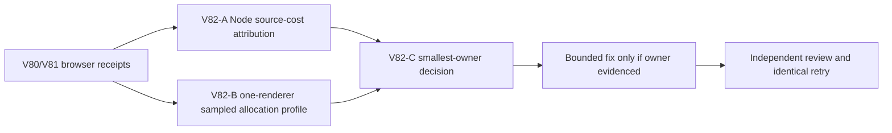

# Ticket Pack: V82 attribute Wizard renderer allocation pressure

## Outcome and evidence

The full Wizard Realms goal remains active. A V79 fresh UI run crashed after a long marker approach. A precrash console log records `structuredClone ... out of memory` in V28 `view()` and a near-simultaneous React Three Fiber performance allocation failure. A restored V31 save #98 reproduced severe renderer pressure during 17 seconds of held W: RSS around 483 MB→1.53 GB, CDP used heap 54.2→214.0 MB. V81 safely memoized controller active-view reads, cutting 17-step view calls 69→18 and reducing post-input used heap to 132.9 MB, but RSS still climbed 446 MB→1.54 GB with CPU over 100%. Explicit GC after idle returned heap and RSS close to baseline. Temporary allocation is observed; a retained leak and its exact owner are not established.

V81 is retained as a validated reduction in redundant reads, not declared a memory fix. V79 post-spade Dig proof is paused until a bounded profiling run identifies a safe owner or establishes a practical memory budget. Do not open a second renderer or stack speculative caching changes.

## Scope and evidence contracts

- Attribute allocations among V28 `view()` streamed tile rebuild/deep clone, V23/V31 view projections and discovery, React render/Three scene geometry, V28 replay/autosave, and browser harness overhead. Distinguish JS used-heap, post-GC retained heap, renderer RSS allocator high-water, CPU, and GPU resources where possible.
- Use the exact V79 saved V31 rev98 local IndexedDB checkpoint in a fresh isolated profile at `http://127.0.0.1:5193/`. Confirm pose via UI. A short 3–5 second held-W allocation-sampling interval is preferred over another 17-second high-RSS stress test; collect comparable no-input idle and one save checkpoint if safe. Avoid full heap snapshots if they risk memory or produce huge sensitive files. Aggregate top function names and byte/sample counts without printing game save data.
- In parallel, source/Node profiling may compare `runtime.view()` and projection cost on the decoded checkpoint, including unchanged player-in-chunk frames versus crossing a chunk boundary. Count tile generation, `structuredClone` calls, and allocations. No browser in this lane.
- No code edits until the attribution is reviewed and a smallest-owner hypothesis is grounded. Preserve dirty worktree and mode-600 state export. One Wizard renderer maximum, no Blender. No PR/GitHub action; future game GitHub work requires `gh-bioscopics`, personal noreply, and `ben/` branches.

## Lane graph

Node and browser lanes are independent. Browser profiling must not overlap source edits. The owner decision uses both receipts before authorizing a code patch. Dispatch verdict: PASS.

## V82-A read-only Node attribution

Use a decoded valid V31 saved root from the local export without printing record contents. Benchmark active `runtime.view()` cost and allocation over repeated accepted frames, and isolate generation versus defensive clone if possible without source mutation. Compare component/projection pure functions when feasible. Record steady-state calls, wall time, heap used before/after explicit GC, and bounded sample sizes. No browser, edits, commits, or GitHub action.

## V82-B one-renderer browser sampling

Restore the original V79 rev98 checkpoint in a fresh isolated browser. Confirm save and pose. Sample allocation stacks for a short held-W interval through CDP if supported, plus idle control and renderer RSS/CPU/JS heap before, immediately after, and after safe GC. Record top allocators and relative shares, not raw save contents. Stop below 2 GB RSS or upon OOM; close the sole renderer. This is diagnostic, not a gameplay acceptance claim.

## V82-C decision and stop rule

Choose one smallest owner and a measurable before/after contract. If sampled stacks implicate the V28 streamed tile rebuild/deep clone, preserve view isolation while reusing immutable world-window source data or reducing clone volume, with identity/terrain-change tests. If scene geometry or autosave dominates, route to that owner instead. If profile evidence cannot distinguish the owner, do not alter production behavior; design a narrower probe and report the limitation. No claim of memory stability from one non-crashing run.

## Profiling receipt, 2026-10-10

One restored V31 save #98 browser used CDP allocation sampling over matched 4-second idle and held-W intervals. Idle allocated about 26.9 MB; movement allocated an estimated 4.406 GB of short-lived objects while advancing from (-157.42,83.37) to (-157.64,93.60). Leading self-allocation sites: V14 state validation 16.9%, terrain-generation `hypot` 11.0%, active-window discovery 9.1%, React development object diff 6.1%, V14 value comparison 6.1%, V13 snapshot copy 5.4%, and discovery regex 5.1%. V28 `view()` self-allocation was only 1.3%. JS used heap 47.2→107.6 MB during movement, then 84.6 MB after idle and 62.2 MB after explicit GC; renderer RSS peaked near 1.09 GB and was about 749 MB post-GC. The sole browser closed. This points away from WebGL as the dominant movement allocator, though React dev overhead remains present.

Read-only Node profiling on the same decoded state measured 17 accepted frames. `advanceFrame` used 510 `structuredClone` calls (30/frame), and `view()` 34 (2/view); the latter includes 17 active-tile clones. Median per-frame `advanceFrame` was 25.7 ms versus `view()` 3.86 ms. One strict 17-frame checked save took 1.39 s and produced 23 events. A pure full projection was 4.67 ms/render median. These measurements nominate versioned validation/replay as the largest CPU/allocation owner, with discovery and terrain generation as secondary. Before implementation, trace which repeated checks are redundant while preserving the checked boundary; no authorization to skip validation merely because it is hot.
