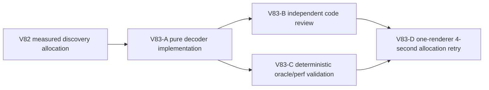

# Ticket Pack: V83 discovery-window allocation repair

## Outcome and evidence

The full Wizard Realms goal remains active. V82 browser profiling of restored V31 save #98 measured about 4.406 GB sampled allocations during four seconds of held W versus 26.9 MB idle. Active-window discovery accounted for 9.1% self-allocation and discovery regex another 5.1%; validation and terrain generation were larger separate owners. The current active-window decoder validates the mask once, then creates up to 2,304 `tile-*` strings and calls a per-ID helper that revalidates the mask and regex-parses the ID before reading its bit. This repeats in checked movement, runtime view, and pure projection. The pure decoder is a bounded, safe first optimization, not a promise to solve all renderer pressure.

## Scope and invariants

- Own only `engine/src/domain/publicV13DiscoveryWindow.ts` and its existing focused test. Validate the discovery mask once, derive numeric cell indexes inside the unchanged active-chunk window, test the same bit directly, and construct IDs only for discovered cells. Preserve `activeChunkCoordinates`, lexical sort, frozen output, and exact behavior for invalid masks and edge coordinates. Do not add identity caching, since masks are mutable and copied by accepted frames.
- Preserve fog secrecy and stale-view rejection, historical replay, all save schemas, and checked action boundaries. No changes to terrain generation, V28 replay, UI, renderer, or assets in this unit.
- Compare output against the existing full-mask decode/filter oracle for empty, sparse, and full masks, both UI seeds, ±64 chunk transitions, world corners, repeated calls after mutating the same mask, invalid masks, and active-view validation. Test call-count reduction by instrumenting the per-ID helper or string construction if feasible without overfitting internals. Run focused discovery/V14/V23/V28/V31 tests, TypeScript, and a benchmark on decoded V31 saved rev98.
- Independent review checks bit-index correctness, order/freeze, no fog leak, world bounds, and smallest diff. One stable isolated browser then repeats the same 4-second W allocation sample from the original V79 save #98, with idle comparator and 2 GB cap. Report total and discovery-specific sampled allocation, JS heap/RSS/CPU, position and save, not merely non-crash. If little improvement, keep only a validated safe simplification and move to a separately proven larger owner.
- One Wizard renderer maximum, no Blender during browser proof; do not print or commit mode-600 browser state. No PR/GitHub action; future game GitHub work requires `gh-bioscopics`, personal noreply, and `ben/` branches.

## Lane graph

The source owner is exclusive. Reviewer and deterministic validator can run concurrently after implementation. Browser profiling waits for both GO and no HMR edits. Dispatch verdict: PASS.

## V83-A implementer ticket

Role lock: implementer. Worktree `/private/tmp/pa-wizard-playable-v2`, branch `ben/wizard-playable-v2`. Read this pack, AGENTS, and smallest-viable-diff. Change only the discovery-window function and its focused test. Follow the numeric-bit algorithm while preserving all valid and invalid input behavior. Return exact diff, focused tests, TypeScript, saved-state microbenchmark, and `observed error | change | restart | retry result | next action`. No browser, nested agents, commits, PR, or GitHub action.

## V83-B/C review and deterministic validation

Reviewer: read-only findings-first GO/NO-GO for mask indexing, bounds, fog, order/freeze, mutation, and scope. Validator: read-only independent oracle over deterministic masks and saved V31 rev98 movement/view path, report output parity and cost. Neither opens a browser or edits.

## V83-D identical browser allocation retry

Restore original V79 rev98 state at `http://127.0.0.1:5193/`, confirm pose, and sample four seconds idle plus four seconds same-yaw W under CDP. Baseline V82: idle 26.9 MB, W 4.406 GB, discovery 9.1% plus regex 5.1%, heap 47.2→107.6 MB, RSS peak 1.09 GB, CPU about 115%. Capture top allocation stack changes and post-idle/post-GC values. Stop below 2 GB RSS and close renderer. This proves an allocation effect, not full gameplay completion. If acceptable, resume V79 spade/Dig proof in a later bounded UI run.

## Stop rule

If numeric-bit output differs from the oracle for any active or fogged cell, do not proceed to browser. If the browser sample shows little total improvement, do not add an unreviewed terrain or replay cache in the same unit; use the V82 evidence to choose a new owner with its own contract.

## Code-gate receipt, 2026-10-10

The two-file numeric-bit implementation passed 91/91 focused discovery/V14/V23/V28/V31 tests and TypeScript. Independent review returned GO after separately running 47/47 focused tests and TypeScript, checking mask index parity, active-chunk bounds, order/freeze, fog, same-mask mutation, and stale-view rejection. Independent validation on the exact V79 V31 rev98 save compared 19 windows across 17 accepted movement frames and a strict rev99 save, all matching the full-mask oracle, old loop, runtime view, and V23 projection; 23 events matched. The saved window had 250 known IDs versus 2,304 candidate cells. Median 120-call timing was 0.0508 ms optimized versus 0.3624 ms old, about 7.1 times faster. Browser-wide allocation effect remains pending.

## Identical browser allocation receipt, 2026-10-10

The original V79 V31 rev98 save restored at (-157.42,83.37). Four seconds of same-yaw W reached exactly the V82 endpoint (-157.64,93.60), and validated save #99 restored it. CDP sampled movement allocations fell 4.406→3.937 GB, a 468.6 MB or 10.6% reduction; idle allocations were 26.94→25.42 MB. Discovery-window and regex sites disappeared from the top 22 allocators, though their exact residual was not captured. Renderer RSS peak fell only 1.088→1.056 GB; post-GC JS used heap was essentially unchanged, 62.2→62.4 MB. V14 validation remained about 1.106 GB and terrain-generation `hypot` about 490 MB in the four-second movement sample. This is a measured bounded improvement, not a renderer-pressure or crash-risk fix. The sole renderer was closed.
