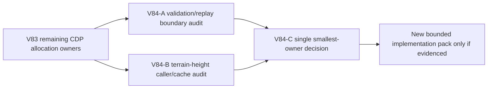

# Ticket Pack: V84 validation and terrain hot-path audit

## Outcome and evidence

The full Wizard Realms goal remains active. On exact restored V31 save #98, V83 reduced four-second movement allocations by 10.6%, from 4.406 GB to 3.937 GB, while preserving pose and checked save. Renderer RSS still peaked around 1.056 GB in four seconds. CDP attribution leaves about 1.106 GB in V14 validation and about 490 MB under generated-terrain `hypot`; each is a larger remaining owner than the removed discovery work. Node profiling measured 25.7 ms median per accepted `advanceFrame` and 30 `structuredClone` calls per frame, while a 17-frame checked save took 1.39 seconds. These are observed costs, not permission to skip checks.

## Scope and invariants

- Audit V31→V14 validation/replay call graph and generated-terrain height calls separately. Quantify repeated work on an exact decoded V31 rev98 frame and short batch, including cache misses, state-copy counts, validator invocation counts, and input trust boundaries.
- Preserve fail-closed untrusted snapshot decoding, checked witness/equality, historical replay, immutable caller isolation, deterministic world generation, save migration, and fog secrecy. Do not propose returning mutable internal state or skipping validation without proving an equivalent existing trusted boundary.
- No source changes during audit. No browser or Blender, one renderer remains closed. Do not print or commit local IndexedDB save data. Future game GitHub actions require `gh-bioscopics`, personal noreply, and `ben/` branches; no PR requested.

## Lane graph

The two read-only audits are independent. The primary agent integrates one smallest-owner repair contract before any source edit. Dispatch verdict: PASS.

## V84-A validation/replay audit

Trace one accepted V31 saved-bridge frame from UI controller through V31/V30/V28/V23/V14 validation, preview equality, and checked-store boundaries. Instrument read-only or temporary out-of-tree probes against the valid rev98 fixture to count `validatePublicV14State`, full decodes, `structuredClone`, and events for one frame and a 17-frame batch. Separate redundant nested checks from required independent trust gates. Propose one smallest safe change, or NO-GO with reason, plus malformed-input and writer parity tests. Do not edit source or browser.

## V84-B terrain-height audit

Trace `terrainHeightAt` and sampled native `hypot` under a V31 accepted frame and pure view projection. Count generated-world calls and base-chunk LRU hits/misses at same-chunk movement and boundary. Determine whether repeated terrain generation is caused by validation, projection, or authored cache invalidation. Propose a deterministic, bounded simplification only if call evidence supports it; otherwise NO-GO for terrain changes. Do not edit source or browser.

## V84-C decision

Compare expected saved-state four-second allocation impact, complexity, and compatibility risk. Prefer the smallest change with clear parity and a repeatable before/after browser sample. If neither path has a safe owner, report the limitation and design a narrower diagnostic. The next feature milestone V79 Dig remains pending until renderer pressure is controlled enough for a bounded UI proof.
