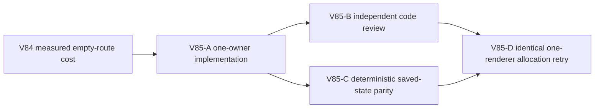

# Ticket Pack: V85 empty legacy-route hot-path repair

## Outcome and evidence

The full Wizard Realms goal remains active. Exact restored V31 save #98 still allocates about 3.937 GB during four seconds of movement after V83. V84 read-only attribution found 806 `terrainHeightAt` calls in one warmed accepted frame, all from 13 `createPublicV11RouteSupport` constructions. Each constructs 62 canonical legacy sites before filtering against an empty `greenway.builtRouteIds`; a pure `view()` adds 62 more height calls. Each height lookup scans the canonical 256-tile grid with repeated `Math.hypot`. Warm base-chunk cache had zero misses, so cache expansion is not the observed owner.

V84-A independently found 54 V14 validation passes and 510 `structuredClone` calls across 17 accepted frames. Its potential one-third validation reduction needs a more delicate V28 replay change involving detached visitor state. V85 chooses the smaller single-owner terrain branch first, since an in-memory trial removed all 806 unnecessary frame height calls with identical frame, preview, status, active-view, and projection output on rev98.

## Scope and invariants

- Own `engine/src/domain/publicV11RouteSupport.ts` and direct route-support coverage in `engine/src/domain/publicWorldV13ContinuousSession.test.ts` only. If `state.greenway.builtRouteIds` is empty, skip `canonicalRouteSites`; always compute independent Mireglass regional support. If nonempty, retain existing canonical filtering and saved `route.siteId` matching without change.
- No save schema, terrain generator, world chunk cache, route geometry, projection, UI, or asset changes. Preserve positive Greenway ladder/Highland bridge and Fen bridge/Slate ladder behavior, including invalid or stale saved route IDs being filtered as before.
- Add a focused proof that canonical legacy enumeration is skipped only on the empty list, plus positive legacy and regional-route tests. Run relevant focused tests, TypeScript, and exact rev98 17-frame pose/events/save parity without printing private save content.
- Independent reviewer and deterministic validator check the diff before one isolated browser repeats V83's exact 4-second idle and same-yaw W allocation sample. Report total sampled allocation, terrain hotspot, heap/RSS/CPU, pose and save; do not claim crash solved from a four-second sample.
- One Wizard renderer maximum, no Blender during browser proof, close browser after measurement. Do not print or commit mode-600 browser state. No PR/GitHub action; future game GitHub work requires `gh-bioscopics`, personal noreply, and `ben/` branches.

## Lane graph

Dispatch verdict: PASS. The code owner is exclusive; review and read-only validation can run concurrently after implementation. UI measurement requires a stable build with no HMR edits.

## Stop rule

If positive legacy or regional routes change, revert the branch and diagnose. If the browser allocation reduction is minor or RSS still grows, retain only a validated safe simplification and move to a separate V28 validation ticket with strict trust-boundary tests. The V79 post-spade Dig UI milestone remains pending.

## Validation receipt, 2026-10-10

V85-A changed only `publicV11RouteSupport.ts` and direct focused coverage in `publicWorldV13ContinuousSession.test.ts`. Six focused files passed 83/83 and TypeScript passed. Independent code review returned GO after 9/9 focused tests and TypeScript, finding positive legacy/siteId filtering and independent Fen/Slate support intact. Independent exact rev98 dual-runtime validation matched 17 accepted frames, pose, preview, status, active view, rev99 strict save, and 23 events. One warmed frame avoided 13 canonical enumerations and 806 terrain-height calls; a subsequent view avoided one enumeration and 62 calls. Its five-file suite passed 79/79.

The identical one-renderer UI sample resumed the original pose and reached the same endpoint. Four-second movement allocations fell from V83's 3.937 GB to 3.594 GB, an 8.7% reduction; movement renderer RSS peak fell from 1.056 GB to 0.897 GB. The former 489.55 MB terrain-height/`hypot` stack disappeared; current `hypot` samples totaled 2.85 MB. Idle allocation was 26.85 MB, post-GC JS heap 60.30 MB, and save #99 reloaded with the exact final pose. The renderer was closed. This is a bounded improvement, not proof of long-session stability or completion of V79 Dig.
