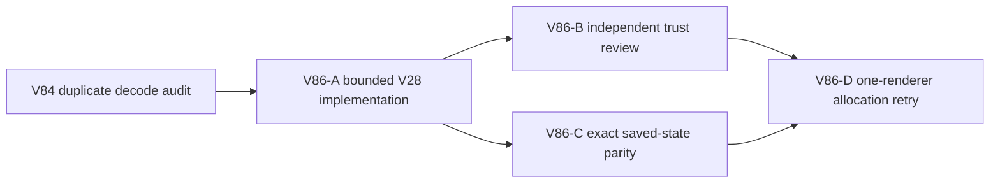

# Ticket Pack: V86 duplicate V28 replay validation

## Outcome and evidence

The full Wizard Realms goal remains active. V85 reduced exact four-second movement allocations to 3.594 GB and renderer RSS peak to 0.897 GB, but V14 validation still accounts for about 743.5 MB of sampled movement allocations. On exact valid V31 save #98, V84 counted 54 V23/V17/V14/V13 validation/copy passes and 510 `structuredClone` calls across 17 accepted live frames. The saved-bridge V28 replay decodes the starting V23 progress before `visitPublicV23FramesWithEvents` decodes it again. A bounded elimination of that duplicate may remove about 18 passes and 72 clones across those 17 frames, but the trust boundary must remain intact.

## Scope and invariants

- Own only `engine/src/domain/publicWorldV28Replay.ts` and its existing focused V28 replay/runtime test. Do not edit V23's visitor, V14 validation, save schema, or other replay layers.
- Remove V28's outer starting-progress decode only if the visitor's first detached, validated `previous` is captured and used for **every** V28 pretrial gate and later origin: initial `projectPublicV28Pose`, jump flight, ordinary segment/deck/flight, dry retry, and final progress. Never use raw `oldProgress(before)` for a V28 pose or support decision. `oldProgress(before)` may be passed only into the visitor, whose first operation is fail-closed decode.
- Preserve zero-frame behavior if the witness allows it; if safe capture cannot be proven for that case, retain its explicit decode. Preserve historical V31/V30 replay, witness/equality, atomic writer/CAS, detached caller isolation, airborne landing reserve, dry seam and saved deck admissions, and off-deck/river/pit rejection.
- Add malformed/accessor/proxy caller rejection and mutation-isolation tests where relevant, plus exact bridge/jump/dry-seam and rejected control parity. Run focused replay/runtime tests and TypeScript.
- Independent reviewer checks trust-boundary ordering and every raw-data access. Independent validator compares exact rev98 17-frame pose, 23 events, preview/status and strict rev99 save against the pre-change oracle, with validator/copy counts. Only then run the identical one-renderer four-second browser allocation sample from rev98, using V85's 3.594 GB and 0.897 GB movement RSS as baseline. Stop below 2 GB RSS, close renderer, do not print or commit local save data.
- No PR/GitHub action. Future game GitHub work requires `gh-bioscopics`, personal noreply, and `ben/` branches. One Wizard renderer maximum; no Blender during UI proof.

## Lane graph

Dispatch verdict: PASS. The source owner is exclusive. Review and deterministic validation run in parallel after implementation. Browser work waits for a stable build and both GO receipts.

## Stop rule

If the first visitor `previous` cannot be proven detached and fully validated before V28 gates on all paths, or if malformed input acceptance changes, do not ship the optimization. Retain V85 and continue the V79 gameplay milestone when a bounded UI run is safe.

## Validation receipt, 2026-10-10

V86-A changed only V28 replay and its existing runtime test. Five focused files passed 49/49 and TypeScript passed. Independent trust review returned GO after 23/23 focused tests and TypeScript; the V23 visitor detaches and validates its starting progress before either V28 path uses the first `previous`, and malformed/accessor/proxy, zero-frame, and bridge controls remained fail-closed. The exact rev98 dual-runtime oracle matched 17 accepted frames, 19 views/status snapshots, rev99 strict save, 23 events, saved-bridge dry seam and landed jump, and off-deck rejection. Frame-only V23/V17/V14/V13 validation passes fell from 54 to 37 each and `structuredClone` calls from 510 to 442.

The identical one-renderer four-second UI sample reached the same endpoint and saved/reloaded #99. Movement allocations fell from V85's 3.594 GB to 3.367 GB, down 6.3%; V14 self-allocation fell 743.5 to 662.7 MB and movement RSS peak fell 896.9 to 812.8 MB. Idle allocation rose 26.85 to 29.56 MB; immediate JS heap was higher, but post-GC heap was 60.93 MB. No app request failure or OOM appeared, and the renderer was closed. V79's longer resumed journey subsequently hit 1.67 GB RSS before marker Study, so short-sample improvement is not long-session stability proof.
