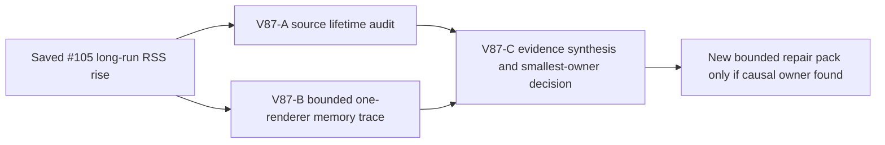

# Ticket Pack: V87 long-session renderer memory attribution

## Outcome and evidence

The full Wizard Realms goal remains active. Three bounded source optimizations reduced four-second movement allocations from 4.406 GB to 3.367 GB, with exact saved-state/gameplay parity. Yet an authentic V31 UI resume from saved checkpoint #105 grew renderer RSS from about 339 MB to 1.67 GB during a short map-guided approach toward the frontier marker, before Study or Dig. The tester stopped below a 2 GB cap. Console showed only initial favicon 404 and `THREE.Clock` warning; there was no observed app exception. This is a measured long-session memory problem, not a reason to guess at unrelated render code.

## Scope and invariants

- Diagnose, do not edit source in V87-A/B. Separate retained JS data, V8 transient heap expansion, DOM/React churn, WebGL GPU/scene object lifetime, browser profile/DevTools instrumentation, and hot-reload effects where evidence permits. Do not label RSS as a leak without post-idle/GC and repeated-run evidence.
- V87-A reads the current V31 scene/UI source, renderer mount/unmount and chunk caches, disposals, per-frame geometry/material creation, and React prop identity. Return one or two concrete candidate owners with exact call sites and expected lifecycle, or NO-GO for source inference. No browser, Blender, or source edits.
- V87-B uses one isolated browser renderer and the exact mode-600 `wizard-v80-marker-checkpoint-indexeddb.json` at `http://127.0.0.1:5193/`, verifies UI save revision/pose, then captures per-second renderer RSS/CPU, JS used/total heap, DOM nodes/listeners if available, and light CDP allocation sampling during a reproducible short map-guided input sequence. Include idle before, idle after, explicit GC, and same-tab reload if below the cap. Avoid a full heap snapshot if it would risk OOM. Stop at 1.4 GB RSS or lower if rising fast, then close the renderer. Do not print/commit private save data. The browser lane is read-only except ordinary tested game inputs and save/reload.
- Correlate source and UI traces before proposing a new source change. If only a development-build React check owns the pressure, compare a production preview in a separate later one-renderer run; do not run two renderers concurrently. Preserve deterministic save/replay and game UI behavior.
- No PR/GitHub action. Future game GitHub work requires `gh-bioscopics`, personal noreply, and `ben/` branches. One Wizard renderer maximum, no Blender during UI proof.

## Lane graph

Dispatch verdict: PASS. The two audit lanes are read-only and independent. The primary agent owns synthesis and any later implementation contract.

## Stop rule

If neither source nor CDP/OS metrics identifies an actionable bounded owner, do not rewrite the renderer speculatively. Produce a tighter diagnostic or a production-build comparison. Do not resume the lengthy V79 Study/spade/Dig journey while the renderer rapidly approaches the RAM cap.

## Audit receipt, 2026-10-10

V87-A found bounded caches and disposal paths in the scene but no static evidence of accumulating geometry, listeners, or Canvas instances. It returned NO-GO for a speculative renderer edit. V87-B restored genuine save #105, then sampled 4 seconds idle and a short D/A/W sequence. Idle after GC: about 47–49 MB JS used, 326 MB renderer RSS, 390 DOM nodes and 215 listeners. The input sampled 5.20 GB transient allocations, with V14 validation 1.30 GB, V14 comparison 496 MB, V13 copy 423 MB, and React development prop diff 334 MB. Used JS heap reached 281 MB and renderer RSS about 1.10 GB. After idle and explicit GC, used JS fell to 53.5 MB, DOM to 399/215, but renderer RSS remained about 0.90 GB. GPU process RSS stayed 166–171 MB. Same-tab reload drove renderer RSS to 1.53 GB, so the tester closed it above the 1.4 GB stop threshold. No OOM or app exception was observed. This points to heavy transient V8 churn with unproven residual RSS origin; it does not prove retained JS or GPU objects. A production-build comparison and a separately scoped validation cost audit are next.
